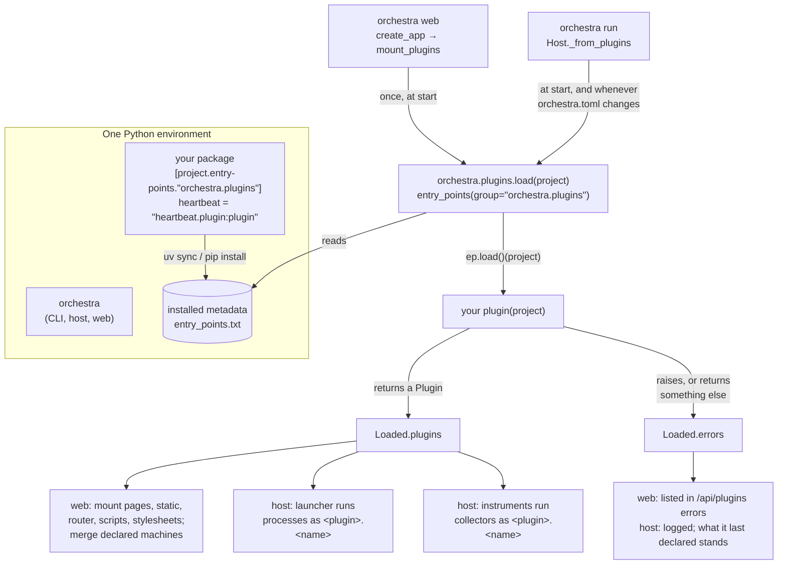
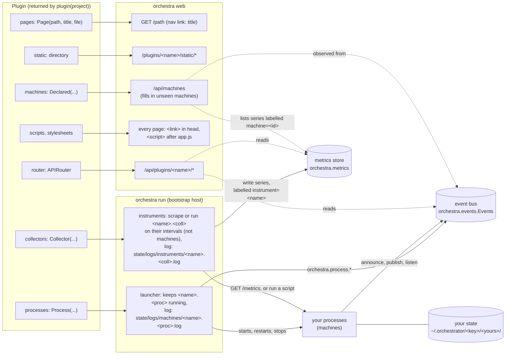

# Writing an Orchestra plugin

A **plugin** is a Python package, installed beside Orchestra, that adds things to an Orchestra
project: the programs `orchestra run` keeps running, the instruments it measures with, the
machines the Machines page lists before they are first seen, pages, API routes, Dashboard
panels and machine cards in the web UI, and a subcommand of the `orchestra` command line. The task system (`~/orchestra-tasking`), the AI agents
(`~/orchestra-agents`) and the bridges (`~/orchestra-bridges`) are plugins.

This guide is for an engineer building one. It covers the interface exactly as the code on `main`
defines it (`orchestra/plugins.py`, `orchestra/launcher.py`, `orchestra/collect/spec.py`,
`orchestra/host.py`, `orchestra/web/app.py`, `orchestra/web/static/app.js`), the rules a plugin lives under, how the
three existing plugins use the interface, and a walkthrough that builds a small plugin from
nothing and runs it end to end. The walkthrough's code was run as shown.

Read alongside it:

- [`SPEC.md`](SPEC.md) §2 (machines and events), §5.1 (the launcher) and §10.1 (plugins): the design.
- [`AGENTS.md`](AGENTS.md): the rules. Rules 1, 2, 3, 5 and 9 bind plugins directly.
- [`docs/machines.md`](docs/machines.md): writing a machine's measurements and events, with or without a plugin.
- [`ARCHITECTURE.md`](ARCHITECTURE.md): how the core fits together.
- [`USING_ORCHESTRA.md`](USING_ORCHESTRA.md): running Orchestra on a project.

Contents:

1. [What a plugin is](#1-what-a-plugin-is)
2. [How Orchestra finds and loads plugins](#2-how-orchestra-finds-and-loads-plugins)
3. [What a plugin plugs into](#3-what-a-plugin-plugs-into)
4. [The interface, field by field](#4-the-interface-field-by-field)
5. [The browser side: scripts, cards, panels, pages](#5-the-browser-side-scripts-cards-panels-pages)
6. [Machines, events and metrics from a plugin](#6-machines-events-and-metrics-from-a-plugin)
7. [What a plugin may and may not do](#7-what-a-plugin-may-and-may-not-do)
8. [The existing plugins as worked examples](#8-the-existing-plugins-as-worked-examples)
9. [Walkthrough: a plugin from scratch](#9-walkthrough-a-plugin-from-scratch)
10. [Testing a plugin](#10-testing-a-plugin)
11. [Versioning and compatibility](#11-versioning-and-compatibility)
12. [Pitfalls the existing plugins hit](#12-pitfalls-the-existing-plugins-hit)
13. [What the interface does not do yet](#13-what-the-interface-does-not-do-yet)

---

## 1. What a plugin is

Orchestra is empty on purpose (AGENTS.md rule 1). It has an event bus, a metrics store, a system
dynamics model, a bootstrap host with a launcher, and a web UI. It has no tickets, tasks, builds or
agents, and it runs no AI. Everything with a domain lives outside it. A plugin is how a package of
machines gets the parts of Orchestra that a bare program cannot get by itself:

| A bare machine can... | A plugin can also... |
|---|---|
| publish and read events over HTTP (the events endpoint, `USING_ORCHESTRA.md` §5.2), or through `orchestra.events.Events` | have `orchestra run` start, restart and stop its processes (`processes`) |
| be kept running by a project's `[[machines]]` entry | have `orchestra run` measure what it serves, with instruments of its own (`collectors`) |
| be measured by the project's instruments (`[[collect]]`, `[[scrape]]`) | list its machines on the Machines page before they first run (`machines`) |
| | add pages and API routes to the web UI (`pages`, `router`) |
| | draw its machines' cards and add Dashboard panels (`scripts`, `stylesheets`) |
| | add `orchestra <name> ...` to the command line (entry point group `orchestra.commands`, §4.10) |

A plugin adds nothing to the core. Orchestra never imports a plugin's modules by name, never reads
its events' `data`, and never learns what its pages mean. The core treats a plugin as a few lists:
paths to mount, commands to run, instruments to read and ids to show.

---

## 2. How Orchestra finds and loads plugins

A plugin is a **Python entry point** in the group `orchestra.plugins`. The entry point names a
function that takes the project (`orchestra.config.Project`) and returns an
`orchestra.plugins.Plugin`:

```toml
# the plugin's pyproject.toml
[project.entry-points."orchestra.plugins"]
heartbeat = "heartbeat.plugin:plugin"
```

That is all the registration there is.

- **Not listed in `orchestra.toml`.** Every plugin installed in the environment that runs
  `orchestra` is loaded for every project. A plugin decides for itself whether it does anything in
  a given project, usually by checking for its own section of `orchestra.toml` (§4.6, §4.9).
- **Read the configuration from `project.config.raw`.** It is `orchestra.toml` with the owner's
  private overlay merged over it (SPEC §8.1), so a section the owner keeps out of a shared
  repository reaches the plugin there, and the host loads the plugins again when either file
  changes. **A plugin reads and changes configuration only through Orchestra's objects, never by
  opening, parsing or editing `orchestra.toml` (or the overlay) itself** (AGENTS.md rule 10): read
  `project.config.raw`, follow changes with `project.config_stamp()` and
  `project.reload_config()`, and change settings with `project.config_edit` (§4.9).
- **Read from installed metadata.** `importlib.metadata.entry_points(group="orchestra.plugins")`
  reads the entry points from the installed package's `entry_points.txt`, so the plugin must be
  installed in the same environment as Orchestra. An editable install picks up code changes
  without reinstalling, but a change to the entry point itself needs `uv sync` (or
  `pip install -e`) again.
- **Same environment.** If Orchestra is installed as a tool, the plugin goes into that tool's
  environment, for example `uv tool install 'orchestra @ git+https://github.com/danroblewis/orchestra@main'
  --with /path/to/plugin` (README, "Install"). Its command line comes with it as `orchestra
  <name>` (§4.10): there is no console script of its own to put on the PATH. Installing the tool
  again replaces it: a plugin whose `--with` is left out is uninstalled. Each plugin's repository has its own `.venv`, with
  Orchestra from GitHub at the commit its `uv.lock` pins, and runs `orchestra` from there.

`orchestra.plugins.load(project)` calls each entry point's function and keeps what it returns. It
is called from two places, at different times:

| Caller | When | What it uses |
|---|---|---|
| `orchestra web` (`web/app.py`, `mount_plugins`) | **once**, when the web server starts | `pages`, `static`, `router`, `scripts`, `stylesheets`, `machines` |
| `orchestra run` (`host.py`, `Host._from_plugins`) | when the host starts, and **again every time `orchestra.toml` changes** (after re-reading the config); one load serves the launcher and the instruments | `processes`, `collectors` |



**A broken plugin is never fatal** (rule 8: the core stays up). If the function raises, or returns
something that is not a `Plugin`, `load` logs a warning and records
`{"plugin": <entry point name>, "error": ..., "trace": ...}`. The web app lists it under `errors` in
`/api/plugins` and leaves the plugin out. The host logs `plugin X failed to load: ...; what it last
declared, if anything, stands` and keeps running that plugin's processes and instruments as it
last knew them. A plugin whose `name` an earlier plugin already has is left out and reported the
same way (`its name ... is taken by the plugin of entry point ...; left out`).

Because the host calls your function on every `orchestra.toml` change, and builds your router each
time only to throw it away, **`plugin(project)` must be cheap and have no side effects**. Open the
bus or the store inside request handlers, not while building the `Plugin`.

---

## 3. What a plugin plugs into



The solid arrows are what the plugin declares and what its processes and instruments do. The
dotted arrows are reads. What the Machines page knows of a machine comes from the bus; a
declaration only fills in what has not been observed yet (rule 2). Measurements come from
instruments, which are not machines: they are on the Instruments page, not the Machines page
(rule 7). A machine's card lists the series labelled `machine=<its id>`, if any, but a series
never makes a machine.

---

## 4. The interface, field by field

Everything is in `orchestra/plugins.py`, `orchestra/launcher.py` and `orchestra/collect/spec.py`:

```python
@dataclass
class Page:
    path: str            # where it is served, e.g. "/pages"
    title: str           # its link in the navigation
    file: Path           # the HTML

@dataclass
class Declared:
    id: str                                   # the machine, as its events' source names it
    kind: str = "program"                     # what the package says it is: program, person, service, ...
    mode: str | None = None                   # continuous | scheduled | ad hoc
    listens_for: list[str] = field(default_factory=list)

@dataclass
class Plugin:
    name: str
    pages: list[Page] = field(default_factory=list)
    static: Path | None = None
    router: Any = None   # a fastapi.APIRouter, mounted at /api/plugins/<name>
    scripts: list[str] = field(default_factory=list)   # files in ``static`` loaded on every page
    stylesheets: list[str] = field(default_factory=list)   # files in ``static`` every page links
    machines: list[Declared] = field(default_factory=list)
    processes: list[Process] = field(default_factory=list)   # what `orchestra run` starts for it
    collectors: list[Collector] = field(default_factory=list)   # what `orchestra run` scrapes or runs for measurements

# orchestra/launcher.py
@dataclass
class Process:
    name: str
    command: str | list[str]
    restart: str = "always"
    owner: str = "project"         # "project", or the plugin that declared it
    stop_grace_s: float | None = None   # from SIGTERM to SIGKILL when stopping it; None: STOP_GRACE_S

# orchestra/collect/spec.py
@dataclass(frozen=True)
class Collector:
    name: str
    kind: str                  # "collect" (a command) or "scrape" (a URL)
    target: str                # the command, or the URL
    every_s: float = EVERY_S   # 60 s
    timeout_s: float = TIMEOUT_S   # 10 s, never more than every_s
    owner: str = "project"     # "project", or the plugin that declared it

    @classmethod
    def scrape(cls, name: str, url: str, **kw) -> Collector: ...
    @classmethod
    def collect(cls, name: str, command: str, **kw) -> Collector: ...
```

That is the whole interface. There is no hook for CLI commands, config schemas or lifecycle
callbacks (§13).

### 4.1 `name`

The plugin's name. It is used:

- in its URLs: `/plugins/<name>/static/...` and `/api/plugins/<name>/...`;
- as the prefix of its processes: a `Process("scheduler", ...)` from plugin `tasks` runs as
  `tasks.scheduler`, with its log at `<state>/logs/machines/tasks.scheduler.log`, and is recorded
  with `owner: "tasks"` in the runtime record, on the Core page and in `orchestra.process.started`;
- as the prefix of its instruments: a `Collector.scrape("slack", ...)` from plugin `bridges` runs
  as `bridges.slack` (§4.7);
- as the `package` of the machines it declares (§4.5).

Two plugins with one `name`: the first loaded is kept, the second is left out and reported
(`Loaded.errors`, `/api/plugins` errors, the host's log).

Keep it to letters, digits, `.`, `_` and `-`. The launcher checks `<name>.<process>` against that
pattern and refuses (logs once, does not start) anything else. Use the same string as your entry
point's name: `load` reports errors under the entry point's name, everything else uses `Plugin.name`.

### 4.2 `pages`

Each `Page(path, title, file)` is served with `GET path` and linked in the navigation as `title`,
after Orchestra's own links. `app.js` adds the links on every page from `/api/plugins`.

- A page whose `path` Orchestra already serves (`/`, `/machines`, `/dynamics`, `/core`, any
  `/api/...`), or that an earlier plugin took, is left out and reported in `/api/plugins` errors.
- The file is read **on every request**, so editing the HTML takes effect at once. `{{v}}` in it is
  replaced with the mtime of Orchestra's newest static file (for `?v={{v}}` cache-busting), and the
  plugins' stylesheets are linked just before `</head>` unless the page already links them.
- The page is plain HTML. Most pages copy Orchestra's frame: `<link rel="stylesheet"
  href="/static/style.css?v={{v}}">`, the `<nav id="nav">` with `#proj` and `#conn`, the
  `#overlay`/`#drawer` pair, and `<script src="/static/app.js?v={{v}}">`. `app.js` fills in the
  navigation and loads the plugins' every-page scripts (§5).
- Pages are mounted whether or not the project uses the plugin. The Tickets and Agents pages appear
  in any project where those packages are installed.

### 4.3 `static`

A directory, mounted at `/plugins/<name>/static`. It is needed for `scripts` and `stylesheets`,
which name files in it. Without `static`, every file those two lists name is left out and reported (§4.8).

### 4.4 `router`

A FastAPI `APIRouter`, included at `/api/plugins/<name>`. The routes are the plugin's own;
Orchestra knows nothing of what they mean. Any method works: the task system's
`POST /api/plugins/tasks/control` and the agents' `POST /api/plugins/agents/supervisor` are the
human-facing writes that rule 9 allows plugins to have (§7).

The router is built in the web server's process. To see edits to `orchestra.toml` live, re-read it
in the handler (`project.reload_config()`, which merges the private overlay too; the task system
does it in a router dependency, `Depends(fresh)`).

### 4.4.1 Your routes are behind Orchestra's login

`orchestra web` puts every route behind the project's web token (`orchestra/web/auth.py`,
USING_ORCHESTRA.md "Logging in to the web UI"): your pages, your static directory, your router,
and the websocket. It does this in one middleware in front of the whole app, so a plugin adds
nothing and cannot forget it:

- a request reaches your handler only when it carries a valid session cookie or
  `Authorization: Bearer <web token>`. Never check the token yourself, and never add a route meant
  to be reached without it (a webhook, a status page, a "public" API). Mounting a second app, a
  `StaticFiles` of your own outside `static`, or a server on another port to get around the login
  is not allowed. Something that must be reached from outside belongs in a process of its own
  (`processes`) with its own authentication, and says so in the plugin's docs;
- a `POST`, `PUT` or `DELETE` carried by the cookie must come from Orchestra's origin (an `Origin`
  or `Referer` naming the host that was asked, and no cross-site `Sec-Fetch-Site`), or it answers
  `403` before your handler runs. A browser's `fetch` from your page sends `Origin` by itself, so a
  same-origin page needs nothing. Keep your own checks (the outbox requires
  `Content-Type: application/json`): they add to Orchestra's, never replace them;
- a fetch from your page that gets `401` (the session ended) sends the browser to the login page
  when `app.js` is loaded, and back after it;
- in tests, give the client the token: `TestClient(create_app(project), headers=bearer(project))`
  (`from orchestra.web.auth import bearer`); a program that calls your routes sends the same
  header, with `orchestra web token`'s token.

### 4.5 `machines`: declared machines

`Declared(id, kind, mode, listens_for)` lists a machine the package provides, so the Machines page
shows it before it is first seen. A declaration is a placeholder: it never overrides what is
observed and says nothing about flows. The web app merges the declarations into every `/api/machines`
response (`mount_plugins.declare`):

- **What is observed always wins.** For a machine already seen on the bus, a
  declaration only fills in `package` (the plugin's name) and `kind`, and only where no
  announcement gave them.
- A machine not seen yet is added with `"unseen": true`, `package` = the plugin's name, and the
  declared `kind`, `mode` and `listens_for` (as `subscribes`). Cards draw it greyed or dashed
  ("declared, not run yet").
- Only `orchestra web` reads `machines`, and only once at start (§2). A machine declared because a
  section exists in `orchestra.toml` appears only after `orchestra web` restarts.

- **It says nothing about flows.** Nothing in a plugin declares which flows a machine affects.
  Whether a machine is associated with a flow is only ever inferred, as a hypothesis with its
  evidence and confidence, from its events on the bus matching the flow's counter
  (`orchestra/sd/attribute.py`, AGENTS.md rule 6). A declared machine that never publishes is
  never a hypothesis for any flow.

This is AGENTS.md rule 2's exception: "the machines a plugin declares (`Plugin.machines`):
placeholders that only fill in machines not seen yet, never override what is observed, and say
nothing about flows."

### 4.6 `processes`

What `orchestra run` keeps running for the plugin, the same `Process` as a project's
`[[machines]]` entry (SPEC §5.1):

| Field | Meaning |
|---|---|
| `name` | Letters, digits, `.`, `_`, `-`. Runs as `<plugin>.<name>`. |
| `command` | A list of arguments (preferred), or a string split like a shell would split it (`shlex`) but **not** run by a shell. |
| `restart` | `always` (the default), `on-failure` or `never`. |
| `stop_grace_s` | Seconds from SIGTERM to SIGKILL; `None` means 10. Make it longer than your own shutdown. |
| `owner` | Do not set it. The host sets it to the plugin's name. |

How the launcher runs it (`orchestra/launcher.py`):

- in the repository root, with the host's environment plus `ORCHESTRA_REPO` (the root),
  `ORCHESTRA_MACHINE_LOG` (its log file) and `PYTHONUNBUFFERED=1`;
- in its own process group, with stdout and stderr appended to
  `<state>/logs/machines/<plugin>.<name>.log` (rotated at 5 MB);
- restarted after it exits (per `restart`), after a pause that doubles with each quick exit, up to
  a minute. After 5 failing exits in a row, each within 60 s of starting, it is given up on
  (`orchestra.process.gave_up`), until its declaration changes or `orchestra run` restarts;
- stopped with SIGTERM to its group, then SIGKILL after its grace, when the host stops, or when the
  plugin no longer declares it, or declares it differently (a different argv or restart);
- published by the host as `orchestra.process.started` / `exited` / `gave_up` (source
  `orchestra-host`, `data.owner` = your plugin's name), and listed on the Core page.

Only one host launches per project (`launcher` in the runtime record). A second `orchestra run`
for the same project starts nothing.

Start Python processes with `sys.executable`: `[sys.executable, "-m", "yourpkg", ...]`, or your
plugin command through Orchestra's module, `[sys.executable, "-m", "orchestra", "<name>", "run",
...]` (the same as `orchestra <name> run`, §4.10). `sys.executable` is the interpreter running
`orchestra run`, which is the environment your plugin is installed in; a bare `python` in a
command the launcher runs is that one too (SPEC §5.1), but a bare `orchestra` is whatever comes
first on the `PATH`. **Never name a console script of your own** (the old `tasking run`): a plugin has
none (§4.10), and one left on the `PATH` from an older install may be another environment's.

The usual pattern is to declare processes only when the project configures the plugin:

```python
configured = section(project.config.raw, "github") is not None
processes=[Process("github", [sys.executable, "-m", "orchestra_bridges", "github"], stop_grace_s=10)] if configured else []
```

Since the host asks again whenever `orchestra.toml` changes, adding the section starts the
process within seconds and removing it stops the process. The walkthrough shows this working
(§9.6).

### 4.7 `collectors`: instruments

`Collector.scrape(name, url, ...)` and `Collector.collect(name, command, ...)` declare what
`orchestra run` reads measurements from for the plugin: the same instruments as a project's
`[[scrape]]` (a URL serving the Prometheus text format) and `[[collect]]` (a command that prints
it) entries, with `every_s` and `timeout_s` in seconds (defaults 60 and 10; a timeout longer than
`every_s` is cut to it).

They declare **instruments, not machines** (AGENTS.md rule 7). An instrument measures and never
acts:

- It runs as `<plugin>.<name>` (`bridges.slack`), with `owner` set to the plugin's name. Do not
  set `owner` yourself.
- Each point it writes is labelled `project` and `instrument=<plugin>.<name>` (provenance). The
  target's other labels are kept as served, `machine` included; a target label `project` or
  `instrument` is kept as `exported_project` / `exported_instrument`.
- Nothing is announced on the bus for it. It is not on the Machines page; it is on the
  **Instruments page** (`/instruments`, `/api/instruments`, `/api/instruments/<name>/log`), with
  its kind (script or URL), target, interval, last write and points, failures and last error.
- Its health is in the runtime record under `instruments`, written by the host that launches
  (`orchestra/collect/runner.py`); its log is `<state>/logs/instruments/<plugin>.<name>.log`; a
  failed round is counted in `orchestra_collect_failures_total{collector=<plugin>.<name>}`.
- A project entry (`[[scrape]]` or `[[collect]]`) with the same name wins: the plugin's is left
  out and the host logs `plugin <x>: its collector <name> is replaced by the project's entry of that
  name`. An entry that fails the checks (bad name, bad URL, empty command, `every_s` under 1 s) is
  left out and logged the same way; the others stand.
- Instrument names are their own namespace. `bridges.slack` the instrument and `bridges.slack` the
  process and machine are three different things that may share a name.
- Like `processes`, `collectors` is asked for again whenever `orchestra.toml` changes (§2): one
  added starts at once, one removed stops, one changed starts over.

The usual pattern is again to declare one only when the project configures the plugin. The Slack
bridge serves its counts on `/metrics` (`[bridges.slack] host` and `port`, by default
`127.0.0.1:9465`), so its plugin can declare the scrape beside the process:

```python
from orchestra.collect.spec import Collector

slack = section(project.config.raw, "slack")
collectors=[Collector.scrape("slack", f"http://{slack.get('host', '127.0.0.1')}:{slack.get('port', 9465)}/metrics",
                             every_s=30)] if slack is not None else []
```

An instrument says nothing about which machine does the work it measures. A machine is
associated with a flow only by inference from its events (§4.5, §6.5).

### 4.8 `scripts` and `stylesheets`

- `scripts`: file names in `static`. They are listed in `/api/plugins` as
  `/plugins/<name>/static/<file>`, and `app.js` appends each one as a `<script>` to the body of
  every page that loads `app.js`: Orchestra's pages and every plugin's. They run after
  Orchestra's own scripts. A page that already has the script keeps its copy.
- `stylesheets`: file names in `static`, linked in the `<head>` of every page Orchestra renders
  (its own and every plugin's), after `style.css`.
- A listed file that is not in `static` (or a plugin with no `static`) is left out and reported in
  `/api/plugins` errors (`script x.js is not a file in its static directory; left out`).

### 4.9 Configuration: your section of `orchestra.toml`

Orchestra has no config registry. It parses the whole of `orchestra.toml` and keeps it as
`project.config.raw` (a `dict`). It reads its own sections (`[events]`, `[metrics]`,
`[discovery]`, `[[machines]]`, `[[collect]]`, `[[scrape]]`, `[[sources]]`) and ignores the rest.
A plugin reads its own sections from `raw` and validates them itself. Raise
`orchestra.config.ConfigError` for a bad value, and use `orchestra.config.parse_duration` for
`"60s"`-style values. The host re-reads the config (`project.reload_config()`) before it asks the
plugins for processes.

Never open `orchestra.toml` yourself (`project.repo_root / "orchestra.toml"`): you would miss the
private overlay (SPEC §8.1). A process of your own (`Plugin.processes`) calls
`orchestra.config.load_project()` and reads `project.config.raw` the same way; to follow edits it
compares `project.config_stamp()` with the last one it saw and calls `project.reload_config()` when
it differs. Name your section after your plugin (`[bridges.github]`, `[agents]`, `[heartbeat]`).
Nothing stops two packages from claiming the same section (§13).

To change a setting, use `project.config_edit` (`orchestra/config_edit.py`, SPEC §8.2), never a
text edit of your own:

```python
edit = project.config_edit
edit.set("heartbeat.every", "10s")                                   # target="repo": orchestra.toml
edit.set("desk.channels", ["#mine"], target="overlay")              # the owner's, out of the repository
edit.add_entry("machines", {"name": "pager", "command": "machines/pager.sh"}, target="overlay")
edit.remove_entry("machines", "pager", target="overlay")
c = edit.set("heartbeat.every", "1s", check=my_reader, dry_run=True)  # refused if my_reader objects
edit.apply(c)                                                        # ... written later; edit.restore(c) undoes it
```

Each returns a `Change` (`file`, `before`, `after`, `what`, `keys`, `note`), has kept the file's
comments, has refused a result Orchestra's readers or your `check` object to, and has reloaded
`project.config`. Committing a change to `orchestra.toml` is yours to decide; the overlay is never
committed. Personal settings (identities, channels, templates) belong in the overlay, the
project's in the repository.

### 4.10 CLI commands: `orchestra <name>`

A plugin's command line is a subcommand of `orchestra`, never a console script of its own
(`orchestra/commands.py`). Declare it as an entry point in the group `orchestra.commands`, named
for the plugin (`Plugin.name`), naming a callable that takes the arguments after the name:

```toml
# the plugin's pyproject.toml
[project.entry-points."orchestra.commands"]
tasks = "tasking.cli:main"
```

```python
# tasking/cli.py
"""The task system: tickets, the scheduler, the record."""   # the line `orchestra --help` shows

def main(argv: list[str]) -> int | None:
    p = argparse.ArgumentParser(prog=os.environ.get("ORCHESTRA_PROG"))   # "orchestra tasks"
    ...
```

- `orchestra tasks add "x" --to y` calls `main(["add", "x", "--to", "y"])` and exits with what it
  returns (`None` is 0). Raising `SystemExit`, as argparse does, works as usual.
- Before the call, `ORCHESTRA_PROG` is set to `orchestra tasks` and so is `sys.argv[0]`: an
  `argparse.ArgumentParser()` with no `prog` already shows `orchestra tasks` in its usage.
- `orchestra --repo PATH tasks ...` sets `ORCHESTRA_REPO` to `PATH` for the command.
- `orchestra --help` lists each plugin command with one line: the callable's `help` attribute if
  it has one, else the first line of its module's docstring.
- It is a group of its own, apart from `orchestra.plugins`, because a command must work before a
  project exists (`orchestra tasks init`): it is given argv, never a project. Load the project
  yourself when you need one (`orchestra.config.load_project`).
- A command that fails to load fails alone (`orchestra: plugin command 'tasks' (tasking.cli:main)
  failed to load: ...`, exit 1), and `orchestra --help` shows it as broken; the rest of the CLI
  works. A name that is one of Orchestra's own subcommands (`init`, `run`, `web`, `metrics`, `sd`,
  `sources`, `events`) is refused, with a warning on every `orchestra` command; of two entry points
  with one name, the first is kept.

Do not declare `[project.scripts]`: users install a plugin with `--with` alone (README,
"Install"), and nothing of yours lands on the PATH. A `__main__` is still fine for your processes
(`python -m orchestra_bridges github`). A process of yours runs either `[sys.executable, "-m",
"yourpkg", ...]` or `[sys.executable, "-m", "orchestra", "<name>", "run", ...]` (`orchestra <name>
run`; §4.6), never a console script.

---

## 5. The browser side: scripts, cards, panels, pages

`orchestra/web/static/app.js` defines what an every-page script can use. It loads before any
plugin script.

**Machine cards: `Orchestra.machineCards`.** A machine belongs to a package when its announcement
says `package` or a plugin declares it (`m.package`). The package's script registers once, under
its package name:

```js
Orchestra.machineCards.register("<package>", {
  card(m, { compact }) { /* HTML for inside the card, or null for Orchestra's own */ },
  open(m)    { /* true if it opened the machine's dialog itself; else Orchestra opens its own */ },
  summary(m) { /* a few words for the Dashboard's machine list, or null */ },
  rank(m)    { /* sort position; Orchestra's own are 0, default 50 */ },
});
```

- Orchestra draws the frame and, under your HTML, its own rows of what it observed: engaged
  (mode), kind, package, group, instances, seen, publishes, listens for, counted traffic and
  metrics (`Orchestra.machineCards.rows(m)`). You draw what is inside; you cannot remove those rows.
- Every hook is wrapped in `try`/`catch`: a throw falls back to Orchestra's card.
- Call `Orchestra.machineCards.changed()` when your data arrives, so the pages draw the cards
  again (it dispatches `orchestra:machinecards`). `openDefault(id)` opens Orchestra's own dialog;
  the agents and tasks cards use it for their "machine details" link.
- `m` is the machine as `/api/machines` gives it: `id`, `kind`, `kinds`, `mode`, `package`,
  `name`, `group`, `about` (the announcement's other fields: strings, numbers, booleans, lists),
  `instances` (each with `id`, `kind`, `mode`, `active`, `last_seen`, ...), `publishes`,
  `subscribes`, `metrics`, `active`, `unseen`, `first_seen`, `last_seen`.

**Dashboard panels: `Orchestra.panels`.**

```js
Orchestra.panels.register({ id: "tasks", title: "Tasks", size: { w: 12, h: 9 }, mount(body, ui) {
  // draw into body once and keep it current yourself; ui.setSub(text) sets the line beside the title
} });
```

`size` is in grid columns of 12 and rows of 40 px. Where a panel sits, its size and whether it
is shown belong to the viewer and are kept in the browser.

**Helpers** in `app.js` that plugin scripts use: `$` (getElementById), `esc` (HTML-escape),
`ago(seconds)`, `color(state)`, `openDrawer(html)` / `closeDrawer()`. `openMachine(id)` exists only
on pages that load `machine-dialog.js`.

**Rules of thumb the existing plugins follow:**

- Guard the top: `if (!window.Orchestra || !Orchestra.machineCards) return;`.
- Every-page scripts run on other plugins' pages too, and load asynchronously, after
  `/api/plugins` answers. With several files, ship one loader script that loads the rest once.
  The task system's `tasks-boot.js` loads `tasks.js` and then `attention.js`, `machine-cards.js`
  and `tasks-panel.js`, skipping any the page already has.
- Stylesheets apply to every page: prefix your selectors (`.tkc-`, `.hb-`) so you never restyle
  Orchestra or another plugin.
- Read your own API (`/api/plugins/<name>/...`) on an interval. The agents' cards poll
  `/api/plugins/agents/agents` every 3 s and call `changed()` only when something they draw changed.

---

## 6. Machines, events and metrics from a plugin

A plugin's processes are machines only by their events: Orchestra knows a machine because it
shows up on the bus, and by what it publishes and listens for (rule 2). Machines do not produce
metrics. Measurements of the running system come from instruments (rule 7), kept apart from the
machines so they can test what we believe about them. `docs/machines.md` covers measurements in
full. This section covers what a plugin's machines in particular need.

### 6.1 The provider is never the machine

A plugin often provides machines without being one. A target repository's own code is a machine
by publishing under its own source; a bridge relays another system's actors as machines; the
Agents plugin runs configured agents as machines. In each case the program that does the
publishing is infrastructure, and the rule (AGENTS.md rule 2) is the same for every plugin:

**A plugin's infrastructure processes (schedulers, hosts, runtimes, relays) are never machines.**

- They **never announce themselves**: no `orchestra.machine.started` with their own source, and
  no `Plugin.machines` declaration for them.
- They **never publish under their own name**. Everything they put on the bus goes out as the
  machine whose act it is or whose responsibility they implement at that moment: the task
  system's scheduler publishes offers as `worker` or `reviewer`, answers as the asker and gate
  acts as `merge_gate`; the agents' host publishes a session's events as the agent's instance
  and a team's probe as the team's lead. Guard it in your own `publish`: refuse your process's
  own name, as `tasking/events.py` and `orchestra_agents/events.py` do.
- They **never write metrics directly**. Keep the counts in your own record and declare an
  instrument (`Plugin.collectors`, §4.7) that prints them: `tasks.tickets` (`orchestra tasks metrics`),
  `agents.turns` (`orchestra-agents metrics`). Keep series names stable across such a change;
  the instrument adds `instrument=<plugin>.<name>`.
- They **act only as the machines they implement**, and each of those machines announces what
  it listens for: what the infrastructure watches on the machine's behalf is the machine's
  subscription (the agents' Supervisor lists `gate.landed`, because the host watches landings
  for it; the task system announces, as `worker`, what makes the worker's queue offer work).
  Orchestra then draws every edge to the machine that reacts.

Write a conformance test that fails when your infrastructure announces itself or publishes as
itself, and check `/api/machines` after an end-to-end run: no node, edge or hand-off names it.
The existing ones: orchestra-tasking's `tests/e2e/test_handoffs_e2e.py` (no event, node, edge or
metric of `task_scheduler`), and orchestra-agents' `tests/unit/test_host_is_no_machine.py` and
`test_the_agents_host_is_no_machine` in its `tests/e2e/test_dummy_demo_e2e.py`.

### 6.2 Identity: sources and instances

A machine is its CloudEvents `source`. Several instances of one machine publish as
`<machine>/<instance>` (`worker/1`, `worker/2`; Orchestra splits at the first `/`). Open your bus handle with your source:

```python
events = Events.for_project(project, source="heartbeat")
```

`Events.for_project(project)` without `source=` publishes as **`orchestra-host`**, Orchestra's own
machine.

### 6.3 Announcing: `orchestra.machine.started`

When an instance starts, it announces itself. This is Orchestra's own event type, so Orchestra
reads its `data` (`web/machines.py`):

| `data` field | Meaning | Kept per |
|---|---|---|
| `mode` | `continuous`, `scheduled` or `ad hoc` | instance |
| `kind` | `program`, `agent`, `person`, `service` | instance |
| `listens_for` | event types it reads (older: `orchestra.machine.subscribed` with `types`) | machine (union) |
| `package` | your plugin's name, so your card draws it | machine (latest that says one) |
| `log` | its log file; shown only if inside the repository or the state directory | instance |
| `name`, `group` (or `team`) | a display name and a group label | machine (latest announcement) |
| anything else | passed unread to your card as `m.about` (scalars and lists only) | machine (latest announcement) |

Announcements are not counted as beats when Orchestra judges whether a machine is active. A
machine stays active while its events keep coming at their usual cadence.

### 6.4 Publishing and listening

```python
events.publish("heartbeat.pong", {"after_beats": 6}, subject="by-hand", causationid=ping["id"])
evs, offset = events.after(offset)        # every event after offset, in order; then read on from the new offset
```

- Name your event types with your own prefix (`task.*`, `ticket.*`, `github.issue.*`). The
  `orchestra.` prefix is Orchestra's.
- `subject` is what the event is about. The Machines page infers hand-offs from it: one machine
  acts on a subject, then another does.
- Follow the bus by offset with `Events.after`. Start from `events.end()` to hear only what comes
  after you started, or from `0` to rebuild your state from your own past events (the bridges keep
  no state of their own and rebuild it this way).
- An event brought in from another system keeps its own time and a stable id:
  `publish(..., time=..., id=...)`.
- A plugin's process that is not written in Python, or would rather not import Orchestra, uses
  the events endpoint instead: the launcher gives it `ORCHESTRA_EVENTS_ENDPOINT` and
  `ORCHESTRA_EVENTS_TOKEN`, as it does every process (`USING_ORCHESTRA.md` §5.2).

### 6.5 Metrics

The metrics store is filled by instruments. For what a plugin's process counts, the way is to
serve it on `/metrics` in the Prometheus text format and declare the scrape in `Plugin.collectors`
(§4.7), or have the project declare it (`[[scrape]]`). The scrape's points are labelled
`instrument=<plugin>.<name>`; the series stay a measurement of the system, not a machine's.

Writing through Orchestra's store directly also works, and the heartbeat in §9 does it:

```python
from orchestra.metrics import Point, ProjectStore, for_project
store = ProjectStore(for_project(project), project.key)        # or orchestra.metrics.for_repo()
store.write([Point("heartbeat_beats_total", 42, time.time(), {"machine": "heartbeat"})])
```

A `machine` label written this way, or served on `/metrics`, is a label like any other: the
machine's card lists such series, but the label never makes a machine, and is never read to
associate a machine with a flow. Orchestra's only series derived from the event log is
`orchestra_events_total{type,source}`, its count of the bus, and it is secondary.

- Name each series for what it measures, with its unit. A counter ends in `_total`. Never start a
  name with `orchestra_`. Whether a series is a stock or a flow is for discovery to decide (rules
  6 and 7), not you.
- Serve or write on a schedule, even when nothing changed. Points stamped more than 60 s in the
  future are refused.
- Which flows a machine's work relates to is never declared, by you or anyone. Discovery infers
  it, as hypotheses with evidence and a confidence, only from event counts on Orchestra's bus: a
  counter that is the machine's own event count, or one whose increments match a machine's events
  of one type step by step (`orchestra/sd/attribute.py`). A match is a correlation in time, not a
  cause. A flow with none reads "no machine associated yet".

### 6.6 The whole path, in order

```mermaid
sequenceDiagram
    autonumber
    participant Host as orchestra run (host + launcher)
    participant Proc as plugin process (heartbeat.beat)
    participant Bus as event bus
    participant Store as metrics store
    participant Web as orchestra web (background index)
    participant UI as browser (app.js + plugin script)

    Host->>Host: plugins.load(project) → Plugin.processes
    Host->>Proc: start [sys.executable, -m, heartbeat.machine]<br/>env ORCHESTRA_REPO, ORCHESTRA_MACHINE_LOG
    Host->>Bus: orchestra.process.started {name: heartbeat.beat, owner: heartbeat}
    Proc->>Bus: orchestra.machine.started (source heartbeat)<br/>{package, mode, kind, listens_for, log}
    loop every [heartbeat] every
        Proc->>Bus: heartbeat.beat {n}
        Proc->>Store: heartbeat_beats_total{machine="heartbeat"}
    end
    Web->>Bus: read new events (incrementally)
    Web->>Store: read series labelled machine=... (listed on the card; never make a machine)
    UI->>Web: GET /api/plugins
    Web-->>UI: pages, scripts
    UI->>Web: GET /plugins/heartbeat/static/heartbeat.js
    UI->>UI: Orchestra.machineCards.register("heartbeat", ...)
    UI->>Web: GET /api/machines
    Web-->>UI: heartbeat: package, kind, mode, subscribes, metrics, active<br/>(declared fields fill only what was not observed)
    UI->>Web: GET /api/plugins/heartbeat/state
    Web-->>UI: the plugin's own view
    UI->>UI: draw the card inside Orchestra's frame, with Orchestra's rows under it
```

---

## 7. What a plugin may and may not do

These follow from AGENTS.md. The plugins' own `AGENTS.md` files repeat them.

**A plugin may:**

- define any domain: tickets, agents, people, pings. These live in the plugin, never in Orchestra (rule 1);
- run processes and instruments through `orchestra run`, publish and listen on the bus, and serve
  or write series;
- add pages, routes, panels and machine cards, and give humans a way to change the system. **Rule
  9: humans change the system only through plugins.** Orchestra's own UI and CLI are read-only
  except for rediscovering the model. The paths that exist are the agents' Supervisor chat (which
  changes the configuration through its tools, by `project.config_edit`, in `orchestra.toml` or
  the owner's overlay, after which the host restarts processes accordingly)
  and the task system's operator controls (pause pickup, capacity, stop a ticket's holder;
  `docs/roadmap/decisions.md` D1);
- read the `data` of `orchestra.machine.started` (an Orchestra event type) and of event types that
  another package publishes as a protocol for others to speak. The agents speak the task system's
  assignment and request protocol, documented in its SPEC.

**A plugin must not:**

- **add a domain concept to Orchestra.** If a feature needs Orchestra to know what a ticket or an
  agent is, the design is wrong. Do it in the plugin, or propose a domain-free mechanism for the
  core;
- **read `data` it does not own** (rule 3), and must not ask Orchestra to. Orchestra reads only the
  envelope and its own `orchestra.*` events;
- **turn counted traffic into events** (rule 3);
- **add a route reachable without the web token**, or bypass Orchestra's login in any other way
  (§4.4.1);
- **touch a backend or Orchestra's files directly** (rule 5). Events go through
  `orchestra.events.Events` or the events endpoint, metrics through `orchestra.metrics`, config through
  `orchestra.config` (`project.config` to read, `project.config_edit` to change; never open
  `orchestra.toml` or the overlay). Never open the JSONL files, Redis or VictoriaMetrics yourself, and never
  write Orchestra's `runtime.json`, `events.jsonl` or `metrics.jsonl`. Other stores
  (`[[sources]]`) are read only, through `orchestra.sources`;
- **keep state anywhere but its own place**: `~/.orchestrator/<key>/<plugin>/`
  (`project.state_dir / "tasks"`, `.../"agents"`), or the bus and the store themselves (the bridges
  keep nothing else). Records that belong in the repository go in a directory of your own (the
  agents use `.orchestra/`);
- **split the system** (rule 4): no topic, model or view per package. A plugin's events go on the
  project's one bus;
- import Orchestra's web app, host or model from runtime code. The bridges state it as their rule
  5: "Nothing here imports Orchestra's web app, model or host." Tests may use
  `orchestra.web.app.create_app`;
- describe its machines to Orchestra in place of being observed. A declaration fills in an unseen
  machine and nothing more (rule 2);
- declare which flows a machine affects. There is no way to, by design: that association is only
  inferred (rule 6);
- treat an instrument as a machine. A collector measures; it is not announced, and its name says
  nothing about who does the work (rule 7);
- **make its infrastructure a machine** (rule 2, §6.1). A scheduler, host, runtime or relay never
  announces itself, never publishes under its own name, never writes metrics directly, and acts
  only as the machines it implements.

---

## 8. The existing plugins as worked examples

### 8.1 The task system: `orchestra-tasking`, plugin `tasks`

```toml
[project.entry-points."orchestra.plugins"]
tasks = "tasking.web:plugin"
```

```python
# tasking/web.py
def plugin(orchestra_project) -> Plugin:
    """The plugin for the repository Orchestra serves (its entry point, in pyproject.toml)."""
    project = Project.from_orchestra(orchestra_project)
    return Plugin("tasks", [Page("/tickets", "Tickets", STATIC / "tickets.html")],
                  STATIC, router(project), scripts=["tasks-boot.js"], stylesheets=["tasks.css"],
                  processes=processes(project), collectors=collectors(project))


def processes(project: Project) -> list[Process]:
    if not set_up(project):
        return []
    return [Process("scheduler", [sys.executable, "-m", "orchestra", "tasks", "run", "--wait"])]


def collectors(project: Project) -> list[Collector]:
    if not set_up(project):
        return []
    step = max(1.0, float(project.orchestra.config.discovery_step))
    return [Collector.collect("tickets", f"{shlex.quote(sys.executable)} -m orchestra tasks metrics", every_s=step, timeout_s=min(step, 10.0))]

```

| Field | What it registers |
|---|---|
| `pages` | `/tickets` ("Tickets"): the ticket graph |
| `static`, `scripts` | one loader, `tasks-boot.js`, which loads `tasks.js`, then `attention.js` (the blocked-ticket banner) and `tasks-panel.js` (the Tasks panel, `Orchestra.panels.register({id: "tasks", ...})`) |
| `stylesheets` | `tasks.css` |
| `router` | `/api/plugins/tasks/state`, `/board`, `/attention`, `/tickets/{id}`, `/metrics` (the measurements as Prometheus text), and `POST /control` (operator controls, published as the machine `task_web`). A router dependency reloads the configuration (`project.reload_config()`, the overlay merged) on every request, so the capacity ceiling is live |
| `machines` | none. The scheduler is no machine (below); `task_web` and `merge_gate` appear once seen |
| `processes` | `tasks.scheduler`, only when `orchestra.toml` has `[project]` or `[tasks]` |
| `collectors` | `tasks.tickets`: `orchestra tasks metrics` every discovery step, printing `tasks_tickets{state}`, `tasks_tickets_created_total{by}`, `tasks_ticket_transitions_total{from,to,by}` and `tasks_worktrees{state}` from the task system's record. A command rather than a scrape of `/metrics`, because `orchestra run` does not know the web server's port; the text is the same |

Its config sections: `[project]`, `[tasks]`, `[gate]`, `[staging]`. State:
`~/.orchestrator/<key>/tasks/`. The scheduler is an implementation detail of the plugin, not a
machine: one daemon standing in for each machine's own scheduler (the worker's queue, the
reviewer's, the merge gate, the answers to a planner's requests). It never announces itself and
never publishes as `task_scheduler`: its offers and releases go out as `worker` or `reviewer`,
its answers and what a request made as the asker, the gate's acts as `merge_gate` (which announces
itself, `listens_for: ["review.approved"]`), and it publishes nothing that restates another
machine's act (no `ticket.transitioned`). So it is on no page but the Core page's process list.
The table of who publishes what is in orchestra-tasking's SPEC.md section 3.

### 8.2 The AI agents: `orchestra-agents`, plugin `agents`

```toml
[project.entry-points."orchestra.plugins"]
agents = "orchestra_agents.web:plugin"
```

```python
# orchestra_agents/web.py
def plugin(orchestra_project) -> Plugin:
    """The plugin for the repository Orchestra serves (its entry point, in pyproject.toml)."""
    project = Project.of(orchestra_project)
    return Plugin("agents", [Page("/agents", "Agents", STATIC / "agents.html")], STATIC, router(project),
                  scripts=["attention.js", "machine-cards.js"], stylesheets=["agents.css"],
                  machines=declared(project), processes=processes(project), collectors=collectors(project))


def processes(project) -> list[Process]:
    return ([Process("host", [sys.executable, "-m", "orchestra_agents", "run", "--wait"], stop_grace_s=STOP_GRACE_S)]
            if set_up(project) else [])


def collectors(project) -> list[Collector]:
    if not set_up(project):
        return []
    step = max(1.0, float(project.orchestra.config.discovery_step))
    return [Collector.collect("turns", f"{shlex.quote(sys.executable)} -m orchestra_agents metrics", every_s=step, timeout_s=min(step, 10.0))]


def declared(project) -> list[Declared]:
    work = project.config.work
    return [Declared(a.name, "agent", "continuous" if a.resident else "ad hoc", listens_for(a, work))
            for a in all_agents(project).values()]
```

| Field | What it registers |
|---|---|
| `pages` | `/agents` ("Agents"): roles, agents, teams, wake-ups |
| `scripts` | `attention.js` (the way to the Supervisor chat on every page) and `machine-cards.js`, which loads `agents.js` on demand (transcripts, chat, session chips) and registers `Orchestra.machineCards.register("agents", ...)`: resident agents as a row, workers and reviewers as the tickets they are on; the host has no card |
| `stylesheets` | `agents.css` |
| `router` | `GET /org`, `/state`, `/agents`, `/agents/{name}`, `/roles/{name}`, `/teams/{name}`, `/attention`, `/sessions/{id}/transcript`, `/metrics` (the measurements as Prometheus text); `POST /attention/seen`, and `POST /supervisor`: the one human write, the Supervisor chat (rule 9) |
| `machines` | each configured agent (kind `agent`; continuous when resident, ad hoc otherwise; `listens_for` as it announces itself). The host is no machine and is not declared |
| `processes` | `agents.host`, only when `orchestra.toml` has `[agents]`; `stop_grace_s=30`, longer than the host's worst-case shutdown (20 s), so Orchestra never kills it halfway and orphans its sessions |
| `collectors` | `agents.turns`: `orchestra-agents metrics` every discovery step, printing `agents_working{role,machine}`, `agent_turns_started_total{role,machine}` and `agent_turns_finished_total{role,machine}` from the agents' runtime record |

The plugin provides an implementation of a machine (the AI agent), the means to configure one
(roles, harness, model, engagement, permissions), a shared runtime that runs the configured
agents (the host) and UI additions. The host is no machine (§6.1): it never announces itself,
never publishes as `agents` and writes no metrics. It announces each agent instance it starts, as
that instance (`supervisor`, `worker/1`, `reviewer/1`, ...), with `kind: "agent"`, the events the
host watches on the agent's behalf as `listens_for` (its `wake_on`, the answers to its own
requests, and for the Supervisor the end of the tickets it created for the human and
`ticket.created`), and extra fields (`role`, `harness`, `model`) that reach the card as
`m.about`. State: `~/.orchestrator/<key>/agents/`; the organisation's records are in
the repository under `.orchestra/`.

### 8.3 The bridges: `orchestra-bridges`, plugin `bridges`

```toml
[project.entry-points."orchestra.plugins"]
bridges = "orchestra_bridges.plugin:plugin"
```

```python
# orchestra_bridges/plugin.py (main)
def plugin(project) -> Plugin:
    raw = project.config.raw
    configured = [s for s in SYSTEMS if section(raw, s) is not None] + jira_sections(raw)
    scrapes = [(s, url) for s in configured if (url := metrics_url(section(raw, s), PORTS.get(s)))]
    return Plugin(
        "bridges",
        processes=[Process(s, [sys.executable, "-m", "orchestra_bridges", s], stop_grace_s=10) for s in configured],
        collectors=[Collector.scrape(s, url, every_s=SCRAPE_EVERY_S) for s, url in scrapes])
```

It has **no pages, router or scripts**: what the bridges show is Orchestra's own Machines page
and series. It declares one process per configured bridge (GitHub issues, GitHub pull requests,
Jira, Slack) and one instrument per bridge (a scrape of the bridge's own `/metrics`). It declares
**no machine**: a bridge is a relay (§6.1). The machines are the actors it relays, each published
with the actor as the source (`person.<login>`, or `bot.<name>` for a bot or the system itself,
e.g. `bot.jira` for an automation with no author), and announced first with `kind: "person"` or
`program` and `package: "bridges"`. A guard (`orchestra_bridges/relay.py`) refuses any other
source. A gap in what a bridge saw is a measurement in its instrument, not an event. It keeps no
state of its own: it rebuilds from its events' ids and its instrument's series at start.

---

## 9. Walkthrough: a plugin from scratch

We build `orchestra-heartbeat`, a plugin with one machine, `heartbeat`. It:

- runs as a process `orchestra run` keeps running (`heartbeat.beat`), only in projects with a
  `[heartbeat]` section;
- announces itself, publishes `heartbeat.beat` on an interval, listens for `heartbeat.ping` and
  answers each with `heartbeat.pong`;
- writes `heartbeat_beats_total` and `heartbeat_pongs_total`;
- adds a page (`/heartbeat`), an API route, a Dashboard panel and its machine card.

All of the code below was run against Orchestra `main` (828da6d0): the tests pass, and
`orchestra run` plus `orchestra web` served it as described in §9.6.

### 9.1 Layout

```
orchestra-heartbeat/
  pyproject.toml
  heartbeat/
    __init__.py         the plugin's and the machine's names
    config.py           [heartbeat] in orchestra.toml
    machine.py          the process: python -m heartbeat.machine
    plugin.py           the entry point: plugin(project) -> Plugin, and the router
    static/
      heartbeat.html    the page
      heartbeat.js      every-page script: machine card and Dashboard panel
      heartbeat.css     every-page stylesheet
  tests/
    conftest.py
    test_plugin.py
    test_orchestra_run.py
```

### 9.2 `pyproject.toml`

```toml
[build-system]
requires = ["hatchling"]
build-backend = "hatchling.build"

[project]
name = "orchestra-heartbeat"
version = "0.1.0"
description = "A minimal Orchestra plugin: one machine that beats, answers pings, and is shown on its own page."
requires-python = ">=3.12"
dependencies = ["orchestra @ git+https://github.com/danroblewis/orchestra@main", "fastapi>=0.115"]

[project.optional-dependencies]
dev = ["pytest>=8.0", "httpx>=0.27"]

# Orchestra finds the plugin here: the entry point names a function that takes the project.
[project.entry-points."orchestra.plugins"]
heartbeat = "heartbeat.plugin:plugin"

[tool.hatch.metadata]
allow-direct-references = true      # hatchling refuses a `name @ url` dependency without it

[tool.hatch.build.targets.wheel]
packages = ["heartbeat"]

[tool.pytest.ini_options]
testpaths = ["tests"]
```

Orchestra is a direct reference to its GitHub repository (PEP 508), not a `[tool.uv.sources]`
entry, for two reasons. pip reads it too, where it would ignore uv's sources and look for another
`orchestra` on PyPI. And a uv workspace can still replace it with a local checkout, which it cannot
do to a member's own git source. `uv lock` pins the commit; `uv lock --upgrade-package orchestra`
takes the newest `main`. Use the same URL, `@main` included, in every plugin: pip refuses two
different URLs for one package in one environment. A dependency on another plugin, whose repository is
private, goes over SSH: `"orchestra-tasking @ git+ssh://git@github.com/danroblewis/orchestra-tasking"`.

To run the plugin against an Orchestra checkout with uncommitted changes, lay it over the
environment for one command, `uv run --with-editable /path/to/orchestra python -m pytest`; each
plugin's README ("Developing against a local Orchestra") has the details. `httpx` is there for
FastAPI's `TestClient`.

### 9.3 The package

`heartbeat/__init__.py`:

```python
"""A minimal Orchestra plugin: the machine ``heartbeat`` and its page."""

PACKAGE = "heartbeat"      # the plugin's name: its URLs, its processes' prefix, its machines' package
MACHINE = "heartbeat"      # the machine's id: the CloudEvents source it publishes as
```

`heartbeat/config.py`: its own section, validated by itself:

```python
"""The plugin's settings: ``[heartbeat]`` in the project's orchestra.toml, a section Orchestra ignores.

::

    [heartbeat]
    every = "5s"      # how often the machine beats
"""

from __future__ import annotations

from dataclasses import dataclass
from typing import Any

from orchestra.config import ConfigError, parse_duration


@dataclass
class Settings:
    every: float = 5.0


def section(raw: dict[str, Any]) -> dict | None:
    """``[heartbeat]`` of a parsed orchestra.toml, or None when the project does not configure it."""
    s = raw.get("heartbeat")
    return s if isinstance(s, dict) else None


def settings(raw: dict[str, Any]) -> Settings:
    s = section(raw)
    if s is None:
        raise ConfigError("orchestra.toml has no [heartbeat] section")
    every = parse_duration(s.get("every"), 5.0)
    if every < 1:
        raise ConfigError("[heartbeat] every must be at least 1s")
    return Settings(every=every)
```

`heartbeat/machine.py`: the machine. It imports only `orchestra.config`, `orchestra.events` and
`orchestra.metrics`, and keeps its logic in a class a test can drive without a process:

```python
"""The machine ``heartbeat``: ``python -m heartbeat.machine``, which ``orchestra run`` keeps running
as ``heartbeat.beat``. It announces itself, publishes ``heartbeat.beat`` every ``[heartbeat] every``,
answers each ``heartbeat.ping`` with a ``heartbeat.pong`` about the same subject, and writes two
series labelled ``machine="heartbeat"``."""

from __future__ import annotations

import os
import signal
import sys
import threading
import time

from orchestra.config import load_project
from orchestra.events import Events
from orchestra.metrics import Point, ProjectStore, for_project

from . import MACHINE, PACKAGE
from .config import settings

BEAT, PING, PONG = "heartbeat.beat", "heartbeat.ping", "heartbeat.pong"


class Heart:
    def __init__(self, events: Events, store, every: float, clock=time.time):
        self.events, self.store, self.every, self.clock = events, store, every, clock
        self.beats = self.pongs = 0
        self.offset = events.end()           # listen from now: pings sent before it started are not its

    def announce(self) -> None:
        log = os.environ.get("ORCHESTRA_MACHINE_LOG")    # the launcher sets it; shown in the machine's dialog
        self.events.publish("orchestra.machine.started", {
            "package": PACKAGE, "mode": "continuous", "kind": "program",
            "listens_for": [PING], **({"log": log} if log else {})})

    def beat(self) -> None:
        self.beats += 1
        self.events.publish(BEAT, {"n": self.beats})
        self.measure()

    def answer(self) -> int:
        """Answer the pings published since the last call; returns how many."""
        evs, self.offset = self.events.after(self.offset)
        n = 0
        for ev in evs:
            if ev.get("type") == PING:
                self.events.publish(PONG, {"after_beats": self.beats}, subject=ev.get("subject"), causationid=ev["id"])
                n += 1
        self.pongs += n
        if n:
            self.measure()
        return n

    def measure(self) -> None:
        now = self.clock()
        labels = {"machine": MACHINE}
        self.store.write([Point("heartbeat_beats_total", self.beats, now, labels),
                          Point("heartbeat_pongs_total", self.pongs, now, labels)])

    def run(self, stop: threading.Event) -> None:
        self.announce()
        next_beat = 0.0
        while not stop.is_set():
            if self.clock() >= next_beat:
                self.beat()
                next_beat = self.clock() + self.every
            self.answer()
            stop.wait(0.5)


def main() -> int:
    project = load_project()                  # ORCHESTRA_REPO, which the launcher sets
    heart = Heart(Events.for_project(project, source=MACHINE), ProjectStore(for_project(project), project.key),
                  settings(project.config.raw).every)
    stop = threading.Event()
    for sig in (signal.SIGTERM, signal.SIGINT):
        signal.signal(sig, lambda *_: stop.set())
    print(f"{MACHINE}: beating every {heart.every:g} s", flush=True)
    heart.run(stop)
    print(f"{MACHINE}: stopped after {heart.beats} beats", flush=True)
    return 0


if __name__ == "__main__":
    sys.exit(main())
```

Notes: it opens the bus with `source=MACHINE`; it handles SIGTERM, so the launcher's stop is
clean; its counters start again from zero after a restart, which is a counter reset as in
Prometheus. The pong's data belongs to this machine; Orchestra never reads it.

`heartbeat/plugin.py`: the entry point. It does no work when called; the router opens the bus and
the store per request:

```python
"""The heartbeat as an Orchestra plugin (``orchestra/plugins.py``): its page, its API, its every-page
script and look, the machine it declares, and the process ``orchestra run`` keeps running for it,
only in a project whose orchestra.toml has a ``[heartbeat]`` section.

Orchestra calls ``plugin(project)`` in the web server once, when it starts, and in ``orchestra run``
each time orchestra.toml changes, so it does no work and opens nothing: the router opens the bus
and the store when a request comes."""

from __future__ import annotations

import sys
import time
from pathlib import Path

from fastapi import APIRouter
from orchestra.events import Events
from orchestra.launcher import Process
from orchestra.metrics import for_project
from orchestra.plugins import Declared, Page, Plugin

from . import MACHINE, PACKAGE
from .config import section
from .machine import BEAT, PING, PONG

STATIC = Path(__file__).parent / "static"


def plugin(project) -> Plugin:
    configured = section(project.config.raw) is not None
    return Plugin(
        PACKAGE,
        pages=[Page("/heartbeat", "Heartbeat", STATIC / "heartbeat.html")],
        static=STATIC,
        router=router(project),
        scripts=["heartbeat.js"],
        stylesheets=["heartbeat.css"],
        machines=[Declared(MACHINE, "program", "continuous", [PING])] if configured else [],
        processes=[Process("beat", [sys.executable, "-m", "heartbeat.machine"], stop_grace_s=5)] if configured else [],
    )


def router(project) -> APIRouter:
    r = APIRouter()

    @r.get("/state")
    def state() -> dict:
        """The machine's last beats and pongs (its own events, so it reads their data), and its
        beat counter as the metrics store has it."""
        events = Events.for_project(project)
        try:
            evs, _ = events.read(0, limit=500)           # the last 500 events on the bus
        finally:
            events.close()
        mine = [e for e in evs if e.get("source") == MACHINE and e.get("type") in (BEAT, PONG)]
        latest = for_project(project).latest("heartbeat_beats_total", {"machine": MACHINE})
        return {"ok": True, "now": time.time(), "configured": section(project.config.raw) is not None,
                "beats_total": latest[1] if latest else None,
                "recent": [{"type": e["type"], "time": e["time"], "subject": e.get("subject"), "data": e.get("data")}
                           for e in mine[-20:]][::-1]}

    return r
```

Pass `Plugin` fields **by keyword**. Positional arguments tie you to the dataclass's field order (§11).

### 9.4 The web side

`heartbeat/static/heartbeat.html`: a page in Orchestra's frame:

```html
<!doctype html>
<html lang="en">
<head>
<meta charset="utf-8">
<meta name="viewport" content="width=device-width, initial-scale=1">
<title>Heartbeat</title>
<link rel="stylesheet" href="/static/style.css?v={{v}}">
</head>
<body>
<nav id="nav"><a href="/">Dashboard</a><a href="/machines">Machines</a><a href="/dynamics">Dynamics</a><a href="/core">Core</a><span class="muted" id="proj"></span><span class="muted" id="conn" style="margin-left:auto"></span></nav>
<main class="hb-page">
  <h1>Heartbeat</h1>
  <p class="muted">The machine <code>heartbeat</code>: its beat counter as stored, and its last beats and pongs on the bus.</p>
  <div id="hb-body">reading…</div>
</main>
<div id="overlay" class="overlay" onclick="if(event.target===this)closeDrawer()"><div id="drawer" class="drawer"></div></div>
<script src="/static/app.js?v={{v}}"></script>
<script>
async function refresh() {
  try {
    const d = await (await fetch("/api/plugins/heartbeat/state")).json();
    const rows = d.recent.map((e) => `<tr><td>${esc(e.time)}</td><td>${esc(e.type)}</td><td>${esc(e.subject || "")}</td><td>${esc(JSON.stringify(e.data))}</td></tr>`).join("");
    $("hb-body").innerHTML = `<p>beats stored: <b class="hb-n">${d.beats_total ?? "none yet"}</b></p>
      <table class="hb-table"><tr><th>time</th><th>type</th><th>subject</th><th>data</th></tr>${rows}</table>`;
    $("conn").textContent = "live";
  } catch (e) { $("conn").textContent = "disconnected"; }
}
refresh(); setInterval(refresh, 3000);
</script>
</body>
</html>
```

`heartbeat/static/heartbeat.js`: the every-page script, with the machine card and a Dashboard panel:

```js
// The heartbeat on every page of Orchestra's web UI (Plugin.scripts): the machine's card and a
// Dashboard panel. Orchestra loads it after its own app.js, so Orchestra.machineCards and
// Orchestra.panels exist; a page without them (a page of another plugin) gets nothing.
(function () {
  if (!window.Orchestra || !Orchestra.machineCards) return;
  const API = "/api/plugins/heartbeat";
  let D = null;

  async function refresh() {
    try {
      const d = await (await fetch(API + "/state")).json();
      const changed = !D || d.beats_total !== D.beats_total;
      D = d;
      if (changed) Orchestra.machineCards.changed();     // ask the pages to draw the cards again
    } catch (e) {}
  }

  // the inside of the card of every machine whose package is "heartbeat"; Orchestra draws the
  // frame and its own rows (engaged, kind, instances, publishes, metrics) under it
  Orchestra.machineCards.register("heartbeat", {
    card(m) {
      if (m.id !== "heartbeat") return null;              // Orchestra's own card for anything else
      const n = D && D.beats_total != null ? D.beats_total : "–";
      return `<div class="hb-card"><span class="hb-dot ${m.active ? "on" : ""}"></span><b>${esc(m.id)}</b>
        <span class="muted">${m.unseen ? "declared, not run yet" : `${n} beats`}</span></div>`;
    },
    summary(m) { return D && D.beats_total != null ? `${D.beats_total} beats` : null; },
    rank() { return 40; },
  });

  if (Orchestra.panels) {
    Orchestra.panels.register({ id: "heartbeat", title: "Heartbeat", size: { w: 4, h: 4 }, mount(body, ui) {
      const draw = () => {
        body.innerHTML = `<div class="hb-n">${D && D.beats_total != null ? D.beats_total : "–"}</div><div class="muted">beats stored</div>`;
        ui.setSub(D && D.recent.length ? `last ${D.recent[0].type}` : "");
      };
      draw(); setInterval(draw, 3000);
    } });
  }

  refresh(); setInterval(refresh, 3000);
})();
```

`heartbeat/static/heartbeat.css`:

```css
/* The heartbeat's look: linked in the head of every page Orchestra serves (Plugin.stylesheets),
   so every selector is prefixed hb- and nothing here restyles Orchestra's or another plugin's. */
.hb-page { max-width: 900px; margin: 0 auto; padding: 16px }
.hb-n { font-size: 28px; font-weight: 800 }
.hb-table { border-collapse: collapse; font-size: 12px; width: 100% }
.hb-table td, .hb-table th { border-bottom: 1px solid var(--border); padding: 3px 6px; text-align: left }
.hb-card { display: flex; gap: 8px; align-items: center }
.hb-dot { width: 9px; height: 9px; border-radius: 50%; background: #64748b }
.hb-dot.on { background: #ef4444 }
```

### 9.5 Tests

`tests/conftest.py`: a project in a fresh git repository, under a temporary `ORCHESTRATOR_HOME`:

```python
"""A project in a fresh git repository under a temporary ORCHESTRATOR_HOME, with [heartbeat] set."""

import subprocess

import pytest
from orchestra.config import load_project


@pytest.fixture
def project(tmp_path, monkeypatch):
    monkeypatch.setenv("ORCHESTRATOR_HOME", str(tmp_path / "home"))      # never the real ~/.orchestrator
    monkeypatch.delenv("ORCHESTRA_EVENTS_URL", raising=False)            # the file bus and store, in the temp home
    monkeypatch.delenv("ORCHESTRA_METRICS_URL", raising=False)
    repo = tmp_path / "repo"
    repo.mkdir()
    subprocess.run(["git", "init", "-q", "-b", "main"], cwd=repo, check=True)
    (repo / "orchestra.toml").write_text('[events]\nurl = "file"\n\n[metrics]\nurl = "file"\n\n[heartbeat]\nevery = "1s"\n')
    monkeypatch.setenv("ORCHESTRA_REPO", str(repo))
    return load_project(repo)
```

`tests/test_plugin.py`: the declaration as a pure function, Orchestra finding the installed entry
point, the web app serving it, and the machine driven in-process:

```python
"""The plugin's declaration, Orchestra finding it, and the web app serving it."""

import sys
from pathlib import Path

from fastapi.testclient import TestClient
from orchestra.config import Config, Project
from orchestra.events import Events
from orchestra.plugins import load
from orchestra.web.app import create_app

from heartbeat.machine import Heart
from heartbeat.plugin import plugin


def proj(toml: str) -> Project:
    return Project("k", Path("/repo"), Config.from_toml(toml))


def test_it_runs_only_where_it_is_configured():
    off = plugin(proj('[events]\nurl = "file"\n'))
    assert (off.name, off.processes, off.machines) == ("heartbeat", [], [])
    on = plugin(proj("[heartbeat]\n"))
    [p] = on.processes
    assert (p.name, p.argv(), p.restart) == ("beat", [sys.executable, "-m", "heartbeat.machine"], "always")
    assert [(m.id, m.kind, m.mode, m.listens_for) for m in on.machines] == [("heartbeat", "program", "continuous", ["heartbeat.ping"])]


def test_orchestra_finds_the_installed_plugin():
    loaded = load(proj("[heartbeat]\n"))
    assert "heartbeat" in [p.name for p in loaded.plugins] and not loaded.errors


def test_the_web_app_serves_its_page_script_and_api_and_declares_its_machine(project):
    c = TestClient(create_app(project))
    d = c.get("/api/plugins").json()
    assert {"plugin": "heartbeat", "path": "/heartbeat", "title": "Heartbeat"} in d["pages"] and d["errors"] == []
    assert "/plugins/heartbeat/static/heartbeat.js" in d["scripts"]
    assert '<link rel="stylesheet" href="/plugins/heartbeat/static/heartbeat.css">' in c.get("/").text
    assert "{{v}}" not in c.get("/heartbeat").text
    assert c.get("/api/plugins/heartbeat/state").json()["recent"] == []
    # the Machines page reads the bus in the background: wait for its first read
    for _ in range(100):
        m = c.get("/api/machines").json()
        if m.get("ok"):
            break
    hb = {x["id"]: x for x in m["machines"]}["heartbeat"]
    assert (hb["package"], hb["kind"], hb["unseen"]) == ("heartbeat", "program", True)


def test_the_machine_beats_answers_pings_and_measures(project):
    from orchestra.metrics import ProjectStore, for_project

    store = ProjectStore(for_project(project), project.key)
    heart = Heart(Events.for_project(project, source="heartbeat"), store, every=1.0, clock=lambda: 1_793_000_000.0)
    heart.announce()
    heart.beat()
    Events.for_project(project, source="tester").publish("heartbeat.ping", subject="p1")
    assert heart.answer() == 1
    evs, _ = Events.for_project(project).after(0)
    assert [(e["type"], e["source"], e.get("subject")) for e in evs] == [
        ("orchestra.machine.started", "heartbeat", None), ("heartbeat.beat", "heartbeat", None),
        ("heartbeat.ping", "tester", "p1"), ("heartbeat.pong", "heartbeat", "p1")]
    assert evs[0]["data"]["package"] == "heartbeat" and evs[0]["data"]["listens_for"] == ["heartbeat.ping"]
    assert store.latest("heartbeat_pongs_total", {"machine": "heartbeat"})[1] == 1
```

`tests/test_orchestra_run.py`: end to end through a real `orchestra run`:

```python
"""End to end: `orchestra run` starts the process the plugin declares, the machine beats and answers
a ping on the bus and writes its series, and stopping `orchestra run` stops it."""

import os
import signal
import subprocess
import sys
import time
from pathlib import Path

from orchestra.events import Events
from orchestra.metrics import for_project


def wait_for(check, timeout=30.0):
    end = time.time() + timeout
    while time.time() < end:
        if v := check():
            return v
        time.sleep(0.3)
    raise AssertionError("timed out")


def test_orchestra_run_keeps_the_heartbeat_running(project):
    orchestra = Path(sys.executable).with_name("orchestra")      # the one installed beside the plugin
    host = subprocess.Popen([str(orchestra), "run"], cwd=project.repo_root, env=os.environ.copy(),
                            stdout=subprocess.DEVNULL, stderr=subprocess.STDOUT, start_new_session=True)
    bus = Events.for_project(project, source="tester")
    try:
        on_bus = lambda: Events.for_project(project).after(0)[0]   # noqa: E731
        wait_for(lambda: any(e["type"] == "heartbeat.beat" for e in on_bus()))
        bus.publish("heartbeat.ping", subject="e2e")
        wait_for(lambda: any(e["type"] == "heartbeat.pong" and e.get("subject") == "e2e" for e in on_bus()))
        assert wait_for(lambda: for_project(project).latest("heartbeat_beats_total", {"machine": "heartbeat"}))
        started = [e for e in on_bus() if e["type"] == "orchestra.process.started"]
        assert [(e["data"]["name"], e["data"]["owner"]) for e in started] == [("heartbeat.beat", "heartbeat")]
    finally:
        host.send_signal(signal.SIGTERM)
        host.wait(timeout=30)
    log = (project.logs_dir / "machines" / "heartbeat.beat.log").read_text()
    assert "heartbeat: stopped after" in log
```

The last test reads `orchestra.process.started`'s `data`. That is safe because it is an Orchestra
event type, and it is a test.

### 9.6 Install, run and see it

```bash
cd orchestra-heartbeat
uv sync --extra dev
uv run python -c "from importlib.metadata import entry_points; print([(e.name, e.value) for e in entry_points(group='orchestra.plugins')])"
# [('heartbeat', 'heartbeat.plugin:plugin')]
uv run python -m pytest -q
# 5 passed
```

Then on a project of its own. Any git repository with an `orchestra.toml` works. Use a plain
directory or a clone, never a git worktree: Orchestra resolves a worktree to its main repository
(§12.5).

```bash
export ORCHESTRATOR_HOME=$PWD/home            # keep this trial's state out of ~/.orchestrator
mkdir project && cd project && git init -q -b main
cat > orchestra.toml <<'EOF'
[events]
url = "file"

[metrics]
url = "file"

[heartbeat]
every = "2s"
EOF
git add -A && git commit -qm init

../orchestra-heartbeat/.venv/bin/orchestra run &              # the host, from the plugin's environment
../orchestra-heartbeat/.venv/bin/orchestra web --port 8093 &
```

What the run showed:

- the host's log: `launcher: heartbeat.beat: started `.../.venv/bin/python -m heartbeat.machine` (pid ...)`;
- `GET /api/plugins` →
  `{"ok":true,"pages":[{"plugin":"heartbeat","path":"/heartbeat","title":"Heartbeat"}],"scripts":["/plugins/heartbeat/static/heartbeat.js"],"errors":[]}`;
- `GET /api/plugins/heartbeat/state` → `beats_total` counting up, and the recent `heartbeat.beat` events;
- after publishing a `heartbeat.ping` with subject `by-hand` from another source (`tester`), the
  state showed `('heartbeat.pong', 'by-hand')`, and `/api/machines` showed `heartbeat` with
  `package: heartbeat`, `kind: program`, `kinds: {program: 1}`, `mode: continuous`, `subscribes:
  [heartbeat.ping]`, `metrics: [heartbeat_beats_total, heartbeat_pongs_total]`, `active: true`, its
  log, and publishes `heartbeat.beat` and `heartbeat.pong`. The Machines map drew `tester →
  heartbeat`;
- `/api/core` listed the process `heartbeat.beat`: running, `owner: heartbeat`, 0 restarts;
- in a browser: a "Heartbeat" link in the navigation, the page, a "Heartbeat" panel on the
  Dashboard, and "12 beats" beside `heartbeat` in the Dashboard's machine list (the card's `summary`);
- with `[heartbeat]` removed from `orchestra.toml`, the host's log said `launcher: heartbeat.beat:
  stopped (no longer declared as it was)` within seconds. SIGTERM to `orchestra run` then stopped
  the host, and nothing was left running.

---

## 10. Testing a plugin

The existing plugins test at four levels. Each level uses real Orchestra code, not mocks of it.

**The declaration, as a pure function.** `plugin()` takes a `Project`. A project built from a TOML
string needs no files, if your plugin reads only `project.config.raw`, as the bridges and the
heartbeat do:

```python
def proj(toml: str) -> Project:
    return Project("k", Path("/repo"), Config.from_toml(toml))
```

The task system's and the agents' plugins read files from the repository, so their tests make a
real one (`git init` plus `orchestra.toml`, or `orchestra.config.init_project`).

**Orchestra finds the installed plugin.** `orchestra.plugins.load(project)` with no `found=` reads
the real installed entry points (`orchestra-bridges/tests/unit/test_config_plugin.py`). Orchestra's
own tests stand in fake entry points instead: `monkeypatch.setattr(plugins, "entry_points", ...)`,
`plugins.load(project, found=...)`, or `Host(project, found=lambda: [EntryPoint()])`
(`tests/unit/test_plugins.py`, `tests/unit/test_launcher.py`).

**The web app with the plugin mounted.** `TestClient(create_app(load_project(repo)))` serves your
pages, static files and routes, and `/api/machines` with your declarations merged
(`orchestra-tasking/tests/unit/test_plugin.py`). `/api/machines` answers `{"ok": false, "warming":
true}` until its background read finishes, so poll it.

**Real processes, end to end.** Start `orchestra run` (and `orchestra web` on a free port) as
subprocesses from the plugin's environment (`Path(sys.executable).with_name("orchestra")`, or
`[sys.executable, "-m", "orchestra", "run"]`). Wait for the bus, the store or HTTP to show the
result, then SIGTERM the host and check the process's log in `<state>/logs/machines/` (an instrument's is in `<state>/logs/instruments/`). Examples:
`orchestra-bridges/tests/e2e/test_orchestra_run.py`, and `orchestra-tasking/tests/e2e/test_demo_e2e.py`,
which reuses `demo/run.py`'s own `make_project`/`start`/`stop` and runs the Tickets page in
headless Chrome when one is at hand.

**Fixtures every level shares:**

- a temporary `ORCHESTRATOR_HOME`, so no test touches `~/.orchestrator`;
- `ORCHESTRA_EVENTS_URL` and `ORCHESTRA_METRICS_URL` removed, so the file bus and file store are used;
- `ORCHESTRA_REPO` set to the temporary repository, as the launcher would set it;
- an injected clock where time matters (the bridges' `Clock`, the heartbeat's `clock=`).

**Fakes, one per thing on the other side of a protocol.** The rule in all three repositories is
to fake what your code talks to, in its real shapes, and never to mock the code under test:

| Fake | Stands in for | Used by |
|---|---|---|
| `orchestra-tasking/tests/fake_machine.py` (`FakeMachine`) | a machine filling the worker and reviewer roles, speaking only the assignment protocol on the bus | the scheduler's tests |
| `orchestra-agents/tests/fake_tasks.py` (`FakeTasks`) | the task system's request desk (`request.done` / `request.refused`), in memory | the agents' tests, without the real task system |
| `orchestra-agents/tests/e2e/fake_pi.py`, `fake_claude.py`, `fake_codex.py` | the harness binaries, speaking their real stream protocols; selected with `PI_BINARY`, `CLAUDE_BINARY`, `CODEX_BINARY` | the agents' e2e tests, once per harness |
| `orchestra-bridges/tests/fake_github.py` (`FakeGitHub`) | GitHub's REST API, as a local HTTP server in the real response shapes | the bridge's unit and e2e tests |
| `orchestra-bridges/tests/contract/` | the real API, opt-in, shapes only | checks the fake stays honest |

The agents' and the task system's e2e tests also run the real other plugin (`orchestra-tasking`
is a dev dependency of `orchestra-agents`) beside the fakes.

---

## 11. Versioning and compatibility

How it stands today:

- Orchestra is `1.0.0a1`. The plugin interface has **no version number** of its own and no
  compatibility check. A plugin is a `Plugin` dataclass instance, and that is the contract.
- The plugins depend on `orchestra @ git+https://github.com/danroblewis/orchestra@main`, and each
  one's `uv.lock` pins the commit. They run against that commit until `uv lock --upgrade-package
  orchestra` moves it, or against a local checkout laid over them (`uv run --with-editable`).
- The interface changes in lockstep with its users. For example, `Declared` lost its
  `description` field in orchestra_2 `6d80b787`, and the agents dropped the argument the same day
  (orchestra-agents `ba7135c`). Kind per instance (`f6402f05`) changed what `m.kind` holds, and the
  agents' cards followed (`91ce6dd`).

How to stay compatible:

- **Pass `Plugin(...)` and `Declared(...)` fields by keyword** after `name`. `collectors` was added
  last, with a default, so plugins that do not use it are unaffected. The task system and the
  agents pass `pages`, `static` and `router` positionally, which ties them to the field order.
- Import only the interfaces: `orchestra.plugins` (`Plugin`, `Page`, `Declared`),
  `orchestra.launcher.Process`, `orchestra.collect.spec.Collector`, `orchestra.events`, `orchestra.metrics`, `orchestra.config`, and
  `orchestra.runtime.alive` if you need it. Keep `orchestra.web.*` to tests.
- Don't set `Process.owner`, and don't depend on fields `/api/machines` does not document (§5).
- A plugin built against a newer Orchestra that passes a keyword an older `Plugin` lacks raises
  `TypeError` when it loads. The web app reports it, the host logs it, and nothing else breaks.
- When publishing a plugin outside this machine, pin a range (`orchestra>=1.0.0a1,<1.1`) and run
  your e2e test against Orchestra's `main` before each release.

---

## 12. Pitfalls the existing plugins hit

### 12.1 Announcements

- **Announce before your first event, once per instance, with `package`.** Without `package`, the
  machine is not yours and your card never draws it. Without `listens_for`, the map infers what you
  read from hand-offs.
- **Announce only what you act on as yourself.** The agents' host used to announce that it listened
  for `task.assigned`, `task.released` and `task.attention_needed`, which its agents act on, not
  the host (fixed in orchestra-agents `ca04f16`).
- **Publish as the right source.** The same commit fixed snapshot queries that went out under the
  host's default source, so the map showed the host asking the task system. Pass `source=` every time.
- **Don't describe yourself.** Announcements and declarations carried `does` and `description`
  fields that nothing read. They were removed (orchestra_2 `6d80b787`, orchestra-agents `ba7135c`).
  Orchestra reads `mode`, `kind`, `listens_for`, `log`, `package`, `name` and `group`. Anything else
  is passed to your card as `m.about`, and only the latest announcement's `about` survives.
- **A sync announces in its own time.** The GitHub bridge announces each person stamped with the
  time of their first event, with a stable id (`github:announce:...`), so a re-read never
  duplicates it, and announces again only when the name or team changed.
- **Announcing is not living.** Announcements do not count towards a machine's cadence. A machine
  that announces and then falls silent goes inactive.

### 12.2 Instance naming

A source is `<machine>/<instance>`. Two programs that publish as the same source are, to Orchestra
and to any protocol keyed on the source, **one instance**. In the agents' demo, the agents' host
names its AI workers `worker/1`, `worker/2`, so the program worker had to be named `worker/shell`
(`shell_worker.py shell`). Otherwise two machines would both have held one assignment. Choose an
instance name that cannot collide, and label your series `machine=<machine>`,
`instance=<instance>` to match the source.

### 12.3 Kind per instance

`kind` and `mode` belong to each instance; its latest announcement stands. A machine whose
instances differ gets a combined `kind` such as `"agent ×2, program ×1"`, with the counts in
`kinds` (`{"agent": 2, "program": 1}`) and each instance's own kind in `instances[i].kind`. The
agents' cards compared `m.kind === "agent"` and lost the worker's card when the program worker
joined it (fixed in `91ce6dd`: `m.kinds && m.kinds.agent ? "agent" : m.kind`). Read `kinds` or
`instances` and never compare `kind` exactly. A declared `kind` fills in only when no instance
announced one.

### 12.4 A scrape labels points with its own name, as `instrument`

A scrape or a collect (the project's, or a plugin's `collectors`) labels every point it writes
`project` and `instrument=<its name>` (`orchestra/collect/round.py`). Until 2026-10-27 it replaced
the `machine` label with its name instead, and the host announced each one on the bus as a
machine; both are gone. So:

- the target's own labels are kept as served, `machine` included. One scrape may serve series for
  several machines' work, each with its own `machine=` label;
- a target label `project` or `instrument` is kept as `exported_project` / `exported_instrument`;
- the scrape's name no longer has to match a machine's. Name it for what it reads;
- collected series changed identity at the upgrade (`machine=<name>` before, `instrument=<name>`
  after), so a series' history splits there. Stores were not rewritten. A process that reads its
  own counts back at start by the scrape's label must change: the Slack bridge's `_stored` reads
  by `machine="bridges.slack"`, which new points carry only if its `/metrics` serves that label
  itself. Read by `instrument=` (or serve the label), and expect the old points under `machine=`
  until they age out.

### 12.5 An editable install imports the working tree

- A plugin run with `uv run --with-editable /path/to/orchestra` (or with Orchestra installed
  editable into its `.venv`) imports that checkout's working tree as it is now: its tests,
  `orchestra run`, `orchestra web`, and every process started with `sys.executable`. If the
  checkout is on another branch or half-edited, the plugin runs that code. Without it, the plugin
  runs the commit its `uv.lock` pins.
- Orchestra resolves a git worktree to its main repository (`find_repo_root` uses
  `--git-common-dir`). `orchestra run` inside a worktree runs the main checkout's project: its
  `orchestra.toml`, its project key and its state directory. Try plugins in a plain directory or a
  clone.
- The same applies to the plugin itself. Its own `.venv` imports the checkout it was synced from.
  A different checkout needs its own `uv sync`.
- Already-running processes keep the code they imported. `orchestra web` mounts plugins once, so
  restart it after changing a plugin. The host re-asks for processes, but its own imported plugin
  module is not reloaded. Launched processes pick up new code when they restart.

### 12.6 Smaller ones

- `plugin()` runs often (§2). The agents' plugin builds an `AgentStore` and an `Events` in its
  router on every call; keep yours lazy.
- `orchestra run` passes its whole environment to every process it starts. Never put a secret in
  it (the Slack bridge reads its token from a file outside the repository for this reason).
- `stop_grace_s` must exceed your own shutdown, or Orchestra kills you halfway and your children
  are orphaned (the agents' 30 s against their 20 s worst case).
- Every-page stylesheets restyle every page: prefix your selectors.
- Use `sys.executable` in process commands, not `python`.
- A series named `orchestra_*` is refused by instruments and left out by discovery.

---

## 13. What the interface does not do yet

Gaps and inconsistencies in the plugin interface on `main` today. This is a list, not a plan.

1. **The web app never reloads plugins.** The host asks for processes and collectors again on
   every `orchestra.toml` change; the web app calls `plugin()` once at start. Declarations that
   depend on config (the bridges', the heartbeat's) are stale until `orchestra web` restarts.
2. **No CLI extension point**, and the `orchestra` CLI cannot list the installed plugins or their
   errors. Only `/api/plugins` in the web app can.
3. **`/api/plugins` lists pages, scripts and errors only.** A plugin with no pages, such as the
   bridges, is invisible there. Its processes show on the Core page, its instruments on the
   Instruments page, its declared machines on the Machines page, and its stylesheets nowhere.
4. **No config registry or namespacing.** Sections are read from `raw` by convention, so two
   packages can claim one section undetected. The task system claims generic names (`[project]`,
   `[gate]`, `[staging]`).
5. **Plugin names are not checked against the name pattern.** A name that fails it only shows up
   as a launcher log line (and as left-out instruments in the host's log). `load` reports errors
   under the entry point's name, which may differ from `Plugin.name`.
6. **No interface version.** The field order of `Plugin` is de facto API, because two plugins pass
   fields positionally (§11).
7. **`Process` has no `env` or `cwd`.** Every process runs in the repository root with the host's
   environment. There is no way to pass a per-process setting except argv, and no way to keep a
   secret out of other processes' environments.
8. **`Declared` cannot carry a log, a name or a group.** An unseen machine cannot show where its log
   will be.
9. **`{{v}}` reflects only Orchestra's static files**, so `?v={{v}}` on a plugin's own assets
   never changes when the plugin's files change. The `Cache-Control: no-store` header on every
   response makes this harmless today.

Closed on 2026-10-27: a plugin can declare scrapes and collects (`collectors`, §4.7); two plugins
with one `name` are detected, and the second is left out and reported (§4.1); a script or
stylesheet missing from `static` is reported (§4.8); and instrument names are their own
namespace, so a collector sharing a process's name is no longer a conflict (§4.7). And the plugins
read and change their configuration only through Orchestra's objects (`project.config`,
`project.config_edit`, §4.9): none of them opens `orchestra.toml` itself any more.
