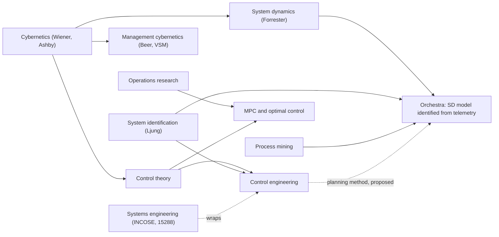
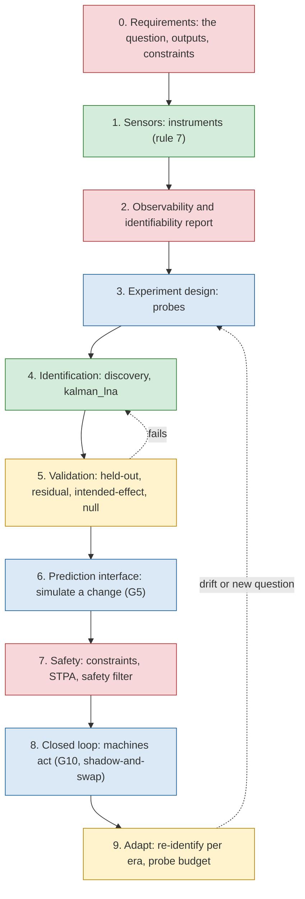
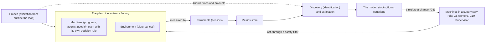

# Control engineering: what Orchestra already is, and what the plan is missing

Status: proposal, not applied. Research done 2026-10-27 for the owner's question:

> Can we record this control theory stuff somewhere? Based on what you've said, we should do it,
> but I think it might be a significant shift to our roadmap and work so far, maybe renaming.
> There might be better structured guidance and information about how to plan these sorts of
> projects if we had started from control engineering, and that is something I am worried about.
> There might be existing software that is better than we have come up with, and better than the
> Modelica and other system dynamics modeling tools we found when we were searching for sysdyn.

Nothing in the code, the roadmap or the other docs is changed by this file. Section 7 lists the
edits it proposes.

## Summary

- **Orchestra is already a control-engineering project in all but name.**
  - SD Lab's discovery is grey-box system identification. Its literature review is built on Ljung
    (`~/orchestra/sdlab/docs/research/literature/system-identification.md`).
  - The default strategy, `kalman_lna`, is a Kalman filter: a state estimator.
  - Rule 7's split between instruments and machines is the control engineer's split between sensors
    and the plant.
  - UC-0's four steps (observe, find causes, change, verify) are the control design loop.
  - What the docs lack is the vocabulary and the stages of that loop that have not been planned.
- **The shift is mostly additive, not a rewrite.** The horizons stay as they are. Five things are
  missing from the plan, and control engineering would have put them in from the start:
  - requirements, written per use case;
  - observability and identifiability, reported per model version;
  - identification experiments, designed and budgeted (impulse injection is one of them);
  - validation criteria that say when the model is good enough to act on;
  - safety constraints on any machine that acts on the model's advice.
- **The biggest risk the frame exposes is closed-loop identification.** Once machines act on the
  model (G5, G10, shadow-and-swap), what they do depends on what the model measures. That
  confounds the plant with the controller.
  - SD Lab has already measured this: a PI loop under a constant setpoint was unidentifiable for
    every strategy (`control-cases.md`, cases 213–215).
  - The remedy is the standard one: deliberate excitation from outside the loop.
  - So impulse injection is not optional once agents act; it is what keeps the model learnable.
- **No existing tool does what Orchestra does.** None infers stock-and-flow structure from live
  telemetry, relates machines known by their events to flows, or lets agents simulate a change
  before making it. That still held in this survey (§5).
- **Several tools do one part better and should be components:**
  - python-control for linear analysis (observability, controllability, eigenvalues);
  - PySD or pysimlin for model export;
  - do-mpc or CasADi, if and when a real optimising controller is built;
  - Simod and PM4Py as references for the event side. PM4Py is AGPL, so it is a reference only.
- **Do not rename the product, "machine", "stock", "flow" or "model".** Add a glossary that maps
  each one to its control term. Rename one item: "impulse injection" becomes **"probes"** (or
  identification experiments), because impulses are the weakest kind of probe.

## Recommendation

1. **Plan with the control design loop; keep system dynamics as the model's language.**
   - SD is how the model is shown to people. "The simulation charts" persuade managers, and stocks
     and flows read well.
   - Control engineering is how the work is sequenced and judged. Each horizon gets a stage of
     the loop and an exit criterion from it.
2. **Add the five missing pieces to the roadmap** (§7):
   - control requirements per use case;
   - an identifiability and observability report;
   - probes, designed and budgeted;
   - validation criteria for acting on the model;
   - STPA-style safety analysis and a safety filter before any machine acts on the model.
3. **Treat G5 as decision support first and MPC later.**
   - "Simulate before acting" is a what-if prediction made once.
   - It becomes model-predictive control only when it is repeated on a horizon, with an
     objective, constraints and a state estimate.
   - Build the prediction interface so that it can grow into MPC: return an uncertainty band and
     check constraints.
4. **Use, don't reinvent:**
   - python-control (BSD) for linear analysis;
   - pysimlin (Apache-2.0) or PySD (MIT) for XMILE and Vensim interoperability;
   - do-mpc or CasADi (LGPL) only when G10 needs an optimiser.
5. **Keep every name.** Add the glossary (§6) to SPEC.md and rename "impulse injection" to "probes".

## 1. Was the owner told the right list?

The owner was told that six parts of control theory map onto Orchestra. Five are right as stated.
Two need sharpening, and the list is missing four topics that matter more for this project than
optimal control does.

| Told | Verdict | What it is in Orchestra |
|---|---|---|
| System identification | **Right, and it is what's built.** More precisely: grey-box, multivariable, positive (compartmental), closed-loop identification with Poisson counting noise | Discovery: conservation, SD Lab strategies, `sd/fit.py` |
| Observability and state estimation (Kalman filters) | **Right, but two different things.** Observability is a structural question: can a hidden stock be determined from these sensors at all? Estimation is the filter that does it. Orchestra has the filter (`kalman_lna`, `mass_balance`) but no observability check | Hidden stocks (dashed); `kalman_lna` |
| Controllability | **Right, but a weak guide on its own.** Linear controllability ignores floors, caps and positivity, which dominate SD models. What the plan wants (leverage points) is closer to **sensitivity analysis** and **input–output pairing** (the relative gain array, Bristol 1966) | Leverage points (H2); "never two machines steering one stock" |
| Optimal control | **Right but secondary.** It needs an explicit cost function. The owner's goals ("meet the expectations of the people who judge my work") are constraints more than a cost | Not planned; would be G10's objective |
| Model-predictive control | **Right, and the closest fit for G5,** with the caveat in Recommendation 3: G5 as written is a single what-if, not MPC | G5, G10 |
| Adaptive and dual control, with persistent excitation | **Right.** Dual control (Feldbaum 1960–61) is the formal statement of "act to regulate, and act to learn". In practice it is approximated by explicit excitation with a budget, or by bandit-style exploration | Impulse injection (H1); model versions and eras |
| *Missing:* **closed-loop identification** | The main obstacle once G5 lands (§3.3, §4) | Not in the plan |
| *Missing:* **identifiability** | Which parameters and structures the data can tell apart. SD Lab has an analysis of it (`identifiability.md`, the ladder's "unidentifiable" labels); Orchestra does not report it | Not in the plan |
| *Missing:* **fault detection and isolation** | Residual-based detection of a change in the plant. This is the "unexplained-change test" of `docs/rationale/lifted-models.md` §3.3 under its standard name | Lifted-model tests |
| *Missing:* **hierarchical and supervisory control** | Process plants layer regulatory loops under supervisory and optimising layers. Orchestra's Supervisor and G10 sit in those upper layers | Supervisor, G10 |
| *Missing:* **safety of actuation** | Safety filters, control barrier functions, STPA (§4.4) | Only rule 9 and the outbox |

## 2. The fields, and where they overlap

| Field | What it covers | Standard reference | Relation to Orchestra |
|---|---|---|---|
| Control theory | The mathematics of feedback: stability, robustness, performance limits, estimation | Åström & Murray, *Feedback Systems*, 2nd ed. 2021 | The analysis Orchestra would run on its model |
| Control engineering | Applying it to real plants: choosing sensors, actuators and control structure, then tuning, implementing and validating | Skogestad & Postlethwaite, *Multivariable Feedback Control*, 2nd ed. 2005 | **The planning discipline this proposal adopts** |
| System identification | Dynamic models from measured data; experiment design; validation | Ljung, *System Identification*, 2nd ed. 1999 | **What discovery is** |
| Cybernetics | Control and communication in animal and machine; requisite variety ("only variety can destroy variety") | Wiener 1948; Ashby, *An Introduction to Cybernetics*, 1956 | The common ancestor of control theory, SD and Beer |
| Operations research | Optimisation, queueing and stochastic models for decisions, mostly static | Hillier & Lieberman | Flow rates and capacity (queueing forms) |
| System dynamics | Stock-and-flow feedback models of managed systems, for policy design; mostly built from structure, not from data | Forrester, *Industrial Dynamics*, 1961; Sterman, *Business Dynamics*, 2000 | **The model's language** |
| Systems engineering | The lifecycle: needs, requirements, architecture, verification, validation, operation | INCOSE SE Handbook, 5th ed. 2023; ISO/IEC/IEEE 15288:2023 | How requirements and V&V would be written |
| Process mining | Process models from event logs; conformance checking | van der Aalst, *Process Mining* | The event-side twin of discovery |

**The overlap that matters most is that SD and control theory share their origin.** Forrester
worked on servomechanisms for radar and gun mounts at MIT in the war, then built Whirlwind, then
founded system dynamics (Forrester 1989, 2007). SD kept feedback thinking and dropped most of the
mathematics, on purpose: managers had to read the models. Since then the SD literature has brought
control theory back in several times:

- modal control for policy design (Mohapatra & Sharma 1985);
- control heuristics (Özveren & Sterman 1989);
- loop gains and eigenvalue elasticity (Kampmann 2012; Kampmann & Oliva 2006).

The one thing SD never took from control engineering is identification from data. Its practice
has been to calibrate a structure a person drew. That gap is exactly Orchestra's.

## 3. Has this been tried? What worked and what didn't

### 3.1 Feedback control of computing systems

- **What was done.** Hellerstein, Diao, Parekh and Tilbury (*Feedback Control of Computing
  Systems*, 2004) identified ARMA models of real servers from experiments and designed controllers
  from them:
  - Lotus Notes, held to a service-level target (Parekh et al. 2002);
  - Apache's MaxClients and KeepAlive, with a MIMO controller (Diao et al. 2002).
  
  The controllers behaved as the analysis predicted.
- **Why it did not spread.** Hellerstein's own assessment (ACC 2004) was that "formal control
  methods are rarely used in practice… it is uncommon to do system identification". He named the
  obstacles:
  - there is no plant model;
  - sensors are "noisy, incomplete, and inconsistent";
  - actuators "do not correspond well to the control objectives";
  - there are delays.
  
  Filieri et al. (SEAMS 2015) named the same two gaps a decade later: models of software, and
  engineering methods for controllability.

**Lesson for Orchestra.** The thing that blocked control of computing systems is the model.
Orchestra's whole bet is to make the model cheap and continuous. If discovery works, it removes
the obstacle Hellerstein named first. If it doesn't, nothing downstream works either. This
supports H1's stop rule as written.

### 3.2 What did work: simple loops on one well-measured quantity

- **Networking.**
  - TCP congestion control (Jacobson 1988) is a feedback loop.
  - PIE is explicitly a PI controller on queueing delay (RFC 8033), and CoDel (RFC 8289) is a
    related design.
  - Netflix's adaptive concurrency limits treat a concurrency limit like a TCP window (2018).
- **Autoscaling.** The Kubernetes HPA scales replicas by the ratio of measured to desired load,
  with a 10% deadband and a 300 s hold before scaling down. It is a simple incremental controller,
  though the docs never call it one.
- **SRE.** The Google SRE book calls the error budget a "control loop to manage release velocity"
  (ch. 3).
- **Surveys.** Self-adaptive systems mostly use linear models and PI controllers, then MPC
  (Shevtsov et al., IEEE TSE 2018; 42 studies).

**Lesson for Orchestra.** What survives in practice is a low-order controller on a quantity that
is measured well, with deadbands and rate limits. It is not a designed MIMO optimiser. Orchestra's
machines will be like this. The model's job is to say *which* loops to close and where they will
fight, more than to tune them.

### 3.3 Management cybernetics

- **The model.** Beer's Viable System Model (*Brain of the Firm*, 1972) describes an organisation
  as recursive regulators.
- **What Cybersyn achieved.** In Chile (1971–73) it built a telex network that helped coordinate
  supplies during the October 1972 strike (Medina 2006, 2011). The statistical forecasting
  (Cyberstride) and the operations room were only partly finished.
- **How it ended.** The coup ended it in 1973.
- **The critique.** Ulrich (1981) argued it treated purposeful people as components to regulate.

**Lesson for Orchestra.** It is a warning that matches the owner's own: automation must "never
quietly take over the part that makes up my identity". Rule 9 (humans talk only to the
Supervisor) and the outbox are the right instincts. The VSM is not worth adopting as a model: it
is a diagnostic framework, not something to fit to data.

### 3.4 Control of software processes

- Abdel-Hamid & Madnick (*Software Project Dynamics*, 1991) built an SD model of software
  projects. It was hand-built and calibrated to case studies.
- Cangussu, DeCarlo & Mathur (IEEE TSE 2002; ISSRE 2001) modelled the software test process as a
  linear state-variable system and used feedback control on it.

These are the nearest prior work to Orchestra's domain. Both are declared models, not identified
ones. Neither had live telemetry.

### 3.5 MPC in operations

MPC has been run on real supply chains: Intel's three-echelon network (Braun et al. 2003; Wang,
Rivera & Kempf 2007). It worked despite forecast error and mismatch between plant and model,
because the loop re-solves every period. That is the argument for G5 growing into MPC rather than
a single what-if: re-planning absorbs model error.

### 3.6 Model risks, by their names

| Risk | Statement | Where it bites Orchestra | Defence |
|---|---|---|---|
| **Closed-loop identification** | Under feedback, the input is correlated with the noise. Plant and controller can't be told apart without excitation from outside the loop (Forssell & Ljung 1999) | Every flow a machine sets from a stock it reads. SD Lab's control cases: the controller's term and the plant's drain merge into one number; unidentifiable under a constant setpoint; a PRBS carries about 4× the information of steps (`control-cases.md` §213–215) | Probes from outside every loop; eras as instruments; report what is unidentifiable instead of picking |
| **Lucas critique** | A model fitted under one policy fails when the policy changes (Lucas 1976) | Ghost machines and G5 predictions fitted before a swap. `convergence.md` §4.3 answers it for rules we *declared*; AI agents' rules are not declared | Every swap is a hypothesis with a kill criterion (already in ghost-machines §3); re-identify after each era |
| **Goodhart / Campbell** | "When a measure becomes a target, it ceases to be a good measure" (Strathern 1997; Campbell 1979) | Agents that read the model will optimise the series it shows. G5's guidance has agents *implementing* new metrics | Rule 7 already keeps instruments apart from machines. Add: a machine may propose an instrument but never write the series it is judged by (lifted-models §3.1: "sensors outside every agent's write access") |
| **Dual-control trade-off** | Acting to regulate and acting to learn conflict (Feldbaum) | A machine that only exploits the model stops exciting it; the model goes stale | A probe budget; the model reports when its data no longer exercise a flow (SD Lab's `benchmark-excitation.md` measures this) |

## 4. Structured guidance: how control engineering would have planned this

### 4.1 The two standard workflows

**Skogestad & Postlethwaite §1.1** list the control design steps. They add a step 0, the
controllability of the process itself: "even the best control system cannot make a Ferrari out
of a Volkswagen".

1. Study the system and its objectives.
2. Model it.
3. Scale and analyse the model.
4. Choose the controlled outputs.
5. Choose the sensors and actuators.
6. Choose the control configuration.
7. Choose the controller type.
8. Set the performance specifications.
9. Design the controller.
10. Analyse the closed loop.
11. Simulate.
12. Iterate.
13. Implement.
14. Test, validate and tune online.

**Ljung's identification loop** runs: prior knowledge → experiment design → data → model set →
criterion → compute the model → validate → revise any earlier choice. SD Lab's literature review
(§18) already turns it into a ten-step order for the discovery engine.

**Systems engineering** wraps both:
- requirements trace to verification (was it built right?) and to validation (was it the right
  thing?), on the V-model (Forsberg & Mooz 1991; ISO/IEC/IEEE 15288);
- SysML v2 was adopted by OMG in 2025 for writing such models;
- for digital twins, the National Academies (2024) make continual verification, validation and
  uncertainty quantification (VVUQ) a condition of a twin, not an afterthought.

**Kritzinger et al. (2018)** give a classification that places Orchestra exactly:

| Kind | Data flow | Orchestra |
|---|---|---|
| Digital model | Manual both ways | A hand-drawn Vensim model |
| **Digital shadow** | Automatic, physical → digital only | **Orchestra today** |
| Digital twin | Automatic both ways | Orchestra once machines act on the model (G5, G10) |

"The relationship goes both ways" (goals.md) is, in these terms, the step from shadow to twin.

### 4.2 Orchestra's horizons against the loop

| Stage | Where it is in the plan | State |
|---|---|---|
| 0. Requirements | Use cases list expected stocks and flows, but not the question, the outputs that matter, or the constraints on acting | **Missing** |
| 1. Sensors | Instruments, `[[collect]]`, `[[scrape]]`, `[[sources]]`, resolution (H1) | Built |
| 2. Observability and identifiability | SD Lab has the analysis (ladder labels, `identifiability.md`); Orchestra does not report it | **Missing in Orchestra** |
| 3. Experiment design | Impulse injection (H1), as a single machine; SD Lab's `probe-design.md` and `experiment-design.md` are ideas, not built | Planned, under-specified |
| 4. Identification | Discovery (H1) | Built, under test |
| 5. Validation | `sd/netflow.py` refutations; lifted-models §3 tests; UC acceptance | Partial: no stated bar for "good enough to act on" |
| 6. Prediction | G5 simulate tool | Planned |
| 7. Safety | Rule 9, outbox (H3) | **Missing as analysis** |
| 8. Closed loop | G10, shadow-and-swap (H3), H4 | Planned |
| 9. Adaptation | Model versions, eras (H1) | Partial; no probe budget, no drift trigger |

**What a control-first plan would have done differently.** Mostly it would have put the order
and the gates in front. The content would be much the same.

- Each use case would start with a requirement: the question, the outputs, and what acting would
  mean.
- Observability would be checked *before* collecting. "To estimate hidden stock X you need
  instruments on Y and Z" is advice Orchestra could give UC-0's curious observer.
- Experiments would be designed in H1, not bolted on. SD Lab's own result (PRBS beats steps
  about 4×; impulses are weakest) would shape the probe machine.
- Validation would have a stated bar before G5 lets agents act on predictions.
- Safety analysis would come before any machine closes a loop.

### 4.3 What the frame maps onto, concept by concept

| Orchestra | Control engineering | Note |
|---|---|---|
| The software factory | The plant (process) | |
| Instrument | Sensor | Rule 7 is good sensor practice and a Goodhart defence |
| Series, metric | Measured output *y* | |
| Stock | State *x*; hidden stock = unmeasured state | |
| Flow and its equation | The state equation's terms *f(x, u, d)* | |
| Machine | A component of the plant that does work. Its decision rule is a local controller *inside* the plant | The owner's meaning: not a valve or a controller |
| A machine that consults the model and chooses (G5 worker, G10, Supervisor) | A supervisory controller | Still a machine; it also plays a controller's role |
| The environment | Disturbances *d* (exogenous inputs) | |
| Impulse injection | Excitation signal, probe, dither | Rename to "probes" |
| Discovery | System identification | |
| `kalman_lna` | State estimator; prediction-error identification | |
| Era | Regime; known parameter switch | |
| Ghost machine | An identified decision rule (controller identification, behavioural cloning) | Confounded under feedback (§3.6) |
| Leverage points | Sensitivity, controllability, input–output pairing | |
| "One machine per decision rule; never two steering one stock" | Decentralised control; pairing by the relative gain array | |
| Shadow mode | Running a candidate controller open-loop in parallel | |
| Swap | Bumpless transfer | |
| Intended-effect test | Closed-loop validation against a prediction | |
| Null test | Validation that a change left the dynamics unchanged | |
| Unexplained-change test | Fault detection by residuals | |
| Goals, the owner's expectations | Reference, constraints, cost | |

### 4.4 Safety of acting on the model

Two bodies of work apply directly.

- **STPA** (Leveson, *Engineering a Safer World*, 2011; STPA Handbook 2018) models a system as a
  hierarchy of controllers, each with a *process model* of what it controls. It finds unsafe
  control actions of four kinds:
  - not given when needed;
  - given when unsafe;
  - given too early or too late;
  - stopped too soon or applied too long.
  
  It names the commonest cause: a controller whose process model is wrong. That is exactly an agent
  acting on an outdated or misidentified Orchestra model. STPA is the closest existing method to
  "agents consult a model before acting", and its book is freely available.
- **Safety filters** (Hsu, Hu & Fisac 2024; Wabersich et al. 2023) sit between a controller and
  the plant and change only proposed actions that would leave a safe set. In ops practice the same
  idea is canaries, rate limits, deadbands, error-budget freezes and the HPA's stabilisation window.

For Orchestra this means two things. A machine that acts on the model's advice goes through
constraints the model can check: bounds on stocks, rates of change, and how sure the model is.
And "the model is not trusted here" is an answer the prediction tool can give.

## 5. Existing software

Versions and licences were checked against PyPI, GitHub and vendor pages on 2026-10-27. SD Lab's
earlier survey (`~/orchestra/sdlab/docs/research/SD-TOOLS-AND-DISCOVERY.md`, 2026-10-17) covered
about 25 SD and Modelica tools. This section adds control, identification, process mining,
digital twins and AIOps, and re-checks the conclusion.

**The headline.** Nothing found infers stock-and-flow structure from time series. That rules out
the SD tools, Modelica, the sysid toolboxes, SciML, process mining, digital-twin platforms and
AIOps alike. The newest SD entrants (isee's sd-ai, Stella's AI Assistant, "code-first SD", 2026)
build models from *text*, not data. **Nothing clearly beats what Orchestra and SD Lab have for this
use.** Several tools are better at one part.

### 5.1 System identification

| Tool | Better than us at | Lacks for this use | Licence, cost | Use it? |
|---|---|---|---|---|
| MATLAB System Identification Toolbox | Mature linear and nonlinear ARX, Hammerstein–Wiener, grey-box ODE fitting (`idnlgrey`), online filters, validation plots; decades of engineering | Generic equations per output, no flows between stocks, no Poisson counts, no live service | Proprietary; MATLAB needed | No. A reference for validation practice |
| SIPPY | Subspace methods (N4SID, MOESP, CVA) and the ARX/ARMAX/OE/BJ families, MIMO | Linear black box; no conservation | LGPL-3.0 | Maybe: a **state-order estimate** (how many hidden stocks) from Hankel singular values, which SD Lab's review ranks second |
| nfoursid | Small N4SID plus a Kalman filter | Same | MIT | Same use as SIPPY; easier licence |
| PySINDy | Sparse equation discovery | Per-variable equations, not flows. **SD Lab benchmarked it and rejected it as a strategy** (`pysindy.md`: best 20.5% skill against the main line's 31.6%) | MIT | Already in `sd-research` |
| SysIdentPy | NARMAX term selection (FROLS) | Per-variable | BSD-3 | SD Lab lists FROLS as an idea (`frols.md`) |
| Julia SciML (ModelingToolkit, DataDrivenDiffEq, UDEs) | Fast simulation, automatic differentiation, universal differential equations (declared structure plus a learned unknown, then symbolic recovery; Rackauckas et al. 2020). The cleanest frame for D4's "priors" | Julia; no SD semantics; no flows | MIT. JuliaSim is now **Dyad**: source-available, not open source | Not now. Worth a look if priors (D4) become central |
| ControlSystemIdentification.jl | Prediction-error and subspace identification in Julia | Same | MIT | No |

### 5.2 Estimation and control

| Tool | Better than us at | Lacks | Licence | Use it? |
|---|---|---|---|---|
| python-control | Linear analysis: observability and controllability matrices, Gramians, eigenvalues, step responses, basic MPC | Nonlinear SD forms | BSD-3 | **Yes**, for the observability report and leverage-point analysis on the linearised model |
| filterpy | Teaching-quality KF, EKF and UKF | `kalman_lna` is already tailored (Poisson process noise shared across a flow's ends) | MIT | No |
| dynamax | JAX state-space models: filtering, smoothing, EM, HMC | Same | MIT | Possibly, for hidden-stock EM (SD Lab's `state-space.md` idea) |
| do-mpc | Nonlinear, economic and robust multi-stage MPC; moving-horizon estimation | Needs a model in CasADi form | LGPL-3.0 | **When G10 needs an optimiser**, not before |
| CasADi | Automatic differentiation plus NLP; the engine under do-mpc | Same | LGPL-3.0 | Same |
| acados | Real-time embedded MPC | Built for millisecond loops; ours are minutes to weeks | BSD-2 | No |

### 5.3 Modelling and simulation

| Tool | Better than us at | Lacks | Licence, cost | Use it? |
|---|---|---|---|---|
| Vensim (Pro, DSS) | Calibration, optimisation, Monte Carlo; **DSS calibrates with an extended Kalman filter**, the closest commercial match to `kalman_lna`; Reality Checks | Structure must be drawn; Windows DLL | Proprietary | No, but **export to it** (owner's managers may know it) |
| Stella Architect | Optimisation and calibration, Loops that Matter, sd-ai | Same | $3,999 perpetual or $1,929/year | Export target |
| AnyLogic | SD, discrete-event and agent-based in one model; OptQuest | Hand-built; Java; no identification | Proprietary; free PLE for learning only | No |
| OpenModelica, Dymola | Acausal physical modelling, FMI | Physics, not organisations; OMSysIdent unmaintained since 2021 | AGPL-3.0 or OSMC-PL; Dymola by quote | **No.** SD Lab reached the same conclusion |
| PySD | Runs Vensim and XMILE models in Python | Import only | MIT | Yes, to *check* an exported model runs |
| pysimlin (Simlin) | Reads **and writes** XMILE and `.mdl`; Loops that Matter; an MCP server for agents | Engine only | Apache-2.0 | **Yes, for export**, and its MCP server is a model of what G5's tools could look like |

### 5.4 Process mining (the event side)

| Tool | Better than us at | Lacks | Licence | Use it? |
|---|---|---|---|---|
| Celonis | Object-centric process models from enterprise logs; Process Simulation for what-if questions on volume and resources | Commercial; reads payloads (rule 3 forbids it); no SD | Proprietary | No |
| PM4Py | Discovery, conformance and object-centric event logs (OCEL) | No dynamics | **AGPL-3.0** (commercial licence sold) | **Reference only.** The licence is a problem for a public MIT/BSD-style project |
| Simod (with Prosimos) | **Turns an event log into a tuned simulation model automatically**: the closest thing to "discovery" on the event side | Business process simulation, not stocks and flows; Prosimos has no licence file | Apache-2.0 (Simod) | Study it for ghost machines from the bus |
| Apromore | Mining plus simulation | Acquired by Salesforce (Nov 2025); open core archived | — | No |

Process mining could turn Orchestra's bus into flows and decision points the same way discovery
turns metrics into them. But rule 3 says Orchestra never reads `data`, and process mining needs a
case identifier, which usually lives in the payload. Only envelope fields (`source`, `type`,
`subject`, extensions) are allowed. That is worth an open question (§9).

### 5.5 Digital-twin platforms and AIOps

| Kind | Examples | What they do | Verdict |
|---|---|---|---|
| Twin platforms | Azure Digital Twins (DTDL graph), AWS IoT TwinMaker (not deprecated; its siblings IoT Events and IoT Analytics were), Eclipse Ditto (EPL-2.0) | A graph of entities and state, plus event routing and 3D views. **No simulation, no identification** | No. They are registries, not models |
| Frameworks | ISO 23247; Digital Twin Consortium capabilities table; National Academies 2024 | Checklists and VVUQ requirements | **Use the National Academies report** for the validation section |
| AIOps | Dynatrace (Davis, now "Dynatrace Intelligence"), Datadog Watchdog, Dell APEX AIOps (Moogsoft), BigPanda, PyRCA (BSD, no release since 2023) | Anomaly detection, alert correlation, causal root cause on topology; forecasting is univariate extrapolation | No product found simulates an intervention from a fitted dynamic model. **This is Orchestra's gap in the market, not a gap in Orchestra** |

### 5.6 Does anything beat what we have?

- **For identifying SD structure from telemetry: no.** SD Lab's survey (2026-10-17) and this one
  agree.
- **For parts, yes:**
  - MATLAB and SIPPY for linear identification and validation tools;
  - Vensim DSS for Kalman calibration of a drawn model;
  - python-control for the analysis we don't do;
  - do-mpc for MPC;
  - Simod for event-log simulation.
- **What we should honestly expect.** For the owner's actual use (a software factory with AI
  agents), the hard problems are not the solvers. They are identifiability under feedback, little
  excitation, slow eras, and Goodhart. No tool solves those. The control literature only tells us
  how to manage them.

## 6. Renaming

| Name | Control term | Rename? | Why |
|---|---|---|---|
| Orchestra | — | No | |
| system dynamics model | plant model, state-space model | **No** | SD is what managers read; the model *is* an SD model; "plant" invites the wrong picture of people |
| discovery | system identification | **No**, but say "discovery (system identification)" once in SPEC §4.3 | "Discovery" also covers *structure*, which "identification" often doesn't imply to readers |
| machine | — (not "controller", not "actuator") | **No** | The owner's choice is right: a machine does work and *contains* a decision rule. Some machines also play a supervisory role; that is a role, not a kind |
| stock, flow | state, rate | No | |
| instrument | sensor | No | Already the right word |
| environment | disturbance | No | Glossary only |
| impulse injection | excitation, probe | **Yes: "probes"** | An impulse is one design and the weakest. SD Lab measured PRBS at about 4× the information of steps. The plan should not lock in a waveform |
| ghost machine | identified decision rule | No | Glossary: say it is confounded under feedback |
| shadow-and-swap | parallel running, bumpless transfer | No | Glossary |

Cost of a broad rename: code paths (`orchestra/sd`), every doc, the UI and the owner's own
vocabulary, for no gain in function. Cost of a glossary: one table in SPEC.md. **Recommend the
glossary plus the one rename.**

## 7. What changes in the roadmap (proposed edits, not applied)

### 7.1 `docs/roadmap/README.md`

- **Under "The goal":** add one paragraph:
  - "Orchestra is a digital shadow becoming a twin (Kritzinger et al. 2018).
  - Discovery is system identification; the model is its plant model in system dynamics form.
  - The horizons follow the control design loop: requirements, sensors, observability,
    experiments, identification, validation, prediction, safety, closed loop, adaptation
    (`docs/proposals/control-theory.md`)."
- **H1, new item: "Identifiability and observability, reported."** Each model version says:
  - which stocks and flows the window's data determine, which are equivalent and why (the
    controller-drain merge, collinearity with a constant);
  - which hidden stocks are observable from which instruments;
  - for UC-0, which instrument would make an unobservable quantity observable.
  
  Use SD Lab's analysis and python-control on the linearised model. Done when UC-1 and the SD Lab
  control cases 213–215 are labelled as the ladder labels them.
- **H1, "Impulse injection" becomes "Probes (identification experiments)":**
  - a probe machine with a design (PRBS, steps or impulses, chosen per flow), an amplitude and
    time budget, and the user's sign-off before it acts on anything real (SD Lab
    `experiment-design.md`);
  - discovery reads the probes as known inputs and as instruments (`injection-instruments.md`);
  - done when a probe on the bakery tells apart two structures the data alone leaves equivalent.
- **H1, new item: "Validation criteria for acting."** A stated bar a model version must pass
  before G5 may present its predictions as advice, not just description:
  - held-out prediction at the horizon of use;
  - residual whiteness per stock;
  - an uncertainty band on every simulated stock;
  - the false-change rate of null tests measured on a quiet period (lifted-models §3.2).
  
  Below the bar, the prediction tool says "not trusted here".
- **H2, G5:** the simulate tool returns:
  - a prediction with an uncertainty band (ensemble or bootstrap; SD Lab `bayesian-structure.md`);
  - the constraints the change would break (stock bounds, rates);
  - the validation status of every equation it used.
  
  It records the prediction for the intended-effect test. It is MPC's prediction step; nothing
  optimises yet.
- **H2, leverage points:** compute them as sensitivity of the fitted model, plus pairing (the
  relative gain array) for "never two machines steering one stock". Report controllability under
  bounds, not linear controllability alone.
- **H2, new item: "Who controls what."**
  - A control-structure view: each stock with the machines whose decision rules set its flows
    (hypotheses, rule 6) and the machines that read it;
  - loops a machine closes on purpose, marked as such;
  - the input to STPA in H3.
- **H3, new item before shadow-and-swap: "Safety of acting".**
  - An STPA pass over the first loop a machine will close: the controllers, their process models
    (the Orchestra model they read), the four kinds of unsafe control actions;
  - a safety filter on actions taken on model advice: bounds, rate limits, a confidence floor,
    and the outbox for anything that speaks as the owner.
- **H3, shadow-and-swap:** name the swap as bumpless transfer: the candidate's state is aligned
  with the original's before it takes over. Each swap is followed by a re-identification in the
  next era, with probes on, because the swap itself is a policy change (Lucas).
- **H4:** "policy design, deployment and verification are one loop" becomes explicitly adaptive:
  - re-identify on drift (the unexplained-change test as fault detection);
  - keep a standing probe budget so closed loops stay identifiable (dual control in practice).

### 7.2 `docs/roadmap/goals.md`

- **"The relationship goes both ways":** add the shadow-to-twin sentence. Add: "Once machines
  act on the model, what they do correlates with what it measures; the model stays learnable only
  with probes from outside every loop (closed-loop identification, §3.6 of the proposal)."
- **G5 acceptance, add:**
  - the simulate tool returns a band and refuses when the model is below the validation bar;
  - a dummy worker's expected-effect note includes the band, and the later version is judged
    against it.
- **G5 guidance:** "agents implement new metrics" gets a guard. An agent may write an instrument,
  but not one that measures its own work's acceptance. Those are written or reviewed by someone
  else (Goodhart; lifted-models §3.1).
- **G10 acceptance (when written):**
  - the pipeline manager is a supervisory controller with a stated objective and constraints;
  - it acts through the safety filter;
  - it spends a probe budget;
  - it is judged by closed-loop validation: did the stocks move as predicted, within the band?
  - if it needs optimisation, do-mpc or CasADi, not a home-made solver.

### 7.3 `docs/roadmap/use-cases.md`

Each case gains a **"Control requirements"** line:
- the question;
- the outputs that matter;
- what is observable;
- what excitation exists (eras, probes, natural variation);
- what acting would mean, and its constraints.

For UC-0 it is the curious observer's step 2–3. For UC-1 to UC-4 it is mostly "observe only".

### 7.4 `SPEC.md` and `AGENTS.md`

- **SPEC.md:** a glossary table (§4.3 above, shortened) and "discovery (system identification)"
  in §4.3.
- **AGENTS.md rule 7:** one sentence makes the Goodhart defence explicit: "A machine is never the
  only instrument of its own acceptance." This changes an invariant, so it needs the owner and a
  note in the commit.

## 8. What we keep

- **Discovery as built.** Conservation, `kalman_lna`, `sd/netflow.py`'s refutations and
  resolution handling are identification done carefully. SD Lab's research already follows Ljung's
  loop, its validation checklist and its warnings. The frame changes their names, not their code.
- **The rules.** Rule 2 (machines known by events) and rule 6 (machine-to-flow attribution is a
  hypothesis) are what identification under feedback requires: who sets a flow is inferred, never
  declared. Rule 7 (instruments are not machines) is sensor discipline and the main Goodhart
  defence. Rule 9 is the start of a safety filter.
- **SD as the language of the model and the UI.**
- **"Machine" as the owner defined it.**
- **Ghost machines, leverage points, shadow-and-swap, eras, priors (D4).** All have standard
  counterparts, and the plan already has them in the right order.
- **The order of horizons and H1's stop rule.** The history (§3.1) says the model is the thing
  that blocks everything else, so trust in the model comes first.
- **No VSM, no Modelica, no MATLAB.** No commercial SD tool as the engine.

## 9. Open questions for the owner

1. **Adopt the frame?** Should the roadmap say it follows the control design loop (§7.1's
   paragraph), or keep control engineering as a reference in `docs/rationale` only?
2. **Rename "impulse injection" to "probes"?**
3. **Probes on real systems.** Who signs off a probe that nudges a real quantity, and what is the
   default budget? Rule 9 says humans act only through the Supervisor. Is a probe the
   Supervisor's to approve?
4. **The validation bar.** What must a model pass before agents may act on its predictions? One
   bar for all, or per stock?
5. **Rule 7 addition.** "A machine is never the only instrument of its own acceptance": make it
   an invariant?
6. **Process mining on the envelope.** Rule 3 forbids reading `data`. May a machine put a case
   identifier in an envelope extension (CloudEvents allows extensions), so the bus can be mined
   for flows and ghost machines?
7. **Export.** Should models export to XMILE (pysimlin) so they open in Vensim or Stella for the
   people the owner reports to?
8. **Julia.** If priors (D4) grow into "declared structure plus learned unknowns", universal
   differential equations in Julia's SciML fit that best. Is a Julia dependency acceptable, or must
   it stay Python?

## References

**Control and identification**
- Åström, K.J., Murray, R.M. (2021). *Feedback Systems*, 2nd ed. Princeton UP. https://fbswiki.org
- Skogestad, S., Postlethwaite, I. (2005). *Multivariable Feedback Control*, 2nd ed. Wiley. https://skoge.folk.ntnu.no/book/
- Ljung, L. (1999). *System Identification: Theory for the User*, 2nd ed. Prentice Hall.
- Forssell, U., Ljung, L. (1999). Closed-loop identification revisited. *Automatica* 35(7):1215–1241. https://doi.org/10.1016/S0005-1098(99)00022-9
- Gevers, M. (2005). Identification for control. *Eur. J. Control* 11(4–5):335–352. https://doi.org/10.3166/ejc.11.335-352
- Hjalmarsson, H. (2005). From experiment design to closed-loop control. *Automatica* 41(3):393–438. https://doi.org/10.1016/j.automatica.2004.11.021
- Bombois, X. et al. (2006). Least costly identification experiment for control. *Automatica* 42(10):1651–1662. https://doi.org/10.1016/j.automatica.2006.05.016
- Feldbaum, A.A. (1960–61). Dual control theory I–IV. *Avtomatika i Telemekhanika* 21–22. Overview: Wittenmark, B. (1995). Adaptive dual control methods: an overview. IFAC. https://doi.org/10.1016/S1474-6670(17)45327-4
- Bristol, E. (1966). On a new measure of interaction for multivariable process control. *IEEE Trans. Automatic Control* 11(1):133–134.
- Ashby, W.R. (1956). *An Introduction to Cybernetics*. Chapman & Hall. https://archive.org/details/introductiontocy00ashb

**Control of computing systems**
- Hellerstein, J.L., Diao, Y., Parekh, S., Tilbury, D.M. (2004). *Feedback Control of Computing Systems*. Wiley. https://doi.org/10.1002/047166880X
- Hellerstein, J.L. (2004). Challenges in control engineering of computing systems. ACC. https://skoge.folk.ntnu.no/prost/proceedings/acc04/Papers/0352_ThA01.1.pdf
- Parekh, S. et al. (2002). Using control theory to achieve service level objectives in performance management. *Real-Time Systems* 23:127–141. https://doi.org/10.1023/A:1015350520175
- Diao, Y. et al. (2002). Using MIMO feedback control to enforce policies for interrelated metrics. NOMS. https://doi.org/10.1109/NOMS.2002.1015566
- Filieri, A. et al. (2015). Software engineering meets control theory. SEAMS. https://doi.org/10.1109/SEAMS.2015.12
- Shevtsov, S., Berekmeri, M., Weyns, D., Maggio, M. (2018). Control-theoretical software adaptation: a systematic literature review. *IEEE TSE* 44(8):784–810. https://doi.org/10.1109/TSE.2017.2704579
- Lorido-Botran, T. et al. (2014). A review of auto-scaling techniques for elastic applications in cloud environments. *J. Grid Computing* 12(4):559–592. https://doi.org/10.1007/s10723-014-9314-7
- Kubernetes. Horizontal Pod Autoscaling. https://kubernetes.io/docs/concepts/workloads/autoscaling/horizontal-pod-autoscale/
- Jacobson, V. (1988). Congestion avoidance and control. SIGCOMM. https://doi.org/10.1145/52325.52356
- Pan, R. et al. (2017). PIE. RFC 8033. https://doi.org/10.17487/RFC8033
- Nichols, K., Jacobson, V. (2012). Controlling queue delay. *ACM Queue* 10(5). https://doi.org/10.1145/2208917.2209336
- Netflix Technology Blog (2018). Performance under load. https://netflixtechblog.medium.com/performance-under-load-3e6fa9a60581
- Beyer, B. et al. (2016). *Site Reliability Engineering*, ch. 3 and 21. https://sre.google/sre-book/embracing-risk/
- Kusic, D. et al. (2009). Power and performance management of virtualized computing environments via lookahead control. *Cluster Computing* 12(1):1–15. https://doi.org/10.1007/s10586-008-0070-y

**System dynamics and its relation to control**
- Forrester, J.W. (1989). The beginning of system dynamics. https://www.mckinsey.com/capabilities/strategy-and-corporate-finance/our-insights/the-beginning-of-system-dynamics
- Forrester, J.W. (2007). System dynamics—a personal view of the first fifty years. *SDR* 23(2–3):345–358. https://doi.org/10.1002/sdr.382
- Mohapatra, P.K.J., Sharma, S.K. (1985). Synthetic design of policy decisions in system dynamics models. *SDR* 1(1):63–80. https://doi.org/10.1002/sdr.4260010106
- Özveren, C.M., Sterman, J.D. (1989). Control theory heuristics for improving the behavior of economic models. *SDR* 5(2):130–147. https://doi.org/10.1002/sdr.4260050204
- Kampmann, C.E., Oliva, R. (2006). Loop eigenvalue elasticity analysis. *SDR* 22(2):141–162. https://doi.org/10.1002/sdr.333
- Kampmann, C.E. (2012). Feedback loop gains and system behavior. *SDR* 28(4):370–395. https://doi.org/10.1002/sdr.1483
- Sterman, J.D. (1989). Misperceptions of feedback in a dynamic decision making experiment. *Management Science* 35(3):321–339. https://doi.org/10.1287/mnsc.35.3.321
- Sterman, J.D. (2000). *Business Dynamics*. McGraw-Hill.
- Barlas, Y. (1996). Formal aspects of model validity and validation in system dynamics. *SDR* 12(3):183–210.
- Abdel-Hamid, T., Madnick, S. (1991). *Software Project Dynamics*. Prentice Hall.
- Cangussu, J.W., DeCarlo, R.A., Mathur, A.P. (2002). A formal model of the software test process. *IEEE TSE* 28(8):782–796. https://doi.org/10.1109/TSE.2002.1027800

**MPC in operations**
- Braun, M.W. et al. (2003). A model predictive control framework for robust management of multi-product, multi-echelon demand networks. *Annual Reviews in Control* 27(2):229–245. https://doi.org/10.1016/j.arcontrol.2003.09.006
- Wang, W., Rivera, D.E., Kempf, K.G. (2007). Model predictive control strategies for supply chain management in semiconductor manufacturing. *IJPE* 107(1):56–77. https://doi.org/10.1016/j.ijpe.2006.05.013

**Management cybernetics**
- Beer, S. (1972). *Brain of the Firm*. Allen Lane.
- Medina, E. (2006). Designing freedom, regulating a nation. *J. Latin American Studies* 38(3):571–606. https://doi.org/10.1017/S0022216X06001179
- Medina, E. (2011). *Cybernetic Revolutionaries*. MIT Press.
- Ulrich, W. (1981). A critique of pure cybernetic reason: the Chilean experience with cybernetics. *J. Applied Systems Analysis* 8:33–59.

**Systems engineering, digital twins, safety, validation**
- INCOSE (2023). *Systems Engineering Handbook*, 5th ed. Wiley. ISO/IEC/IEEE 15288:2023.
- Forsberg, K., Mooz, H. (1991). The relationship of system engineering to the project cycle. INCOSE. https://doi.org/10.1002/j.2334-5837.1991.tb01484.x
- OMG (2025). SysML v2 adoption. https://www.omg.org/news/releases/pr2025/07-21-25.htm
- Kritzinger, W. et al. (2018). Digital Twin in manufacturing: a categorical literature review and classification. *IFAC-PapersOnLine* 51(11):1016–1022. https://doi.org/10.1016/j.ifacol.2018.08.474
- National Academies (2024). *Foundational Research Gaps and Future Directions for Digital Twins*. https://doi.org/10.17226/26894
- AIAA & AIA (2020). Digital Twin: Definition & Value. https://www.aia-aerospace.org/wp-content/uploads/Digital-Twin-Institute-Position-Paper-December-2020-1.pdf
- Digital Twin Consortium (2024). Capabilities Periodic Table, v1.1. https://www.digitaltwinconsortium.org/wp-content/uploads/sites/3/2024/04/DTC_Capabilities-Periodic-Table-User-Guide-v1.1.pdf
- Leveson, N. (2011). *Engineering a Safer World*. MIT Press. https://doi.org/10.7551/mitpress/8179.001.0001
- Leveson, N., Thomas, J. (2018). *STPA Handbook*. https://psas.scripts.mit.edu/home/get_file.php?name=STPA_handbook.pdf
- Hsu, K.-C., Hu, H., Fisac, J.F. (2024). The safety filter. *Annu. Rev. Control Robot. Auton. Syst.* 7:47–72. https://arxiv.org/abs/2309.05837
- Wabersich, K.P. et al. (2023). Data-driven safety filters. *IEEE Control Systems* 43(5):137–177. https://doi.org/10.1109/MCS.2023.3291885

**Model risks**
- Lucas, R.E. (1976). Econometric policy evaluation: a critique. *Carnegie-Rochester Conf. Series* 1:19–46. https://doi.org/10.1016/S0167-2231(76)80003-6
- Strathern, M. (1997). 'Improving ratings': audit in the British University system. *European Review* 5(3):305–321.
- Campbell, D.T. (1979). Assessing the impact of planned social change. *Evaluation and Program Planning* 2(1):67–90. https://doi.org/10.1016/0149-7189(79)90048-X

**Software**
- MATLAB System Identification Toolbox: https://www.mathworks.com/products/sysid.html
- SIPPY: https://github.com/CPCLAB-UNIPI/SIPPY · nfoursid: https://github.com/spmvg/nfoursid · PySINDy: https://github.com/dynamicslab/pysindy · SysIdentPy: https://github.com/wilsonrljr/sysidentpy
- ModelingToolkit.jl: https://github.com/SciML/ModelingToolkit.jl · DataDrivenDiffEq.jl: https://github.com/SciML/DataDrivenDiffEq.jl · Rackauckas et al. (2020), Universal differential equations: https://arxiv.org/abs/2001.04385 · ControlSystemIdentification.jl: https://github.com/baggepinnen/ControlSystemIdentification.jl · JuliaSim/Dyad: https://juliahub.com/products/juliasim
- python-control: https://github.com/python-control/python-control · filterpy: https://github.com/rlabbe/filterpy · dynamax: https://github.com/probml/dynamax · do-mpc: https://github.com/do-mpc/do-mpc · CasADi: https://github.com/casadi/casadi · acados: https://github.com/acados/acados
- OpenModelica: https://github.com/OpenModelica/OpenModelica · Dymola: https://www.3ds.com/products/catia/dymola · AnyLogic: https://www.anylogic.com/purchase · Vensim Kalman filtering: https://vensim.com/documentation/ref_kalman.html · Stella Architect: https://iseesystems.com/store/products/stella-architect.aspx · sd-ai: https://github.com/UB-IAD/sd-ai · PySD: https://github.com/SDXorg/pysd · Simlin: https://github.com/bpowers/simlin · BPTK-Py: https://github.com/transentis/bptk_py
- PM4Py: https://github.com/process-intelligence-solutions/pm4py · Simod: https://github.com/AutomatedProcessImprovement/Simod · Celonis Process Simulation: https://docs.celonis.com/en/process-simulation.html · Apromore acquisition: https://www.salesforce.com/news/stories/salesforce-signs-definitive-agreement-to-acquire-apromore
- Azure Digital Twins: https://azure.microsoft.com/pricing/details/digital-twins · AWS IoT TwinMaker: https://docs.aws.amazon.com/iot-twinmaker/latest/guide/what-is-twinmaker.html · Eclipse Ditto: https://github.com/eclipse-ditto/ditto
- Datadog Watchdog RCA: https://docs.datadoghq.com/watchdog/rca · PyRCA: https://github.com/salesforce/PyRCA

**In this repository and SD Lab**
- `docs/rationale/why-not-something-obvious.md` (control theory as SD's partner), `docs/rationale/convergence.md` §4.2–4.3, `docs/rationale/lifted-models.md` §3
- `docs/proposals/environment-and-ghost-machines.md`
- `~/orchestra/sdlab/docs/research/literature/system-identification.md` (Ljung's loop, §18), `control-cases.md` (closed-loop identification, 213–215), `probe-design.md`, `experiment-design.md`, `injection-instruments.md`, `identifiability.md`, `state-space.md`, `pysindy.md`, `SD-TOOLS-AND-DISCOVERY.md`, `tools-survey.md`, `benchmark-excitation.md`
