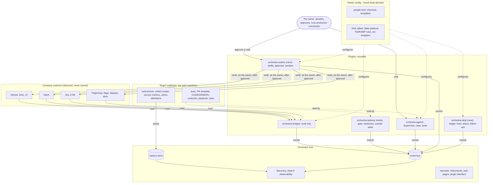

# Where each user story's parts belong

Status: draft for the owner's review, 2026-10-27. Not committed.

The owner asked: "explore these user stories and figure out which parts should be implemented in
Orchestra, which parts would be changes to Plugins, and which parts would be implemented in the
target codebase itself. Some of those things belong in the codebase, not in plugins or the core
orchestra app."

This document answers that for all 21 stories in `docs/user-stories.md`. It was checked against
the code and docs of the four repositories on 2026-10-27:

- `~/orchestra_2` at `8351ba68`;
- `~/orchestra-tasking` at `cf43592`;
- `~/orchestra-agents` at `413c2d4`;
- `~/orchestra-bridges` at `1c5530b`, with the Slack bridge on branch `slack-bridge`.

Where I am unsure, the text says so.

Contents:

1. [The layers, and the test for each](#1-the-layers-and-the-test-for-each)
2. [Placements every story relies on](#2-placements-every-story-relies-on)
3. [The stories, one by one](#3-the-stories-one-by-one)
4. [The matrix: stories × layers](#4-the-matrix-stories--layers)
5. [The shared building blocks, ranked](#5-the-shared-building-blocks-ranked)
6. [What the target codebase must provide](#6-what-the-target-codebase-must-provide)
7. [What is in the wrong place today](#7-what-is-in-the-wrong-place-today)
8. [Open questions for the owner](#8-open-questions-for-the-owner)

---

## 1. The layers, and the test for each

| Layer | Test | Where |
|---|---|---|
| **Core** | A generic mechanism that every user in any domain needs. If it names a ticket, a PR, Jira, Slack or an alert, it is not core. | `~/orchestra_2` |
| **Tasking** | Tickets and the work they track: the scheduler, roles offered work, the gate, worktrees, and waits on outside items. Reusable across codebases and companies. | `~/orchestra-tasking` (plugin `tasks`) |
| **Agents** | AI agents as machines: roles, prompts, tools, harnesses, the Supervisor. Reusable. | `~/orchestra-agents` (plugin `agents`) |
| **Bridges** | Reading other systems and publishing metadata-only events, read only. Reusable for any company that uses the product. | `~/orchestra-bridges` (plugin `bridges`) |
| **Outbox** (new plugin) | Anything written to another system as the owner: drafts, approval, earned autonomy, sending, audit. | proposed `~/orchestra-outbox` |
| **Desk** (new plugin) | One person's view over the bus: ledger, conditions board, morning brief, status page, follow-ups. | proposed `~/orchestra-desk` |
| **Target** | What belongs to the system being worked on: its instruments and domain metrics, its machines, its tests, templates, runbooks, playbook, worker roles. It lives in its repository. | the owner's work repository (7 GB) |
| **Owner config** | Personal or company specifics (D10): identities, channels, Jira templates, SAIL labels, FedRAMP rules, `arc` commands. Never in a shared repository. | proposed private repository `~/work-desk`, secrets in `~/.config` or the keychain, and a private company plugin only where code is needed |
| **Human** | The owner's own act. A machine may prepare it, never do it. | — |

---

## 2. Placements every story relies on

These are decisions this analysis makes once, so the per-story tables can be short. Each one
is a proposal for the owner, not a decision taken.

### 2.1 Orchestra is never a machine in a story

`docs/user-stories.md` lists `orchestra` as a machine that does "probes, routing, pings, labels,
pattern-matched triage". `docs/user-story-equations.md` puts "Orchestra programs" on 16 flows.
Rules 1 and 2 forbid this: Orchestra runs no machine beyond its host, and a machine is known only
by its events. Each of those flows needs a named machine in a plugin:

| Flow in the stories | Who should do it |
|---|---|
| Ping reviewers once a working day (1), nudge owners (3), nudge teammates (14), remind document reviewers (11) | Desk's **follow-up pacer**, which drafts into the Outbox; the Outbox enforces "at most one per person per day" |
| Route a change to my check, or auto-pass it, by trust (1) | Outbox **autonomy policy** per action kind |
| Add and re-apply the SAIL label (1, 9, 16) | Outbox action `github.label`, requested by Tasking's outside-wait rules |
| Triage a SAIL failure by known pattern (1) | Tasking's **outside-wait rules**, with the patterns from the owner config and the target |
| Capture lessons (1) | A `librarian` agent (custom role, Agents) woken by rejections and late flaws |
| A flaw found late goes back to diagnosis; a bug becomes a ticket (1) | Tasking (rejection returns work, D17); a planner agent for bugs from the Jira bridge |
| Verify the chain of authority (2) | A script in the owner config (company rules), run as a team tool |
| Runbook lessons (2) | The `librarian` again |
| Page shows the block; remembered surprises (3) | Desk's status page |
| Agent learns the code (4) | The review-brief agent writing to the codemap (Target) |

### 2.2 Anything written as the owner goes through the Outbox

The stories separate "Speak" (as me, through the outbox) from "Act" (push, open PR, label). On a
company GitHub, a push, a PR and a label are all done under the owner's identity. So both are
Outbox action kinds. "Act" just means a kind that starts on `auto` sooner. This keeps story 1's
functional test 3 true: "No other path pushes or opens PRs."

The Outbox is a **new plugin**, not part of Bridges:

- Bridges promise "read only, GET only", and their tests prove it. Keeping write tokens out of
  them keeps that promise.
- One place holds every write token and every audit record. FedRAMP will want that audit.
- Rule 9 says a human path that changes the system belongs to a plugin. Approving a draft is such
  a path.

The Outbox's senders could share the API clients with the bridges (`github/api.py` and the Slack
client). Where that code lives is open question 4.

### 2.3 Bridges carry metadata; agents need the text

Bridges never carry text: no titles, bodies or messages (their rule 1). But nearly every story
has an analyst that must read a Jira ticket, a Slack thread or a document. So agents need
**content access**: read-only tools for Jira, Slack, docs and PagerDuty, granted per role.

This belongs in **Agents**. The harnesses already speak MCP, so a role could be granted named
outside MCP servers. Each server carries a **data class**, and a role's model carries the classes
it is cleared for (story 12). Which servers exist, their tokens, the classes and the clearances
are the owner config. Agents can already read code and run `gh` in their worktree, so code and
diffs need nothing new.

### 2.4 Conditions are instruments; the board is the Desk

A "condition" (story 20's standing conditions, story 8's "no secret within 30 days", story 18's
prerequisites) is a measurement: a 0/1 level or a number such as seconds to expiry. Core already
takes these as `[[collect]]` scripts and stores them, and discovery reads 0/1 levels as flags
(`a24555ae`). So:

- the condition's **check** is an instrument: a `[[collect]]` script in the Target (its own
  domain) or in the owner config (company systems);
- the **board** that ranks false conditions, and the **remedy** (wake an agent, file a ticket,
  draft a message), is the Desk.

This replaces the "register" that `docs/proposals/orchestra-for-the-whole-job.md` put in core.

### 2.5 Scheduled engagements stay with Tasking, as recurring tickets

D7 gives datetime scheduling to the task system. I checked whether it belongs elsewhere:

- Core cannot hold it. A clock that wakes machines is a machine, and Orchestra runs none.
- A clock plugin of its own would be very small and generic. But every scheduled thing in the
  stories is a piece of work with an owner and a due time: the brief (20), the weekly update
  (15), the DR plan (18), the daily hygiene list (14), the weekly pattern search (2). A
  **recurring ticket** says that directly, gets BLOCKED when it fails, and shows in the brief.

So D7 stands: Tasking gains recurring tickets (a template and a schedule, which create a ticket
at the time). The Agents host then drops its own `every` and `at` timers (§7, item 1). A project
without Tasking would need a clock; that is open question 6.

### 2.6 Outside waits are Tasking's

G6 makes a ticket follow its pull request until it is merged. The same shape recurs: a ticket
waits on a Jira CCB ticket (10), a document's review (11), a port PR (16), a SAIL label (1).
Tasking gains one generic mechanism: **a ticket waits on an outside item**, named by the
bridges' `subject`. Rules in config say which events re-engage the worker, which resolve the
wait, and which re-request an action through the Outbox. The bridges already publish everything
this needs for pull requests (`ARCHITECTURE.md` §12.7 of the bridges).

### 2.7 The owner's config needs a place outside the work repository

Today a project has exactly one `orchestra.toml`, at the repository root
(`orchestra/config.py:load_project`), and the agents keep roles under `.orchestra/` in the same
repository. On the work repository that means either:

- the owner's Slack channels, Jira templates and identity map land in a repository the whole
  team shares, which D10 forbids; or
- Orchestra's files stay untracked, and the Supervisor's commits and the gate's `orchestra.toml`
  resolver stop working.

So **core needs a private overlay**: a second config file (for example named by an environment
variable or a path in the state directory) merged over `orchestra.toml`, and a way for Agents to
read `.orchestra/` from that overlay's repository. This is generic: anyone who uses Orchestra on
a shared repository needs it. See open question 1.

**Built in core (2026-10-27, SPEC §8.1):** `ORCHESTRA_CONFIG_OVERLAY`, else
`~/.orchestrator/<key>/orchestra.local.toml`, merged over `orchestra.toml` (tables key by key,
arrays of tables by `name`, `enabled = false` removes, `[overlay] secret` hides values on
`/api/project` and the Core page). **Changing it, in core too (2026-10-27, SPEC §8.2):**
`project.config_edit` sets keys and entries in `orchestra.toml` or the overlay, keeping comments
and validating the merged result. Tasking and Agents read their sections only from
`project.config` (the overlay merged), and the Supervisor's setup tools change configuration only
through `config_edit`, choosing the overlay for the owner's own settings and committing only
changes to `orchestra.toml`. Reading `.orchestra/` from the overlay's repository is not built.

---

## 3. The stories, one by one

Status words in the "Built?" column:

- **Built**: on `main` and tested.
- **Branch**: built on a branch, not merged.
- **Partial**: some of it exists; the cell says what is missing.
- **No**: not built. "Proposed" means a proposal or goal describes it.

### Story 1: a simple task for another team

| # | Step or capability | Layer | Where, and what | Built? |
|---|---|---|---|---|
| 1 | Someone asks on Slack or Jira | Bridges | Slack pings bridge (mentions, DMs, groups); Jira bridge (`jira.issue.created`, `.assigned`) | Slack: Branch. Jira: No (proposed, event-sources phase 3) |
| 2 | Collect the requirements | Human | The owner tells the Supervisor (Agents chat, rule 9) | Built (the chat) |
| 3 | Research; stakeholders; linked work | Agents + Target + Owner config | An `analyst` role (`.orchestra/roles/analyst.*`, Target); content access to Jira and Slack (§2.3, Agents change); CODEOWNERS (Target); the service catalogue's location (Owner config) | Roles: Built. Content access: No |
| 4 | Author a ticket with requirements and criteria | Agents + Outbox + Owner config | A `drafter` role; Outbox kind `jira.create`; the Jira template: type, label, points, project, sprint field (Owner config, G8 step 2). The internal ticket: Supervisor `create_ticket` (Tasking) | Internal ticket: Built. Rest: No |
| 5 | Implement on a branch | Tasking + Agents + Target | Code mode, worktree pool (G2), the worker; the playbook the worker reads (Target: `CLAUDE.md`/`AGENTS.md`); a branch command hook if `arc feature` must make the branch (Tasking change; the command is Owner config) | Code mode, pool: Built. Hook: No |
| 6 | Tests, internal AI review, rework | Tasking + Agents + Target | Worker → reviewer → same worker (D17); `[[gate.unit]]` as the worker's `unit_command`; the reviewer's checklist prompt (Target) | Built |
| 7 | PR description in the company format | Target + Owner config + Agents | `.github/pull_request_template.md` (Target); company rules such as the length limit and revert note (Owner config); test output from the review request (Tasking keeps `test_output`) | Template: Target's. Drafting: Partial |
| 8 | Approve and submit the PR | Human + Outbox + Tasking | Outbox kind `github.open_pr` (push and open), approved by the owner; Tasking's external-review path in place of the merge gate (G6) | No (G6 proposed) |
| 9 | PR checks fail; fix; push again | Bridges + Tasking + Outbox | `github.pr.check_completed` (Built); re-engage the same worker session (G6); the push as an `auto` Outbox kind; tell the owner after 3 failures (Tasking's escalation threshold, Built) | Partial |
| 10 | Company AI review; comments answered | Bridges + Tasking + Outbox | `github.pr.review_commented` (Built); re-engage (G6); replies as Outbox `github.reply` | Partial |
| 11 | Post for review in the channels | Agents + Outbox + Target + Owner config | Drafter; Outbox `slack.post`; which team owns the code (CODEOWNERS, Target); team → channel map and the "RR: link cc: @person" format (Owner config) | No |
| 12 | Ping reviewers once a working day | Desk + Outbox | Desk follow-up pacer reads `github_prs_awaiting_review` and `review_requested`; drafts; Outbox limits one per reviewer per day and stops at approval (story says "orchestra": wrong layer, §2.1) | No |
| 13 | Human review | Human (company) | Observed by the PR bridge | Built (observing) |
| 14 | Address comments until approved | Tasking + Agents + Outbox | One round per review (bridges §12.7 item 3); replies drafted; push; `github.request_review` | No (G6) |
| 15 | Add the SAIL label | Human, later Outbox | Outbox `github.label`; the label name is Owner config; earns `auto` by a run of unedited approvals | No |
| 16 | SAIL lands or fails | Human (company) | Observed: `github.pr.labelled`, `github.pr.merged` | Built (observing) |
| 17 | Triage a SAIL failure | Tasking + Owner config + Target + Outbox | Tasking outside-wait rule: a failing label checks the patterns; a known flake asks the Outbox to re-label (at most N, with backoff), anything else re-engages the worker with the log. SAIL's labels and infrastructure flakes: Owner config. Test flakes: Target (`.orchestra/flakes.toml`). How to fetch a SAIL log: unknown, probably a private company plugin | No |
| 18 | Draft the Jira comment, status and message | Agents + Outbox | Drafter woken by `github.pr.merged` | No |
| 19 | Approve and send | Human + Outbox | The Outbox page | No |
| — | BLOCKED, in the morning brief (test 12) | Tasking + Desk | BLOCKED is Tasking's (Built); the brief is the Desk's | Partial |
| — | Agent playbook (R-learning, B-decay) | Target + Agents + Tasking | Playbook files in the Target; a `librarian` agent woken by `changes.requested` and gate rejections; its tickets land like any change. Protect capture (gap 1.4): Tasking reserves capacity per worker kind (G3 extension) | No |
| — | Trust, autonomy | Outbox | The edit rate per action kind is the measured stand-in for "my trust" | No |
| — | Budget | Agents | Usage and cost series per role and ticket (H2), and a brake | No |
| — | The model's stocks | Core + each layer's instruments | Asks (bridges' levels), tickets (Tasking), PRs (`github_prs_awaiting_*`), outbox waiting (Outbox `/metrics`), playbook size (a Target `[[collect]]`) | Partial |

**Reusable here:** Outbox, outside waits (G6), the pacer, content access, worker kinds, the
librarian pattern. **Specific:** the Jira template, channels, SAIL, `arc feature`, the PR format.

**Wrong layer in the text:**

- `orchestra` at steps 12, 15 and 17, and "Orchestra programs" on nine flows in the equations
  (§2.1).
- The interface table puts "Push, open PR, label" under "Act", outside the outbox. They are
  written as the owner, so they go through the Outbox (§2.2).
- "My check" against "auto-pass" is a routing flow in the model. In the build it is an Outbox
  policy, not a machine.
- Tasking's gate lands by fast-forwarding the base branch and can push (`push = true`). On the
  work repository that must be off: SAIL lands.

### Story 2: a request to run a production command

| # | Step or capability | Layer | Where, and what | Built? |
|---|---|---|---|---|
| 1 | Someone asks | Bridges | Slack, Jira | Slack: Branch. Jira: No |
| 2 | Runbooks; what the command does; risk | Agents + Target | Analyst woken by the ask (Agents must wake on bridged events, §5 block 6); runbooks in the Target (`docs/runbooks/`) or the wiki (content access) | No |
| 3 | Verify the chain of authority | Owner config | A team tool script (`authority-check`) that reads Jira approvals, the change ticket and the org chart. The rules are the company's. Story says "orchestra": wrong layer | No |
| 4 | Root cause and context | Agents + Bridges + Owner config | Analyst; flag and deploy history (new bridges, not yet proposed); release calendars and the list of government and monthly environments (Owner config) | No |
| 5 | Decide | Human | — | — |
| 6 | Run it | Human only | The guarantee is the owner's environment: the machine the agents run on holds no bastion credentials or route. Agents cannot enforce it: harnesses run with permission checks off and path grants are only instructions (agents `ARCHITECTURE.md` §18) | Not enforceable today |
| 7 | Log it where the company sees it | Agents + Outbox + Desk | Drafter; Outbox `jira.comment` or `slack.post`; a ledger entry of kind "production command" (Desk) | No |
| 8 | File follow-ups per environment | Agents + Outbox + Owner config | Drafter; Outbox `jira.create`; the environment list (Owner config) | No |
| 9 | Patterns across requests | Desk + Agents + Tasking | Cases are ledger entries; a weekly recurring ticket for an analyst | No |
| 10 | Problem statements and proposals | Agents + Outbox + Human | Drafter; Outbox `doc.create`; the owner edits | No |
| 11 | The company adopts prevention | Human (company) | — | — |
| — | Runbooks learn (R-runbooks) | Target + Agents | Librarian tickets update the Target's runbooks; for a wiki, Outbox `doc.edit` | No |

**Reusable:** the brief pattern (event → analyst with content access → draft). **Specific:**
bastions, authority rules, environments, FedRAMP.

**Wrong layer or contradiction:**

- Step 3 has `orchestra` as the machine (§2.1).
- Test 3 ("no tool in the catalogue opens a session to production hosts") is true of the
  catalogue (`harness/tools.py` has no such tool) but proves little: every harness has a shell.
  The real test belongs to the owner's environment: no credentials, no network route. A sandbox
  (another OS user or a container) is an Agents change the story needs.

### Story 3: a manager asks for status

| Step or capability | Layer | Where, and what | Built? |
|---|---|---|---|
| The list of tracked projects | Owner config | `tracked.toml` in `~/work-desk`: each item and its Jira keys, docs, threads | No |
| Detect a change in a ticket, doc or thread | Bridges | Jira, docs and Slack bridges publish events with the item as `subject` | Jira, docs: No (proposed). Slack: Branch, pings only |
| Mark the entry stale; refresh within an hour | Desk + Agents | The status page marks entries whose subjects changed, and serves `desk_status_items{state}` on `/metrics`; an analyst summarises what changed | No |
| The status page | Desk | A plugin page: state, last change, owner, next step, blockers, links | No |
| Answer the manager in five minutes | Agents + Outbox | Supervisor reads the page (a tool), drafts; Outbox or the owner copies | No |
| Flag stale items at the source; nudge owners | Desk + Outbox | Pacer, with B-hygiene and R-nagging in mind | No |

**Reusable:** the status page and pacer. **Specific:** which projects, and who the manager is.
**Wrong layer:** "Orchestra programs" nudge owners and show the block (§2.1).

### Story 4: reviewing teammates' PRs

| Step or capability | Layer | Where, and what | Built? |
|---|---|---|---|
| A review is requested of me | Bridges | PR bridge, `github.pr.review_requested` with `reviewer`. Change: follow a PR when the owner is asked to review it (today it follows by branch glob or label) | Partial |
| A brief within an hour | Agents + Target | A `review-brief` agent (custom, ad hoc) woken by that event. Change: `wake_on` accepts only task and agent event types (`org.EVENT_TYPES`) and filters only `to`, `status`, `probe`, `subject`; it must accept bridged types and a filter on `reviewer` | No |
| The agent's map of the codebase (R-knowledge) | Target | `docs/codemap.md` or per-directory `AGENTS.md`, written by the agent through tickets. If the team will not take it, the owner's desk repository | No |
| Comments posted only on approval | Outbox | Kind `github.review_comment` | No |
| No agent approves a PR | Outbox | The Outbox has no "approve" kind, by design, and refuses one | No |
| The verdict | Human | — | — |
| Reviews given, goodwill | Core | Counted from `review_submitted` by `person.<owner>`; discovered | Built |

**Reusable:** all of it except the identity. **Specific:** none beyond the identity map.

### Story 5: a PagerDuty alert while on call

| Step or capability | Layer | Where, and what | Built? |
|---|---|---|---|
| The page | Bridges | A PagerDuty bridge (new; not in any proposal) | No |
| Change timeline by a program | Desk + Bridges + Owner config | A `timeline` program over the bus (`GET /events`, by time and subject) once deploys, flags and config changes are bridged; the service → repositories and flags map is Owner config | No |
| Within 60 s | Bridges | Polling at one minute cannot meet it. PagerDuty webhooks need a relay (bridges phase 4) | No |
| On-call for dependencies; similar past alerts | Agents | Content access to PagerDuty; past alerts from the ledger | No |
| The usefulness comment | Agents + Outbox | Drafter; Outbox `jira.comment`, the first candidate for `auto` | No |
| Declare an incident; incident command | Human | — | — |

**Wrong layer:** "orchestra programs" do the enrichment; it is the Desk's timeline over bridged
events. The story is right that it must be a program, not a model call.

### Story 6: incident to postmortem to action items

| Step or capability | Layer | Where, and what | Built? |
|---|---|---|---|
| The timeline | Desk + Agents | The timeline program; the Slack text needs content access | No |
| The draft report | Agents + Outbox | Drafter; Outbox `doc.create` | No |
| Conclusions | Human | — | — |
| Action items filed with owners | Agents + Outbox | Outbox `jira.create` | No |
| Weekly progress, or in the brief | Tasking + Desk | A weekly recurring ticket; the brief | No |
| Latent risk (open action items) | Bridges + Core | The Jira bridge serves open counts on `/metrics`; discovery makes it a stock | No |

### Story 7: a feature-flag ramp to approve

| Step or capability | Layer | Where, and what | Built? |
|---|---|---|---|
| Ramp requests | Bridges | A flags bridge (new), or Jira if ramps are tickets | No |
| The brief: guarded code, schedule, watched metrics, rollback, past ramps | Agents + Core | Analyst; metric values from the company's Prometheus through `[[sources]]` (Core, Built). Change: an agent tool to query a source (today `list_metrics` reads only the own store) | Partial |
| Test coverage of the guarded code | Target | A coverage command | Target's |
| Decide | Human | — | — |
| Record what was checked | Desk + Outbox | Ledger entry; the comment through the Outbox | No |
| Change failure falls as ramp review rises | Core | A declared coupling: a prior (D4), an assumption until fitted (rule 6); the coupled model (H4) | No |

### Story 8: a secret about to expire

| Step or capability | Layer | Where, and what | Built? |
|---|---|---|---|
| Find expiry 30 days ahead, no model calls | Owner config or Target | A `[[collect]]` script that reads the secret store's metadata and prints `secret_expiry_seconds{secret}`. It is the Target's if the repository declares its secrets, else the owner's | No (the mechanism is Built) |
| A ticket when it is too near | Desk + Tasking | The Desk's remedy files a ticket through Tasking's request (`task.requested`), once per secret | No |
| The rotation | Story 1 | — | — |

**Wrong layer:** "a pure program probe" is right; it is an instrument plus a Desk remedy, not
Orchestra.

### Story 9: a long-haul project as stacked PRs

| Step or capability | Layer | Where, and what | Built? |
|---|---|---|---|
| Problem Statement → Proposal → Design | Story 11 | — | — |
| CCB approval | Story 10 | — | — |
| A chain of stacked PRs | Tasking | `depends_on` (Built); branch from the parent's branch with git-spice (G7, D8) | No |
| Rebase and retest on a parent's move | Tasking | A reconciler: restack, retest with `[[gate.unit]]`, debounce (corporate-workflow §6) | No |
| Conflicts to the implementer | Tasking + Agents | As gate conflicts today | Built for the gate |
| Restack onto the squash commit | Bridges + Tasking | `github.pr.merged` carries `merge_commit` (Built); Tasking restacks | Partial |
| Each PR lands through review and SAIL | Story 1 | — | — |
| Unreviewed depth cap | Tasking | A config value | No |
| Does a push dismiss approvals? | Owner config | A fact about the company repository; it decides the refresh policy | Unknown |

**Wrong layer:** `docs/proposals/corporate-workflow.md` puts the reconciler, `[codehost]`,
`[landing] label = "SAIL"` and `[tracker] kind = "jira"` in Orchestra's config, written before
the split. Today: the reconciler is Tasking's; the label names and tracker are Owner config.

### Story 10: a FedRAMP change through CCB

| Step or capability | Layer | Where, and what | Built? |
|---|---|---|---|
| Draft the CCB ticket from the design and PRs | Agents + Owner config + Outbox | Drafter; the CCB template (Owner config); Outbox `jira.create` | No |
| Track it to approval | Bridges + Tasking | Jira transitions; a ticket waits on the outside Jira item (§2.6) | No |
| No rollout without approval | Tasking + Desk + Human | The owner's own rollout step is a ticket that depends on the outside item; the Desk condition "rollout without an approved CCB" warns | No |

**Contradiction:** "a missing approval blocks the rollout step" can hold only for the owner's own
plan. Orchestra cannot block a company pipeline; it can warn, and the owner (a human act) or the
company's pipeline blocks.

### Story 11: Problem Statement → Proposal → Design, with reviewers

| Step or capability | Layer | Where, and what | Built? |
|---|---|---|---|
| Drafts from my notes | Agents + Owner config | Drafter; the notes live in the owner's desk repository | No |
| Reviewers by ownership | Target + Owner config | CODEOWNERS for code; teams for docs | No |
| Comment threads to resolution | Bridges | A docs bridge (Confluence or Google Drive comments: metadata) | No (proposed) |
| Who owes a response | Desk | A page of open documents and their unresolved threads | No |
| Reminders paced like pings | Desk + Outbox | The pacer | No |

### Story 12: a FedRAMP customer bug ticket

| Step or capability | Layer | Where, and what | Built? |
|---|---|---|---|
| The ticket arrives | Bridges + Owner config | Jira bridge on the FedRAMP instance (a second `[bridges.jira]` entry) | No |
| Summary, links to known issues and changes | Agents | Analyst with content access | No |
| Customer data never reaches a model not cleared | Agents + Owner config | Data classes on each content source and clearances per model (§2.3); a refusal is recorded | No |
| Requested commands | Story 2 | — | — |
| SLA | Bridges + Core | The bridge serves waiting and oldest age; discovery makes the stock | No |

### Story 13: a Slack question about my code

| Step or capability | Layer | Where, and what | Built? |
|---|---|---|---|
| The question | Bridges | Slack ping | Branch |
| An answer from code, README and history, with links | Agents + Target | Analyst with Slack content access; the Target's code and module READMEs | No |
| Answers to repeated questions become README additions | Tasking + Target | A ticket on the Target | Partial (tickets Built) |
| Send | Outbox | `slack.reply` | No |

### Story 14: teammates' stale PRs and Jira hygiene

| Step or capability | Layer | Where, and what | Built? |
|---|---|---|---|
| Teammates' PRs waiting N days | Bridges + Owner config | PR bridge must follow PRs by author team (the team is in `people.toml`) | Partial |
| Tickets in progress with no activity | Bridges | Jira bridge | No |
| The daily list | Desk + Tasking | A Desk page, from a daily recurring ticket | No |
| Nudges, one click, at most one per person per day | Desk + Outbox | Pacer and Outbox limits | No |

**Specific:** who is on the team (Owner config). Everything else is reusable.

### Story 15: the weekly update and the monthly slide

| Step or capability | Layer | Where, and what | Built? |
|---|---|---|---|
| The ledger: landed, reviewed, prevented, with links | Desk | Entries built from bridged events by `person.<owner>` and from the Outbox audit | No |
| Draft a day before due | Tasking + Agents | Recurring ticket; drafter | No |
| Format of the update and slide | Owner config | Templates | No |
| Deliver | Outbox | `doc.create`, slides | No |
| Present | Human | — | — |

### Story 16: a port to a release branch

| Step or capability | Layer | Where, and what | Built? |
|---|---|---|---|
| The landed squash commit | Bridges | `merge_commit` on `github.pr.merged` | Built |
| Cherry-pick onto a branch from the release branch | Tasking | A ticket kind `port` with a start ref (corporate-workflow §11) | No |
| `arc port` or the PORT label | Owner config | A wrapper script, or the label name; what they do is unknown (corporate-workflow question 4) | Unknown |
| Conflicts to the implementer | Tasking + Agents | As the gate's | Built for the gate |
| The release branch's own tests | Target + Tasking | The commands at that ref. Tasking reads `[[gate.unit]]` from the root's `orchestra.toml`, not the ref's: a change | No |
| Tracked to landed | Story 1 | — | — |

### Story 17: a check on a release branch

| Step or capability | Layer | Where, and what | Built? |
|---|---|---|---|
| A detached worktree at a ref, no branch, no PR | Tasking | A ticket kind `check` with a ref; the pool can already make detached worktrees (`git worktree add --detach`) | Partial |
| Run the checks; a report | Agents + Target | Worker; the Target's commands | Built (worker) |
| Delete the worktree; push nothing | Tasking | Tasks never push with `push = false` | Built |

### Story 18: the monthly disaster-recovery exercise

| Step or capability | Layer | Where, and what | Built? |
|---|---|---|---|
| The plan two weeks ahead, from last month's | Tasking + Agents | Recurring ticket; drafter reads last month's record | No |
| Prerequisites checked by probes | Owner config + Desk | Condition scripts as instruments; the board | No |
| A checklist during the exercise | Desk | A page | No |
| Run the exercise | Human | — | — |
| File the record | Outbox | `doc.create` or `jira.comment` | No |

### Story 19: a small improvement with measured impact

| Step or capability | Layer | Where, and what | Built? |
|---|---|---|---|
| The target metric's baseline | Target + Core | An instrument for the metric; the store or `[[sources]]` | Built (mechanism) |
| A written prediction | Core + Agents | `orchestra sd whatif` and `POST /api/dynamics/whatif` (Built, `b7763056`); the agents' tool and the expected-effect note (G5) | Partial |
| The change | Story 1 | — | — |
| Remeasure; verdict | Core | Eras and the intended-effect test (H1, H4, `rationale/lifted-models.md`) | No |
| The slide | Outbox | — | No |

This is the one story whose new work is mostly core, and all of it is generic.

### Story 20: the morning brief

| Item on the brief | Layer | Where | Built? |
|---|---|---|---|
| False conditions, ranked | Core + Desk | Instruments; the Desk ranks | Partial |
| Overnight alerts and outages | Bridges | PagerDuty bridge | No |
| What waits for my approval | Outbox | Its waiting drafts | No |
| My PRs stuck, and why | Bridges + Tasking | `github_prs_awaiting_*`; tickets' outside waits; BLOCKED | Partial |
| Reviews owed | Bridges | `review_requested` for the owner | Built (events) |
| Deadlines | Bridges | Jira due dates; a calendar bridge if wanted | No |
| Ready by a set time | Tasking | A recurring ticket (D7) | No |
| One cheap summarising pass | Agents | A role on a cheap model | Built (roles) |
| The page | Desk | Built by a program, linking every item | No |

### Story 21: a junior engineer asks for help

| Step or capability | Layer | Where, and what | Built? |
|---|---|---|---|
| The ask | Bridges | Slack ping | Branch |
| A context note within 15 minutes | Agents | Analyst; their PR via `gh`; the thread via content access | No |
| Nothing is sent to them by an agent | Agents | The role is granted no Outbox kind. The note goes only to the owner (Supervisor chat or the Desk) | No |
| The coaching | Human | — | — |

---

## 4. The matrix: stories × layers

`●` the story needs something new or changed here. `○` it uses what is built. Blank: not
involved.

| Story | Core | Tasking | Agents | Bridges | Outbox | Desk | Target | Owner config | Human |
|---|---|---|---|---|---|---|---|---|---|
| 1 Simple task | ○ | ● G6, G3, branch hook, flake rules | ● roles, content, usage | ● Jira; Slack merge | ● | ● pacer, brief | ● playbook, PR template, tests, CODEOWNERS | ● Jira template, channels, SAIL | requirements, approvals |
| 2 Production command | ○ | ● recurring | ● wake on events, content, sandbox | ● Jira, flags, deploys | ● | ● ledger | ● runbooks | ● authority, environments | decide, **run** |
| 3 Status | ○ | | ● content | ● Jira, docs | ● | ● status page, pacer | | ● tracked list | send |
| 4 Reviews given | ○ | | ● wake on events | ● follow review requests | ● | | ● codemap | ○ identity | verdict, wording |
| 5 PagerDuty alert | ○ | | ● content | ● PagerDuty, deploys, flags, webhooks | ● | ● timeline | | ● service map | declare, command |
| 6 Postmortem | ○ | ● recurring | ● content | ● Jira, PagerDuty | ● | ● timeline, brief | | | conclusions |
| 7 Flag ramp | ● priors | | ● source query tool | ● flags | ● | ● ledger | ● coverage | | decide |
| 8 Secret expiry | ○ | ○ | | | ○ | ● remedy | ● if declared | ● collect script | |
| 9 Stacked PRs | ○ | ● G7, reconciler | ○ | ○ | ● | | ● tests | ● SAIL, dismissal fact | review (company) |
| 10 CCB | ○ | ● outside wait | ○ | ● Jira | ● | ● condition | | ● CCB template | rollout |
| 11 Documents | ○ | | ● content | ● docs | ● | ● threads, pacer | ○ CODEOWNERS | ● notes | |
| 12 Customer ticket | ○ | | ● data classes, sandbox | ● Jira (FedRAMP) | ● | | | ● classes, clearances | run |
| 13 Slack question | ○ | ○ | ● content | ○ Slack | ● | | ● READMEs | | |
| 14 Hygiene | ○ | ● recurring | | ● follow by team; Jira | ● | ● list, pacer | | ● team | one click |
| 15 Weekly, monthly | ○ | ● recurring | ○ | ● Jira | ● | ● ledger | | ● templates | present |
| 16 Port | ○ | ● port kind, tests at a ref | ○ | ○ | ● | | ● release tests | ● `arc port` | |
| 17 Release check | ○ | ● check kind | ○ | | | | ● tests | | |
| 18 DR exercise | ○ | ● recurring | ○ | | ● | ● board, checklist | | ● prerequisite scripts | run it |
| 19 Measured improvement | ● eras, intended-effect | ○ | ● G5 tool | | ● | | ● metric instrument | | |
| 20 Morning brief | ○ | ● recurring | ○ | ● PagerDuty, Jira | ○ | ● brief | | ● conditions | |
| 21 Junior help | ○ | | ● content, no-send grant | ○ Slack | | ○ | | | coaching |

What each layer must provide, read down a column:

- **Core:** little that is new. Priors (D4), eras and the intended-effect test, and the private
  config overlay (§2.7). Everything else the stories need from core is built: the bus, the events
  endpoint, instruments, sources, discovery, what-if.
- **Tasking:** outside waits (G6 generalised), worker kinds (G3), recurring tickets (D7), ticket
  kinds `check` and `port` with a start ref, git-spice stacks (G7), a branch command hook.
- **Agents:** content access with data classes, waking on any bridged event, the what-if and
  source-query tools (G5), usage and cost series, and a sandbox.
- **Bridges:** Jira first, then docs, PagerDuty, flags and deploys; merge Slack; follow PRs by
  reviewer and by author team.
- **Outbox and Desk:** new, used by 19 and 13 stories respectively.

---

## 5. The shared building blocks, ranked

Ranked by how many stories each one unlocks, counted from the matrix. Sizes are rough: S is
days, M about a week, L two to three weeks, each with fakes and tests as the repositories'
rules require.

**Preconditions** come before the ranking, because without them nothing runs on the work
repository at all:

| Precondition | Layer | Size | Why |
|---|---|---|---|
| Private config overlay | Core (+ Agents reads `.orchestra/` from it) | S | §2.7; open question 1 |
| Merge the Slack bridge | Bridges | S | Built and tested on `slack-bridge`; the asks arrive there |
| Usage and cost series per role and ticket, and a brake | Agents | S–M | The budget stock in every story's model (H2); desk tests D.3, D.4 |

**The ranking:**

| # | Building block | Stories | Count | Layer | What it is | Size |
|---|---|---|---|---|---|---|
| 1 | **Outbox** | 1–16, 18–20 | 19 | New plugin `orchestra-outbox` | Drafts with exact text and target; an approval page (phone-friendly); a policy per action kind (`draft` or `auto`), earned by a run of unedited approvals and lost on a discard; per-recipient limits; an audit log; senders for GitHub, Slack and Jira; `/metrics` for drafts waiting and edit rates | L |
| 2 | **Content access for agents, with data classes** | 1, 2, 3, 5, 6, 7, 10, 11, 12, 13, 15, 18, 21 (+4 by `gh`) | 13 | Agents (mechanism); Owner config (servers, tokens, classes) | Grant a role named read-only outside tools (MCP servers); each carries a data class; each model carries clearances; refusals recorded | M |
| 3 | **Desk** | 1, 2, 3, 5, 6, 7, 8, 10, 11, 14, 15, 18, 20 | 13 | New plugin `orchestra-desk` | Ledger (from events), conditions board and remedies (over instruments), morning brief, status page, follow-up pacer, timeline. Can be built in that order, one part at a time; it may split later | L |
| 4 | **Jira bridge** | 1, 2, 3, 6, 8, 10, 12, 14, 15, 20 | 10 | Bridges (new bridge) | `jira.issue.created`, `.transitioned`, `.assigned`, `jira.comment.added`; waiting levels on `/metrics`; two instances (team and FedRAMP) | M |
| 5 | **Worker kinds and per-item roles (G3)** | 1, 6, 8, 9, 10, 11, 15, 16, 17, 18, 19 | 11 | Tasking (offer by kind, reserved capacity); Agents (fill by role); Target (the roles' prompts and tools) | `analyst`, `drafter`, `implementer`, `librarian`, frontend and backend as kinds | S–M (in progress) |
| 6 | Wake an agent on any bridged event | 2, 3, 4, 5, 7, 12, 13, 21 | 8 | Agents | `wake_on` takes any observed type and filters on named data fields | S |
| 7 | Recurring tickets (D7) | 2, 6, 14, 15, 18, 20 (+3) | 7 | Tasking | A template and a schedule; the Agents host's own timers go | S |
| 8 | Outside waits (G6, generalised) | 1, 8, 9, 10, 16 (+11, 19 through 1) | 7 | Tasking | A ticket waits on an outside subject; config rules map events to re-engage, resolve, or request an Outbox action; flake patterns | M–L |
| 9 | Docs bridge (Confluence or Google Drive) | 2, 3, 6, 11, 15, 18 | 6 | Bridges | Edits and comments, metadata only | M |
| 10 | PagerDuty, flags and deploys bridges, and the timeline | 2, 5, 6, 7, 12, 20 | 6 | Bridges; timeline in Desk | Which flag and deploy products is unknown (open question 7) | M each |
| 11 | Core model work: priors, eras, intended-effect test | 1, 2, 7, 19, the desk model | 5 | Core | H1 and H4 already plan them | L |
| 12 | Ticket kinds `check` and `port`, a start ref, tests at a ref | 16, 17 (+9) | 3 | Tasking | Corporate-workflow §11 | M |
| 13 | git-spice stacks and the reconciler (G7) | 9 | 1 | Tasking | — | L |
| 14 | A sandbox for agents | 2, 12 | 2 | Agents, and the owner's machine | Another OS user or a container; no production routes | M |

**The top five, placed:**

1. **Outbox:** a new plugin, `orchestra-outbox`. Size L.
2. **Content access with data classes:** a change to `orchestra-agents`; the servers, tokens and
   classes are the owner's config. Size M.
3. **Desk:** a new plugin, `orchestra-desk`. Size L, built in parts.
4. **Jira bridge:** a new bridge in `orchestra-bridges`, not a plugin of its own: it follows the
   bridge pattern (bridges `ARCHITECTURE.md` §9) and Jira is a product many companies use. Size M.
5. **Worker kinds (G3):** `orchestra-tasking` and `orchestra-agents`, with the roles themselves in
   the target. Size S–M.

H3 starts with story 1, which needs blocks 1, 2, 4, 5 and 8, and the Desk only for the pacer and
the brief. So the build order for H3 differs from the ranking: outside waits (8) come before the
Desk.

---

## 6. What the target codebase must provide

A checklist for the owner's 7 GB work repository. "Agents can write it" means a worker, the
Supervisor (G4) or a librarian can produce it through a ticket, as G4 and G5 expect; anything
committed to the shared repository still goes through the company's review.

| # | Item | Files in the repository | Agents can write it? |
|---|---|---|---|
| 1 | **Instruments for its domain stocks**: counts the work changes, named for what they measure (UC-3b) | `[[collect]]` scripts under `scripts/orchestra/` (Prometheus text); `[[scrape]]` of a service's `/metrics`; `[[sources]]` series definitions for the company's Prometheus or Chronosphere | Yes: Supervisor `set_collector` (Built); workers write the scripts (G5 guidance) |
| 2 | **Domain metrics in the services**, where the code can count what matters | the services' own `/metrics` code | Yes, as ordinary changes through story 1 |
| 3 | **Test commands** that run in one worktree in reasonable time: the fast tier the worker runs before review | `[[gate.unit]]` | Yes: Supervisor `set_gate_unit` (Built) |
| 4 | **The gate in work mode**: no landing (SAIL lands), `push = false`, `reuse_worktrees = true` with a small `worktree_pool` (G2), `worktree_clean_ignored = false` to keep build caches | `[project]`, `[tasks]` | Partly: the Supervisor sets capacity and gate units; G6's external-review switch is not built |
| 5 | **Worker roles, prompts and tool grants** (G3): analyst, drafter, implementer, librarian, review-brief, and kinds such as frontend and backend | `.orchestra/roles/<name>.json` and `.md`, `.orchestra/agents/`, `.orchestra/teams/`, `[agents] prompts` | Yes: the Supervisor's `roles` tools (Built) |
| 6 | **Project context** | `.orchestra/PROJECT.md` | Yes: `update_project_context` (Built) |
| 7 | **The agent playbook** (story 1's R-learning): conventions, traps, how to test each area | `CLAUDE.md` and `AGENTS.md` at the root and per directory, which Claude Code and Codex read; or `.orchestra/playbook/` | Yes: the librarian, through tickets. Its size is an instrument (item 1) |
| 8 | **A PR template** | `.github/pull_request_template.md` | Yes, but it is the team's: propose, do not impose |
| 9 | **Ownership** | `.github/CODEOWNERS`; the service catalogue's location | No: the team's. Read only |
| 10 | **Runbooks** (story 2) | `docs/runbooks/<service>.md`, or the wiki | Yes, drafts; the owner and team approve |
| 11 | **Module READMEs** (story 13) | `README.md` per module | Yes, proposed from repeated questions |
| 12 | **A codemap** for review briefs (story 4) | `docs/codemap.md` or per-directory `AGENTS.md` | Yes |
| 13 | **Known test flakes** | `.orchestra/flakes.toml` (test name or log pattern → retry rule) | Yes: whoever fixes a case teaches the file |
| 14 | **CI checks** | `.github/workflows/` | No: the company's. Orchestra reads results through the PR bridge |
| 15 | **Checks beyond CI** (acceptance, performance; corporate-workflow R7) | local commands in `orchestra.toml` | Yes |
| 16 | **Coverage command** (story 7) | a script | Yes |
| 17 | **Machines it runs locally** (a dev service for acceptance checks) | `[[machines]]` | Yes: Supervisor `set_machine` (Built) |
| 18 | **Secrets it declares** (story 8), if the repository declares them | a `[[collect]]` script | Yes |
| 19 | **Where Orchestra's own files live**: committed, or kept out | `.gitignore` or `.git/info/exclude`, or the overlay (§2.7) | No: the owner decides (open question 1) |

What the target must **not** hold: identities, channel names, Jira templates, SAIL label names,
FedRAMP rules, `arc` wrappers, tokens. Those are the owner config (D10).

---

## 7. What is in the wrong place today

Reported, not changed.

### In the code

1. **The Agents host keeps its own timers.** `host._schedule_wakeups` serves `every` and `at` on
   agents, and `[agents] coordinator_every`. D7 gives scheduling to the task system. Already
   planned for H2; still present at `413c2d4`.
2. **Two probe runners in two plugins.** Tasking runs `[[probes]]` (`tasking/probes.py`) and
   Agents runs team `probes` (`orchestra_agents/probes.py`). Both publish `probe.failed` and
   `probe.recovered`. Neither is about tickets or agents. A condition is a measurement, which
   rule 7 makes an instrument. I suggest conditions become `[[collect]]` instruments (0/1 or a
   value) and the Desk (or any listener) reacts to them. Medium confidence: the events let
   agents wake on a condition today, which instruments cannot do without a listener.
3. **Machines write their own metrics.** Rule 7 says "a machine does not produce metrics" and
   "the metrics store is filled by instruments directly". Yet Tasking's scheduler
   (`tasking/measures.py`), the Agents host (`orchestra_agents/measures.py`) and the GitHub issues
   bridge (`github/measures.py`) write points through `orchestra.metrics` from the machine's own
   process. `PLUGINS.md` §6.4 says this "also works". The Slack and PR bridges already serve
   `/metrics` for an instrument the plugin declares. The rule and the docs disagree; the owner
   should say which wins. Tasking no longer does (2026-10-27): its measurements come from the
   instrument `tasks.tickets` its plugin declares; the Agents host and the GitHub bridge still do.
4. **Tasking's staging** (`tasking/staging.py`, with a cloudflared tunnel) deploys the target's
   build. That is the target's or a deployment plugin's job more than a task system's. Low
   confidence; it serves personal projects where the gate lands.
5. **Tasking claims generic config names** (`[project]`, `[gate]`, `[staging]`), and Agents reads
   `[project]` too. Already listed in `PLUGINS.md` §13 item 4.
6. **Agents commit to the base branch.** The Supervisor's setup tools and
   `roles.commit_orchestra_files` commit `orchestra.toml` and `.orchestra/` to the base branch.
   On a repository that only SAIL lands, that makes local commits on `master` that differ from
   the remote. The overlay (§2.7) would fix it; until then it is a hazard on the work repository.
7. **Agents can wake only on task and agent events** (`org.EVENT_TYPES`). A team may declare
   `emits`, but only as new names. So Agents knows the task system's vocabulary and no other, and
   no agent can be woken by a bridged event. A gap more than a misplacement (§5 block 6).
8. **Core**: `sd/fit.py:running_intervals` reads `loop_started` events from the old task loop
   (rule 1). Already listed in `ARCHITECTURE.md` as a known departure.

### In the docs

9. `docs/user-stories.md` lists `orchestra` as a machine, and `docs/user-story-equations.md`
   puts "Orchestra programs" on 16 flows (§2.1).
10. `docs/user-stories.md` says the fakes of each company system are "for the Orchestra
    implementation". They belong in the repositories that talk to those systems: Bridges and the
    Outbox.
11. `docs/proposals/orchestra-for-the-whole-job.md` puts the desk, sources, register, workflows,
    outbox, ledger and data classes under `orchestra/` and changes core invariants. It predates
    the empty Orchestra and D10, and is not marked superseded. Its components are, in today's
    terms: Desk, Bridges, instruments plus Desk, Tasking, Outbox, Desk, Agents.
12. `docs/proposals/corporate-workflow.md` puts `[codehost]`, `[landing]`, `[tracker]` and the
    reconciler in Orchestra, and says "the core never knows which implementation". Today: the
    reconciler and landing are Tasking's; GitHub and Jira are Bridges and the Outbox; `SAIL` is
    the owner's config.
13. The interface table in `docs/user-stories.md` puts "Push, open PR, label" under "Act",
    outside the outbox (§2.2).

---

## 8. Open questions for the owner

1. **Where do Orchestra's files live on the work repository?** Committed to the shared repository
   (the team sees `orchestra.toml` and `.orchestra/`), kept untracked, or in a private overlay
   (§2.7, which needs a small core change)? Everything in §6 depends on this.
2. **Will the team take the target's share?** A PR template, a codemap, runbooks and `AGENTS.md`
   help the whole team, but they are the team's files. Which may agents propose there, and which
   stay in your desk repository?
3. **Is the Outbox one plugin, or is it part of Bridges?** This analysis says a new plugin
   (§2.2). Do you agree that pushes, PRs and labels are Outbox kinds too, so that nothing writes
   as you by any other path?
4. **Where do the senders' API clients live?** Copied into the Outbox, or a small shared library
   with Bridges?
5. **What is SAIL, technically?** How does it report failure (a label, a check, a comment), and
   where are its logs? This decides whether a private company plugin is needed, or only config.
   The same for `arc feature` and `arc port` (corporate-workflow questions 1 and 4 are still
   open).
6. **Recurring tickets for every scheduled thing, or a separate clock?** This analysis keeps D7
   and puts schedules in Tasking as recurring tickets. A project without Tasking would then have
   no clock.
7. **Which flag, deploy and on-call products** does the company use (stories 2, 5, 6, 7)? And
   may their APIs be read from your machine?
8. **Which content may agents read, and with which models?** Data classes and clearances for
   Jira, Slack, docs and the FedRAMP instance (stories 1, 12; charter §8).
9. **Should the Desk be one plugin or several?** Ledger, brief, status page and pacer share one
   reader of the bus; they could split once each is used.
10. **Rule 7 and plugins' own metrics** (§7 item 3): should Tasking, Agents and the GitHub issues
    bridge serve `/metrics` for a declared instrument, as the newer bridges do?
11. **Where do agents run?** Story 2 needs a machine with no route to bastions. Is your laptop
    such a machine, or does that need another OS user or a container?
