# User-story diagrams

Generated by `node docs/models/render.mjs`. Don't edit by hand. The source of everything here
is `models/build.py`; run `build.py`, `check.mjs` and `render.mjs` after changing it. Every flow's
equation is in `user-story-equations.md`.

Stories and their acceptance tests are in `user-stories.md`; assumptions in `models/README.md`.

**Where the numbers come from.** Every equation, initial value, input, variant, chart and measure
was written by hand (by Claude, from what you described of your work) in `models/build.py`.
They are planning estimates, not measurements, and nothing here was fitted or discovered from
data. The simulation is deterministic: the same files always give the same charts. Each chart
lists the measure it plots and the formula used to compute it.

**How to read the diagrams.**

- **Boxes are stocks.** They're blue in our band, amber in the interface (where work crosses into
  company systems, and my outbox), and grey in the company band (observed, not owned). Dashed
  boxes are information stocks.
- **Arrows are flows,** coloured by the machine that runs them, named under each label. A flow
  that splits shows its share on each branch. Clouds are outside the model.
- **Dashed cyan lines are effects:** a stock that speeds or slows a flow. These are the feedback
  loops.
- **The agent budget is left out of the diagrams** to keep them readable. Every agent flow draws
  on it.

## Story 1: simple tasks, done by agents that learn

Other teams ask me for simple tasks. I collect the requirements; agents research, write the ticket, attempt it, and learn from failures by writing their own playbook. Whether an attempt succeeds, fails, or hides a flaw depends on the playbook and the code's debt. My trust in the agents decides how much I check; what I don't check goes to the company, whose checks and reviewers catch some flaws and miss others, which land and come back as bugs. Delivering builds requesters' confidence, which brings more asks. Time unit: a working hour; horizon 26 weeks.

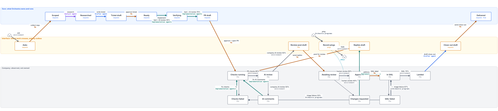

### Feedback loops

| Loop | Type | Through | What it does |
|---|---|---|---|
| R-learning | reinforcing | Failed or caught → Lessons not written down → Agent playbook → Attempted | Failures become lessons; lessons become playbook; a better playbook means fewer failures and flaws. |
| B-decay | balancing | Agent playbook → Landed recently | The playbook goes stale as the code it describes changes; the faster we land, the faster it rots. |
| B-overload | balancing | Agent playbook | Past about 120 entries a bigger playbook lowers success: too much context. |
| R-trap | reinforcing | Open tickets → Lessons not written down → Agent playbook | When the backlog is long, lessons are not captured; the playbook decays; more work fails; the backlog grows. |
| B-trust | balancing | My trust in the agents → To check (flawed) → In review (flawed) → Landed with a hidden flaw → Bugs found in production | Clean landings raise trust; trust lowers how much I check; more flaws escape; late findings cut trust. |
| B-fatigue | balancing | In review (sound) → In review (flawed) | A long review queue slows reviewers and lowers how many flaws they catch. |
| R-debt | reinforcing | Technical debt → Attempted → Landed with a hidden flaw | Landings, especially flawed ones, add debt; debt slows attempts and raises flaws; paying it down competes for agents. |
| R-reputation | reinforcing | Requesters' confidence → Asks → Landed recently | Delivering builds requesters' confidence, which brings more asks; bugs erode it. |

### Starting state and drivers

Every stock starts at 0 except: Requesters' confidence 20 points; Asks 4 requests; Open tickets 2 requests; Agent playbook 20 entries; Technical debt 20 points; My trust in the agents 30 points; Agent budget 120 dollars.

Flows into the model from outside (the drivers). None is a waveform unless it reads an input:

| Flow | Rate |
|---|---|
| ask → “Asks” | 0.06 + 0.003 × “Requesters' confidence” per hour  |
| confidence grows → “Requesters' confidence” | 0.05 × “Landed recently”  |
| debt added → “Technical debt” | 0.01 × “Landed recently” + 0.1 × “Landed with a hidden flaw” per hour × “Agent playbook” effect (0→1.5, 60→0.7, 150→0.6) |
| trust earned → “My trust in the agents” | 0.03 × “Landed recently” × “My trust in the agents” effect (0→1, 80→0.5, 100→0) |
| weekly budget → “Agent budget” | 3 per hour (120 a week)  |

**Variants** (each starts from the designed model and changes only what's listed):

- **manual**: Today: I research, implement and fix everything myself. I check my own work as I go, so nothing is routed for a separate check. My know-how stays where it is: nobody writes a playbook, and nothing decays. *Changes:* “research”: on me, 1.5 h each; “attempt”: on me, 4 h each; “diagnose + requeue”: on me, 0.75 h each; “write playbook”: nobody does it; “route to my check”: nobody does it; “route to my check”: nobody does it; “auto-pass”: no effects; “auto-pass”: no effects; “fix nits”: on me, 0.75 h each; “pay down debt”: on me, 1 h each; “capture lessons”: nobody does it; “goes stale”: nobody does it.
- **no-learning**: Agents, but nobody writes the playbook: failures are fixed and forgotten. *Changes:* “write playbook”: nobody does it.
- **surge**: Twice the asks from week one (a reorganisation sends everything my way). *Changes:* “ask”: rate 0.2 + 0.003 × “Requesters' confidence” per hour.
- **surge-protected** (from surge): The surge, with lesson capture protected: lessons are written down however long the backlog. *Changes:* “capture lessons”: no effects.
- **blind-trust**: Agents, starting with high trust (80): I check little from day one. *Changes:* “My trust in the agents” starts at 80.

### Simulation

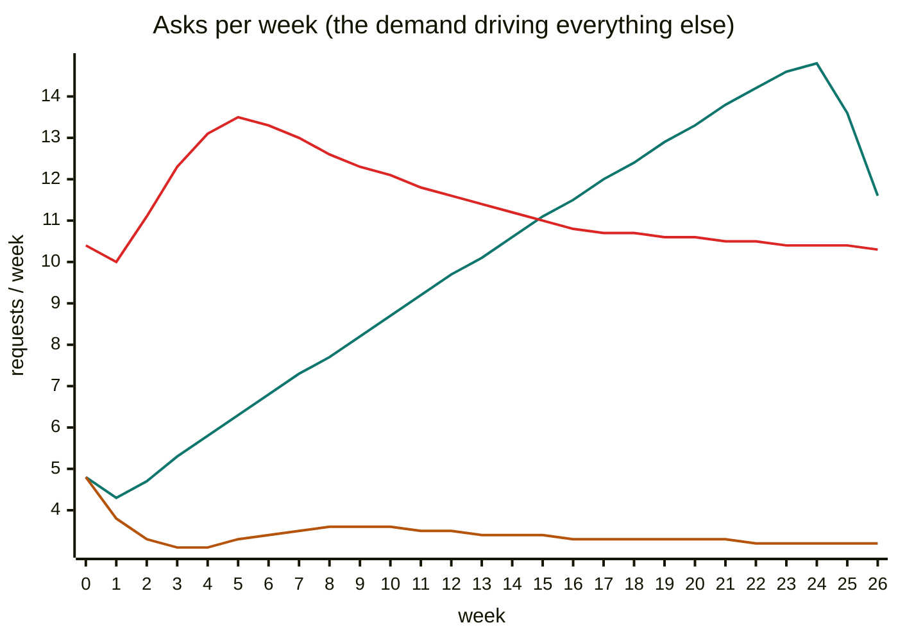
*Lines:* 🟩 designed · 🟧 manual (today) · 🟥 surge of asks

*Plotted:* **Asks per week** = the rate of “ask”, per hour × 40. Not a fixed input: asks are 0.06 an hour plus 0.003 × requesters' confidence, so they rise as I deliver.

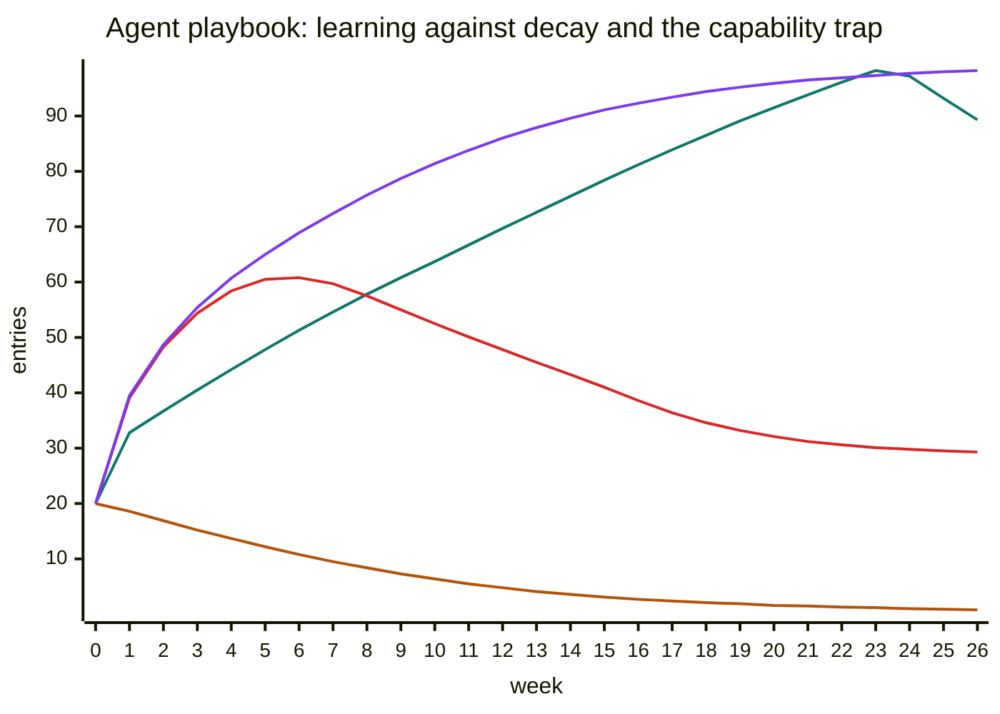
*Lines:* 🟩 designed · 🟧 no learning · 🟥 surge of asks · 🟪 surge, lesson capture protected

*Plotted:* **Agent playbook** = the level of the stock “Agent playbook” (`t_playbook`). Starts at 20 entries in every variant.

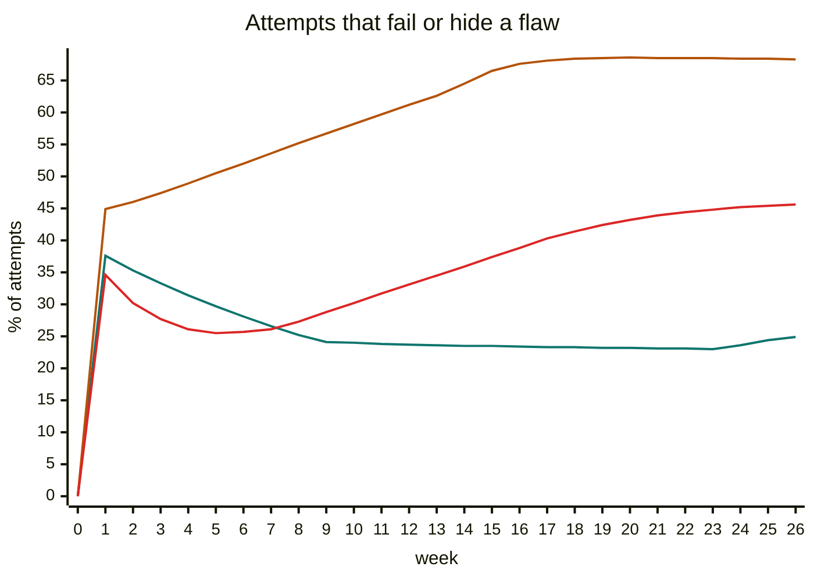
*Lines:* 🟩 designed · 🟧 no learning · 🟥 surge of asks

*Plotted:* **Attempts that fail or hide a flaw** = 100 × (“hidden flaw” + “fails”) ÷ (“sound” + “hidden flaw” + “fails”), using each flow's rate. The outcome split moves with the playbook and the debt.

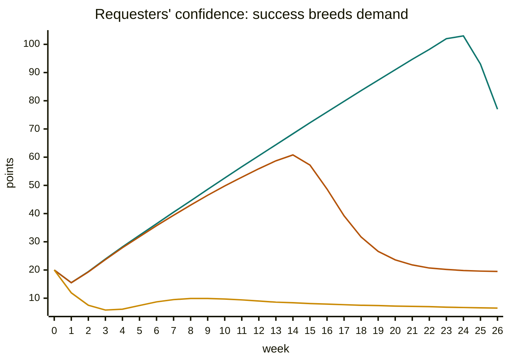
*Lines:* 🟩 designed · 🟧 no learning · 🟨 manual (today)

*Plotted:* **Requesters' confidence** = the level of the stock “Requesters' confidence” (`t_reputation`). Starts at 20 in every variant.

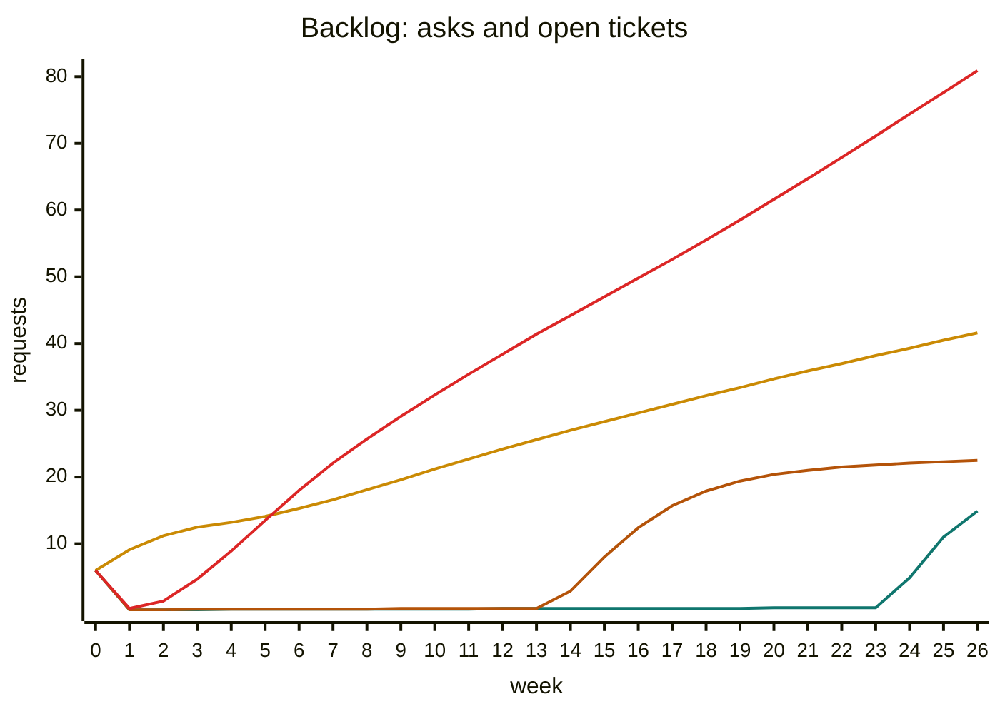
*Lines:* 🟨 manual (today) · 🟩 designed · 🟧 no learning · 🟥 surge of asks

*Plotted:* **Backlog** = the sum of the stocks “Asks” + “Scoped” + “Ticket draft” + “Open tickets”. Starts at 6 (4 asks, 2 open tickets) in every variant.

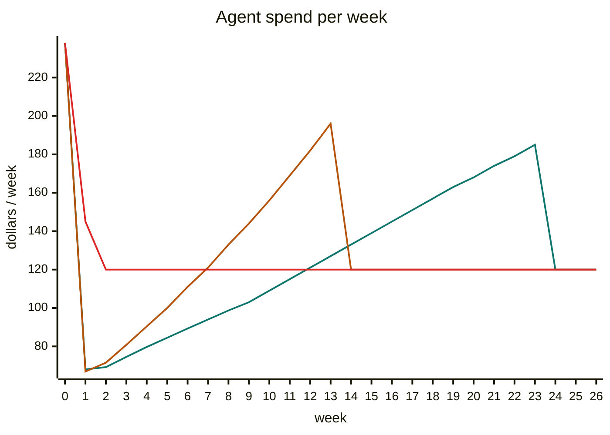
*Lines:* 🟩 designed · 🟧 no learning · 🟥 surge of asks

*Plotted:* **Agent spend per week** = Σ over every flow that uses the budget: its rate × its cost per item, per hour × 40. What the agents' LLM work costs, summed from every agent flow's rate × its cost per item. The budget refills at $120 a week; spend above that draws down the balance.

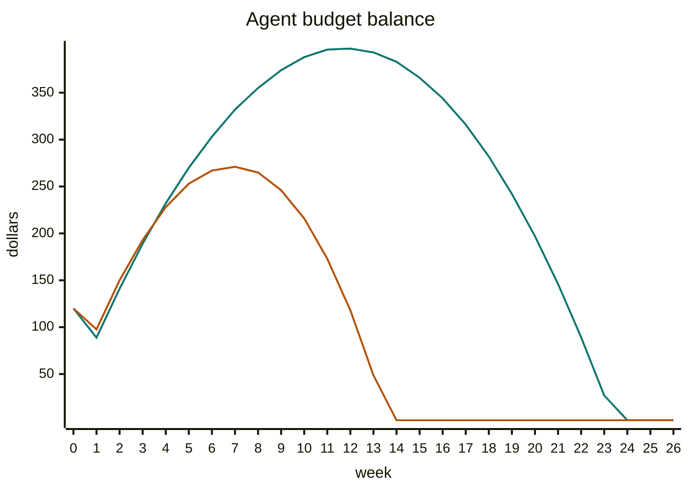
*Lines:* 🟩 designed · 🟧 no learning

*Plotted:* **Agent budget balance** = the level of the stock “Agent budget” (`budget`). A stock: starts at $120, refilled at $3 per working hour, drained by agent spend. At zero, agent work stops.

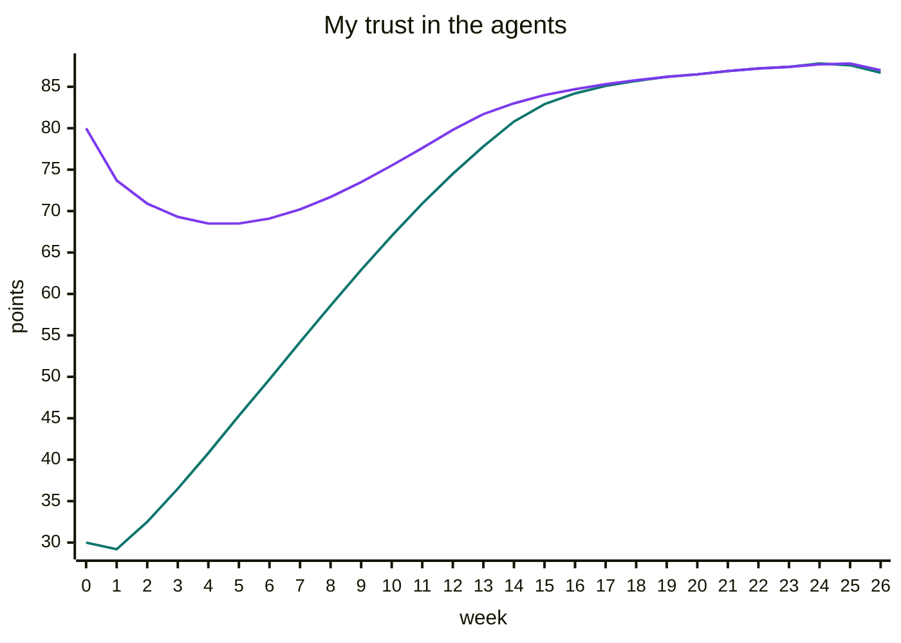
*Lines:* 🟩 designed · 🟪 starting from blind trust

*Plotted:* **My trust in the agents** = the level of the stock “My trust in the agents” (`t_trust`). Starts at 30 (designed) or 80 (blind trust).

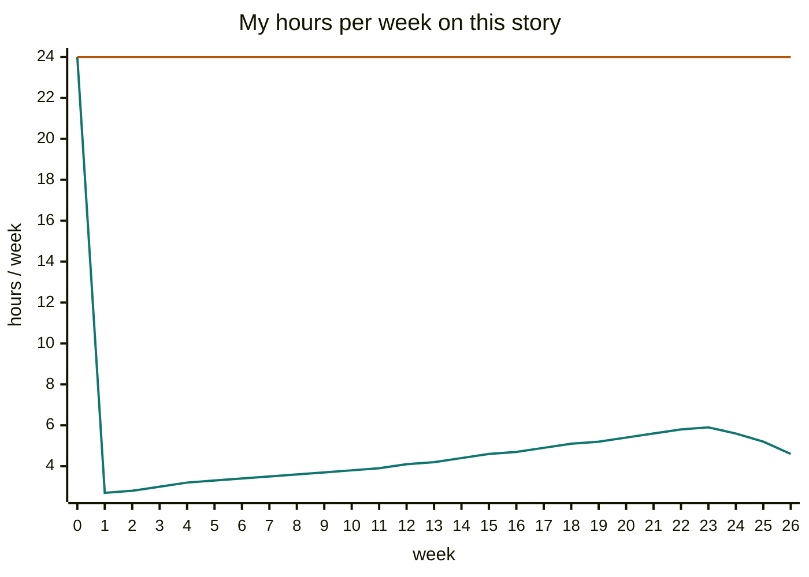
*Lines:* 🟩 designed · 🟧 manual (today)

*Plotted:* **My hours per week on this story** = the machine “me”'s busy share × its capacity × 40. My free time is 0.6 of each working hour: 24 hours a week at most.

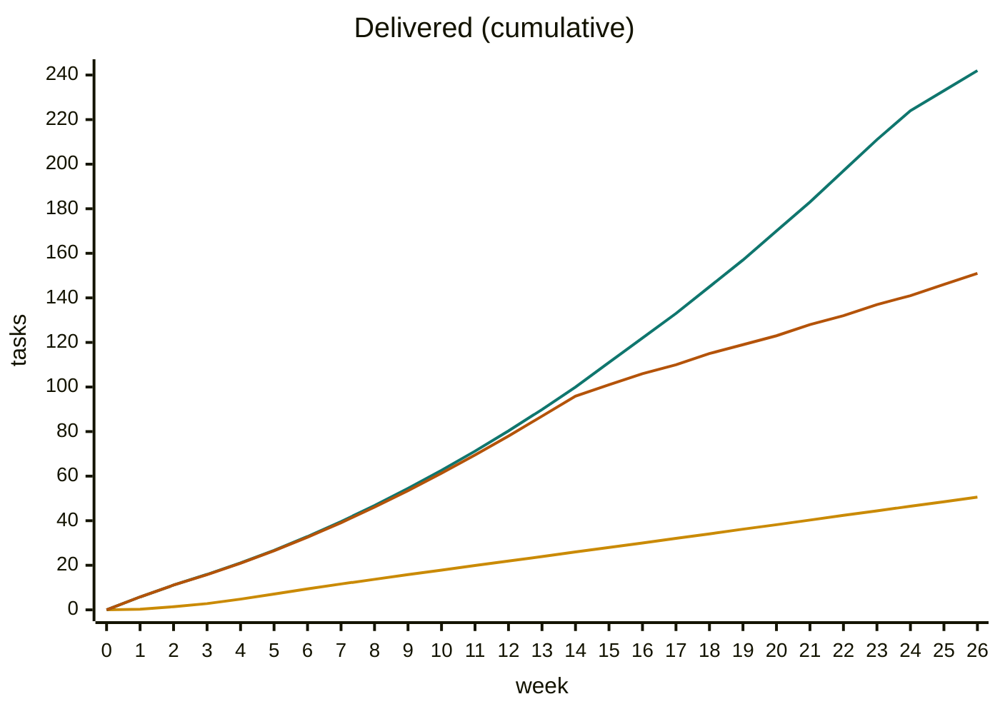
*Lines:* 🟨 manual (today) · 🟩 designed · 🟧 no learning

*Plotted:* **Delivered (cumulative)** = the sum of the stocks “Landed recently” + “Delivered” + “Landed with a hidden flaw” + “Bugs found in production”. Landed changes, sound or flawed.

### Machines

| Machine | Kind | Capacity (hours per hour) | Flows | Busy, designed | Busy, manual |
|---|---|---|---|---|---|
| Me | person | 0.6 | 5 | 18% | 100% |
| Analyst agent | agent | 1 | 2 | 20% | 0% |
| Drafter agent | agent | 1 | 1 | 11% | 0% |
| Implementation agents | agent | 2 | 3 | 38% | 0% |
| Orchestra programs | code | 5 | 9 | 0% | 0% |
| Environment (company, people) | — | — | 20 | — | — |

### Crossings into company systems

| Flow | Machine | Crosses |
|---|---|---|
| ask | environment | slack/jira in |
| research | Analyst agent | read: jira, docs, slack, code |
| approve ticket | Me | jira write (via outbox) |
| auto-pass | Orchestra programs | github push + open PR |
| auto-pass | Orchestra programs | github push + open PR |
| my check: fine | Me | github push + open PR |
| ping | Orchestra programs | slack write |
| fix nits | Implementation agents | read: threads; github push; replies via outbox |
| SAIL label | Me | github label |
| re-label flake | Orchestra programs | read: SAIL logs; github label |
| bug becomes a ticket | Orchestra programs | read: jira; jira write |

### Checks

| Id | Kind | Check | Result | Detail |
|---|---|---|---|---|
| 1.1 | validity | Manual reproduces today: I am fully busy and the backlog keeps growing | pass | busy 100%, backlog 6.00 → 42 in 26 weeks, 51 delivered |
| 1.2 | requirement | Designed: learning beats decay: the playbook at least doubles and fewer attempts go wrong | pass | playbook 20 → 89 entries; attempts failing or flawed 33% (weeks 2–4) → 24% (last 4 weeks) |
| 1.3 | info | Without learning: the playbook rots, more attempts go wrong, debt grows, and the budget runs out sooner | info | playbook → 0.83; going wrong 68% vs 24%; debt 55 vs 29; budget empty from week 14 vs 23; delivered 151 vs 242 |
| 1.4 | requirement | Under a surge of asks, the playbook keeps growing (no capability trap) | **gap** | surge: playbook peaks at 61, ends at 29; with lesson capture protected it ends at 98 |
| 1.5 | requirement | Designed: at most one hour of my time per delivered task | pass | 0.47 h per delivered (manual 12 h); my busy share 18% |
| 1.6 | requirement | Escaped flaws stay under 5 per 100 delivered, even when I start out trusting blindly | pass | 0.34 per 100 designed, 0.35 with blind trust |
| 1.7 | info | Trust: earned slowly, cut by late findings | info | designed 30 → low 29 → 87; blind trust 80 → low 68 → 87 |
| 1.8 | requirement | Designed: the backlog stays small for all 26 weeks | **gap** | largest backlog 15; at the end 15 |
| 1.9 | info | Success breeds demand until the budget binds (limits to growth) | info | asks 4.80 → 12 a week; requesters' confidence 20 → 77; budget empty from week 23 |
| 1.10 | requirement | At most $20 of agent work per delivered task | pass | $13 per delivered |
| 1.11 | requirement | Designed: ticket to landed within 4 working days (Little's law over 26 weeks) | **gap** | mean 4.16 days (manual 70 days) |

### The same model as a Mermaid flowchart

```mermaid
flowchart TB
  classDef ours fill:#eff6ff,stroke:#2563eb,color:#111
  classDef interface fill:#fffbeb,stroke:#d97706,color:#111
  classDef company fill:#f3f4f6,stroke:#6b7280,color:#111
  classDef outside fill:#fff,stroke:#9ca3af,color:#6b7280
  subgraph OURS["Ours: what Orchestra owns and runs"]
    direction LR
    t_scoped["Scoped"]:::ours
    t_open["Open tickets"]:::ours
    t_attempted["Attempted"]:::ours
    t_sound["Done, sound"]:::ours
    t_flawed["Done, hidden flaw"]:::ours
    t_failed["Failed or caught"]:::ours
    t_lessons["Lessons not written down"]:::ours
    t_playbook["Agent playbook"]:::ours
    t_debt["Technical debt"]:::ours
    t_trust["My trust in the agents"]:::ours
    t_delivered["Delivered"]:::ours
  end
  subgraph INTERFACE["Interface: where work crosses, and my outbox"]
    direction LR
    t_asks["Asks"]:::interface
    t_ticket_draft["Ticket draft"]:::interface
    t_check_sound["To check (sound)"]:::interface
    t_check_flawed["To check (flawed)"]:::interface
    t_nudges["Recent pings"]:::interface
  end
  subgraph COMPANY["Company: observed, not owned"]
    direction LR
    t_reputation["Requesters' confidence"]:::company
    t_pr_sound["PR checks (sound)"]:::company
    t_pr_flawed["PR checks (flawed)"]:::company
    t_review_sound["In review (sound)"]:::company
    t_review_flawed["In review (flawed)"]:::company
    t_nits["Nits requested"]:::company
    t_changes["Flaw found late"]:::company
    t_approved["Approved"]:::company
    t_sailing["In SAIL"]:::company
    t_sail_failed["SAIL failed"]:::company
    t_landed_recent["Landed recently"]:::company
    t_latent["Landed with a hidden flaw"]:::company
    t_bugs["Bugs found in production"]:::company
  end
  out_t_ask(("outside")):::outside
  out_t_ask -->|"ask · environment"| t_asks
  out_t_rep_gain(("outside")):::outside
  out_t_rep_gain -->|"confidence grows · environment"| t_reputation
  gone_t_rep_loss(("gone")):::outside
  t_reputation -->|"confidence fades · environment"| gone_t_rep_loss
  t_bugs -.->|"speeds confidence fades"| gone_t_rep_loss
  t_open -.->|"speeds confidence fades"| gone_t_rep_loss
  t_asks -->|"collect reqs · Me"| t_scoped
  t_scoped -->|"research · Analyst agent"| t_ticket_draft
  t_ticket_draft -->|"approve ticket · Me"| t_open
  t_open -->|"attempt · Implementation agents"| t_attempted
  t_debt -.->|"speeds attempt"| t_attempted
  t_attempted -->|"sound · environment"| t_sound
  t_playbook -.->|"speeds sound"| t_sound
  t_debt -.->|"speeds sound"| t_sound
  t_attempted -->|"hidden flaw · environment"| t_flawed
  t_playbook -.->|"speeds hidden flaw"| t_flawed
  t_debt -.->|"speeds hidden flaw"| t_flawed
  t_attempted -->|"fails · environment"| t_failed
  t_playbook -.->|"speeds fails"| t_failed
  t_failed -->|"diagnose + requeue · Analyst agent"| t_open
  out_t_lesson(("outside")):::outside
  out_t_lesson -->|"capture lessons · Orchestra programs"| t_lessons
  t_open -.->|"speeds capture lessons"| t_lessons
  t_lessons -->|"write playbook · Drafter agent"| t_playbook
  gone_t_obsolete(("gone")):::outside
  t_playbook -->|"goes stale · environment"| gone_t_obsolete
  t_landed_recent -.->|"speeds goes stale"| gone_t_obsolete
  out_t_debt_in(("outside")):::outside
  out_t_debt_in -->|"debt added · environment"| t_debt
  t_playbook -.->|"speeds debt added"| t_debt
  gone_t_refactor(("gone")):::outside
  t_debt -->|"pay down debt · Implementation agents"| gone_t_refactor
  t_sound -->|"route to my check · Orchestra programs"| t_check_sound
  t_trust -.->|"speeds route to my check"| t_check_sound
  t_sound -->|"auto-pass · Orchestra programs"| t_pr_sound
  t_trust -.->|"speeds auto-pass"| t_pr_sound
  t_flawed -->|"route to my check · Orchestra programs"| t_check_flawed
  t_trust -.->|"speeds route to my check"| t_check_flawed
  t_flawed -->|"auto-pass · Orchestra programs"| t_pr_flawed
  t_trust -.->|"speeds auto-pass"| t_pr_flawed
  t_check_sound -->|"my check: fine · Me"| t_pr_sound
  t_check_flawed -->|"my check: caught · Me"| t_failed
  t_pr_sound -->|"checks + AI review · environment"| t_review_sound
  t_pr_flawed -->|"checks + AI review 60% · environment"| t_review_flawed
  t_pr_flawed -->|"checks + AI review 40% · environment"| t_changes
  out_t_ping(("outside")):::outside
  out_t_ping -->|"ping · Orchestra programs"| t_nudges
  gone_t_forget(("gone")):::outside
  t_nudges -->|"fade · environment"| gone_t_forget
  t_review_sound -->|"approve · environment"| t_approved
  t_nudges -.->|"speeds approve"| t_approved
  t_review_sound -.->|"speeds approve"| t_approved
  t_review_sound -->|"request nits · environment"| t_nits
  t_nudges -.->|"speeds request nits"| t_nits
  t_nits -->|"fix nits · Implementation agents"| t_pr_sound
  t_review_flawed -->|"reviewer catches flaw · environment"| t_changes
  t_nudges -.->|"speeds reviewer catches flaw"| t_changes
  t_review_sound -.->|"speeds reviewer catches flaw"| t_changes
  t_review_flawed -->|"reviewer misses flaw · environment"| t_latent
  t_nudges -.->|"speeds reviewer misses flaw"| t_latent
  t_review_sound -.->|"speeds reviewer misses flaw"| t_latent
  t_changes -->|"back to diagnosis · Orchestra programs"| t_failed
  t_approved -->|"SAIL label · Me"| t_sailing
  t_sailing -->|"SAIL 75% · environment"| t_landed_recent
  t_sailing -->|"SAIL 25% · environment"| t_sail_failed
  t_sail_failed -->|"re-label flake · Orchestra programs"| t_sailing
  t_landed_recent -->|"leaves the recent window · environment"| t_delivered
  t_latent -->|"bug surfaces · environment"| t_bugs
  t_bugs -->|"bug becomes a ticket · Orchestra programs"| t_open
  out_t_trust_gain(("outside")):::outside
  out_t_trust_gain -->|"trust earned · environment"| t_trust
  t_trust -.->|"speeds trust earned"| t_trust
  gone_t_trust_loss(("gone")):::outside
  t_trust -->|"trust lost · environment"| gone_t_trust_loss
  t_changes -.->|"speeds trust lost"| gone_t_trust_loss
  t_bugs -.->|"speeds trust lost"| gone_t_trust_loss
  linkStyle 0 stroke:#6b7280,stroke-width:2.5px
  linkStyle 1 stroke:#6b7280,stroke-width:2.5px
  linkStyle 2 stroke:#6b7280,stroke-width:2.5px
  linkStyle 3 stroke:#0891b2,stroke-width:1.5px
  linkStyle 4 stroke:#0891b2,stroke-width:1.5px
  linkStyle 5 stroke:#b45309,stroke-width:2.5px
  linkStyle 6 stroke:#7c3aed,stroke-width:2.5px
  linkStyle 7 stroke:#b45309,stroke-width:2.5px
  linkStyle 8 stroke:#0f766e,stroke-width:2.5px
  linkStyle 9 stroke:#0891b2,stroke-width:1.5px
  linkStyle 10 stroke:#6b7280,stroke-width:2.5px
  linkStyle 11 stroke:#0891b2,stroke-width:1.5px
  linkStyle 12 stroke:#0891b2,stroke-width:1.5px
  linkStyle 13 stroke:#6b7280,stroke-width:2.5px
  linkStyle 14 stroke:#0891b2,stroke-width:1.5px
  linkStyle 15 stroke:#0891b2,stroke-width:1.5px
  linkStyle 16 stroke:#6b7280,stroke-width:2.5px
  linkStyle 17 stroke:#0891b2,stroke-width:1.5px
  linkStyle 18 stroke:#7c3aed,stroke-width:2.5px
  linkStyle 19 stroke:#475569,stroke-width:2.5px
  linkStyle 20 stroke:#0891b2,stroke-width:1.5px
  linkStyle 21 stroke:#2563eb,stroke-width:2.5px
  linkStyle 22 stroke:#6b7280,stroke-width:2.5px
  linkStyle 23 stroke:#0891b2,stroke-width:1.5px
  linkStyle 24 stroke:#6b7280,stroke-width:2.5px
  linkStyle 25 stroke:#0891b2,stroke-width:1.5px
  linkStyle 26 stroke:#0f766e,stroke-width:2.5px
  linkStyle 27 stroke:#475569,stroke-width:2.5px
  linkStyle 28 stroke:#0891b2,stroke-width:1.5px
  linkStyle 29 stroke:#475569,stroke-width:2.5px
  linkStyle 30 stroke:#0891b2,stroke-width:1.5px
  linkStyle 31 stroke:#475569,stroke-width:2.5px
  linkStyle 32 stroke:#0891b2,stroke-width:1.5px
  linkStyle 33 stroke:#475569,stroke-width:2.5px
  linkStyle 34 stroke:#0891b2,stroke-width:1.5px
  linkStyle 35 stroke:#b45309,stroke-width:2.5px
  linkStyle 36 stroke:#b45309,stroke-width:2.5px
  linkStyle 37 stroke:#6b7280,stroke-width:2.5px
  linkStyle 38 stroke:#6b7280,stroke-width:2.5px
  linkStyle 39 stroke:#6b7280,stroke-width:2.5px
  linkStyle 40 stroke:#475569,stroke-width:2.5px
  linkStyle 41 stroke:#6b7280,stroke-width:2.5px
  linkStyle 42 stroke:#6b7280,stroke-width:2.5px
  linkStyle 43 stroke:#0891b2,stroke-width:1.5px
  linkStyle 44 stroke:#0891b2,stroke-width:1.5px
  linkStyle 45 stroke:#6b7280,stroke-width:2.5px
  linkStyle 46 stroke:#0891b2,stroke-width:1.5px
  linkStyle 47 stroke:#0f766e,stroke-width:2.5px
  linkStyle 48 stroke:#6b7280,stroke-width:2.5px
  linkStyle 49 stroke:#0891b2,stroke-width:1.5px
  linkStyle 50 stroke:#0891b2,stroke-width:1.5px
  linkStyle 51 stroke:#6b7280,stroke-width:2.5px
  linkStyle 52 stroke:#0891b2,stroke-width:1.5px
  linkStyle 53 stroke:#0891b2,stroke-width:1.5px
  linkStyle 54 stroke:#475569,stroke-width:2.5px
  linkStyle 55 stroke:#b45309,stroke-width:2.5px
  linkStyle 56 stroke:#6b7280,stroke-width:2.5px
  linkStyle 57 stroke:#6b7280,stroke-width:2.5px
  linkStyle 58 stroke:#475569,stroke-width:2.5px
  linkStyle 59 stroke:#6b7280,stroke-width:2.5px
  linkStyle 60 stroke:#6b7280,stroke-width:2.5px
  linkStyle 61 stroke:#475569,stroke-width:2.5px
  linkStyle 62 stroke:#6b7280,stroke-width:2.5px
  linkStyle 63 stroke:#0891b2,stroke-width:1.5px
  linkStyle 64 stroke:#6b7280,stroke-width:2.5px
  linkStyle 65 stroke:#0891b2,stroke-width:1.5px
  linkStyle 66 stroke:#0891b2,stroke-width:1.5px
```

## Story 2: production command requests, made rarer and safer

People ask me to run commands on production bastions. Agents explain the command from runbooks, check the authority chain (asking back when it is missing, which teaches requesters the process), and gather context, including repeats needed in other environments. I decide and run it; nobody else can. Every case is logged; patterns and incidents become problem statements and proposals, which the company adopts faster with more evidence and right after an incident. Runbooks learn from every case and incident and go stale on their own. Time unit: a working hour; horizon 26 weeks.

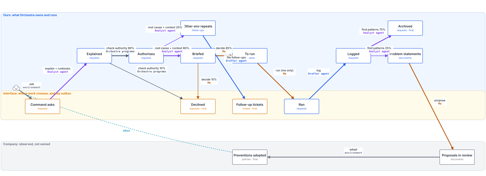

### Feedback loops

| Loop | Type | Through | What it does |
|---|---|---|---|
| B-prevention | balancing | Command asks → Logged → Cases on file → Problem statements → Proposals in review → Preventions in force | Cases become problem statements and proposals; adopted policies make these requests rarer. |
| R-evidence | reinforcing | Cases on file → Proposals in review → Preventions in force | The more cases logged, the stronger the proposal and the sooner it is adopted. |
| R-crisis | reinforcing | Incidents caused by a command → Postmortems in progress → Problem statements → Proposals in review | An incident caused by a command speeds adoption and becomes a postmortem and a problem statement. |
| R-runbooks | reinforcing | Runbook lessons → Runbook coverage → Explained → Incidents caused by a command | Cases and incidents teach the runbooks; better runbooks explain faster and cause fewer incidents. |
| B-decay | balancing | Runbook coverage → Preventions in force | Runbooks go stale as systems change; policies erode as people work around them. |
| B-compliance | balancing | Authority missing → Requesters following the process | Asking for missing authority teaches requesters to bring it; fewer requests arrive incomplete. |
| R-repeats | reinforcing | Repeats not yet filed → Repeats coming due → Command asks | Repeats needed in other environments come back as requests: as surprises if never filed. |

### Starting state and drivers

Every stock starts at 0 except: Requesters following the process 30 points; Command asks 1 requests; Runbook coverage 20 entries; Agent budget 120 dollars.

Flows into the model from outside (the drivers). None is a waveform unless it reads an input:

| Flow | Rate |
|---|---|
| ask → “Command asks” | 0.06 + 0.12 × “company_growth” per hour × “Preventions in force” effect (0→1, 2→0.75, 5→0.5, 10→0.35) |
| requesters learn the process → “Requesters following the process” | 0.6 × “Authority missing” × “Requesters following the process” effect (0→1, 80→0.4, 100→0) |
| weekly budget → “Agent budget” | 3 per hour (120 a week)  |

Input `company_growth`: a ramp from 0, rising 0.000962 per hour (1 by hour 1040).

**Variants** (each starts from the designed model and changes only what's listed):

- **manual**: Today's shortcut: I explain and check it myself, shallowly. No runbook updates, no logging for others, no filing of repeats, no patterns or proposals; postmortems only when an incident forces one. *Changes:* “explain + runbooks”: on me, 1 h each; “root cause + context”: on me, 0.5 h each; “log”: on me, 0.05 h each; “update runbooks”: nobody does it; “file the repeats”: nobody does it; “find a pattern”: nobody does it; “propose”: nobody does it; “postmortem → problem statement”: on me, 3 h each.
- **manual-thorough**: Me doing all of it properly myself: runbooks, logs, repeats, patterns, proposals. *Changes:* “explain + runbooks”: on me, 1 h each; “root cause + context”: on me, 1.5 h each; “log”: on me, 0.25 h each; “file the repeats”: on me, 0.25 h each; “update runbooks”: on me, 0.5 h each; “find a pattern”: on me, 1 h each; “propose”: on me, 4 h each; “postmortem → problem statement”: on me, 3 h each.
- **no-runbooks**: Agents, but nobody updates the runbooks. *Changes:* “update runbooks”: nobody does it.
- **no-evidence**: Agents, but cases are not logged where the company sees them: proposals carry no evidence. *Changes:* “adopt”: effects changed.

### Simulation

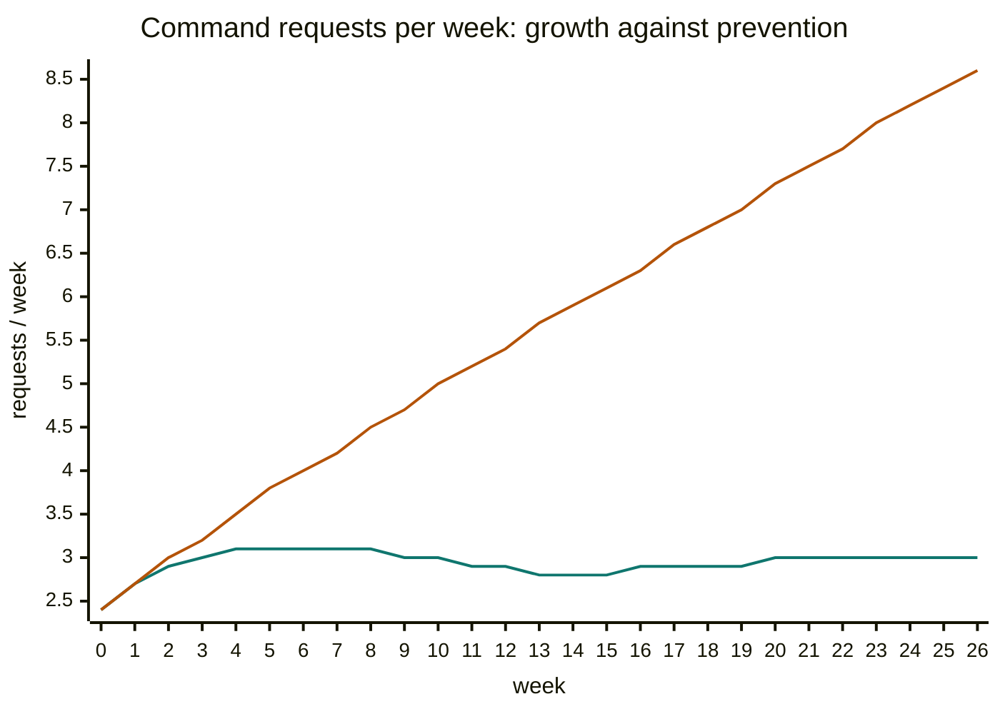
*Lines:* 🟩 designed · 🟧 today's shortcut (no prevention)

*Plotted:* **Command requests per week** = the rate of “ask” + “repeat comes due” + “surprise repeat”, per hour × 40. New requests start at 0.06 an hour (2.4 a week) and grow by 0.12 × company growth, a ramp from 0 to 1 over the 26 weeks; adopted preventions scale them down. Repeats and surprises come on top.

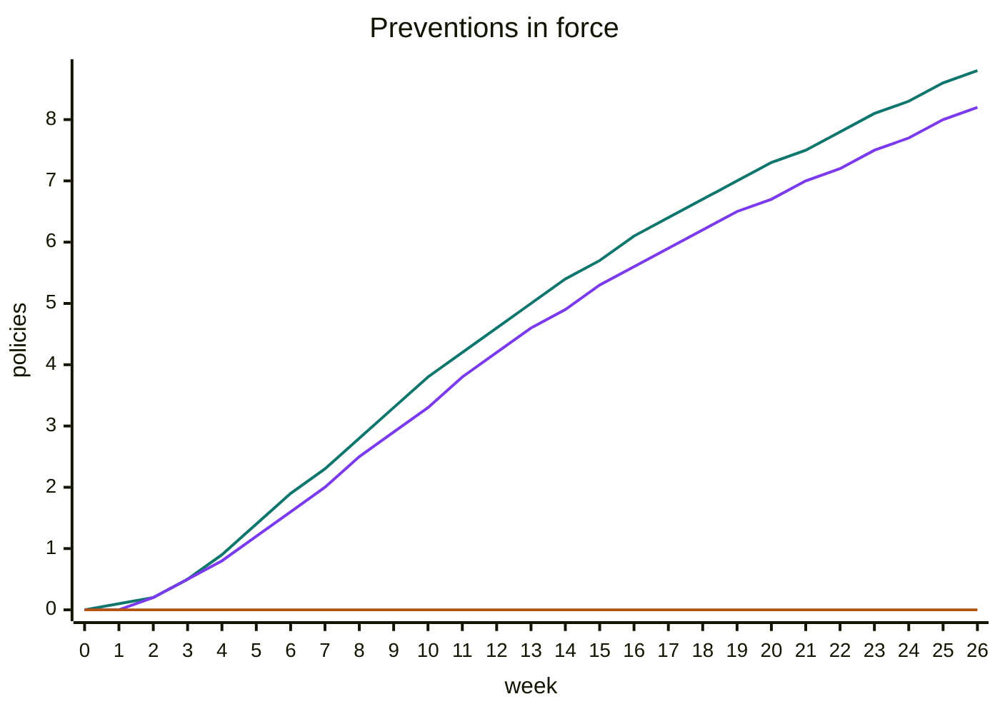
*Lines:* 🟩 designed · 🟪 no evidence logged · 🟧 today's shortcut

*Plotted:* **Preventions in force** = the level of the stock “Preventions in force” (`p_policies`). Starts at 0.

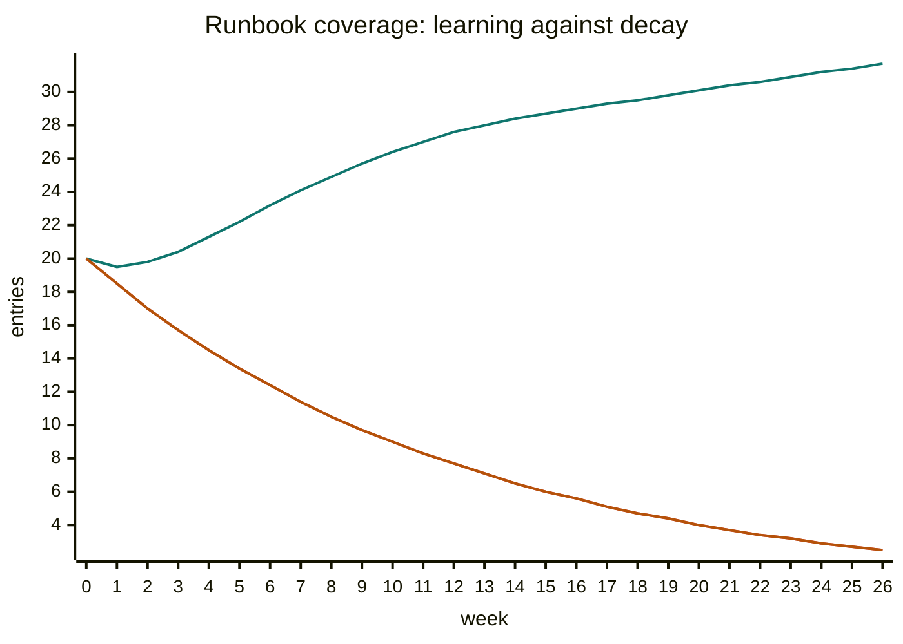
*Lines:* 🟩 designed · 🟥 no runbook updates · 🟧 today's shortcut

*Plotted:* **Runbook coverage** = the level of the stock “Runbook coverage” (`p_runbooks`). Starts at 20 entries.

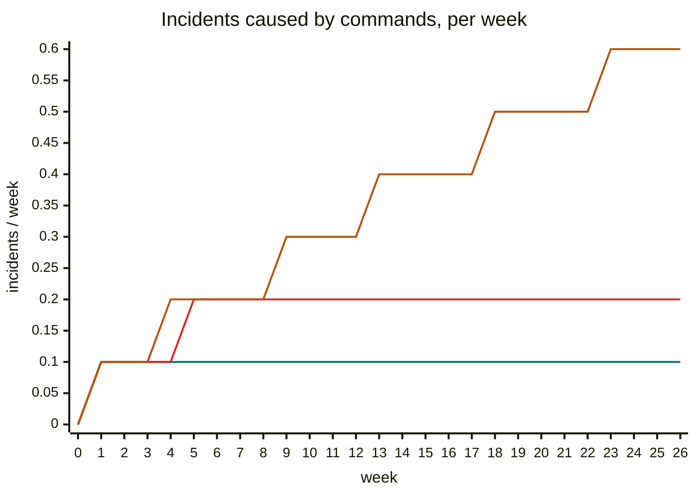
*Lines:* 🟩 designed · 🟥 no runbook updates · 🟧 today's shortcut

*Plotted:* **Incidents caused by commands per week** = the rate of “causes an incident”, per hour × 40. About 6% of commands at 20 runbook entries; the share moves with coverage.

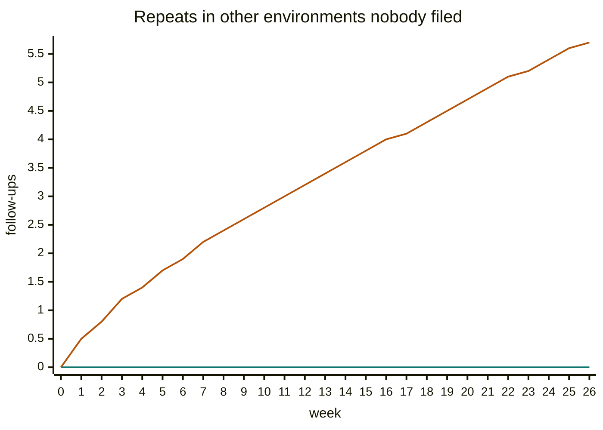
*Lines:* 🟩 designed · 🟧 today's shortcut

*Plotted:* **Repeats nobody filed** = the level of the stock “Repeats not yet filed” (`p_followups`). Starts at 0.

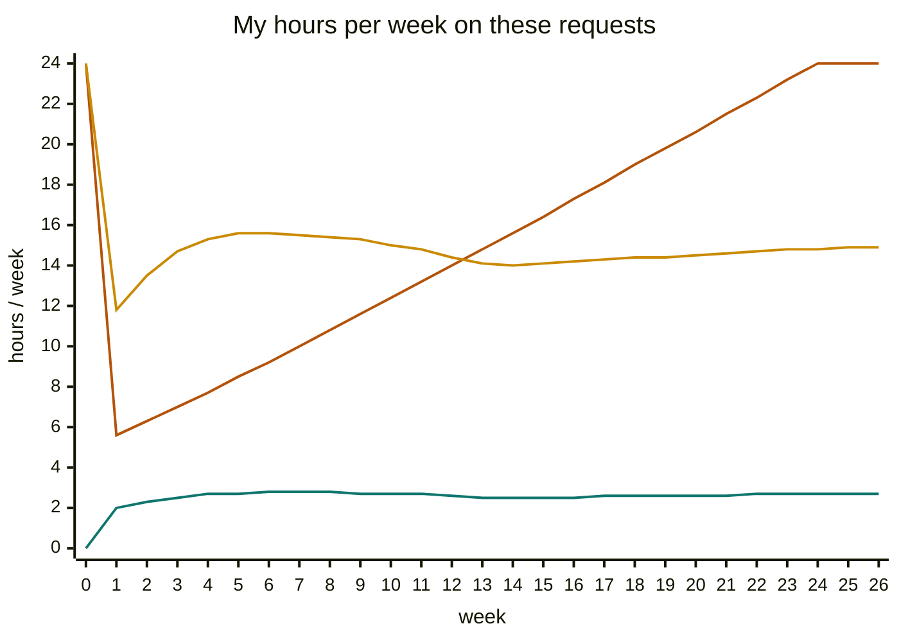
*Lines:* 🟩 designed · 🟧 today's shortcut · 🟨 doing it all properly myself

*Plotted:* **My hours per week on this story** = the machine “me”'s busy share × its capacity × 40. My free time is at most 24 hours a week.

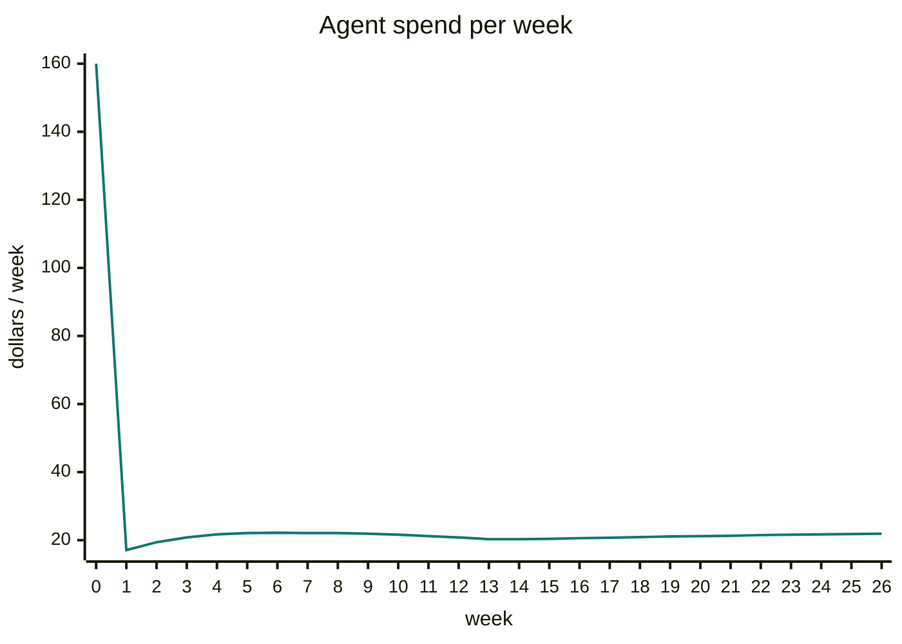
*Lines:* 🟩 designed

*Plotted:* **Agent spend per week** = Σ over every flow that uses the budget: its rate × its cost per item, per hour × 40. Summed from every agent flow's rate × its cost per item.

### Machines

| Machine | Kind | Capacity (hours per hour) | Flows | Busy, designed | Busy, manual |
|---|---|---|---|---|---|
| Me | person | 0.6 | 4 | 11% | 62% |
| Analyst agent | agent | 1 | 4 | 10% | 0% |
| Drafter agent | agent | 1 | 3 | 3% | 0% |
| Orchestra programs | code | 5 | 3 | 0% | 0% |
| Environment (company, people) | — | — | 16 | — | — |

### Crossings into company systems

| Flow | Machine | Crosses |
|---|---|---|
| ask | environment | slack/jira in |
| explain + runbooks | Analyst agent | read: runbooks, code, docs |
| authority complete | Orchestra programs | read: jira approvals, change tickets, org chart |
| authority missing | Orchestra programs | slack write (the question back, via outbox) |
| root cause + context | Analyst agent | read: customer jira, flag history, deploys, release calendars |
| run (me only) | Me | bastion host (human only) |
| respond to the incident | Me | pagerduty, slack, incident process |
| postmortem → problem statement | Analyst agent | read: slack, pagerduty, deploys, flags |
| log | Drafter agent | jira/slack write (via outbox) |
| file the repeats | Drafter agent | jira write (via outbox) |
| update runbooks | Drafter agent | wiki/runbook write (via outbox) |
| propose | Me | docs write; slack post for review |

### Checks

| Id | Kind | Check | Result | Detail |
|---|---|---|---|---|
| 2.1 | validity | Structural: only I run production commands, in every variant | pass | p_run machine = me everywhere |
| 2.2 | requirement | Full due diligence costs me under a quarter of doing it all myself | pass | 1.20 h per request vs 6.77 h doing it all myself (today's shortcut 3.60 h) |
| 2.3 | requirement | Prevention bends the curve: by week 26 requests run at most 75% of what they would without it | pass | 2.78 a week vs 7.20 without prevention (started at 2.40); 8.83 preventions in force |
| 2.4 | requirement | Commands causing incidents: under 5% over the last 8 weeks | **gap** | 5% designed; 11% without runbook updates; 11% today |
| 2.5 | requirement | No repeat in another environment is left to come back as a surprise | pass | 0.02 surprises designed vs 21 today; 5.67 unfiled at the end today |
| 2.6 | info | Evidence speeds adoption; runbooks learn against decay; requesters learn the process | info | preventions in force 8.83 vs 8.21 without evidence; runbook coverage 32 vs 2.50 without updates (2.50 today); compliance 30 → 39 |

### The same model as a Mermaid flowchart

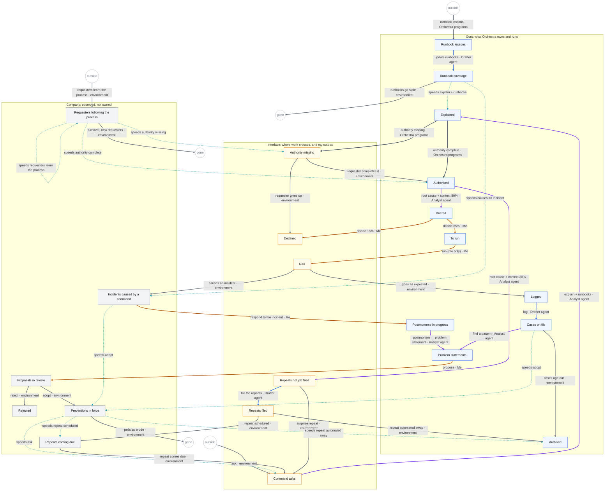

## Story 3: a manager asks for an update

One of my managers asks me for an update, assuming I already have the context. Today I don't: I re-read tickets, docs and Slack threads to reconstruct it before I can give a small update. With a status page the analyst keeps current, the update is already prepared. Around that core are the loops that decide whether it stays that way: the page is refreshed faster when owners keep their sources up; nudges keep them up until they wear out the team's patience. Accurate, quick answers build my manager's confidence and they ask less; wrong answers and surprises (blocked projects they found before me) send them checking in more. Time unit: a working hour; horizon 26 weeks.

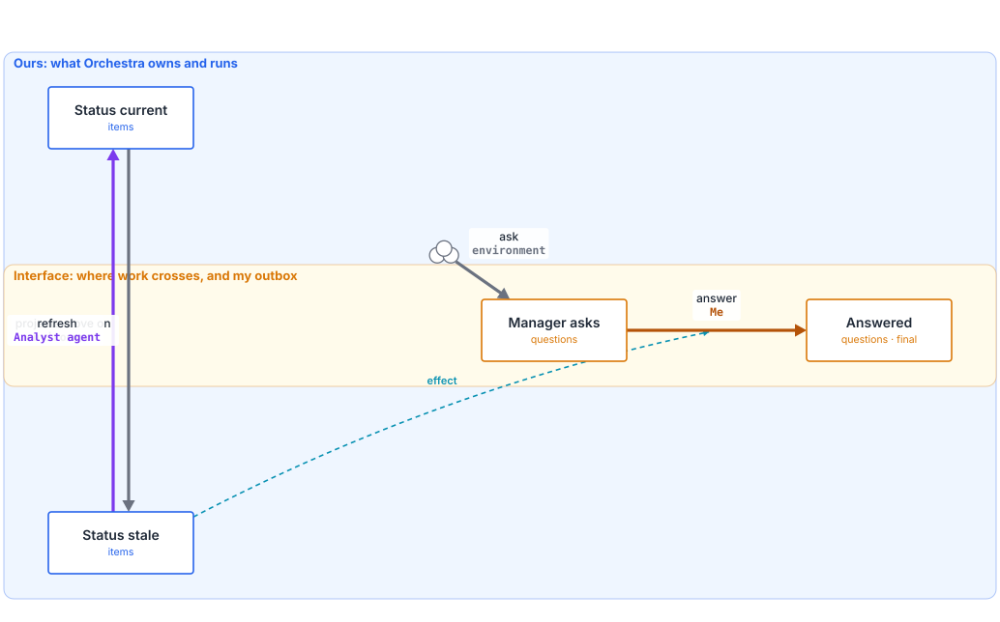

### Feedback loops

| Loop | Type | Through | What it does |
|---|---|---|---|
| B-freshness | balancing | Status current → Status stale → Source hygiene | Projects drift and the page goes stale; refreshing brings it back, faster when the sources are kept up. |
| B-hygiene | balancing | Status stale → Recent nudges to owners → Source hygiene | Stale sources prompt nudges to owners, which keep their tickets current. |
| R-nagging | reinforcing | Recent nudges to owners → Team's patience with nudges → Source hygiene | Too many nudges wear out patience; without patience nudges stop working and sources rot anyway. |
| B-confidence | balancing | Good answers, recently → Manager's confidence in me → Manager asks | Accurate, quick answers build confidence; a confident manager asks less and reads the page. |
| R-spiral | reinforcing | Wrong answers, recently → Surprises, recently → Manager's confidence in me → Manager asks → Status stale | Wrong answers and surprises cut confidence; more check-ins take my time; more answers come from stale knowledge. |
| B-early-warning | balancing | Blocked, not yet noticed → Blocked, I know → Blocked, manager found it first → Surprises, recently | A current page shows blocked projects before my manager finds them. |

### Starting state and drivers

Every stock starts at 0 except: Status current 30 items; Status stale 30 items; Source hygiene 50 points; Team's patience with nudges 80 points; Manager asks 1 questions; Manager's confidence in me 50 points; Agent budget 120 dollars.

Flows into the model from outside (the drivers). None is a waveform unless it reads an input:

| Flow | Rate |
|---|---|
| new items to track → “Status stale” | 0.05 per hour (2 a week)  |
| owners update → “Source hygiene” | 0.6 × “Recent nudges to owners” × “Team's patience with nudges” effect (0→0, 30→0.3, 60→1, 100→1.2) × “Source hygiene” effect (0→1, 80→0.5, 100→0) |
| patience recovers → “Team's patience with nudges” | (100 − “Team's patience with nudges”) ÷ 200  |
| manager asks → “Manager asks” | 0.1 per hour (4 a week) × “Manager's confidence in me” effect (0→2.5, 50→1, 100→0.4) × “Surprises, recently” effect (0→1, 1→2, 3→3) |
| confidence earned → “Manager's confidence in me” | 0.25 × “Good answers, recently” × “Manager's confidence in me” effect (0→1, 80→0.5, 100→0) |
| a project gets blocked → “Blocked, not yet noticed” | 0.025 per hour (1 a week)  |
| weekly budget → “Agent budget” | 3 per hour (120 a week)  |

**Variants** (each starts from the designed model and changes only what's listed):

- **manual**: Today: no status page and no nudges; every answer starts from memory or scratch. *Changes:* “refresh”: nobody does it; “nudge owners”: nobody does it; “page shows the block”: nobody does it.
- **no-nudges**: A status page, but nobody nudges owners. *Changes:* “nudge owners”: nobody does it.
- **nagging**: A status page, nudging four times as hard. *Changes:* “nudge owners”: rate 0.02 × “Status current”.

### Simulation

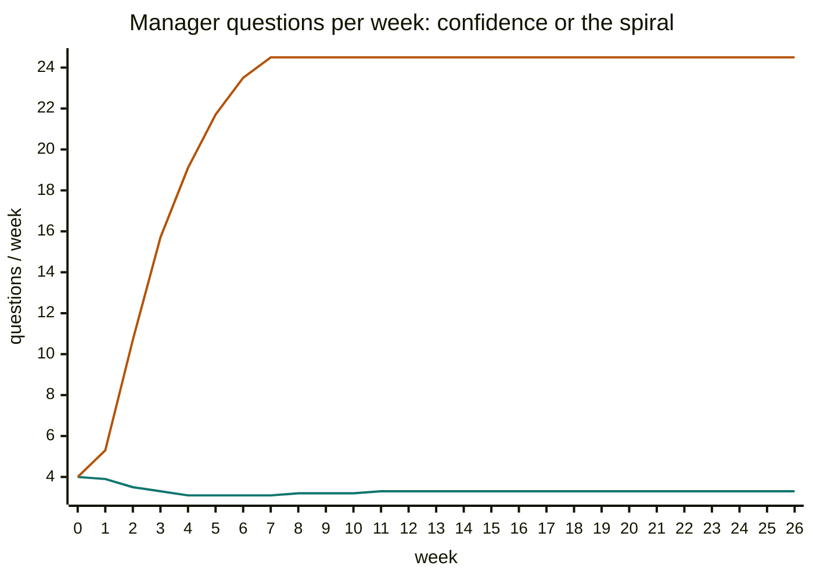
*Lines:* 🟩 designed · 🟧 manual (today)

*Plotted:* **Manager questions per week** = the rate of “manager asks”, per hour × 40. Not a fixed input: 0.1 an hour (4 a week) × an effect of my manager's confidence (2.5× at 0, 1× at 50, 0.4× at 100) × an effect of recent surprises (up to 3×).

```mermaid
---
config:
  themeVariables:
    xyChart:
      plotColorPalette: "#0f766e, #b45309"
---
xychart-beta
  title "Manager's confidence in me"
  x-axis "week" [0, 1, 2, 3, 4, 5, 6, 7, 8, 9, 10, 11, 12, 13, 14, 15, 16, 17, 18, 19, 20, 21, 22, 23, 24, 25, 26]
  y-axis "points"
  line [50.0, 56.1, 65.7, 72.4, 75.9, 77.3, 77.6, 77.5, 77.3, 77.0, 76.8, 76.7, 76.6, 76.6, 76.5, 76.5, 76.5, 76.4, 76.4, 76.4, 76.4, 76.4, 76.4, 76.4, 76.4, 76.4, 76.4]
  line [50.0, 50.2, 37.3, 25.8, 20.3, 17.3, 16.0, 15.2, 15.2, 15.3, 15.3, 15.3, 15.3, 15.3, 15.3, 15.3, 15.3, 15.3, 15.3, 15.3, 15.3, 15.3, 15.3, 15.3, 15.3, 15.3, 15.3]
```
*Lines:* 🟩 designed · 🟧 manual (today)

*Plotted:* **Manager's confidence in me** = the level of the stock “Manager's confidence in me” (`s_confidence`). Starts at 50 of 100.

```mermaid
---
config:
  themeVariables:
    xyChart:
      plotColorPalette: "#0f766e, #b45309"
---
xychart-beta
  title "Stale status items"
  x-axis "week" [0, 1, 2, 3, 4, 5, 6, 7, 8, 9, 10, 11, 12, 13, 14, 15, 16, 17, 18, 19, 20, 21, 22, 23, 24, 25, 26]
  y-axis "items"
  line [30.0, 0.7, 0.7, 0.7, 0.6, 0.6, 0.6, 0.6, 0.6, 0.5, 0.5, 0.5, 0.5, 0.5, 0.5, 0.5, 0.4, 0.4, 0.4, 0.4, 0.4, 0.4, 0.4, 0.4, 0.4, 0.4, 0.4]
  line [30.0, 57.3, 62.4, 64.8, 66.8, 68.8, 70.8, 72.8, 74.8, 76.8, 78.8, 80.8, 82.8, 84.8, 86.8, 88.8, 90.8, 92.8, 94.8, 96.8, 98.8, 101, 103, 105, 107, 109, 111]
```
*Lines:* 🟩 designed · 🟧 manual (today)

*Plotted:* **Stale status items** = the level of the stock “Status stale” (`s_stale`). Starts at 30 stale of 60 tracked; about 5% of current items go stale each working hour; 2 new items a week.

```mermaid
---
config:
  themeVariables:
    xyChart:
      plotColorPalette: "#0f766e, #b45309, #dc2626"
---
xychart-beta
  title "Source hygiene: no nudges, enough, too many"
  x-axis "week" [0, 1, 2, 3, 4, 5, 6, 7, 8, 9, 10, 11, 12, 13, 14, 15, 16, 17, 18, 19, 20, 21, 22, 23, 24, 25, 26]
  y-axis "points"
  line [50.0, 49.7, 49.9, 49.4, 48.7, 48.0, 47.2, 46.5, 45.8, 45.1, 44.5, 43.9, 43.4, 42.8, 42.3, 41.8, 41.4, 40.9, 40.5, 40.1, 39.8, 39.4, 39.1, 38.8, 38.5, 38.3, 38.0]
  line [50.0, 33.5, 22.4, 15.0, 10.1, 6.7, 4.5, 3.0, 2.0, 1.4, 0.9, 0.6, 0.4, 0.3, 0.2, 0.1, 0.1, 0.1, 0.0, 0.0, 0.0, 0.0, 0.0, 0.0, 0.0, 0.0, 0.0]
  line [50.0, 70.0, 59.3, 41.3, 27.8, 18.7, 12.7, 8.7, 6.0, 4.1, 2.9, 2.1, 1.6, 1.2, 0.9, 0.8, 0.7, 0.6, 0.5, 0.5, 0.4, 0.4, 0.4, 0.4, 0.4, 0.4, 0.4]
```
*Lines:* 🟩 designed · 🟧 no nudges · 🟥 nagging

*Plotted:* **Source hygiene** = the level of the stock “Source hygiene” (`s_hygiene`). Starts at 50 of 100.

```mermaid
---
config:
  themeVariables:
    xyChart:
      plotColorPalette: "#0f766e, #dc2626"
---
xychart-beta
  title "Team's patience with nudges"
  x-axis "week" [0, 1, 2, 3, 4, 5, 6, 7, 8, 9, 10, 11, 12, 13, 14, 15, 16, 17, 18, 19, 20, 21, 22, 23, 24, 25, 26]
  y-axis "points"
  line [80.0, 79.2, 78.5, 78.2, 78.2, 78.4, 78.7, 79.1, 79.4, 79.8, 80.1, 80.5, 80.9, 81.2, 81.5, 81.9, 82.2, 82.5, 82.8, 83.0, 83.3, 83.5, 83.8, 84.0, 84.2, 84.4, 84.6]
  line [80.0, 43.4, 15.7, 0.1, 0.1, 0.1, 0.1, 0.1, 0.1, 0.1, 0.1, 0.1, 0.1, 0.1, 0.1, 0.1, 0.1, 0.1, 0.1, 0.1, 0.1, 0.1, 0.1, 0.1, 0.1, 0.1, 0.1]
```
*Lines:* 🟩 designed · 🟥 nagging

*Plotted:* **Team's patience with nudges** = the level of the stock “Team's patience with nudges” (`s_patience`). Starts at 80 of 100.

```mermaid
---
config:
  themeVariables:
    xyChart:
      plotColorPalette: "#0f766e, #b45309"
---
xychart-beta
  title "My hours per week on this story"
  x-axis "week" [0, 1, 2, 3, 4, 5, 6, 7, 8, 9, 10, 11, 12, 13, 14, 15, 16, 17, 18, 19, 20, 21, 22, 23, 24, 25, 26]
  y-axis "hours / week"
  line [24.0, 1.2, 1.1, 1.1, 1.1, 1.1, 1.1, 1.1, 1.1, 1.1, 1.1, 1.1, 1.1, 1.1, 1.1, 1.1, 1.1, 1.1, 1.1, 1.1, 1.1, 1.1, 1.1, 1.1, 1.1, 1.1, 1.1]
  line [24.0, 10.9, 22.2, 24.0, 24.0, 24.0, 24.0, 24.0, 24.0, 24.0, 24.0, 24.0, 24.0, 24.0, 24.0, 24.0, 24.0, 24.0, 24.0, 24.0, 24.0, 24.0, 24.0, 24.0, 24.0, 24.0, 24.0]
```
*Lines:* 🟩 designed · 🟧 manual (today)

*Plotted:* **My hours per week on this story** = the machine “me”'s busy share × its capacity × 40. My free time is at most 24 hours a week.

### Machines

| Machine | Kind | Capacity (hours per hour) | Flows | Busy, designed | Busy, manual |
|---|---|---|---|---|---|
| Me | person | 0.6 | 4 | 5% | 96% |
| Analyst agent | agent | 1 | 1 | 11% | 0% |
| Orchestra programs | code | 5 | 3 | 0% | 0% |
| Environment (company, people) | — | — | 18 | — | — |

### Crossings into company systems

| Flow | Machine | Crosses |
|---|---|---|
| refresh | Analyst agent | read: jira, docs, slack |
| nudge owners | Orchestra programs | slack write (via outbox; earned autonomy) |
| manager asks | environment | slack/meeting in |
| answer | Me | slack write |
| correct it | Me | slack write |
| escalate early | Me | slack/jira write |
| firefight the surprise | Me | slack/meetings |

### Checks

| Id | Kind | Check | Result | Detail |
|---|---|---|---|---|
| 3.1 | validity | Manual reproduces the spiral: confidence falls, questions multiply, I am nearly always busy | pass | confidence 50 → 15; questions 4.00 → 25 a week; busy 96% |
| 3.2 | requirement | The status page stays current: under 10% of items stale on average | pass | 1% stale (today 99%) |
| 3.3 | requirement | An answer costs me at most 15 minutes, including corrections and firefights | **gap** | 0.33 h per answer (today 2.07 h) |
| 3.4 | requirement | My manager's confidence ends higher than it started, and questions do not multiply | pass | confidence 50 → 76; questions 4.00 → 3.31 a week |
| 3.5 | requirement | I learn of at least 85% of blocked projects before my manager does | pass | 95% (today 0%) |
| 3.6 | info | Nudging: none lets sources rot; too much wears out patience and they rot anyway (fixes that fail) | info | source hygiene at week 26: designed 38, no nudges 0.00, nagging 0.37; patience: designed 85, nagging 0.12 |

### The same model as a Mermaid flowchart

```mermaid
flowchart TB
  classDef ours fill:#eff6ff,stroke:#2563eb,color:#111
  classDef interface fill:#fffbeb,stroke:#d97706,color:#111
  classDef company fill:#f3f4f6,stroke:#6b7280,color:#111
  classDef outside fill:#fff,stroke:#9ca3af,color:#6b7280
  subgraph OURS["Ours: what Orchestra owns and runs"]
    direction LR
    s_current["Status current"]:::ours
    s_stale["Status stale"]:::ours
    s_blocked_hidden["Blocked, not yet noticed"]:::ours
    s_blocked_known["Blocked, I know"]:::ours
    s_escalated["Escalated and handled"]:::ours
  end
  subgraph INTERFACE["Interface: where work crosses, and my outbox"]
    direction LR
    s_nudges["Recent nudges to owners"]:::interface
    s_asks["Manager asks"]:::interface
    s_drafted["Answer given, accuracy unknown"]:::interface
    s_answered["Answered"]:::interface
  end
  subgraph COMPANY["Company: observed, not owned"]
    direction LR
    s_hygiene["Source hygiene"]:::company
    s_patience["Team's patience with nudges"]:::company
    s_good_recent["Good answers, recently"]:::company
    s_wrong["Answers found wrong"]:::company
    s_confidence["Manager's confidence in me"]:::company
    s_surprises["Blocked, manager found it first"]:::company
    s_bad_recent["Wrong answers, recently"]:::company
    s_surprise_recent["Surprises, recently"]:::company
  end
  out_s_new(("outside")):::outside
  out_s_new -->|"new items to track · environment"| s_stale
  gone_s_retire(("gone")):::outside
  s_current -->|"items finish · environment"| gone_s_retire
  s_current -->|"projects move on · environment"| s_stale
  s_stale -->|"refresh · Analyst agent"| s_current
  s_hygiene -.->|"speeds refresh"| s_current
  out_s_nudge(("outside")):::outside
  out_s_nudge -->|"nudge owners · Orchestra programs"| s_nudges
  s_hygiene -.->|"speeds nudge owners"| s_nudges
  gone_s_nudge_fade(("gone")):::outside
  s_nudges -->|"fade · environment"| gone_s_nudge_fade
  out_s_hygiene_up(("outside")):::outside
  out_s_hygiene_up -->|"owners update · environment"| s_hygiene
  s_patience -.->|"speeds owners update"| s_hygiene
  s_hygiene -.->|"speeds owners update"| s_hygiene
  gone_s_hygiene_down(("gone")):::outside
  s_hygiene -->|"sources rot · environment"| gone_s_hygiene_down
  gone_s_patience_loss(("gone")):::outside
  s_patience -->|"patience wears · environment"| gone_s_patience_loss
  s_nudges -.->|"speeds patience wears"| gone_s_patience_loss
  out_s_patience_gain(("outside")):::outside
  out_s_patience_gain -->|"patience recovers · environment"| s_patience
  out_s_ask(("outside")):::outside
  out_s_ask -->|"manager asks · environment"| s_asks
  s_confidence -.->|"speeds manager asks"| s_asks
  s_surprise_recent -.->|"speeds manager asks"| s_asks
  s_asks -->|"answer · Me"| s_drafted
  s_stale -.->|"speeds answer"| s_drafted
  s_drafted -->|"turns out right · environment"| s_good_recent
  s_stale -.->|"speeds turns out right"| s_good_recent
  s_drafted -->|"turns out wrong · environment"| s_wrong
  s_stale -.->|"speeds turns out wrong"| s_wrong
  s_wrong -->|"correct it · Me"| s_bad_recent
  s_bad_recent -->|"forgotten · environment"| s_answered
  gone_s_surprise_settle(("gone")):::outside
  s_surprise_recent -->|"forgotten · environment"| gone_s_surprise_settle
  s_good_recent -->|"leaves recent memory · environment"| s_answered
  out_s_conf_gain(("outside")):::outside
  out_s_conf_gain -->|"confidence earned · environment"| s_confidence
  s_confidence -.->|"speeds confidence earned"| s_confidence
  gone_s_conf_loss(("gone")):::outside
  s_confidence -->|"confidence lost · environment"| gone_s_conf_loss
  s_bad_recent -.->|"speeds confidence lost"| gone_s_conf_loss
  s_surprise_recent -.->|"speeds confidence lost"| gone_s_conf_loss
  out_s_block(("outside")):::outside
  out_s_block -->|"a project gets blocked · environment"| s_blocked_hidden
  s_blocked_hidden -->|"page shows the block · Orchestra programs"| s_blocked_known
  s_stale -.->|"speeds page shows the block"| s_blocked_known
  s_blocked_hidden -->|"manager finds it first · environment"| s_surprises
  s_blocked_known -->|"escalate early · Me"| s_escalated
  s_surprises -->|"firefight the surprise · Me"| s_escalated
  out_s_remember(("outside")):::outside
  out_s_remember -->|"remembered · Orchestra programs"| s_surprise_recent
  linkStyle 0 stroke:#6b7280,stroke-width:2.5px
  linkStyle 1 stroke:#6b7280,stroke-width:2.5px
  linkStyle 2 stroke:#6b7280,stroke-width:2.5px
  linkStyle 3 stroke:#7c3aed,stroke-width:2.5px
  linkStyle 4 stroke:#0891b2,stroke-width:1.5px
  linkStyle 5 stroke:#475569,stroke-width:2.5px
  linkStyle 6 stroke:#0891b2,stroke-width:1.5px
  linkStyle 7 stroke:#6b7280,stroke-width:2.5px
  linkStyle 8 stroke:#6b7280,stroke-width:2.5px
  linkStyle 9 stroke:#0891b2,stroke-width:1.5px
  linkStyle 10 stroke:#0891b2,stroke-width:1.5px
  linkStyle 11 stroke:#6b7280,stroke-width:2.5px
  linkStyle 12 stroke:#6b7280,stroke-width:2.5px
  linkStyle 13 stroke:#0891b2,stroke-width:1.5px
  linkStyle 14 stroke:#6b7280,stroke-width:2.5px
  linkStyle 15 stroke:#6b7280,stroke-width:2.5px
  linkStyle 16 stroke:#0891b2,stroke-width:1.5px
  linkStyle 17 stroke:#0891b2,stroke-width:1.5px
  linkStyle 18 stroke:#b45309,stroke-width:2.5px
  linkStyle 19 stroke:#0891b2,stroke-width:1.5px
  linkStyle 20 stroke:#6b7280,stroke-width:2.5px
  linkStyle 21 stroke:#0891b2,stroke-width:1.5px
  linkStyle 22 stroke:#6b7280,stroke-width:2.5px
  linkStyle 23 stroke:#0891b2,stroke-width:1.5px
  linkStyle 24 stroke:#b45309,stroke-width:2.5px
  linkStyle 25 stroke:#6b7280,stroke-width:2.5px
  linkStyle 26 stroke:#6b7280,stroke-width:2.5px
  linkStyle 27 stroke:#6b7280,stroke-width:2.5px
  linkStyle 28 stroke:#6b7280,stroke-width:2.5px
  linkStyle 29 stroke:#0891b2,stroke-width:1.5px
  linkStyle 30 stroke:#6b7280,stroke-width:2.5px
  linkStyle 31 stroke:#0891b2,stroke-width:1.5px
  linkStyle 32 stroke:#0891b2,stroke-width:1.5px
  linkStyle 33 stroke:#6b7280,stroke-width:2.5px
  linkStyle 34 stroke:#475569,stroke-width:2.5px
  linkStyle 35 stroke:#0891b2,stroke-width:1.5px
  linkStyle 36 stroke:#6b7280,stroke-width:2.5px
  linkStyle 37 stroke:#b45309,stroke-width:2.5px
  linkStyle 38 stroke:#b45309,stroke-width:2.5px
  linkStyle 39 stroke:#475569,stroke-width:2.5px
```

## Story 4: reviewing teammates' PRs

Teammates ask me for reviews; some PRs carry a real defect, fewer as the team's skill rises. An agent writes a pre-read brief from its map of the codebase, which it improves with every review. I review: whether I catch a defect depends on the brief and how long my queue is. Caught defects teach authors and build my reputation, which brings more requests; missed ones land and come back as bugs. Reviews given build goodwill (which, in the desk model, speeds reviews of my own PRs); nitpicks spend it. Time unit: a working hour; horizon 26 weeks.

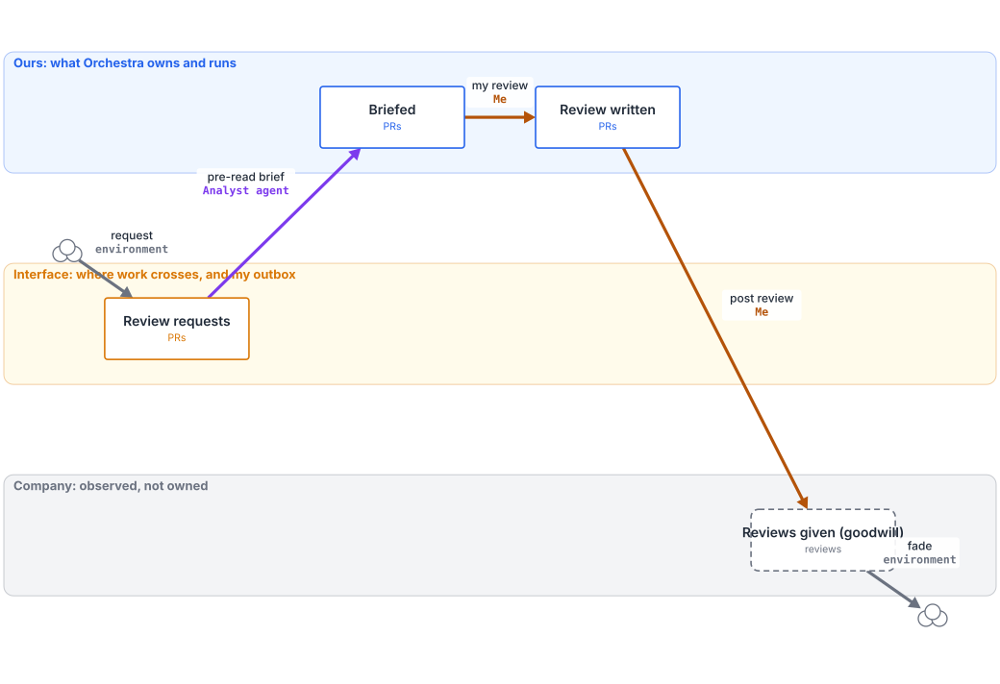

### Feedback loops

| Loop | Type | Through | What it does |
|---|---|---|---|
| R-reciprocity | reinforcing | Reviews given (goodwill) → Teammates' goodwill toward me | Reviews I give build goodwill; in the desk model goodwill speeds reviews of my own PRs. |
| B-fatigue | balancing | Briefed (clean) → Reviewed (defect) → Approved with the defect | A long queue means I skim and miss more defects. |
| B-coaching | balancing | Defect caught: comments posted → Team's skill → Requests (PR with a defect) | Substantive comments raise the team's skill; skilled authors send fewer flawed PRs, so there is less to catch. |
| R-reputation | reinforcing | Defect caught: comments posted → My reputation as a reviewer → Requests (clean PR) → Requests (PR with a defect) | Catching real defects makes me the reviewer people ask for; more requests, until the queue blunts me. |
| R-knowledge | reinforcing | Reviews given (goodwill) → Agent's map of the codebase → Reviewed (defect) | Briefs teach the agent's map of the codebase; better maps make faster, sharper reviews; it decays as code changes. |
| R-goodhart | reinforcing | Nitpicks, recently → Teammates' goodwill toward me | A comment quota adds nitpicks; nitpicks cost goodwill. |
| B-escapes | balancing | Approved with the defect → Bugs from PRs I approved → My reputation as a reviewer | Defects I miss come back as production bugs and cut my reputation as a reviewer. |

### Starting state and drivers

Every stock starts at 0 except: My reputation as a reviewer 50 points; Team's skill 50 points; Requests (clean PR) 2 PRs; Requests (PR with a defect) 1 PRs; Teammates' goodwill toward me 30 points; Agent's map of the codebase 30 entries; Agent budget 120 dollars.

Flows into the model from outside (the drivers). None is a waveform unless it reads an input:

| Flow | Rate |
|---|---|
| review requested → “Requests (clean PR)” | 0.15 + 0.001 × “My reputation as a reviewer” per hour × “Team's skill” effect (0→0.5, 50→0.7, 100→0.9) |
| review requested → “Requests (PR with a defect)” | 0.15 + 0.001 × “My reputation as a reviewer” per hour × “Team's skill” effect (0→0.5, 50→0.3, 100→0.1) |
| nitpicks → “Nitpicks, recently” | 0.005 × “Reviews given (goodwill)”  |
| goodwill earned → “Teammates' goodwill toward me” | 0.05 × “Reviews given (goodwill)” × “Teammates' goodwill toward me” effect (0→1, 80→0.5, 100→0) × “Requests (clean PR)” effect (0→1.2, 5→1, 15→0.5) |
| reputation earned → “My reputation as a reviewer” | 0.4 × “Defect caught: comments posted” × “My reputation as a reviewer” effect (0→1, 80→0.5, 100→0) |
| authors learn → “Team's skill” | 0.3 × “Defect caught: comments posted” × “Team's skill” effect (0→1, 80→0.5, 100→0) |
| weekly budget → “Agent budget” | 3 per hour (120 a week)  |

**Variants** (each starts from the designed model and changes only what's listed):

- **manual**: Today: no brief; I read each change cold, and nothing learns the codebase for me. *Changes:* “pre-read brief”: on me, 0.01 h each; “pre-read brief”: on me, 0.01 h each; “my review”: on me, 0.75 h each; “my review”: on me, 0.9 h each; “agent learns the code”: nobody does it.
- **comment-quota**: Briefs, plus a quota of comments per review: five times the nitpicks. *Changes:* “nitpicks”: rate 0.03 × “Reviews given (goodwill)”.
- **no-agent-learning**: Briefs, but the agent never updates its map of the codebase. *Changes:* “agent learns the code”: nobody does it.

### Simulation

```mermaid
---
config:
  themeVariables:
    xyChart:
      plotColorPalette: "#0f766e, #b45309"
---
xychart-beta
  title "Review requests per week"
  x-axis "week" [0, 1, 2, 3, 4, 5, 6, 7, 8, 9, 10, 11, 12, 13, 14, 15, 16, 17, 18, 19, 20, 21, 22, 23, 24, 25, 26]
  y-axis "PRs / week"
  line [8.0, 8.0, 8.0, 7.9, 7.9, 7.8, 7.7, 7.7, 7.6, 7.6, 7.6, 7.5, 7.5, 7.5, 7.5, 7.5, 7.5, 7.5, 7.5, 7.5, 7.5, 7.5, 7.5, 7.5, 7.5, 7.5, 7.5]
  line [8.0, 8.0, 8.0, 7.9, 7.8, 7.7, 7.7, 7.6, 7.5, 7.4, 7.3, 7.3, 7.2, 7.2, 7.2, 7.1, 7.1, 7.1, 7.1, 7.0, 7.0, 7.0, 7.0, 7.0, 7.0, 7.0, 7.0]
```
*Lines:* 🟩 designed · 🟧 manual (today)

*Plotted:* **Review requests per week** = the rate of “review requested” + “review requested”, per hour × 40. Not a fixed input: 0.15 an hour plus 0.001 × my reputation as a reviewer (about 7 a week at 50).

```mermaid
---
config:
  themeVariables:
    xyChart:
      plotColorPalette: "#0f766e, #dc2626, #b45309"
---
xychart-beta
  title "Agent's map of the codebase: learning against code churn"
  x-axis "week" [0, 1, 2, 3, 4, 5, 6, 7, 8, 9, 10, 11, 12, 13, 14, 15, 16, 17, 18, 19, 20, 21, 22, 23, 24, 25, 26]
  y-axis "entries"
  line [30.0, 29.2, 31.6, 35.4, 39.6, 43.8, 47.8, 51.3, 54.5, 57.2, 59.5, 61.4, 63.1, 64.5, 65.7, 66.7, 67.5, 68.2, 68.8, 69.3, 69.7, 70.1, 70.4, 70.7, 70.9, 71.2, 71.3]
  line [30.0, 25.6, 21.8, 18.6, 15.8, 13.5, 11.5, 9.8, 8.3, 7.1, 6.1, 5.2, 4.4, 3.7, 3.2, 2.7, 2.3, 2.0, 1.7, 1.4, 1.2, 1.0, 0.9, 0.8, 0.6, 0.5, 0.5]
  line [30.0, 25.6, 21.8, 18.6, 15.8, 13.5, 11.5, 9.8, 8.3, 7.1, 6.1, 5.2, 4.4, 3.7, 3.2, 2.7, 2.3, 2.0, 1.7, 1.4, 1.2, 1.0, 0.9, 0.8, 0.6, 0.5, 0.5]
```
*Lines:* 🟩 designed · 🟥 agent not learning · 🟧 manual (today)

*Plotted:* **Agent's map of the codebase** = the level of the stock “Agent's map of the codebase” (`r_knowledge`). Starts at 30 entries.

```mermaid
---
config:
  themeVariables:
    xyChart:
      plotColorPalette: "#0f766e, #b45309"
---
xychart-beta
  title "Defects I miss"
  x-axis "week" [0, 1, 2, 3, 4, 5, 6, 7, 8, 9, 10, 11, 12, 13, 14, 15, 16, 17, 18, 19, 20, 21, 22, 23, 24, 25, 26]
  y-axis "% of defective PRs"
  line [0.0, 20.2, 19.6, 18.6, 17.5, 16.5, 15.6, 14.9, 14.4, 14.1, 13.7, 13.5, 13.2, 13.1, 12.9, 12.8, 12.7, 12.6, 12.5, 12.4, 12.3, 12.3, 12.3, 12.2, 12.2, 12.2, 12.1]
  line [0.0, 21.2, 22.2, 23.1, 23.9, 24.6, 25.2, 25.7, 26.2, 26.6, 26.9, 27.2, 27.4, 27.6, 27.8, 27.9, 28.1, 28.2, 28.3, 28.4, 28.4, 28.5, 28.5, 28.6, 28.6, 28.6, 28.7]
```
*Lines:* 🟩 designed · 🟧 manual (today)

*Plotted:* **Defects I miss** = 100 × (“I miss it”) ÷ (“I catch the defect” + “I miss it”), using each flow's rate. The catch/miss split moves with the code map and my review queue.

```mermaid
---
config:
  themeVariables:
    xyChart:
      plotColorPalette: "#0f766e, #dc2626"
---
xychart-beta
  title "Teammates' goodwill toward me"
  x-axis "week" [0, 1, 2, 3, 4, 5, 6, 7, 8, 9, 10, 11, 12, 13, 14, 15, 16, 17, 18, 19, 20, 21, 22, 23, 24, 25, 26]
  y-axis "points"
  line [30.0, 27.9, 31.6, 35.8, 38.9, 40.8, 41.9, 42.5, 42.8, 42.9, 43.0, 43.0, 42.9, 42.9, 42.9, 42.9, 42.8, 42.8, 42.8, 42.8, 42.8, 42.8, 42.8, 42.8, 42.8, 42.8, 42.8]
  line [30.0, 25.6, 22.6, 21.0, 21.9, 23.0, 23.8, 24.2, 24.5, 24.6, 24.6, 24.6, 24.6, 24.5, 24.5, 24.5, 24.5, 24.5, 24.5, 24.5, 24.5, 24.5, 24.5, 24.5, 24.5, 24.5, 24.5]
```
*Lines:* 🟩 designed · 🟥 comment quota

*Plotted:* **Teammates' goodwill** = the level of the stock “Teammates' goodwill toward me” (`r_goodwill`). Starts at 30.

```mermaid
---
config:
  themeVariables:
    xyChart:
      plotColorPalette: "#0f766e, #b45309"
---
xychart-beta
  title "Team's skill"
  x-axis "week" [0, 1, 2, 3, 4, 5, 6, 7, 8, 9, 10, 11, 12, 13, 14, 15, 16, 17, 18, 19, 20, 21, 22, 23, 24, 25, 26]
  y-axis "points"
  line [50.0, 50.7, 50.8, 50.8, 50.9, 51.0, 51.1, 51.2, 51.3, 51.3, 51.4, 51.4, 51.5, 51.5, 51.5, 51.6, 51.6, 51.6, 51.7, 51.7, 51.7, 51.7, 51.8, 51.8, 51.8, 51.8, 51.9]
  line [50.0, 50.7, 50.7, 50.7, 50.6, 50.4, 50.3, 50.1, 49.8, 49.6, 49.3, 49.1, 48.8, 48.6, 48.3, 48.1, 47.9, 47.6, 47.4, 47.3, 47.1, 46.9, 46.8, 46.6, 46.5, 46.4, 46.3]
```
*Lines:* 🟩 designed · 🟧 manual (today)

*Plotted:* **Team's skill** = the level of the stock “Team's skill” (`r_skill`). Starts at 50.

```mermaid
---
config:
  themeVariables:
    xyChart:
      plotColorPalette: "#0f766e, #b45309"
---
xychart-beta
  title "My reputation as a reviewer"
  x-axis "week" [0, 1, 2, 3, 4, 5, 6, 7, 8, 9, 10, 11, 12, 13, 14, 15, 16, 17, 18, 19, 20, 21, 22, 23, 24, 25, 26]
  y-axis "points"
  line [50.0, 50.6, 49.6, 48.2, 46.6, 44.9, 43.4, 42.0, 40.9, 40.0, 39.3, 38.7, 38.3, 38.0, 37.7, 37.6, 37.5, 37.4, 37.4, 37.4, 37.5, 37.5, 37.6, 37.6, 37.7, 37.7, 37.8]
  line [50.0, 50.5, 49.5, 47.8, 45.8, 43.6, 41.3, 39.2, 37.2, 35.3, 33.7, 32.3, 31.0, 29.9, 28.9, 28.1, 27.4, 26.8, 26.3, 25.9, 25.5, 25.2, 25.0, 24.8, 24.6, 24.4, 24.3]
```
*Lines:* 🟩 designed · 🟧 manual (today)

*Plotted:* **My reputation as a reviewer** = the level of the stock “My reputation as a reviewer” (`r_reputation`). Starts at 50.

### Machines

| Machine | Kind | Capacity (hours per hour) | Flows | Busy, designed | Busy, manual |
|---|---|---|---|---|---|
| Me | person | 0.6 | 2 | 13% | 38% |
| Analyst agent | agent | 1 | 2 | 4% | 0% |
| Orchestra programs | code | 5 | 1 | 0% | 0% |
| Environment (company, people) | — | — | 17 | — | — |

### Crossings into company systems

| Flow | Machine | Crosses |
|---|---|---|
| review requested | environment | github in |
| review requested | environment | github in |
| pre-read brief | Analyst agent | read: PR, code, git log |
| pre-read brief | Analyst agent | read: PR, code, git log |
| my review | Me | github write (approve, comments) |
| I catch the defect | environment | github write (comments) |
| nitpicks | environment | github write (comments) |

### Checks

| Id | Kind | Check | Result | Detail |
|---|---|---|---|---|
| 4.1 | requirement | A review costs me at most half an hour, brief included | pass | 0.42 h per review (today 1.23 h) |
| 4.2 | requirement | I miss at most 15% of real defects over the last 8 weeks | pass | 12% missed (today 29%; agent not learning 29%) |
| 4.3 | requirement | At least 8 review comments a week, most of them substantive | **gap** | 4.68 a week; substantive 1.95, nitpicks 2.74 |
| 4.4 | info | A comment quota hits the count and spends goodwill (Goodhart) | info | comments 18 a week vs 4.68; goodwill at week 26 24 vs 43 |
| 4.5 | info | The agent's map of the code, the team's skill, and my reputation | info | map 71 vs 0.47 today; team skill 52 vs 46; reputation 38 vs 24 |

### The same model as a Mermaid flowchart

```mermaid
flowchart TB
  classDef ours fill:#eff6ff,stroke:#2563eb,color:#111
  classDef interface fill:#fffbeb,stroke:#d97706,color:#111
  classDef company fill:#f3f4f6,stroke:#6b7280,color:#111
  classDef outside fill:#fff,stroke:#9ca3af,color:#6b7280
  subgraph OURS["Ours: what Orchestra owns and runs"]
    direction LR
    r_briefed_clean["Briefed (clean)"]:::ours
    r_briefed_flawed["Briefed (defect)"]:::ours
    r_given["Reviews given"]:::ours
    r_knowledge["Agent's map of the codebase"]:::ours
  end
  subgraph INTERFACE["Interface: where work crosses, and my outbox"]
    direction LR
    r_req_clean["Requests (clean PR)"]:::interface
    r_req_flawed["Requests (PR with a defect)"]:::interface
    r_judged_flawed["Reviewed (defect)"]:::interface
    r_nits["Nitpicks, recently"]:::interface
  end
  subgraph COMPANY["Company: observed, not owned"]
    direction LR
    r_reputation["My reputation as a reviewer"]:::company
    r_skill["Team's skill"]:::company
    r_substantive["Defect caught: comments posted"]:::company
    r_escaped["Approved with the defect"]:::company
    r_bugs["Bugs from PRs I approved"]:::company
    r_recent["Reviews given (goodwill)"]:::company
    r_goodwill["Teammates' goodwill toward me"]:::company
  end
  out_r_ask_clean(("outside")):::outside
  out_r_ask_clean -->|"review requested · environment"| r_req_clean
  r_skill -.->|"speeds review requested"| r_req_clean
  out_r_ask_flawed(("outside")):::outside
  out_r_ask_flawed -->|"review requested · environment"| r_req_flawed
  r_skill -.->|"speeds review requested"| r_req_flawed
  r_req_clean -->|"pre-read brief · Analyst agent"| r_briefed_clean
  r_knowledge -.->|"speeds pre-read brief"| r_briefed_clean
  r_req_flawed -->|"pre-read brief · Analyst agent"| r_briefed_flawed
  r_knowledge -.->|"speeds pre-read brief"| r_briefed_flawed
  r_briefed_clean -->|"my review · Me"| r_recent
  r_knowledge -.->|"speeds my review"| r_recent
  r_briefed_flawed -->|"my review · Me"| r_judged_flawed
  r_knowledge -.->|"speeds my review"| r_judged_flawed
  r_judged_flawed -->|"I catch the defect · environment"| r_substantive
  r_knowledge -.->|"speeds I catch the defect"| r_substantive
  r_briefed_clean -.->|"speeds I catch the defect"| r_substantive
  r_judged_flawed -->|"I miss it · environment"| r_escaped
  r_knowledge -.->|"speeds I miss it"| r_escaped
  r_briefed_clean -.->|"speeds I miss it"| r_escaped
  r_substantive -->|"author fixes it · environment"| r_recent
  r_escaped -->|"lands, defect surfaces · environment"| r_bugs
  gone_r_bug_done(("gone")):::outside
  r_bugs -->|"bug fixed · environment"| gone_r_bug_done
  r_recent -->|"leaves the recent window · environment"| r_given
  out_r_nit(("outside")):::outside
  out_r_nit -->|"nitpicks · environment"| r_nits
  gone_r_nit_fade(("gone")):::outside
  r_nits -->|"forgotten · environment"| gone_r_nit_fade
  out_r_gw_gain(("outside")):::outside
  out_r_gw_gain -->|"goodwill earned · environment"| r_goodwill
  r_goodwill -.->|"speeds goodwill earned"| r_goodwill
  r_req_clean -.->|"speeds goodwill earned"| r_goodwill
  gone_r_gw_loss(("gone")):::outside
  r_goodwill -->|"goodwill fades · environment"| gone_r_gw_loss
  r_nits -.->|"speeds goodwill fades"| gone_r_gw_loss
  out_r_rep_gain(("outside")):::outside
  out_r_rep_gain -->|"reputation earned · environment"| r_reputation
  r_reputation -.->|"speeds reputation earned"| r_reputation
  gone_r_rep_loss(("gone")):::outside
  r_reputation -->|"reputation lost · environment"| gone_r_rep_loss
  r_bugs -.->|"speeds reputation lost"| gone_r_rep_loss
  out_r_teach(("outside")):::outside
  out_r_teach -->|"authors learn · environment"| r_skill
  r_skill -.->|"speeds authors learn"| r_skill
  gone_r_turnover(("gone")):::outside
  r_skill -->|"new joiners, forgetting · environment"| gone_r_turnover
  out_r_learn(("outside")):::outside
  out_r_learn -->|"agent learns the code · Orchestra programs"| r_knowledge
  gone_r_forget(("gone")):::outside
  r_knowledge -->|"code changes under it · environment"| gone_r_forget
  linkStyle 0 stroke:#6b7280,stroke-width:2.5px
  linkStyle 1 stroke:#0891b2,stroke-width:1.5px
  linkStyle 2 stroke:#6b7280,stroke-width:2.5px
  linkStyle 3 stroke:#0891b2,stroke-width:1.5px
  linkStyle 4 stroke:#7c3aed,stroke-width:2.5px
  linkStyle 5 stroke:#0891b2,stroke-width:1.5px
  linkStyle 6 stroke:#7c3aed,stroke-width:2.5px
  linkStyle 7 stroke:#0891b2,stroke-width:1.5px
  linkStyle 8 stroke:#b45309,stroke-width:2.5px
  linkStyle 9 stroke:#0891b2,stroke-width:1.5px
  linkStyle 10 stroke:#b45309,stroke-width:2.5px
  linkStyle 11 stroke:#0891b2,stroke-width:1.5px
  linkStyle 12 stroke:#6b7280,stroke-width:2.5px
  linkStyle 13 stroke:#0891b2,stroke-width:1.5px
  linkStyle 14 stroke:#0891b2,stroke-width:1.5px
  linkStyle 15 stroke:#6b7280,stroke-width:2.5px
  linkStyle 16 stroke:#0891b2,stroke-width:1.5px
  linkStyle 17 stroke:#0891b2,stroke-width:1.5px
  linkStyle 18 stroke:#6b7280,stroke-width:2.5px
  linkStyle 19 stroke:#6b7280,stroke-width:2.5px
  linkStyle 20 stroke:#6b7280,stroke-width:2.5px
  linkStyle 21 stroke:#6b7280,stroke-width:2.5px
  linkStyle 22 stroke:#6b7280,stroke-width:2.5px
  linkStyle 23 stroke:#6b7280,stroke-width:2.5px
  linkStyle 24 stroke:#6b7280,stroke-width:2.5px
  linkStyle 25 stroke:#0891b2,stroke-width:1.5px
  linkStyle 26 stroke:#0891b2,stroke-width:1.5px
  linkStyle 27 stroke:#6b7280,stroke-width:2.5px
  linkStyle 28 stroke:#0891b2,stroke-width:1.5px
  linkStyle 29 stroke:#6b7280,stroke-width:2.5px
  linkStyle 30 stroke:#0891b2,stroke-width:1.5px
  linkStyle 31 stroke:#6b7280,stroke-width:2.5px
  linkStyle 32 stroke:#0891b2,stroke-width:1.5px
  linkStyle 33 stroke:#6b7280,stroke-width:2.5px
  linkStyle 34 stroke:#0891b2,stroke-width:1.5px
  linkStyle 35 stroke:#6b7280,stroke-width:2.5px
  linkStyle 36 stroke:#475569,stroke-width:2.5px
  linkStyle 37 stroke:#6b7280,stroke-width:2.5px
```

## The desk: every story together

Every story in one model: they share my time, the agents and the budget.

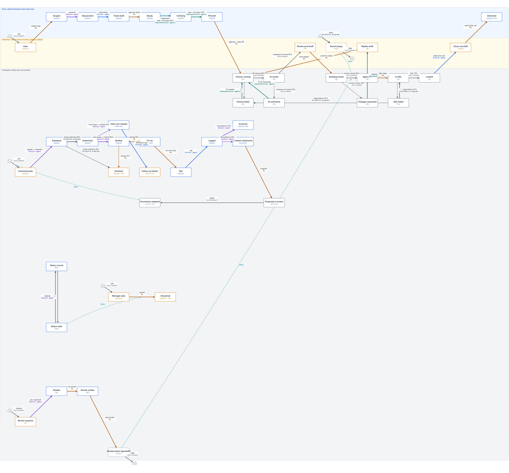

### Starting state and drivers

Every stock starts at 0 except: Requesters' confidence 20 points; Asks 4 requests; Open tickets 2 requests; Agent playbook 20 entries; Technical debt 20 points; My trust in the agents 30 points; Agent budget 120 dollars; Requesters following the process 30 points; Command asks 1 requests; Runbook coverage 20 entries; Status current 30 items; Status stale 30 items; Source hygiene 50 points; Team's patience with nudges 80 points; Manager asks 1 questions; Manager's confidence in me 50 points; My reputation as a reviewer 50 points; Team's skill 50 points; Requests (clean PR) 2 PRs; Requests (PR with a defect) 1 PRs; Teammates' goodwill toward me 30 points; Agent's map of the codebase 30 entries.

Flows into the model from outside (the drivers). None is a waveform unless it reads an input:

| Flow | Rate |
|---|---|
| ask → “Asks” | 0.06 + 0.003 × “Requesters' confidence” per hour  |
| confidence grows → “Requesters' confidence” | 0.05 × “Landed recently”  |
| debt added → “Technical debt” | 0.01 × “Landed recently” + 0.1 × “Landed with a hidden flaw” per hour × “Agent playbook” effect (0→1.5, 60→0.7, 150→0.6) |
| trust earned → “My trust in the agents” | 0.03 × “Landed recently” × “My trust in the agents” effect (0→1, 80→0.5, 100→0) |
| weekly budget → “Agent budget” | 3 per hour (120 a week)  |
| ask → “Command asks” | 0.06 + 0.12 × “company_growth” per hour × “Preventions in force” effect (0→1, 2→0.75, 5→0.5, 10→0.35) |
| requesters learn the process → “Requesters following the process” | 0.6 × “Authority missing” × “Requesters following the process” effect (0→1, 80→0.4, 100→0) |
| new items to track → “Status stale” | 0.05 per hour (2 a week)  |
| owners update → “Source hygiene” | 0.6 × “Recent nudges to owners” × “Team's patience with nudges” effect (0→0, 30→0.3, 60→1, 100→1.2) × “Source hygiene” effect (0→1, 80→0.5, 100→0) |
| patience recovers → “Team's patience with nudges” | (100 − “Team's patience with nudges”) ÷ 200  |
| manager asks → “Manager asks” | 0.1 per hour (4 a week) × “Manager's confidence in me” effect (0→2.5, 50→1, 100→0.4) × “Surprises, recently” effect (0→1, 1→2, 3→3) |
| confidence earned → “Manager's confidence in me” | 0.25 × “Good answers, recently” × “Manager's confidence in me” effect (0→1, 80→0.5, 100→0) |
| a project gets blocked → “Blocked, not yet noticed” | 0.025 per hour (1 a week)  |
| review requested → “Requests (clean PR)” | 0.15 + 0.001 × “My reputation as a reviewer” per hour × “Team's skill” effect (0→0.5, 50→0.7, 100→0.9) |
| review requested → “Requests (PR with a defect)” | 0.15 + 0.001 × “My reputation as a reviewer” per hour × “Team's skill” effect (0→0.5, 50→0.3, 100→0.1) |
| nitpicks → “Nitpicks, recently” | 0.005 × “Reviews given (goodwill)”  |
| goodwill earned → “Teammates' goodwill toward me” | 0.05 × “Reviews given (goodwill)” × “Teammates' goodwill toward me” effect (0→1, 80→0.5, 100→0) × “Requests (clean PR)” effect (0→1.2, 5→1, 15→0.5) |
| reputation earned → “My reputation as a reviewer” | 0.4 × “Defect caught: comments posted” × “My reputation as a reviewer” effect (0→1, 80→0.5, 100→0) |
| authors learn → “Team's skill” | 0.3 × “Defect caught: comments posted” × “Team's skill” effect (0→1, 80→0.5, 100→0) |

### Simulation

```mermaid
---
config:
  themeVariables:
    xyChart:
      plotColorPalette: "#0f766e, #b45309"
---
xychart-beta
  title "Work waiting for me, every story together"
  x-axis "week" [0, 1, 2, 3, 4, 5, 6, 7, 8, 9, 10, 11, 12, 13, 14, 15, 16, 17, 18, 19, 20, 21, 22, 23, 24, 25, 26]
  y-axis "items"
  line [5.0, 0.2, 0.2, 0.2, 0.2, 0.2, 0.2, 0.2, 0.3, 0.3, 0.3, 0.3, 0.3, 0.3, 0.3, 0.3, 0.3, 0.3, 0.3, 0.2, 0.2, 0.2, 0.2, 0.2, 0.2, 0.2, 0.2]
  line [31.0, 37.8, 48.4, 65.0, 86.5, 112, 139, 169, 199, 229, 260, 291, 321, 352, 383, 414, 444, 475, 506, 537, 568, 599, 629, 660, 691, 722, 753]
```
*Lines:* 🟩 designed · 🟧 manual (today)

*Plotted:* **Work waiting for me** = the sum of every stock whose outflow runs on the machine “me”. The sum of every stock that only I drain, across the four stories.

```mermaid
---
config:
  themeVariables:
    xyChart:
      plotColorPalette: "#0f766e, #b45309"
---
xychart-beta
  title "Share of my free time in use"
  x-axis "week" [0, 1, 2, 3, 4, 5, 6, 7, 8, 9, 10, 11, 12, 13, 14, 15, 16, 17, 18, 19, 20, 21, 22, 23, 24, 25, 26]
  y-axis "%"
  line [100, 41.2, 41.8, 42.2, 42.2, 41.8, 41.5, 41.1, 40.9, 40.8, 40.7, 40.8, 41.1, 41.3, 41.5, 41.1, 40.1, 39.1, 38.2, 37.6, 37.2, 36.9, 36.8, 36.7, 36.7, 36.6, 36.6]
  line [100, 100, 100, 100, 100, 100, 100, 100, 100, 100, 100, 100, 100, 100, 100, 100, 100, 100, 100, 100, 100, 100, 100, 100, 100, 100, 100]
```
*Lines:* 🟩 designed · 🟧 manual (today)

*Plotted:* **Share of my free time in use** = the machine “me”'s busy share × 100. My machine's busy share each working hour (100% = all 24 free hours a week).

```mermaid
---
config:
  themeVariables:
    xyChart:
      plotColorPalette: "#0f766e"
---
xychart-beta
  title "Agent spend per week, every story together"
  x-axis "week" [0, 1, 2, 3, 4, 5, 6, 7, 8, 9, 10, 11, 12, 13, 14, 15, 16, 17, 18, 19, 20, 21, 22, 23, 24, 25, 26]
  y-axis "dollars / week"
  line [340, 99.8, 101, 106, 111, 115, 119, 123, 127, 131, 136, 141, 146, 152, 120, 120, 120, 120, 120, 120, 120, 120, 120, 120, 120, 120, 120]
```
*Lines:* 🟩 designed

*Plotted:* **Agent spend per week** = Σ over every flow that uses the budget: its rate × its cost per item, per hour × 40. Summed from every agent flow's rate × its cost per item, across the four stories. The budget refills at $120 a week.

```mermaid
---
config:
  themeVariables:
    xyChart:
      plotColorPalette: "#0f766e"
---
xychart-beta
  title "Agent budget balance"
  x-axis "week" [0, 1, 2, 3, 4, 5, 6, 7, 8, 9, 10, 11, 12, 13, 14, 15, 16, 17, 18, 19, 20, 21, 22, 23, 24, 25, 26]
  y-axis "dollars"
  line [120, 50.3, 70.8, 87.0, 98.1, 105, 108, 107, 102, 93.3, 80.1, 61.7, 37.9, 8.8, 0.7, 0.7, 0.8, 0.8, 0.8, 0.8, 0.8, 0.8, 0.8, 0.7, 0.8, 0.8, 0.8]
```
*Lines:* 🟩 designed

*Plotted:* **Agent budget balance** = the level of the stock “Agent budget” (`budget`). A stock shared by every story: starts at $120, refilled at $3 per working hour, drained by agent spend.

### Machines

| Machine | Kind | Capacity (hours per hour) | Flows | Busy, designed | Busy, manual |
|---|---|---|---|---|---|
| Me | person | 0.6 | 15 | 41% | 100% |
| Analyst agent | agent | 1 | 9 | 52% | 0% |
| Drafter agent | agent | 1 | 4 | 15% | 0% |
| Implementation agents | agent | 2 | 3 | 42% | 0% |
| Orchestra programs | code | 5 | 16 | 0% | 0% |
| Environment (company, people) | — | — | 71 | — | — |

### Crossings into company systems

| Flow | Machine | Crosses |
|---|---|---|
| ask | environment | slack/jira in |
| research | Analyst agent | read: jira, docs, slack, code |
| approve ticket | Me | jira write (via outbox) |
| auto-pass | Orchestra programs | github push + open PR |
| auto-pass | Orchestra programs | github push + open PR |
| my check: fine | Me | github push + open PR |
| ping | Orchestra programs | slack write |
| fix nits | Implementation agents | read: threads; github push; replies via outbox |
| SAIL label | Me | github label |
| re-label flake | Orchestra programs | read: SAIL logs; github label |
| bug becomes a ticket | Orchestra programs | read: jira; jira write |
| ask | environment | slack/jira in |
| explain + runbooks | Analyst agent | read: runbooks, code, docs |
| authority complete | Orchestra programs | read: jira approvals, change tickets, org chart |
| authority missing | Orchestra programs | slack write (the question back, via outbox) |
| root cause + context | Analyst agent | read: customer jira, flag history, deploys, release calendars |
| run (me only) | Me | bastion host (human only) |
| respond to the incident | Me | pagerduty, slack, incident process |
| postmortem → problem statement | Analyst agent | read: slack, pagerduty, deploys, flags |
| log | Drafter agent | jira/slack write (via outbox) |
| file the repeats | Drafter agent | jira write (via outbox) |
| update runbooks | Drafter agent | wiki/runbook write (via outbox) |
| propose | Me | docs write; slack post for review |
| refresh | Analyst agent | read: jira, docs, slack |
| nudge owners | Orchestra programs | slack write (via outbox; earned autonomy) |
| manager asks | environment | slack/meeting in |
| answer | Me | slack write |
| correct it | Me | slack write |
| escalate early | Me | slack/jira write |
| firefight the surprise | Me | slack/meetings |
| review requested | environment | github in |
| review requested | environment | github in |
| pre-read brief | Analyst agent | read: PR, code, git log |
| pre-read brief | Analyst agent | read: PR, code, git log |
| my review | Me | github write (approve, comments) |
| I catch the defect | environment | github write (comments) |
| nitpicks | environment | github write (comments) |

### Checks

| Id | Kind | Check | Result | Detail |
|---|---|---|---|---|
| D.1 | validity | Manual desk reproduces today: fully busy, and work piles up waiting for me | pass | busy 100%, waiting for me 31 → 753 |
| D.2 | requirement | Designed desk: everything fits in my free time, with slack | pass | busy 41% of my free time, waiting for me 0.24 |
| D.3 | validity | Structural: agents can never spend more than the budget holds | pass | lowest balance $0.75 |
| D.4 | requirement | Designed desk: agent work fits the $120 weekly share without drawing down savings | **gap** | $125 a week wanted; balance $120 → $0.75 |
| D.5 | info | Coupling: reviews I give shorten the wait for reviews of my PRs (reciprocity) | info | my PRs wait 2.16 days in human review with reviews given vs 3.05 without; delivered 175 vs 175 (the budget, not review, limits deliveries) |

### The same model as a Mermaid flowchart

```mermaid
flowchart TB
  classDef ours fill:#eff6ff,stroke:#2563eb,color:#111
  classDef interface fill:#fffbeb,stroke:#d97706,color:#111
  classDef company fill:#f3f4f6,stroke:#6b7280,color:#111
  classDef outside fill:#fff,stroke:#9ca3af,color:#6b7280
  subgraph OURS["Ours: what Orchestra owns and runs"]
    direction LR
    t_scoped["Scoped"]:::ours
    t_open["Open tickets"]:::ours
    t_attempted["Attempted"]:::ours
    t_sound["Done, sound"]:::ours
    t_flawed["Done, hidden flaw"]:::ours
    t_failed["Failed or caught"]:::ours
    t_lessons["Lessons not written down"]:::ours
    t_playbook["Agent playbook"]:::ours
    t_debt["Technical debt"]:::ours
    t_trust["My trust in the agents"]:::ours
    t_delivered["Delivered"]:::ours
    p_explained["Explained"]:::ours
    p_authorised["Authorised"]:::ours
    p_briefed["Briefed"]:::ours
    p_to_run["To run"]:::ours
    p_logged["Logged"]:::ours
    p_cases["Cases on file"]:::ours
    p_archived["Archived"]:::ours
    p_statements["Problem statements"]:::ours
    p_postmortem["Postmortems in progress"]:::ours
    p_lessons["Runbook lessons"]:::ours
    p_runbooks["Runbook coverage"]:::ours
    s_current["Status current"]:::ours
    s_stale["Status stale"]:::ours
    s_blocked_hidden["Blocked, not yet noticed"]:::ours
    s_blocked_known["Blocked, I know"]:::ours
    s_escalated["Escalated and handled"]:::ours
    r_briefed_clean["Briefed (clean)"]:::ours
    r_briefed_flawed["Briefed (defect)"]:::ours
    r_given["Reviews given"]:::ours
    r_knowledge["Agent's map of the codebase"]:::ours
  end
  subgraph INTERFACE["Interface: where work crosses, and my outbox"]
    direction LR
    t_asks["Asks"]:::interface
    t_ticket_draft["Ticket draft"]:::interface
    t_check_sound["To check (sound)"]:::interface
    t_check_flawed["To check (flawed)"]:::interface
    t_nudges["Recent pings"]:::interface
    p_asks["Command asks"]:::interface
    p_authority_gap["Authority missing"]:::interface
    p_declined["Declined"]:::interface
    p_ran["Ran"]:::interface
    p_followups["Repeats not yet filed"]:::interface
    p_followup_tickets["Repeats filed"]:::interface
    s_nudges["Recent nudges to owners"]:::interface
    s_asks["Manager asks"]:::interface
    s_drafted["Answer given, accuracy unknown"]:::interface
    s_answered["Answered"]:::interface
    r_req_clean["Requests (clean PR)"]:::interface
    r_req_flawed["Requests (PR with a defect)"]:::interface
    r_judged_flawed["Reviewed (defect)"]:::interface
    r_nits["Nitpicks, recently"]:::interface
  end
  subgraph COMPANY["Company: observed, not owned"]
    direction LR
    t_reputation["Requesters' confidence"]:::company
    t_pr_sound["PR checks (sound)"]:::company
    t_pr_flawed["PR checks (flawed)"]:::company
    t_review_sound["In review (sound)"]:::company
    t_review_flawed["In review (flawed)"]:::company
    t_nits["Nits requested"]:::company
    t_changes["Flaw found late"]:::company
    t_approved["Approved"]:::company
    t_sailing["In SAIL"]:::company
    t_sail_failed["SAIL failed"]:::company
    t_landed_recent["Landed recently"]:::company
    t_latent["Landed with a hidden flaw"]:::company
    t_bugs["Bugs found in production"]:::company
    p_compliance["Requesters following the process"]:::company
    p_in_review["Proposals in review"]:::company
    p_rejected["Rejected"]:::company
    p_policies["Preventions in force"]:::company
    p_incidents["Incidents caused by a command"]:::company
    p_repeat_due["Repeats coming due"]:::company
    s_hygiene["Source hygiene"]:::company
    s_patience["Team's patience with nudges"]:::company
    s_good_recent["Good answers, recently"]:::company
    s_wrong["Answers found wrong"]:::company
    s_confidence["Manager's confidence in me"]:::company
    s_surprises["Blocked, manager found it first"]:::company
    s_bad_recent["Wrong answers, recently"]:::company
    s_surprise_recent["Surprises, recently"]:::company
    r_reputation["My reputation as a reviewer"]:::company
    r_skill["Team's skill"]:::company
    r_substantive["Defect caught: comments posted"]:::company
    r_escaped["Approved with the defect"]:::company
    r_bugs["Bugs from PRs I approved"]:::company
    r_recent["Reviews given (goodwill)"]:::company
    r_goodwill["Teammates' goodwill toward me"]:::company
  end
  out_t_ask(("outside")):::outside
  out_t_ask -->|"ask · environment"| t_asks
  out_t_rep_gain(("outside")):::outside
  out_t_rep_gain -->|"confidence grows · environment"| t_reputation
  gone_t_rep_loss(("gone")):::outside
  t_reputation -->|"confidence fades · environment"| gone_t_rep_loss
  t_bugs -.->|"speeds confidence fades"| gone_t_rep_loss
  t_open -.->|"speeds confidence fades"| gone_t_rep_loss
  t_asks -->|"collect reqs · Me"| t_scoped
  t_scoped -->|"research · Analyst agent"| t_ticket_draft
  t_ticket_draft -->|"approve ticket · Me"| t_open
  t_open -->|"attempt · Implementation agents"| t_attempted
  t_debt -.->|"speeds attempt"| t_attempted
  t_attempted -->|"sound · environment"| t_sound
  t_playbook -.->|"speeds sound"| t_sound
  t_debt -.->|"speeds sound"| t_sound
  t_attempted -->|"hidden flaw · environment"| t_flawed
  t_playbook -.->|"speeds hidden flaw"| t_flawed
  t_debt -.->|"speeds hidden flaw"| t_flawed
  t_attempted -->|"fails · environment"| t_failed
  t_playbook -.->|"speeds fails"| t_failed
  t_failed -->|"diagnose + requeue · Analyst agent"| t_open
  out_t_lesson(("outside")):::outside
  out_t_lesson -->|"capture lessons · Orchestra programs"| t_lessons
  t_open -.->|"speeds capture lessons"| t_lessons
  t_lessons -->|"write playbook · Drafter agent"| t_playbook
  gone_t_obsolete(("gone")):::outside
  t_playbook -->|"goes stale · environment"| gone_t_obsolete
  t_landed_recent -.->|"speeds goes stale"| gone_t_obsolete
  out_t_debt_in(("outside")):::outside
  out_t_debt_in -->|"debt added · environment"| t_debt
  t_playbook -.->|"speeds debt added"| t_debt
  gone_t_refactor(("gone")):::outside
  t_debt -->|"pay down debt · Implementation agents"| gone_t_refactor
  t_sound -->|"route to my check · Orchestra programs"| t_check_sound
  t_trust -.->|"speeds route to my check"| t_check_sound
  t_sound -->|"auto-pass · Orchestra programs"| t_pr_sound
  t_trust -.->|"speeds auto-pass"| t_pr_sound
  t_flawed -->|"route to my check · Orchestra programs"| t_check_flawed
  t_trust -.->|"speeds route to my check"| t_check_flawed
  t_flawed -->|"auto-pass · Orchestra programs"| t_pr_flawed
  t_trust -.->|"speeds auto-pass"| t_pr_flawed
  t_check_sound -->|"my check: fine · Me"| t_pr_sound
  t_check_flawed -->|"my check: caught · Me"| t_failed
  t_pr_sound -->|"checks + AI review · environment"| t_review_sound
  t_pr_flawed -->|"checks + AI review 60% · environment"| t_review_flawed
  t_pr_flawed -->|"checks + AI review 40% · environment"| t_changes
  out_t_ping(("outside")):::outside
  out_t_ping -->|"ping · Orchestra programs"| t_nudges
  gone_t_forget(("gone")):::outside
  t_nudges -->|"fade · environment"| gone_t_forget
  t_review_sound -->|"approve · environment"| t_approved
  t_nudges -.->|"speeds approve"| t_approved
  t_review_sound -.->|"speeds approve"| t_approved
  r_goodwill -.->|"speeds approve"| t_approved
  t_review_sound -->|"request nits · environment"| t_nits
  t_nudges -.->|"speeds request nits"| t_nits
  t_nits -->|"fix nits · Implementation agents"| t_pr_sound
  t_review_flawed -->|"reviewer catches flaw · environment"| t_changes
  t_nudges -.->|"speeds reviewer catches flaw"| t_changes
  t_review_sound -.->|"speeds reviewer catches flaw"| t_changes
  r_skill -.->|"speeds reviewer catches flaw"| t_changes
  t_review_flawed -->|"reviewer misses flaw · environment"| t_latent
  t_nudges -.->|"speeds reviewer misses flaw"| t_latent
  t_review_sound -.->|"speeds reviewer misses flaw"| t_latent
  t_changes -->|"back to diagnosis · Orchestra programs"| t_failed
  t_approved -->|"SAIL label · Me"| t_sailing
  t_sailing -->|"SAIL 75% · environment"| t_landed_recent
  t_sailing -->|"SAIL 25% · environment"| t_sail_failed
  t_sail_failed -->|"re-label flake · Orchestra programs"| t_sailing
  t_landed_recent -->|"leaves the recent window · environment"| t_delivered
  t_latent -->|"bug surfaces · environment"| t_bugs
  t_bugs -->|"bug becomes a ticket · Orchestra programs"| t_open
  out_t_trust_gain(("outside")):::outside
  out_t_trust_gain -->|"trust earned · environment"| t_trust
  t_trust -.->|"speeds trust earned"| t_trust
  gone_t_trust_loss(("gone")):::outside
  t_trust -->|"trust lost · environment"| gone_t_trust_loss
  t_changes -.->|"speeds trust lost"| gone_t_trust_loss
  t_bugs -.->|"speeds trust lost"| gone_t_trust_loss
  out_p_ask(("outside")):::outside
  out_p_ask -->|"ask · environment"| p_asks
  p_policies -.->|"speeds ask"| p_asks
  p_repeat_due -->|"repeat comes due · environment"| p_asks
  p_followups -->|"surprise repeat · environment"| p_asks
  p_asks -->|"explain + runbooks · Analyst agent"| p_explained
  p_runbooks -.->|"speeds explain + runbooks"| p_explained
  p_explained -->|"authority complete · Orchestra programs"| p_authorised
  p_compliance -.->|"speeds authority complete"| p_authorised
  p_explained -->|"authority missing · Orchestra programs"| p_authority_gap
  p_compliance -.->|"speeds authority missing"| p_authority_gap
  p_authority_gap -->|"requester completes it · environment"| p_authorised
  p_authority_gap -->|"requester gives up · environment"| p_declined
  out_p_learn_process(("outside")):::outside
  out_p_learn_process -->|"requesters learn the process · environment"| p_compliance
  p_compliance -.->|"speeds requesters learn the process"| p_compliance
  gone_p_forget_process(("gone")):::outside
  p_compliance -->|"turnover, new requesters · environment"| gone_p_forget_process
  p_authorised -->|"root cause + context 80% · Analyst agent"| p_briefed
  p_authorised -->|"root cause + context 20% · Analyst agent"| p_followups
  p_briefed -->|"decide 85% · Me"| p_to_run
  p_briefed -->|"decide 15% · Me"| p_declined
  p_to_run -->|"run (me only) · Me"| p_ran
  p_ran -->|"goes as expected · environment"| p_logged
  p_ran -->|"causes an incident · environment"| p_incidents
  p_runbooks -.->|"speeds causes an incident"| p_incidents
  p_incidents -->|"respond to the incident · Me"| p_postmortem
  p_postmortem -->|"postmortem → problem statement · Analyst agent"| p_statements
  p_logged -->|"log · Drafter agent"| p_cases
  p_followups -->|"file the repeats · Drafter agent"| p_followup_tickets
  p_followup_tickets -->|"repeat scheduled · environment"| p_repeat_due
  p_policies -.->|"speeds repeat scheduled"| p_repeat_due
  p_followup_tickets -->|"repeat automated away · environment"| p_archived
  p_policies -.->|"speeds repeat automated away"| p_archived
  out_p_lesson(("outside")):::outside
  out_p_lesson -->|"runbook lessons · Orchestra programs"| p_lessons
  p_lessons -->|"update runbooks · Drafter agent"| p_runbooks
  gone_p_runbook_stale(("gone")):::outside
  p_runbooks -->|"runbooks go stale · environment"| gone_p_runbook_stale
  p_cases -->|"find a pattern · Analyst agent"| p_statements
  p_cases -->|"cases age out · environment"| p_archived
  p_statements -->|"propose · Me"| p_in_review
  p_in_review -->|"adopt · environment"| p_policies
  p_cases -.->|"speeds adopt"| p_policies
  p_incidents -.->|"speeds adopt"| p_policies
  p_in_review -->|"reject · environment"| p_rejected
  gone_p_erode(("gone")):::outside
  p_policies -->|"policies erode · environment"| gone_p_erode
  out_s_new(("outside")):::outside
  out_s_new -->|"new items to track · environment"| s_stale
  gone_s_retire(("gone")):::outside
  s_current -->|"items finish · environment"| gone_s_retire
  s_current -->|"projects move on · environment"| s_stale
  s_stale -->|"refresh · Analyst agent"| s_current
  s_hygiene -.->|"speeds refresh"| s_current
  out_s_nudge(("outside")):::outside
  out_s_nudge -->|"nudge owners · Orchestra programs"| s_nudges
  s_hygiene -.->|"speeds nudge owners"| s_nudges
  gone_s_nudge_fade(("gone")):::outside
  s_nudges -->|"fade · environment"| gone_s_nudge_fade
  out_s_hygiene_up(("outside")):::outside
  out_s_hygiene_up -->|"owners update · environment"| s_hygiene
  s_patience -.->|"speeds owners update"| s_hygiene
  s_hygiene -.->|"speeds owners update"| s_hygiene
  gone_s_hygiene_down(("gone")):::outside
  s_hygiene -->|"sources rot · environment"| gone_s_hygiene_down
  gone_s_patience_loss(("gone")):::outside
  s_patience -->|"patience wears · environment"| gone_s_patience_loss
  s_nudges -.->|"speeds patience wears"| gone_s_patience_loss
  out_s_patience_gain(("outside")):::outside
  out_s_patience_gain -->|"patience recovers · environment"| s_patience
  out_s_ask(("outside")):::outside
  out_s_ask -->|"manager asks · environment"| s_asks
  s_confidence -.->|"speeds manager asks"| s_asks
  s_surprise_recent -.->|"speeds manager asks"| s_asks
  s_asks -->|"answer · Me"| s_drafted
  s_stale -.->|"speeds answer"| s_drafted
  s_drafted -->|"turns out right · environment"| s_good_recent
  s_stale -.->|"speeds turns out right"| s_good_recent
  s_drafted -->|"turns out wrong · environment"| s_wrong
  s_stale -.->|"speeds turns out wrong"| s_wrong
  s_wrong -->|"correct it · Me"| s_bad_recent
  s_bad_recent -->|"forgotten · environment"| s_answered
  gone_s_surprise_settle(("gone")):::outside
  s_surprise_recent -->|"forgotten · environment"| gone_s_surprise_settle
  s_good_recent -->|"leaves recent memory · environment"| s_answered
  out_s_conf_gain(("outside")):::outside
  out_s_conf_gain -->|"confidence earned · environment"| s_confidence
  s_confidence -.->|"speeds confidence earned"| s_confidence
  gone_s_conf_loss(("gone")):::outside
  s_confidence -->|"confidence lost · environment"| gone_s_conf_loss
  s_bad_recent -.->|"speeds confidence lost"| gone_s_conf_loss
  s_surprise_recent -.->|"speeds confidence lost"| gone_s_conf_loss
  out_s_block(("outside")):::outside
  out_s_block -->|"a project gets blocked · environment"| s_blocked_hidden
  s_blocked_hidden -->|"page shows the block · Orchestra programs"| s_blocked_known
  s_stale -.->|"speeds page shows the block"| s_blocked_known
  s_blocked_hidden -->|"manager finds it first · environment"| s_surprises
  s_blocked_known -->|"escalate early · Me"| s_escalated
  s_surprises -->|"firefight the surprise · Me"| s_escalated
  out_s_remember(("outside")):::outside
  out_s_remember -->|"remembered · Orchestra programs"| s_surprise_recent
  out_r_ask_clean(("outside")):::outside
  out_r_ask_clean -->|"review requested · environment"| r_req_clean
  r_skill -.->|"speeds review requested"| r_req_clean
  out_r_ask_flawed(("outside")):::outside
  out_r_ask_flawed -->|"review requested · environment"| r_req_flawed
  r_skill -.->|"speeds review requested"| r_req_flawed
  r_req_clean -->|"pre-read brief · Analyst agent"| r_briefed_clean
  r_knowledge -.->|"speeds pre-read brief"| r_briefed_clean
  r_req_flawed -->|"pre-read brief · Analyst agent"| r_briefed_flawed
  r_knowledge -.->|"speeds pre-read brief"| r_briefed_flawed
  r_briefed_clean -->|"my review · Me"| r_recent
  r_knowledge -.->|"speeds my review"| r_recent
  r_briefed_flawed -->|"my review · Me"| r_judged_flawed
  r_knowledge -.->|"speeds my review"| r_judged_flawed
  r_judged_flawed -->|"I catch the defect · environment"| r_substantive
  r_knowledge -.->|"speeds I catch the defect"| r_substantive
  r_briefed_clean -.->|"speeds I catch the defect"| r_substantive
  r_judged_flawed -->|"I miss it · environment"| r_escaped
  r_knowledge -.->|"speeds I miss it"| r_escaped
  r_briefed_clean -.->|"speeds I miss it"| r_escaped
  r_substantive -->|"author fixes it · environment"| r_recent
  r_escaped -->|"lands, defect surfaces · environment"| r_bugs
  gone_r_bug_done(("gone")):::outside
  r_bugs -->|"bug fixed · environment"| gone_r_bug_done
  r_recent -->|"leaves the recent window · environment"| r_given
  out_r_nit(("outside")):::outside
  out_r_nit -->|"nitpicks · environment"| r_nits
  gone_r_nit_fade(("gone")):::outside
  r_nits -->|"forgotten · environment"| gone_r_nit_fade
  out_r_gw_gain(("outside")):::outside
  out_r_gw_gain -->|"goodwill earned · environment"| r_goodwill
  r_goodwill -.->|"speeds goodwill earned"| r_goodwill
  r_req_clean -.->|"speeds goodwill earned"| r_goodwill
  gone_r_gw_loss(("gone")):::outside
  r_goodwill -->|"goodwill fades · environment"| gone_r_gw_loss
  r_nits -.->|"speeds goodwill fades"| gone_r_gw_loss
  out_r_rep_gain(("outside")):::outside
  out_r_rep_gain -->|"reputation earned · environment"| r_reputation
  r_reputation -.->|"speeds reputation earned"| r_reputation
  gone_r_rep_loss(("gone")):::outside
  r_reputation -->|"reputation lost · environment"| gone_r_rep_loss
  r_bugs -.->|"speeds reputation lost"| gone_r_rep_loss
  out_r_teach(("outside")):::outside
  out_r_teach -->|"authors learn · environment"| r_skill
  r_skill -.->|"speeds authors learn"| r_skill
  gone_r_turnover(("gone")):::outside
  r_skill -->|"new joiners, forgetting · environment"| gone_r_turnover
  out_r_learn(("outside")):::outside
  out_r_learn -->|"agent learns the code · Orchestra programs"| r_knowledge
  gone_r_forget(("gone")):::outside
  r_knowledge -->|"code changes under it · environment"| gone_r_forget
  linkStyle 0 stroke:#6b7280,stroke-width:2.5px
  linkStyle 1 stroke:#6b7280,stroke-width:2.5px
  linkStyle 2 stroke:#6b7280,stroke-width:2.5px
  linkStyle 3 stroke:#0891b2,stroke-width:1.5px
  linkStyle 4 stroke:#0891b2,stroke-width:1.5px
  linkStyle 5 stroke:#b45309,stroke-width:2.5px
  linkStyle 6 stroke:#7c3aed,stroke-width:2.5px
  linkStyle 7 stroke:#b45309,stroke-width:2.5px
  linkStyle 8 stroke:#0f766e,stroke-width:2.5px
  linkStyle 9 stroke:#0891b2,stroke-width:1.5px
  linkStyle 10 stroke:#6b7280,stroke-width:2.5px
  linkStyle 11 stroke:#0891b2,stroke-width:1.5px
  linkStyle 12 stroke:#0891b2,stroke-width:1.5px
  linkStyle 13 stroke:#6b7280,stroke-width:2.5px
  linkStyle 14 stroke:#0891b2,stroke-width:1.5px
  linkStyle 15 stroke:#0891b2,stroke-width:1.5px
  linkStyle 16 stroke:#6b7280,stroke-width:2.5px
  linkStyle 17 stroke:#0891b2,stroke-width:1.5px
  linkStyle 18 stroke:#7c3aed,stroke-width:2.5px
  linkStyle 19 stroke:#475569,stroke-width:2.5px
  linkStyle 20 stroke:#0891b2,stroke-width:1.5px
  linkStyle 21 stroke:#2563eb,stroke-width:2.5px
  linkStyle 22 stroke:#6b7280,stroke-width:2.5px
  linkStyle 23 stroke:#0891b2,stroke-width:1.5px
  linkStyle 24 stroke:#6b7280,stroke-width:2.5px
  linkStyle 25 stroke:#0891b2,stroke-width:1.5px
  linkStyle 26 stroke:#0f766e,stroke-width:2.5px
  linkStyle 27 stroke:#475569,stroke-width:2.5px
  linkStyle 28 stroke:#0891b2,stroke-width:1.5px
  linkStyle 29 stroke:#475569,stroke-width:2.5px
  linkStyle 30 stroke:#0891b2,stroke-width:1.5px
  linkStyle 31 stroke:#475569,stroke-width:2.5px
  linkStyle 32 stroke:#0891b2,stroke-width:1.5px
  linkStyle 33 stroke:#475569,stroke-width:2.5px
  linkStyle 34 stroke:#0891b2,stroke-width:1.5px
  linkStyle 35 stroke:#b45309,stroke-width:2.5px
  linkStyle 36 stroke:#b45309,stroke-width:2.5px
  linkStyle 37 stroke:#6b7280,stroke-width:2.5px
  linkStyle 38 stroke:#6b7280,stroke-width:2.5px
  linkStyle 39 stroke:#6b7280,stroke-width:2.5px
  linkStyle 40 stroke:#475569,stroke-width:2.5px
  linkStyle 41 stroke:#6b7280,stroke-width:2.5px
  linkStyle 42 stroke:#6b7280,stroke-width:2.5px
  linkStyle 43 stroke:#0891b2,stroke-width:1.5px
  linkStyle 44 stroke:#0891b2,stroke-width:1.5px
  linkStyle 45 stroke:#0891b2,stroke-width:1.5px
  linkStyle 46 stroke:#6b7280,stroke-width:2.5px
  linkStyle 47 stroke:#0891b2,stroke-width:1.5px
  linkStyle 48 stroke:#0f766e,stroke-width:2.5px
  linkStyle 49 stroke:#6b7280,stroke-width:2.5px
  linkStyle 50 stroke:#0891b2,stroke-width:1.5px
  linkStyle 51 stroke:#0891b2,stroke-width:1.5px
  linkStyle 52 stroke:#0891b2,stroke-width:1.5px
  linkStyle 53 stroke:#6b7280,stroke-width:2.5px
  linkStyle 54 stroke:#0891b2,stroke-width:1.5px
  linkStyle 55 stroke:#0891b2,stroke-width:1.5px
  linkStyle 56 stroke:#475569,stroke-width:2.5px
  linkStyle 57 stroke:#b45309,stroke-width:2.5px
  linkStyle 58 stroke:#6b7280,stroke-width:2.5px
  linkStyle 59 stroke:#6b7280,stroke-width:2.5px
  linkStyle 60 stroke:#475569,stroke-width:2.5px
  linkStyle 61 stroke:#6b7280,stroke-width:2.5px
  linkStyle 62 stroke:#6b7280,stroke-width:2.5px
  linkStyle 63 stroke:#475569,stroke-width:2.5px
  linkStyle 64 stroke:#6b7280,stroke-width:2.5px
  linkStyle 65 stroke:#0891b2,stroke-width:1.5px
  linkStyle 66 stroke:#6b7280,stroke-width:2.5px
  linkStyle 67 stroke:#0891b2,stroke-width:1.5px
  linkStyle 68 stroke:#0891b2,stroke-width:1.5px
  linkStyle 69 stroke:#6b7280,stroke-width:2.5px
  linkStyle 70 stroke:#0891b2,stroke-width:1.5px
  linkStyle 71 stroke:#6b7280,stroke-width:2.5px
  linkStyle 72 stroke:#6b7280,stroke-width:2.5px
  linkStyle 73 stroke:#7c3aed,stroke-width:2.5px
  linkStyle 74 stroke:#0891b2,stroke-width:1.5px
  linkStyle 75 stroke:#475569,stroke-width:2.5px
  linkStyle 76 stroke:#0891b2,stroke-width:1.5px
  linkStyle 77 stroke:#475569,stroke-width:2.5px
  linkStyle 78 stroke:#0891b2,stroke-width:1.5px
  linkStyle 79 stroke:#6b7280,stroke-width:2.5px
  linkStyle 80 stroke:#6b7280,stroke-width:2.5px
  linkStyle 81 stroke:#6b7280,stroke-width:2.5px
  linkStyle 82 stroke:#0891b2,stroke-width:1.5px
  linkStyle 83 stroke:#6b7280,stroke-width:2.5px
  linkStyle 84 stroke:#7c3aed,stroke-width:2.5px
  linkStyle 85 stroke:#7c3aed,stroke-width:2.5px
  linkStyle 86 stroke:#b45309,stroke-width:2.5px
  linkStyle 87 stroke:#b45309,stroke-width:2.5px
  linkStyle 88 stroke:#b45309,stroke-width:2.5px
  linkStyle 89 stroke:#6b7280,stroke-width:2.5px
  linkStyle 90 stroke:#6b7280,stroke-width:2.5px
  linkStyle 91 stroke:#0891b2,stroke-width:1.5px
  linkStyle 92 stroke:#b45309,stroke-width:2.5px
  linkStyle 93 stroke:#7c3aed,stroke-width:2.5px
  linkStyle 94 stroke:#2563eb,stroke-width:2.5px
  linkStyle 95 stroke:#2563eb,stroke-width:2.5px
  linkStyle 96 stroke:#6b7280,stroke-width:2.5px
  linkStyle 97 stroke:#0891b2,stroke-width:1.5px
  linkStyle 98 stroke:#6b7280,stroke-width:2.5px
  linkStyle 99 stroke:#0891b2,stroke-width:1.5px
  linkStyle 100 stroke:#475569,stroke-width:2.5px
  linkStyle 101 stroke:#2563eb,stroke-width:2.5px
  linkStyle 102 stroke:#6b7280,stroke-width:2.5px
  linkStyle 103 stroke:#7c3aed,stroke-width:2.5px
  linkStyle 104 stroke:#6b7280,stroke-width:2.5px
  linkStyle 105 stroke:#b45309,stroke-width:2.5px
  linkStyle 106 stroke:#6b7280,stroke-width:2.5px
  linkStyle 107 stroke:#0891b2,stroke-width:1.5px
  linkStyle 108 stroke:#0891b2,stroke-width:1.5px
  linkStyle 109 stroke:#6b7280,stroke-width:2.5px
  linkStyle 110 stroke:#6b7280,stroke-width:2.5px
  linkStyle 111 stroke:#6b7280,stroke-width:2.5px
  linkStyle 112 stroke:#6b7280,stroke-width:2.5px
  linkStyle 113 stroke:#6b7280,stroke-width:2.5px
  linkStyle 114 stroke:#7c3aed,stroke-width:2.5px
  linkStyle 115 stroke:#0891b2,stroke-width:1.5px
  linkStyle 116 stroke:#475569,stroke-width:2.5px
  linkStyle 117 stroke:#0891b2,stroke-width:1.5px
  linkStyle 118 stroke:#6b7280,stroke-width:2.5px
  linkStyle 119 stroke:#6b7280,stroke-width:2.5px
  linkStyle 120 stroke:#0891b2,stroke-width:1.5px
  linkStyle 121 stroke:#0891b2,stroke-width:1.5px
  linkStyle 122 stroke:#6b7280,stroke-width:2.5px
  linkStyle 123 stroke:#6b7280,stroke-width:2.5px
  linkStyle 124 stroke:#0891b2,stroke-width:1.5px
  linkStyle 125 stroke:#6b7280,stroke-width:2.5px
  linkStyle 126 stroke:#6b7280,stroke-width:2.5px
  linkStyle 127 stroke:#0891b2,stroke-width:1.5px
  linkStyle 128 stroke:#0891b2,stroke-width:1.5px
  linkStyle 129 stroke:#b45309,stroke-width:2.5px
  linkStyle 130 stroke:#0891b2,stroke-width:1.5px
  linkStyle 131 stroke:#6b7280,stroke-width:2.5px
  linkStyle 132 stroke:#0891b2,stroke-width:1.5px
  linkStyle 133 stroke:#6b7280,stroke-width:2.5px
  linkStyle 134 stroke:#0891b2,stroke-width:1.5px
  linkStyle 135 stroke:#b45309,stroke-width:2.5px
  linkStyle 136 stroke:#6b7280,stroke-width:2.5px
  linkStyle 137 stroke:#6b7280,stroke-width:2.5px
  linkStyle 138 stroke:#6b7280,stroke-width:2.5px
  linkStyle 139 stroke:#6b7280,stroke-width:2.5px
  linkStyle 140 stroke:#0891b2,stroke-width:1.5px
  linkStyle 141 stroke:#6b7280,stroke-width:2.5px
  linkStyle 142 stroke:#0891b2,stroke-width:1.5px
  linkStyle 143 stroke:#0891b2,stroke-width:1.5px
  linkStyle 144 stroke:#6b7280,stroke-width:2.5px
  linkStyle 145 stroke:#475569,stroke-width:2.5px
  linkStyle 146 stroke:#0891b2,stroke-width:1.5px
  linkStyle 147 stroke:#6b7280,stroke-width:2.5px
  linkStyle 148 stroke:#b45309,stroke-width:2.5px
  linkStyle 149 stroke:#b45309,stroke-width:2.5px
  linkStyle 150 stroke:#475569,stroke-width:2.5px
  linkStyle 151 stroke:#6b7280,stroke-width:2.5px
  linkStyle 152 stroke:#0891b2,stroke-width:1.5px
  linkStyle 153 stroke:#6b7280,stroke-width:2.5px
  linkStyle 154 stroke:#0891b2,stroke-width:1.5px
  linkStyle 155 stroke:#7c3aed,stroke-width:2.5px
  linkStyle 156 stroke:#0891b2,stroke-width:1.5px
  linkStyle 157 stroke:#7c3aed,stroke-width:2.5px
  linkStyle 158 stroke:#0891b2,stroke-width:1.5px
  linkStyle 159 stroke:#b45309,stroke-width:2.5px
  linkStyle 160 stroke:#0891b2,stroke-width:1.5px
  linkStyle 161 stroke:#b45309,stroke-width:2.5px
  linkStyle 162 stroke:#0891b2,stroke-width:1.5px
  linkStyle 163 stroke:#6b7280,stroke-width:2.5px
  linkStyle 164 stroke:#0891b2,stroke-width:1.5px
  linkStyle 165 stroke:#0891b2,stroke-width:1.5px
  linkStyle 166 stroke:#6b7280,stroke-width:2.5px
  linkStyle 167 stroke:#0891b2,stroke-width:1.5px
  linkStyle 168 stroke:#0891b2,stroke-width:1.5px
  linkStyle 169 stroke:#6b7280,stroke-width:2.5px
  linkStyle 170 stroke:#6b7280,stroke-width:2.5px
  linkStyle 171 stroke:#6b7280,stroke-width:2.5px
  linkStyle 172 stroke:#6b7280,stroke-width:2.5px
  linkStyle 173 stroke:#6b7280,stroke-width:2.5px
  linkStyle 174 stroke:#6b7280,stroke-width:2.5px
  linkStyle 175 stroke:#6b7280,stroke-width:2.5px
  linkStyle 176 stroke:#0891b2,stroke-width:1.5px
  linkStyle 177 stroke:#0891b2,stroke-width:1.5px
  linkStyle 178 stroke:#6b7280,stroke-width:2.5px
  linkStyle 179 stroke:#0891b2,stroke-width:1.5px
  linkStyle 180 stroke:#6b7280,stroke-width:2.5px
  linkStyle 181 stroke:#0891b2,stroke-width:1.5px
  linkStyle 182 stroke:#6b7280,stroke-width:2.5px
  linkStyle 183 stroke:#0891b2,stroke-width:1.5px
  linkStyle 184 stroke:#6b7280,stroke-width:2.5px
  linkStyle 185 stroke:#0891b2,stroke-width:1.5px
  linkStyle 186 stroke:#6b7280,stroke-width:2.5px
  linkStyle 187 stroke:#475569,stroke-width:2.5px
  linkStyle 188 stroke:#6b7280,stroke-width:2.5px
```
