# User-story diagrams

Generated by `node docs/models/render.mjs` from the models in `models/`. Don't edit by hand;
edit `models/build.py`, then run `build.py`, `check.mjs` and `render.mjs`.

Stories and their acceptance tests are in `user-stories.md`; assumptions in `models/README.md`.

**How to read the diagrams.**

- **Boxes are stocks.** They're blue in our band, amber in the interface (where work crosses
  into company systems, and my outbox), and grey in the company band (observed, not owned).
  Dashed boxes are information stocks.
- **Arrows are flows,** coloured by the machine that runs them. Its name is under each label:
  me, the analyst, drafter or implementation agents, Orchestra's programs, or the environment
  (the company and its people). A flow that splits shows its share on each branch. Clouds are
  outside the model.
- **Dashed cyan lines are effects:** a stock that speeds or slows a flow.
- **The agent budget is left out of the diagrams** to keep them readable. Every agent flow
  draws on it.

In the charts, 🟧 is the manual baseline (today), 🟩 the designed system, and 🟪 a what-if.

## Story 1: a simple task for another team

A member of another team asks for a simple task. I collect the requirements; everything from research to the requester being told is carried by agents and programs, with my approval at each point where something is said or pushed as me. The company's side (checks, AI review, human review, SAIL) is the environment. Time unit: a working hour; horizon four weeks.

### Simulation: manual against designed

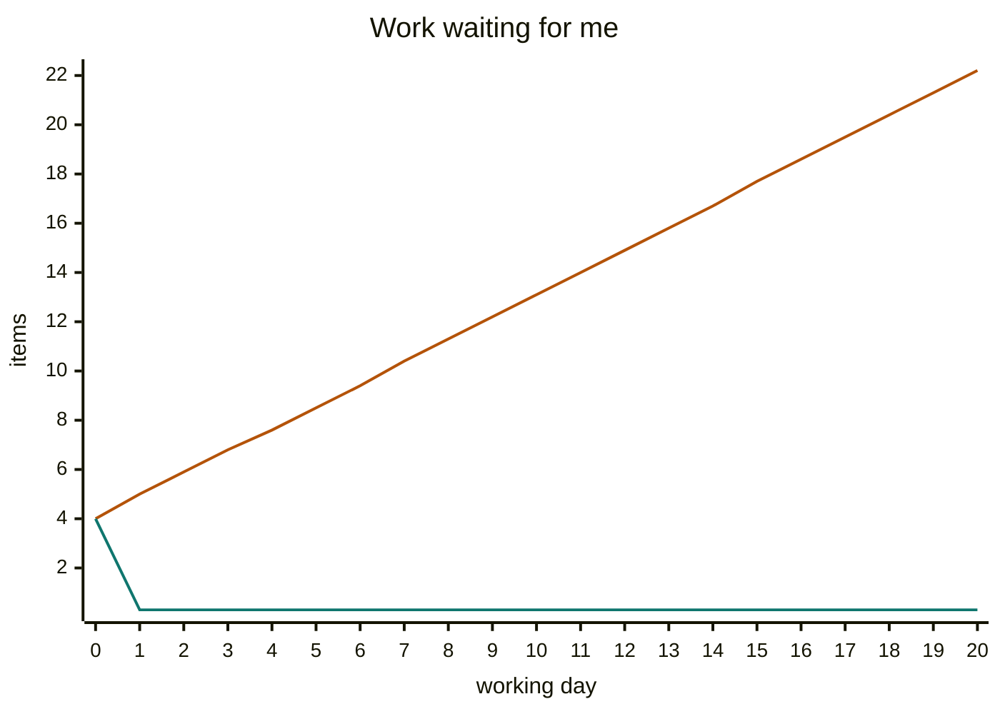
*Lines:* 🟧 manual (today) · 🟩 designed

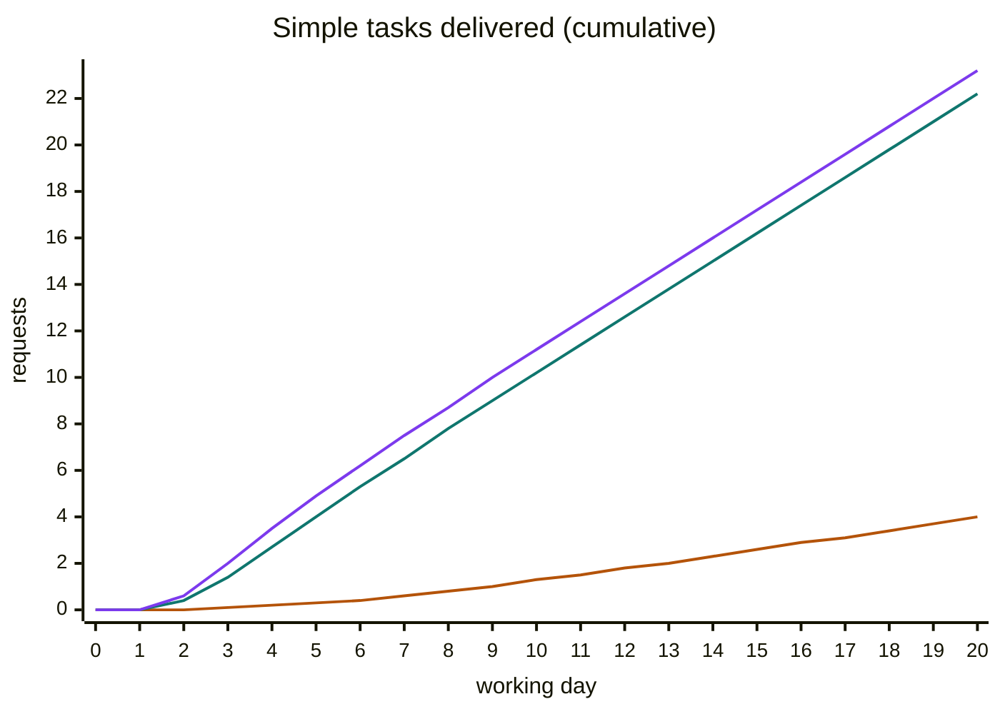
*Lines:* 🟧 manual (today) · 🟩 designed · 🟪 designed, better first pass

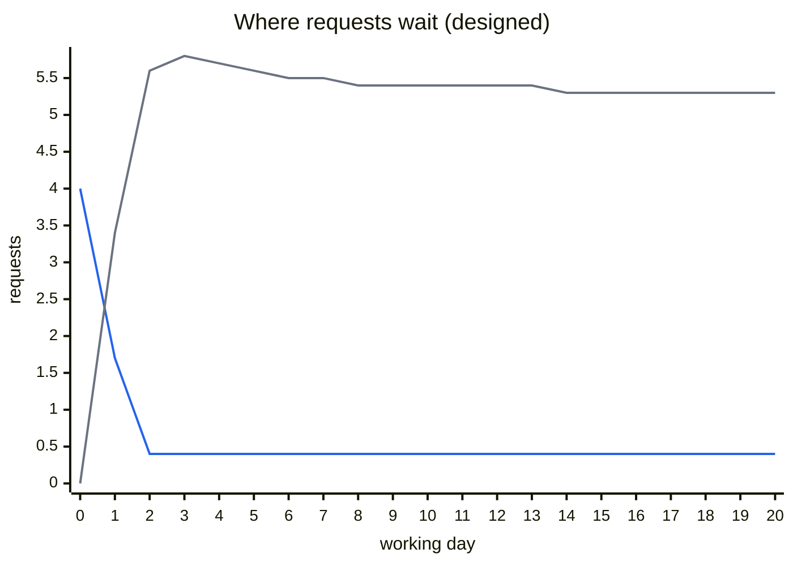
*Lines:* 🟦 ours and interface · ⬜ company (checks, review, SAIL)

### Machines

| Machine | Kind | Flows | Busy, designed | Busy, manual |
|---|---|---|---|---|
| Me | person | 7 | 22% | 100% |
| Analyst agent | agent | 1 | 8% | 0% |
| Drafter agent | agent | 2 | 5% | 0% |
| Implementation agents | agent | 5 | 45% | 0% |
| Orchestra programs | code | 2 | 0% | 0% |
| Environment (company, people) | — | 6 | — | — |

### Crossings into company systems

| Flow | Machine | Crosses |
|---|---|---|
| ask | environment | slack/jira in |
| research | Analyst agent | read: jira, docs, slack, code |
| approve ticket | Me | jira write (via outbox) |
| approve + open PR | Me | github push + open PR |
| fix checks | Implementation agents | read: check logs; github push |
| fix AI comments | Implementation agents | read: PR comments; github push |
| post for review | Me | slack write (via outbox) |
| ping | Orchestra programs | slack write |
| address comments | Implementation agents | read: review threads |
| send replies | Me | github push + replies (via outbox) |
| SAIL label | Me | github label |
| triage failure | Orchestra programs | read: SAIL logs; github label |
| draft close-out | Drafter agent | read: jira, slack |
| send close-out | Me | jira write + slack write (via outbox) |

### Checks

| Id | Kind | Check | Result | Detail |
|---|---|---|---|---|
| 1.1 | validity | Manual reproduces today: I am fully busy, work piles up waiting for me, few requests finish | pass | busy 100%, waiting for me 4.00 → 22, 3.96 of 24 delivered |
| 1.2 | requirement | Designed: nothing piles up waiting for me | pass | waiting for me at the end: 0.29 |
| 1.3 | requirement | Designed: most requests are delivered within four weeks | pass | 22 delivered of 24 asked (manual: 3.96) |
| 1.4 | requirement | Designed: at most one hour of my time per delivered request | pass | 0.94 h per delivered request (busy 22% of my free time) |
| 1.5 | requirement | Designed: at most $20 of agent work per delivered request | **gap** | $22 per delivered |
| 1.6 | requirement | Designed: started to merged within 4 working days (32 working hours, Little's law) | **gap** | mean cycle 42 working hours (5.20 days); 90% of work in progress sits in company stocks |
| 1.6b | info | Fewer rounds at each boundary (better first pass): cost and cycle | info | $16 per delivered, cycle 4.26 days, 23 delivered |
| 1.7 | requirement | Requests rising to 10 a week: designed still keeps up; manual falls further behind | pass | waiting for me: designed 0.34, manual 39; my busy 29% |

### The same model as a Mermaid flowchart

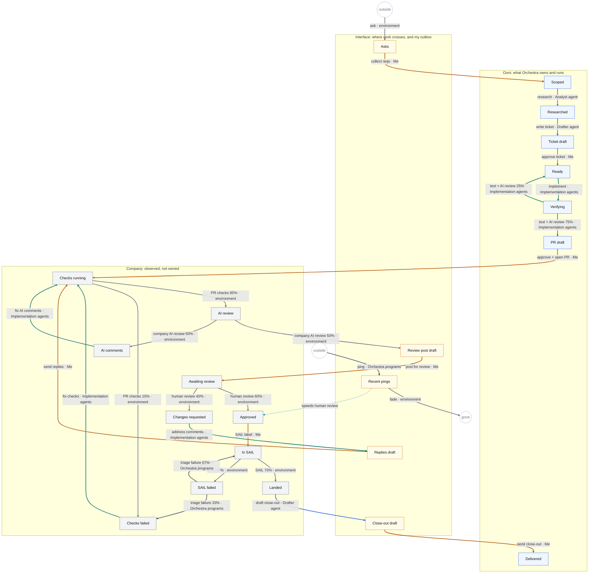

## Story 2: a request to run a production command

Someone asks me to run a command on a production bastion. Before I run it: what it does, its impact and risk, who authorised it, why it is needed, and whether it repeats in other environments. After: it is logged, and patterns become problem statements that, once adopted, make these requests rarer. Agents never run the command. Time unit: a working hour; horizon twelve weeks.

### Simulation: manual against designed

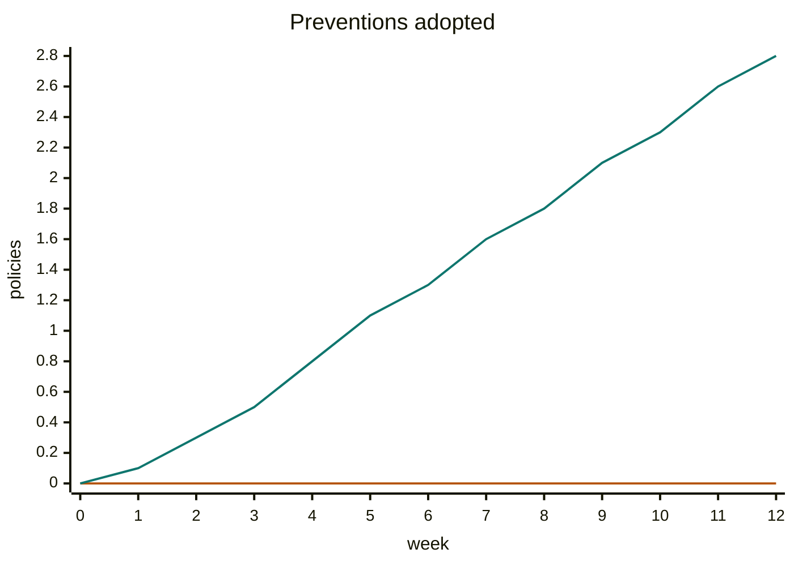
*Lines:* 🟧 today's shortcut · 🟩 designed

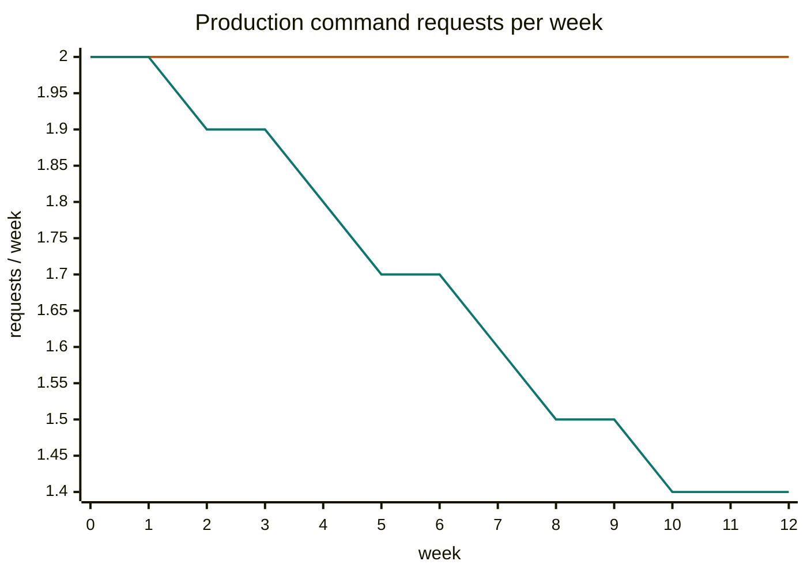
*Lines:* 🟧 today's shortcut · 🟩 designed

### Machines

| Machine | Kind | Flows | Busy, designed | Busy, manual |
|---|---|---|---|---|
| Me | person | 3 | 4% | 20% |
| Analyst agent | agent | 3 | 6% | 0% |
| Drafter agent | agent | 2 | 0% | 0% |
| Orchestra programs | code | 1 | 0% | 0% |
| Environment (company, people) | — | 2 | — | — |

### Crossings into company systems

| Flow | Machine | Crosses |
|---|---|---|
| ask | environment | slack/jira in |
| explain + runbooks | Analyst agent | read: runbooks, code, docs |
| check authority | Orchestra programs | read: jira approvals, change tickets, org chart |
| root cause + context | Analyst agent | read: customer jira, flag history, deploys, release calendars |
| run (me only) | Me | bastion host (human only) |
| log | Drafter agent | jira/slack write (via outbox) |
| file follow-ups | Drafter agent | jira write (via outbox) |
| propose | Me | docs write; slack post for review |

### Checks

| Id | Kind | Check | Result | Detail |
|---|---|---|---|---|
| 2.1 | validity | Structural: only I run production commands, in every variant | pass | p_run machine = me everywhere |
| 2.2 | requirement | Designed: full due diligence costs me under a quarter of doing it all myself | pass | 0.70 h per request vs 5.26 h doing it all myself (today's shortcut: 2.87 h) |
| 2.3 | requirement | Designed: prevention is adopted, and requests become rarer | pass | 2.78 adopted in 12 weeks; arrivals 2.00 → 1.37 a week (today's shortcut adopts 0.00) |
| 2.4 | requirement | Designed: every repeat needed in other environments becomes a ticket | pass | 3.80 filed, 0.00 waiting (today: 4.49 never filed) |

### The same model as a Mermaid flowchart

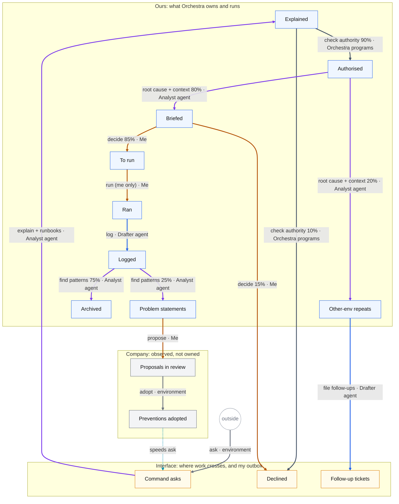

## Story 3: a manager asks for status

Managers ask me about projects assuming I remember. If the status page is current I send it; if not I redo the research. The analyst keeps the page current as tickets, docs and threads change. Time unit: a working hour; horizon four weeks.

### Simulation: manual against designed

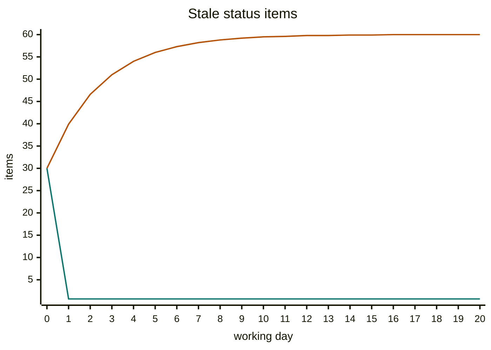
*Lines:* 🟧 manual (today) · 🟩 designed

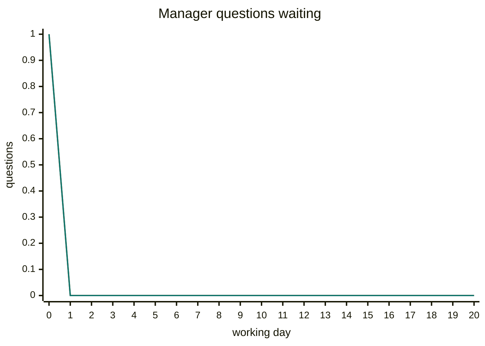
*Lines:* 🟧 manual (today) · 🟩 designed

### Machines

| Machine | Kind | Flows | Busy, designed | Busy, manual |
|---|---|---|---|---|
| Me | person | 1 | 4% | 30% |
| Analyst agent | agent | 1 | 16% | 0% |
| Environment (company, people) | — | 2 | — | — |

### Crossings into company systems

| Flow | Machine | Crosses |
|---|---|---|
| refresh | Analyst agent | read: jira, docs, slack |
| ask | environment | slack/meeting in |
| answer | Me | slack write |

### Checks

| Id | Kind | Check | Result | Detail |
|---|---|---|---|---|
| 3.1 | requirement | Designed: the status page stays current (at most 10 stale items) | pass | mean stale 0.99 (manual 56) |
| 3.2 | requirement | Designed: an answer costs me at most 15 minutes; manual at least an hour | pass | 0.21 h vs 1.72 h per answer |

### The same model as a Mermaid flowchart

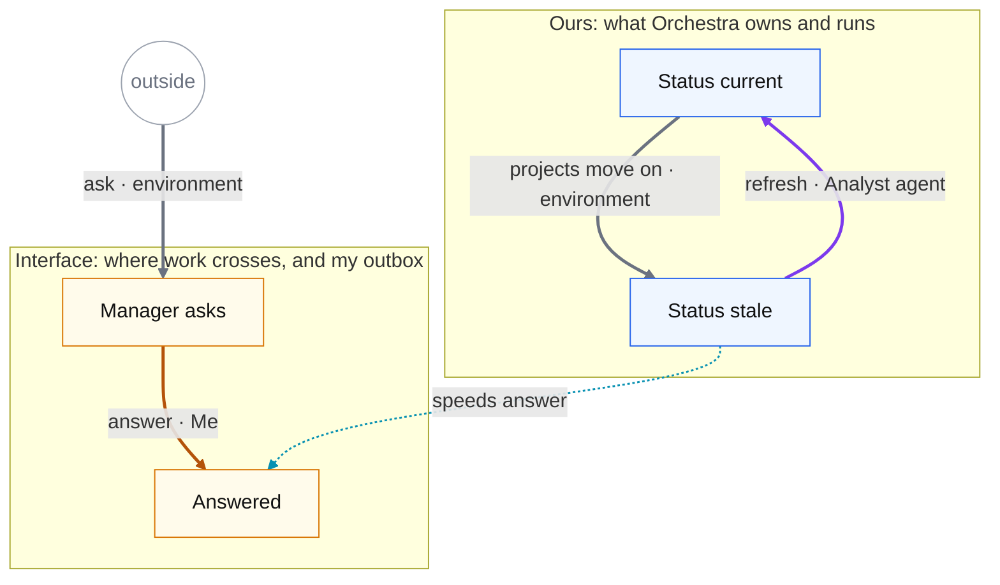

## Story 4: reviewing teammates' PRs

Teammates ask me for reviews. An agent prepares a brief; I review and post. Reviews given recently stand in for goodwill, which (in the desk model) speeds up reviews of my own PRs. Time unit: a working hour; horizon four weeks.

### Simulation: manual against designed

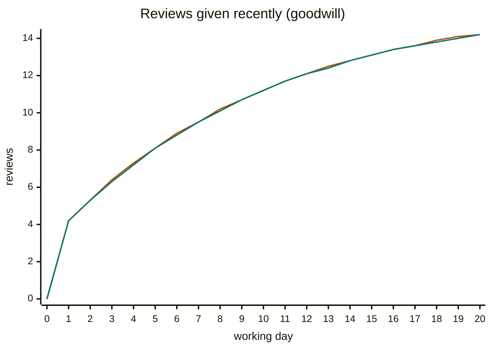
*Lines:* 🟧 manual (today) · 🟩 designed

### Machines

| Machine | Kind | Flows | Busy, designed | Busy, manual |
|---|---|---|---|---|
| Me | person | 2 | 15% | 28% |
| Analyst agent | agent | 1 | 5% | 0% |
| Environment (company, people) | — | 2 | — | — |

### Crossings into company systems

| Flow | Machine | Crosses |
|---|---|---|
| request | environment | github in |
| pre-read brief | Analyst agent | read: PR, code, git log |
| post review | Me | github write |

### Checks

| Id | Kind | Check | Result | Detail |
|---|---|---|---|---|
| 4.1 | requirement | Designed: review requests to me don't pile up | pass | 0.10 waiting (manual 0.10) |

### The same model as a Mermaid flowchart

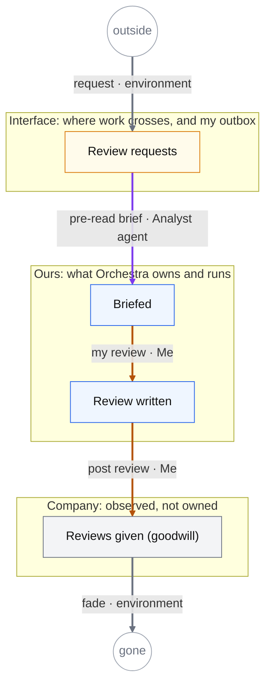

## The desk: every story together

Every story in one model: they share my time, the agents and the budget.

### Simulation: manual against designed

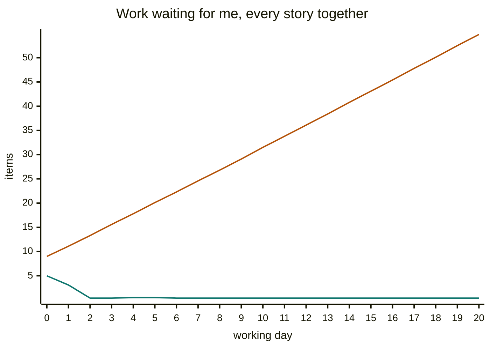
*Lines:* 🟧 manual (today) · 🟩 designed

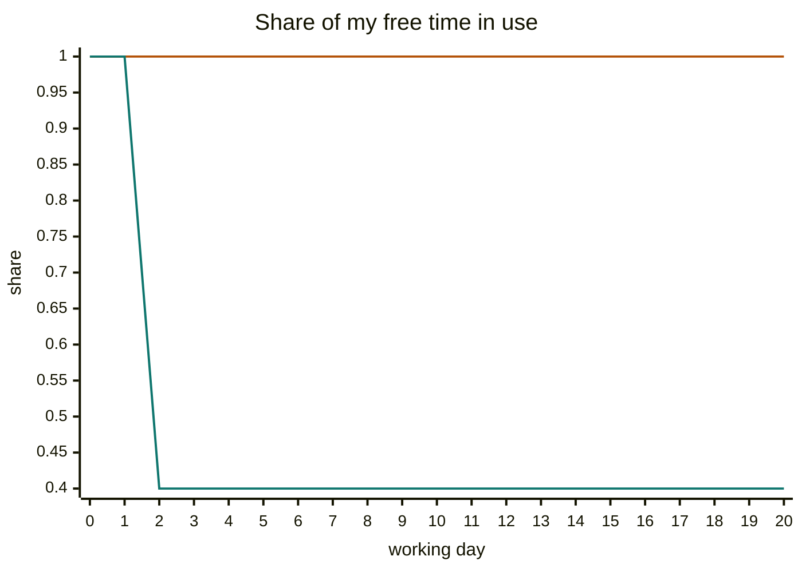
*Lines:* 🟧 manual (today) · 🟩 designed

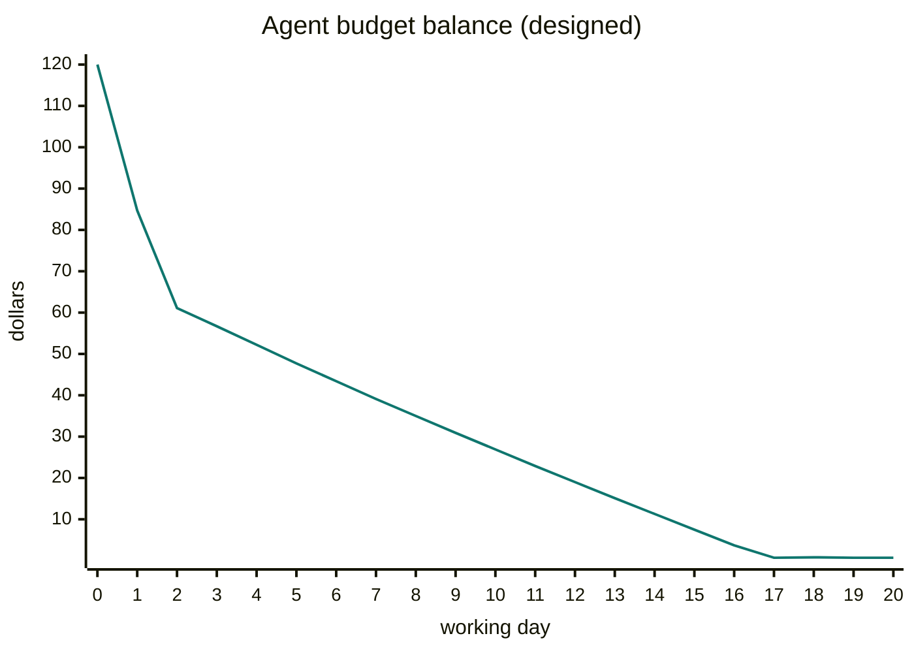
*Lines:* 🟩 designed

### Machines

| Machine | Kind | Flows | Busy, designed | Busy, manual |
|---|---|---|---|---|
| Me | person | 13 | 46% | 100% |
| Analyst agent | agent | 6 | 44% | 0% |
| Drafter agent | agent | 4 | 7% | 0% |
| Implementation agents | agent | 5 | 53% | 0% |
| Orchestra programs | code | 3 | 0% | 0% |
| Environment (company, people) | — | 12 | — | — |

### Crossings into company systems

| Flow | Machine | Crosses |
|---|---|---|
| ask | environment | slack/jira in |
| research | Analyst agent | read: jira, docs, slack, code |
| approve ticket | Me | jira write (via outbox) |
| approve + open PR | Me | github push + open PR |
| fix checks | Implementation agents | read: check logs; github push |
| fix AI comments | Implementation agents | read: PR comments; github push |
| post for review | Me | slack write (via outbox) |
| ping | Orchestra programs | slack write |
| address comments | Implementation agents | read: review threads |
| send replies | Me | github push + replies (via outbox) |
| SAIL label | Me | github label |
| triage failure | Orchestra programs | read: SAIL logs; github label |
| draft close-out | Drafter agent | read: jira, slack |
| send close-out | Me | jira write + slack write (via outbox) |
| ask | environment | slack/jira in |
| explain + runbooks | Analyst agent | read: runbooks, code, docs |
| check authority | Orchestra programs | read: jira approvals, change tickets, org chart |
| root cause + context | Analyst agent | read: customer jira, flag history, deploys, release calendars |
| run (me only) | Me | bastion host (human only) |
| log | Drafter agent | jira/slack write (via outbox) |
| file follow-ups | Drafter agent | jira write (via outbox) |
| propose | Me | docs write; slack post for review |
| refresh | Analyst agent | read: jira, docs, slack |
| ask | environment | slack/meeting in |
| answer | Me | slack write |
| request | environment | github in |
| pre-read brief | Analyst agent | read: PR, code, git log |
| post review | Me | github write |

### Checks

| Id | Kind | Check | Result | Detail |
|---|---|---|---|---|
| D.1 | validity | Manual desk reproduces today: fully busy, and work piles up waiting for me | pass | busy 100%, waiting for me 9.00 → 55 |
| D.2 | requirement | Designed desk: everything fits in my free time, with slack | pass | busy 46% of my free time, waiting for me 0.40 |
| D.3 | validity | Structural: agents can never spend more than the budget holds | pass | lowest balance $0.75 |
| D.4 | requirement | Designed desk: agent work fits the $120 weekly share without drawing down savings | **gap** | $150 a week wanted; balance $120 → $0.75 |
| D.5 | info | Coupling: reviews I give speed up reviews of my PRs (reciprocity) | info | 22 simple tasks delivered with reviews given vs 21 without |

### The same model as a Mermaid flowchart

```mermaid
flowchart TB
  classDef ours fill:#eff6ff,stroke:#2563eb,color:#111
  classDef interface fill:#fffbeb,stroke:#d97706,color:#111
  classDef company fill:#f3f4f6,stroke:#6b7280,color:#111
  classDef outside fill:#fff,stroke:#9ca3af,color:#6b7280
  subgraph OURS["Ours: what Orchestra owns and runs"]
    direction LR
    t_scoped["Scoped"]:::ours
    t_researched["Researched"]:::ours
    t_ticket_draft["Ticket draft"]:::ours
    t_ready["Ready"]:::ours
    t_verifying["Verifying"]:::ours
    t_pr_draft["PR draft"]:::ours
    t_delivered["Delivered"]:::ours
    p_explained["Explained"]:::ours
    p_authorised["Authorised"]:::ours
    p_briefed["Briefed"]:::ours
    p_approved_to_run["To run"]:::ours
    p_ran["Ran"]:::ours
    p_gov_followups["Other-env repeats"]:::ours
    p_candidates["Logged"]:::ours
    p_archived["Archived"]:::ours
    p_problem_statements["Problem statements"]:::ours
    s_current["Status current"]:::ours
    s_stale["Status stale"]:::ours
    r_briefed["Briefed"]:::ours
    r_comments_draft["Review written"]:::ours
  end
  subgraph INTERFACE["Interface: where work crosses, and my outbox"]
    direction LR
    t_inbox["Asks"]:::interface
    t_post_draft["Review post draft"]:::interface
    t_nudges["Recent pings"]:::interface
    t_reply_draft["Replies draft"]:::interface
    t_close_draft["Close-out draft"]:::interface
    p_inbox["Command asks"]:::interface
    p_declined["Declined"]:::interface
    p_gov_tickets["Follow-up tickets"]:::interface
    s_asks["Manager asks"]:::interface
    s_answered["Answered"]:::interface
    r_requests["Review requests"]:::interface
  end
  subgraph COMPANY["Company: observed, not owned"]
    direction LR
    t_ci["Checks running"]:::company
    t_ci_failed["Checks failed"]:::company
    t_bot_review["AI review"]:::company
    t_bot_comments["AI comments"]:::company
    t_awaiting_review["Awaiting review"]:::company
    t_changes_requested["Changes requested"]:::company
    t_approved["Approved"]:::company
    t_sailing["In SAIL"]:::company
    t_sail_failed["SAIL failed"]:::company
    t_landed["Landed"]:::company
    p_in_review["Proposals in review"]:::company
    p_policies["Preventions adopted"]:::company
    r_recent["Reviews given (goodwill)"]:::company
  end
  out_t_arrive(("outside")):::outside
  out_t_arrive -->|"ask · environment"| t_inbox
  t_inbox -->|"collect reqs · Me"| t_scoped
  t_scoped -->|"research · Analyst agent"| t_researched
  t_researched -->|"write ticket · Drafter agent"| t_ticket_draft
  t_ticket_draft -->|"approve ticket · Me"| t_ready
  t_ready -->|"implement · Implementation agents"| t_verifying
  t_verifying -->|"test + AI review 75% · Implementation agents"| t_pr_draft
  t_verifying -->|"test + AI review 25% · Implementation agents"| t_ready
  t_pr_draft -->|"approve + open PR · Me"| t_ci
  t_ci -->|"PR checks 85% · environment"| t_bot_review
  t_ci -->|"PR checks 15% · environment"| t_ci_failed
  t_ci_failed -->|"fix checks · Implementation agents"| t_ci
  t_bot_review -->|"company AI review 50% · environment"| t_post_draft
  t_bot_review -->|"company AI review 50% · environment"| t_bot_comments
  t_bot_comments -->|"fix AI comments · Implementation agents"| t_ci
  t_post_draft -->|"post for review · Me"| t_awaiting_review
  out_t_ping(("outside")):::outside
  out_t_ping -->|"ping · Orchestra programs"| t_nudges
  gone_t_forget(("gone")):::outside
  t_nudges -->|"fade · environment"| gone_t_forget
  t_awaiting_review -->|"human review 60% · environment"| t_approved
  t_awaiting_review -->|"human review 40% · environment"| t_changes_requested
  t_nudges -.->|"speeds human review"| t_approved
  r_recent -.->|"speeds human review"| t_approved
  t_changes_requested -->|"address comments · Implementation agents"| t_reply_draft
  t_reply_draft -->|"send replies · Me"| t_ci
  t_approved -->|"SAIL label · Me"| t_sailing
  t_sailing -->|"SAIL 70% · environment"| t_landed
  t_sailing -->|"SAIL 30% · environment"| t_sail_failed
  t_sail_failed -->|"triage failure 67% · Orchestra programs"| t_sailing
  t_sail_failed -->|"triage failure 33% · Orchestra programs"| t_ci_failed
  t_landed -->|"draft close-out · Drafter agent"| t_close_draft
  t_close_draft -->|"send close-out · Me"| t_delivered
  out_p_arrive(("outside")):::outside
  out_p_arrive -->|"ask · environment"| p_inbox
  p_policies -.->|"speeds ask"| p_inbox
  p_inbox -->|"explain + runbooks · Analyst agent"| p_explained
  p_explained -->|"check authority 90% · Orchestra programs"| p_authorised
  p_explained -->|"check authority 10% · Orchestra programs"| p_declined
  p_authorised -->|"root cause + context 80% · Analyst agent"| p_briefed
  p_authorised -->|"root cause + context 20% · Analyst agent"| p_gov_followups
  p_briefed -->|"decide 85% · Me"| p_approved_to_run
  p_briefed -->|"decide 15% · Me"| p_declined
  p_approved_to_run -->|"run (me only) · Me"| p_ran
  p_ran -->|"log · Drafter agent"| p_candidates
  p_gov_followups -->|"file follow-ups · Drafter agent"| p_gov_tickets
  p_candidates -->|"find patterns 75% · Analyst agent"| p_archived
  p_candidates -->|"find patterns 25% · Analyst agent"| p_problem_statements
  p_problem_statements -->|"propose · Me"| p_in_review
  p_in_review -->|"adopt · environment"| p_policies
  s_current -->|"projects move on · environment"| s_stale
  s_stale -->|"refresh · Analyst agent"| s_current
  out_s_ask(("outside")):::outside
  out_s_ask -->|"ask · environment"| s_asks
  s_asks -->|"answer · Me"| s_answered
  s_stale -.->|"speeds answer"| s_answered
  out_r_arrive(("outside")):::outside
  out_r_arrive -->|"request · environment"| r_requests
  r_requests -->|"pre-read brief · Analyst agent"| r_briefed
  r_briefed -->|"my review · Me"| r_comments_draft
  r_comments_draft -->|"post review · Me"| r_recent
  gone_r_fade(("gone")):::outside
  r_recent -->|"fade · environment"| gone_r_fade
  linkStyle 0 stroke:#6b7280,stroke-width:2.5px
  linkStyle 1 stroke:#b45309,stroke-width:2.5px
  linkStyle 2 stroke:#7c3aed,stroke-width:2.5px
  linkStyle 3 stroke:#2563eb,stroke-width:2.5px
  linkStyle 4 stroke:#b45309,stroke-width:2.5px
  linkStyle 5 stroke:#0f766e,stroke-width:2.5px
  linkStyle 6 stroke:#0f766e,stroke-width:2.5px
  linkStyle 7 stroke:#0f766e,stroke-width:2.5px
  linkStyle 8 stroke:#b45309,stroke-width:2.5px
  linkStyle 9 stroke:#6b7280,stroke-width:2.5px
  linkStyle 10 stroke:#6b7280,stroke-width:2.5px
  linkStyle 11 stroke:#0f766e,stroke-width:2.5px
  linkStyle 12 stroke:#6b7280,stroke-width:2.5px
  linkStyle 13 stroke:#6b7280,stroke-width:2.5px
  linkStyle 14 stroke:#0f766e,stroke-width:2.5px
  linkStyle 15 stroke:#b45309,stroke-width:2.5px
  linkStyle 16 stroke:#475569,stroke-width:2.5px
  linkStyle 17 stroke:#6b7280,stroke-width:2.5px
  linkStyle 18 stroke:#6b7280,stroke-width:2.5px
  linkStyle 19 stroke:#6b7280,stroke-width:2.5px
  linkStyle 20 stroke:#0891b2,stroke-width:1.5px
  linkStyle 21 stroke:#0891b2,stroke-width:1.5px
  linkStyle 22 stroke:#0f766e,stroke-width:2.5px
  linkStyle 23 stroke:#b45309,stroke-width:2.5px
  linkStyle 24 stroke:#b45309,stroke-width:2.5px
  linkStyle 25 stroke:#6b7280,stroke-width:2.5px
  linkStyle 26 stroke:#6b7280,stroke-width:2.5px
  linkStyle 27 stroke:#475569,stroke-width:2.5px
  linkStyle 28 stroke:#475569,stroke-width:2.5px
  linkStyle 29 stroke:#2563eb,stroke-width:2.5px
  linkStyle 30 stroke:#b45309,stroke-width:2.5px
  linkStyle 31 stroke:#6b7280,stroke-width:2.5px
  linkStyle 32 stroke:#0891b2,stroke-width:1.5px
  linkStyle 33 stroke:#7c3aed,stroke-width:2.5px
  linkStyle 34 stroke:#475569,stroke-width:2.5px
  linkStyle 35 stroke:#475569,stroke-width:2.5px
  linkStyle 36 stroke:#7c3aed,stroke-width:2.5px
  linkStyle 37 stroke:#7c3aed,stroke-width:2.5px
  linkStyle 38 stroke:#b45309,stroke-width:2.5px
  linkStyle 39 stroke:#b45309,stroke-width:2.5px
  linkStyle 40 stroke:#b45309,stroke-width:2.5px
  linkStyle 41 stroke:#2563eb,stroke-width:2.5px
  linkStyle 42 stroke:#2563eb,stroke-width:2.5px
  linkStyle 43 stroke:#7c3aed,stroke-width:2.5px
  linkStyle 44 stroke:#7c3aed,stroke-width:2.5px
  linkStyle 45 stroke:#b45309,stroke-width:2.5px
  linkStyle 46 stroke:#6b7280,stroke-width:2.5px
  linkStyle 47 stroke:#6b7280,stroke-width:2.5px
  linkStyle 48 stroke:#7c3aed,stroke-width:2.5px
  linkStyle 49 stroke:#6b7280,stroke-width:2.5px
  linkStyle 50 stroke:#b45309,stroke-width:2.5px
  linkStyle 51 stroke:#0891b2,stroke-width:1.5px
  linkStyle 52 stroke:#6b7280,stroke-width:2.5px
  linkStyle 53 stroke:#7c3aed,stroke-width:2.5px
  linkStyle 54 stroke:#b45309,stroke-width:2.5px
  linkStyle 55 stroke:#b45309,stroke-width:2.5px
  linkStyle 56 stroke:#6b7280,stroke-width:2.5px
```
