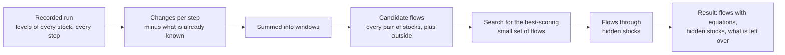
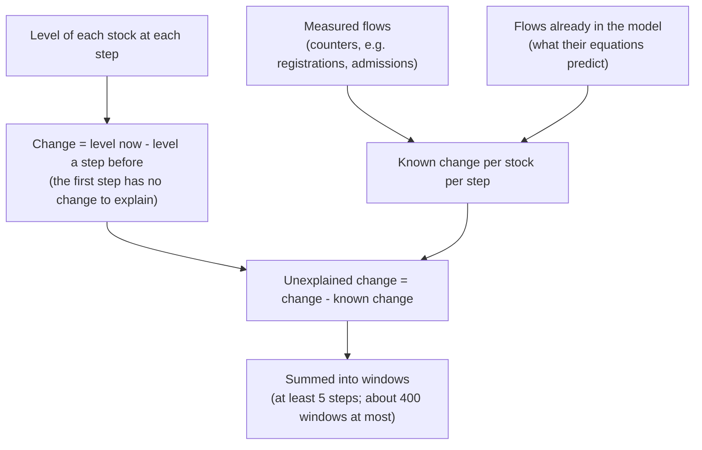
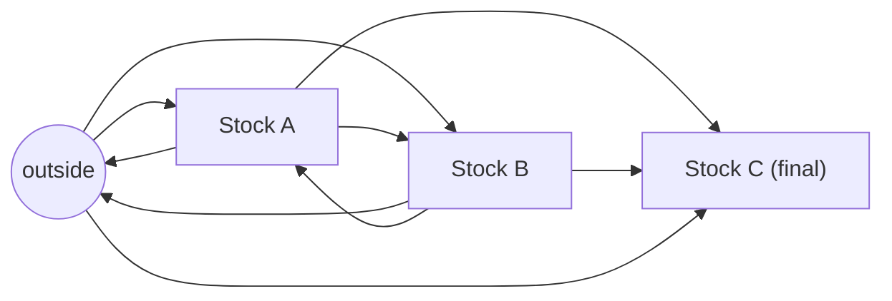
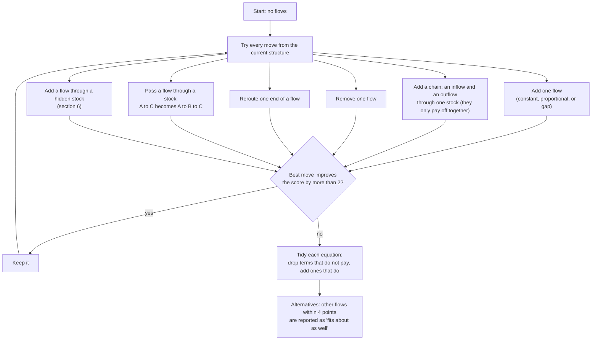
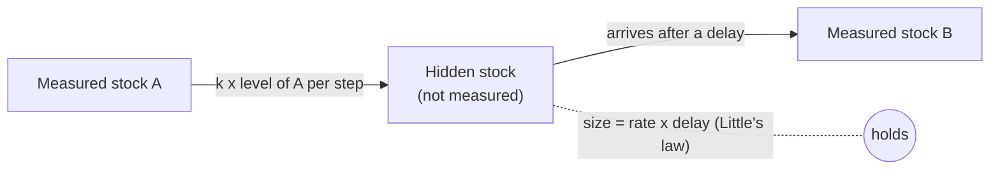
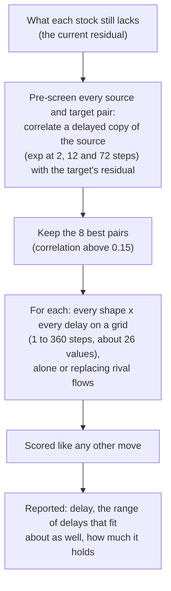
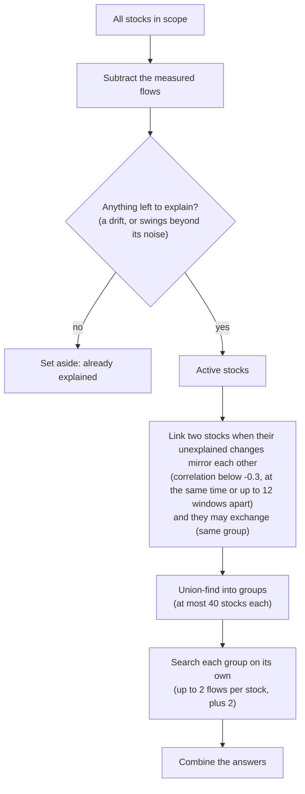
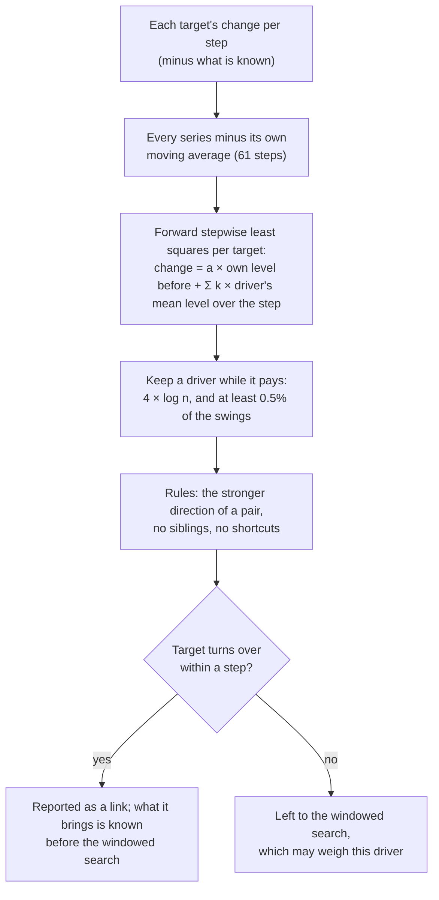

# How "Discover flows" worked (the JavaScript search, now removed)

> **History.** This describes the search the page ran in the browser until discovery moved to the
> server's Python engine (`sdlab/discovery`, the matrix method: SPEC.md section 6.2). `discover.js`
> and the tests that drove it were removed; the document stays as the record of what was tried.

A design brief for SD Lab's discovery feature: what it does, the techniques it uses, the choices
behind them, and where it stops working. The code is `sdlab/static/discover.js` (the search) and
the discovery part of `sdlab/static/app.js` (what the page feeds it and does with its answer).

## The question it answers

A model has stocks: things you can count, such as socks in a basket, patients in a waiting room,
or messages a consumer group has not read yet. You record how their levels change over time. The
question is:

> What is the simplest set of flows, each with a simple equation, that explains how every stock
> changed?

The answer is a structure (which flows exist, between which stocks), an equation for each flow,
and what is still left unexplained. It also proposes stocks nobody measures, when the timing of
what leaves one stock and arrives in another gives them away.

In one sentence: **discovery is sparse system identification.** It imagines a flow between every
pair of stocks, nearly all of them zero. It fits simple linear equations by weighted least
squares, and searches for the smallest set of flows whose fit is worth its complexity, judged by
the Bayesian information criterion (BIC) plus a few physical priors.



Closest standard names: SINDy (sparse identification of nonlinear dynamics), stepwise
regression with BIC, transfer-function/ARX system identification with delay kernels, and Little's
law for sizing hidden stocks.

## 1. From levels to unexplained change

Every step, a stock's change is what flowed in minus what flowed out. Discovery works on those
changes, not on the levels themselves.



- **Known change is subtracted first.** If the run has measured flows, the page gives discovery
  each one's amount per step as "took from" and "made into" stocks. If the model already has flows
  that nothing measures, their equations' predictions count as known too. So discovery explains
  only what the model is missing. A complete model leaves nothing to find. The "Ignore my flows
  and start from nothing" checkbox turns this off.
- **Windows.** Steps are summed into windows: at least 5 steps, and wide enough that there are no
  more than about 400 windows (a month of 5-minute steps becomes two-hour windows). Whole-number
  counts in single steps are noisy; windows smooth that, and keep the search fast. A window's
  change is only the difference between the levels at its two ends, though, so a stock that
  turns over within a step (a service whose requests take a fraction of a second) shows nothing
  in windows: its links are screened on single steps instead (section 8).
- **Starting levels.** A run that starts mid-stream did not jump there from zero. With no starting
  levels given, the first step is treated as having no change to explain.

## 2. Every possible flow

Discovery imagines a candidate flow between every ordered pair of stocks, and between each stock
and "outside" (the environment), in both directions.



Rules prune the list:

| Rule | Why |
|---|---|
| Nothing flows out of a `final` stock (done, shipped, cancelled) | Things never leave it |
| Stocks in different `group`s never exchange directly | One topic's lag cannot flow into another's |
| Between stocks with different units, a flow has a ratio: 2, 3, ½ or ⅓ | 2 socks make 1 pair |

## 3. Each flow's equation

Each candidate flow moves an amount `q` per step, given by a small linear equation:

```
q = c + a × (level of the stock it drains) + b × (level of the stock it fills)
```

Keeping only some of the terms gives the model's own equation forms:

| Terms kept | Form in the model | Meaning |
|---|---|---|
| `c` | constant | a steady rate |
| `a` | proportional | a share of the source per step (a drain, a decay) |
| `c + b` with `b < 0` | gap | close the gap to a goal level in the target |
| `c + a` | linear | a base rate plus a share of the source |

Because `q` is linear in its coefficients, every candidate flow contributes columns to one
linear regression: its effect on each stock (−1 × ratio on the source, +1 on the target) times
each of its inputs. Fitting any set of flows is then **weighted least squares**, solved through
the normal equations. Columns and their dot products are cached, because the search tries
thousands of sets made of the same few hundred columns.

**Eras.** When the run has eras (a machine was added, a capacity changed), a flow between two
stocks gets its own coefficients in each era: changing a machine changes how fast a flow runs, not
whether it exists. Flows to and from outside keep one set: the world does not notice our eras.

**Weights.** Each stock is weighted by its jitter: how much its change differs from one window to
the next. Real movement changes slowly; jitter does not. So a stock that swings by thousands does
not drown out one that moves by ones. One extra row per unit holds the total change of all stocks
in that unit. Flows between measured stocks cancel in it, so it shows plainly what came in from,
or went out to, somewhere unmeasured. That row is the conservation evidence.

## 4. Scoring a structure

A structure (a set of flows, each with chosen terms) is scored. Lower is better:

```
score = BIC + conservation price + movement price
BIC   = N × log(RSS / N) + (number of coefficients) × log N
```

| Part | What it charges | Why |
|---|---|---|
| BIC | misfit (RSS), plus log N for every number fitted | more flows always fit better; each must pay its way |
| Conservation | ½ × log N for a flow to or from outside; ¼ × log N for a unit-converting ratio | things are conserved unless shown otherwise |
| Movement | 2 × log N × (what the flows move) / (how much the stocks changed) | a loop of flows changes no stock, so it fits anything for free; charging movement rules out invisible circulation |
| Hidden-stock flow | 2 × log N more | it adds a delay and a shape to the guess |

A structure is only valid if every flow **runs forwards**: on average it moves things from its
source to its target, and it runs backwards in at most 10% of windows.

## 5. The search

Trying every subset of hundreds of candidates is impossible, so discovery does a **local search**
(close to stepwise regression). It starts with no flows. Each round it tries many changes to the
current structure and keeps the single best one, if it improves the score by more than 2.



- **Chains.** Some flows only pay off in pairs: an inflow and an outflow of the same stock. Adding
  one alone makes the fit worse, so pairs through one stock are tried together. In large models
  (more than 200 candidates), only the 6 most promising flows in and out of each stock are paired.
- **At most 12 flows** per search by default (more for a large group, section 7). The search runs
  at most 3 rounds per allowed flow.
- **Ambiguity is reported, not hidden.** For each flow found, any other flow that scores within 4
  points if swapped in is listed as "fits about as well". Many alternatives mean the run did not
  vary enough to tell them apart. The page then suggests changing something (a machine, a
  capacity) and running again: experiments separate structures.

## 6. Stocks nobody measures

Sometimes things leave a measured stock, wait somewhere nobody measures, and arrive in another
measured stock later: a lab, a vendor, a follow-up visit. The fingerprint is that **what arrives
is a delayed copy of what left.**



Discovery models this as one more kind of candidate flow. It takes `k × (level of A)` from A each
step, like a proportional flow, but delivers it to B through a delay. Three delay shapes are
tried:

| Shape | What the hidden stock is like | How arrivals spread |
|---|---|---|
| exp | drains in proportion to what it holds (a lab working through a pile) | exponential tail |
| erlang | two such stages in a row | bunched around the mean delay |
| pipe | everything waits the same time (a fixed-length process) | a fixed delay |

For a given shape and delay, the flow is again linear in its numbers: `k`, plus how much was
already waiting when measuring began. So it enters the same regression and pays the same price.
It is accepted only if it improves the score, either alone or in place of the flows it explains:
a flow out to outside plus one in from outside, or a direct flow between the same two stocks.
This is how discovery decides whether "a flow out to the environment and a flow in from the
environment" are really one flow through a stock in between.



Details:

- **Echoes.** A flow can also be "timed by" a final stock's gains rather than taken from a stock:
  things that ended (discharged, delivered) and come back later as new arrivals.
- **No self-loops.** A delayed copy of a stock's own level fits any slow wiggle, so a hidden stock
  between a stock and itself is not proposed.
- **Size.** The hidden stock's average contents follow from the flow and the delay (Little's law:
  rate × delay).
- **What the page does with it.** It is drawn as a dashed "not measured" box. Adding it creates an
  `inferred` stock with a flow in (the rate found) and a proportional flow out (one over the
  delay). Its chart shows the level its flows imply, since nothing measures it.

**What must be measured.** A hidden stock is identifiable when the traffic at one of its ends is
counted. Otherwise two waits in a row (the hidden one, and the target's own drain) look the same
in either order. The hospital example shows the boundary. Its lab between treatment and the ward
is found with about the right delay. A 2-hour imaging step is too small and fast to see at
hourly steps. A follow-up visit 5 days later is too smooth to pick out.

## 7. Whole models with hundreds of stocks

Searching every stock at once is too slow for hundreds of stocks, and a hand-picked handful gives
poor answers. With more than 12 stocks in scope (or nothing selected), discovery splits the model
first:



Only stocks whose changes mirror each other could be joined by a flow. One loses about what the
other gains, now or after a delay. So independent parts are searched independently. On the
400-service fleet this takes about a second.

Three guards keep chance from joining stocks:

- **The bar rises with the number of pairs.** Among 861 pairs of 42 stocks, each tried at 25 lags,
  some pair mirrors by chance in a short run. The bar is the larger of 0.3 and
  √(2 ln pairs) / √(windows − lags), the size of the largest chance correlation: 0.53 for 42 stocks
  in 300 one-second steps (60 windows), 0.3 once the run has a few hundred windows.
- **Fast stocks that move together are not mirrored.** For two stocks that turn over within a step
  (section 8) whose changes go up together, the lagged correlations are skipped: A's jump at t and
  B's fall back at t + 1 look like mirroring and are only each level's noise coming and going.
- **Pulls join stocks too** (section 8): a queue that falls as a pool of workers gets busier is
  searched with that pool, in a group of at most 4.

## 8. Links, and stocks that turn over within a step

Most relationships in a running system move nothing. A service that calls another keeps its own
request while the callee gets a new one; a request that publishes a message is not used up. In
stock-and-flow terms these are **links**: an inflow from outside whose rate follows another
stock's level, "outside → B at k × level of A". The search in section 5 can propose them (a
"driven" flow, with the term `d` = the driver's level), ranked by how well the driver's quick
swings match what B still lacks.

That works when stocks change slowly against the step. It fails for the web shop
(`examples/shop`): 42 stocks measured every second, services whose requests last 0.02 to 2 s.
Their in-flight levels are snapshots, renewed every step, and the run had to be read in windows of
5 to 18 seconds. A window's change is the difference between two snapshots, so a service looked
like it never drained, and the link signal was averaged away. Discovery found 0 to 3 true links of
65 and few other flows, getting worse as the run grew (the windows widen).

So `discoverAll` first **screens links on single steps** (`screenLinks`):



- **Single steps, quick swings.** For a target B, the change in one step is regressed on B's own
  level before the step (its drain) and on each driver's mean level over the step (calls are made
  while the caller works through the step; the level after the step counts as much as the level
  before). Each series has its centred moving average taken off first, so the shared daily cycle
  and a flash sale do not make every busy stock a driver of every other. All sums of products are
  computed once (drivers × drivers, drivers × each target), so the whole shop takes about 70 ms.
- **Stricter than BIC.** In a long run, real but indirect correlations become "significant": a
  driver must improve the fit by 4 × log n and explain at least 0.5% of B's swings.
- **A level is a noisy reading of how busy a stock was**, so stocks related to B's real driver help
  predict B too. Three rules remove most of them: (1) when A drives B and B drives A, the stronger
  direction stays; (2) a driver that is itself driven by a stronger driver of B is a sibling, not
  a cause; (3) a driver that reaches B through a stronger path A → C → B is not a direct link.
- **Only stocks that turn over within a step get screened links.** Fast is measured, not assumed:
  a stock whose quick swings do not last into the next step (lag-1 autocorrelation of its
  detrended level at most 0.7). The shop's services are at −0.04 to 0.62, its queues 0.85 to 0.97;
  the baskets and drawers of the socks, the hospital's wards and the reservoirs are 0.76 to 1.0. A
  few stocks of slower models do turn over within a step (the kanban board's review column, at
  0.41) and are screened like services. For a slow stock the same relation could just as well be
  a flow from the driver (the levels fit both equally: a flow that takes k × A from A, and a link
  k × A plus A draining as much to outside, change every stock the same way), so it is left to
  the windowed search with its conservation prior, which may only weigh drivers the screen found.
- **What the links bring is then known.** Each screened link's amount per step is added to what is
  known, so the windowed search explains only the rest: the drains, the traffic from outside, and
  flows between stocks. Groups made only of screened stocks do not look for links again.
- **Pulls.** A negative coefficient between stocks of the same unit is a pull: the target falls as
  the other stock's level rises, as a queue does when a pool of workers takes from it. Pulls are
  looked for with only each series' mean taken off (backlogs build up over minutes), the strongest
  one per stock, moving at least 2% of the puller's level a step. A pulled stock is searched with
  its puller, and the search may then propose a flow **taken in proportion to the taker's level**
  (`q = b × level of the stock it fills`, with no constant): a pool takes work as fast as its busy
  workers finish. The chain move adds that flow together with the pool's proportional drain, since
  neither pays alone. Without a pull, such a flow is still not proposed: a rate that depends only
  on the level of the stock it fills means nothing.

On the shop's answer key (`node` grading against `examples/shop/truth.json`; links are counted
as true only with the right driver and target; page settings: window 5, eras):

| Run length | Before: links, true / found | Before: flows between stocks, queue → pool / found | After: links | After: flows between stocks | Time after |
|---|---|---|---|---|---|
| 300 s | 0 / 1 | 0 / 0 | 16 / 21 | 0 / 3 | 0.06 s |
| 1000 s | 0 / 6 | 0 / 5 | 19 / 39 | 0 / 5 | 0.14 s |
| 2000 s | 3 / 9 | 0 / 0 | 28 / 44 | 0 / 1 | 0.2 s |
| 3000 s | 0 / 6 | 0 / 0 | 27 / 40 | 0 / 0 | 0.2 s |
| 5000 s | 2 / 6 | 0 / 1 | 26 / 47 | 2 / 4 | 1.3 s |
| 7200 s | 1 / 3 | 0 / 0 | 29 / 52 | 3 / 5 | 0.6 s |

The queue → pool flows can only show once a queue has had a backlog (the flash sale starts at
t = 3600). Before, the run also gave only 1 to 15 flows to or from outside; now 21 after 300 s and 34 to 40
from 1000 s on (the shop has 36 drains and 3 external inflows). `tests/shop_discovery.test.mjs`
puts a floor under these numbers.

## 9. What it reports

- **Flows** with their equations (per era where they differ), the amount they move per step,
  alternatives that fit about as well, and whether a flow ran both ways.
- **Hidden stocks**, with where they sit, their delay and its plausible range, and their size.
- **What is not explained**, per stock: a steady drift (a sign a flow or stock is missing), and the
  remaining scatter, which no simple equation should chase.

## 10. Limits

| Limit | Example | What would help |
|---|---|---|
| Levels show only net change; anything that passes through without changing a level is invisible | the fleet: an in-flight gauge holds ~165 requests while ~44,000 pass through every 5 minutes; the Orchestra factory: retry loops within a step | counters (measured flows); a "measurement library" of unattached counters that discovery attaches to stocks |
| It needs variation | steady runs make structures indistinguishable | experiments: change a machine or capacity and run again (eras) |
| Equations are linear in levels | Kafka lag after an outage drains at the consumer's top speed, which no linear form expresses | a capacity-limited form: the smaller of a fitted limit and what is in the stock |
| Links are screened only in models of up to 150 stocks | the 400-service fleet: service B's arrivals follow A's traffic, but the screen (stocks² × steps) is skipped | screening only the drivers that correlate with each target |
| A fast pair's direction is a coin toss | at one-second steps, catalog's and pricing's levels are snapshots of the same moment: catalog → pricing and pricing → catalog fit equally well; 6 of the shop's 23 false links are such reversals | finer steps, or counters of calls |
| A level is a noisy reading of how busy a stock was | stocks that share a driver with B, or sit upstream of B's driver, also predict B; the rules in section 8 remove most, not all (14 of the shop's 23 false links are siblings, ancestors or descendants of a true pair). A producer drives the pool behind an always-empty queue (merchant-api → search-indexer) | counters; fewer, more certain links when the run is long |
| A fast stock's inflow that follows another stock is reported as a link | in the kanban board at daily steps, cards reach review within a day and dev → review is a real move, but at a stock that turns over within a step the levels cannot tell a move from a link, and the screen says link | a counter of what moves; or marking the stock's flows as conserved |
| Capacity-limited flows show only in backlogs | a pool takes from its queue at min(free workers, queue) / job time; the queue → pool flow is found for queues that had a backlog (3 of the shop's 6) | a capacity-limited form |
| Delays on a grid, three shapes | a lognormal 5-day follow-up | more shapes, finer grids |

## Where things are

| Piece | Where |
|---|---|
| The search, hidden stocks, whole-model splitting | `sdlab/static/discover.js` (`discover`, `discoverAll`) |
| What the page feeds it (measured flows, model predictions, eras, scope) | `runDiscovery` in `sdlab/static/app.js` |
| Showing and adding results; inferred stocks' levels | `discoveryView`, `addFoundFlows`, `hiddenParts`, `fillInferred` in `sdlab/static/app.js` |
| Links screened on single steps, pulls | `screenLinks` in `sdlab/static/discover.js`, used by `discoverAll` |
| Tests | `tests/latent.test.mjs`, `tests/sim.test.mjs`, `tests/example_*.test.mjs`, `tests/shop_discovery.test.mjs`, `tests/test_prometheus_pipeline.py` |
| Examples that exercise it | `shop` (links and pulls at one-second steps, with an answer key in `examples/shop/README.md`), `surprises`, `repair` (hidden vendor), `hospital` (hidden lab, imaging, follow-up, with an answer key in `examples/hospital/README.md`), `k8s-kafka`, `k8s-fleet`, `factory` (with `FINDINGS.md`) |
