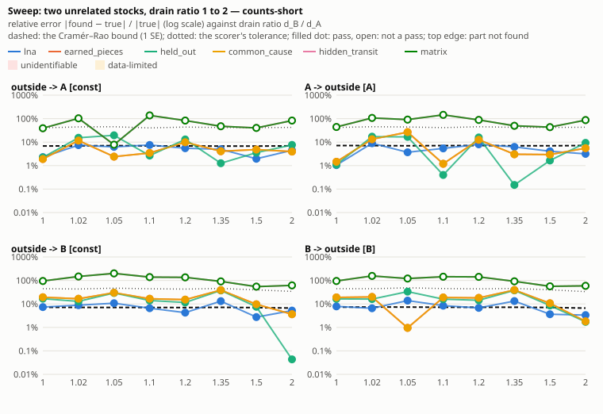
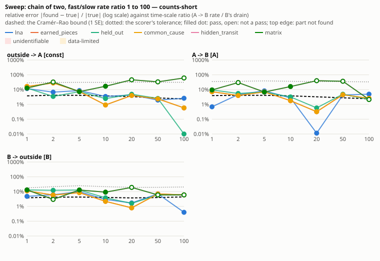
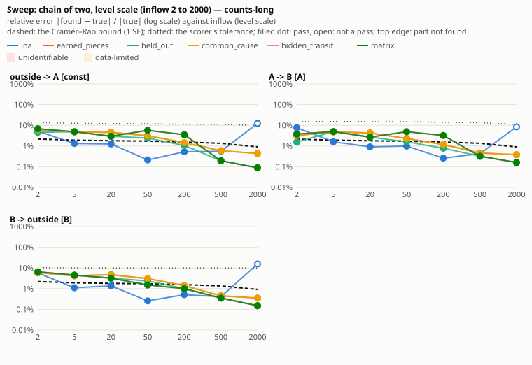
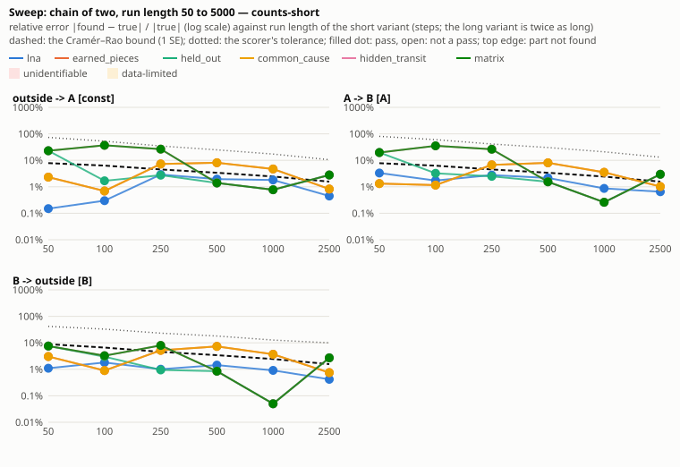
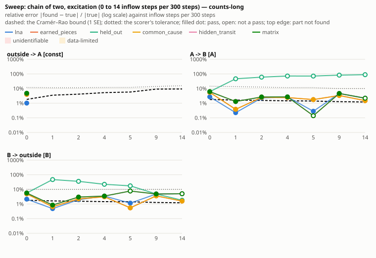
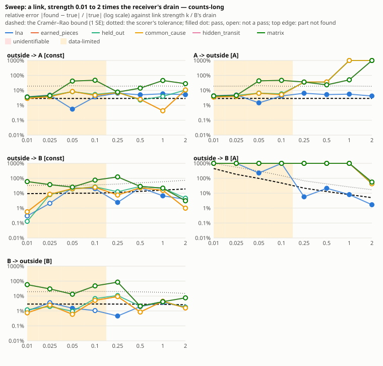
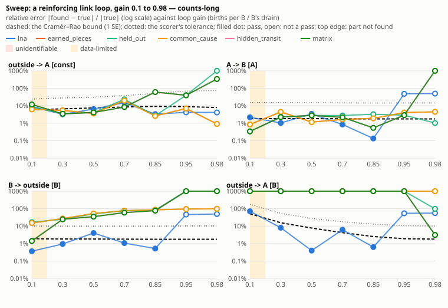
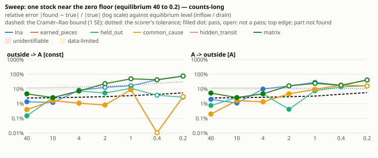

# The ladder: discovery tested on tiny true models

The ladder is SD Lab's primary test bench for discovery. It is a list of tiny ground-truth models,
simplest first, each adding one new feature to a simpler one. Every discovery strategy runs on
every case on its own. The ladder asks whether discovery recovered the **true equations**, flow by
flow and number by number, not only whether it predicts well. Behaviour (skill@H) is reported next
to that.

Everything is fast: the whole ladder with `matrix` (25 cases x 4 variants, 100 items) runs in about 2.5 seconds from a cold cache
on 27 workers (20 seconds on one). Results are kept in a store, so only what changed runs again:

- a new or changed case runs every strategy on it;
- a new or changed strategy, or any change to `sdlab/discovery`, runs that strategy on every case;
- a change to the scoring re-scores the stored found models without running discovery again.

A failure found anywhere (an example, the generator, the page) becomes a new case: the smallest
model that shows it. The 31 examples (`sdlab/examples/sd-*`) and the generated models
(`tests/bench/generator.py`) are secondary benchmarks
([DISCOVERY-LOOP.md](DISCOVERY-LOOP.md)).

## Commands

```
uv run sdlab-ladder sync                               # run everything stale (all strategies, all cases)
uv run sdlab-ladder sync --strategies matrix           # only matrix
uv run sdlab-ladder run --strategies matrix --cases 003,tag:loop --variants counts   # run these now, current or not
uv run sdlab-ladder status                             # the strategy x case matrix, per-tag summaries
uv run sdlab-ladder status --strategies matrix --variant counts-short   # one strategy, one variant in detail
uv run sdlab-ladder show 011 --strategy matrix         # true vs found equations, part by part, with scores
uv run sdlab-ladder watch                              # sync now, then whenever a case or strategy changes
uv run sdlab-ladder check                              # every case file compiles, and the cases' sanity checks
uv run sdlab-ladder new my-slug                        # write the next case, NNN-my-slug.yaml, from a template
uv run sdlab-ladder freeze 042#5                       # write draw 5 of parametric case 042 as an ordinary case
uv run sdlab-ladder strict                             # fill strict pass's caches, then pass vs strict pass per strategy
```

`python -m sdlab.ladder ...` works too. Cases are chosen by id or number prefix (`003`,
`003-chain-2`), tag (`tag:loop`) or level (`level:6`); a parametric case's prefix (`042`) is all its
draws, and `042#5` is one. Variants are chosen by name (`counts-short`),
noise (`none`, `counts`) or length (`short`, `long`). Common options: `--jobs N` (default: CPU cores
minus 1; each worker uses one numpy thread) and `--timeout S` (per item, default 120 s). A strategy
that raises is recorded as `error` and one that runs out of time as `timeout`; the run carries on.

Data and results live outside the repository, in `$SDLAB_LADDER_CACHE` (default
`~/.cache/sdlab/ladder`): `data/` holds each case's runs, and `results.sqlite` holds the results.

## Cases

One file per case in `sdlab/sdlab/ladder/cases/`, named `NNN-slug.yaml` (the number sets the order;
the id is the file name without `.yaml`). A case is a few lines of YAML, written by hand:

```yaml
title: Chain of three
level: 3                        # the rung: 1 is the simplest
tags: [chain, move]             # motifs, for the per-tag summary
tests: two moves in a row are recovered, each at its own rate     # one sentence
seed: 4                         # optional (default 1)
stocks: {A: 0, B: 0, C: 0}      # each stock's initial level, in order
flows:
  outside -> A: 20              # constant                       id: in
  A -> B: 0.5 * A               # proportional                   id: ab
  B -> C: 0.25 * B              #                                id: bc
  C -> outside: 0.1 * C         #                                id: c_out
```

### Add a case in a minute

1. `uv run sdlab-ladder new my-slug` writes the next case (`NNN-my-slug.yaml`, a chain of two) and
   prints its path. Edit it: the smallest model that shows the feature or the failure, one change
   relative to a simpler case. Pick numbers that keep it bounded and moving: start stocks away from
   equilibrium, and drive slow parts with a schedule (a square wave in an inflow) if they would
   otherwise settle.
2. `uv run sdlab-ladder check --cases NNN` must say `ok`. It compiles every case file (a mistake is
   reported as `file:line: ...`), then checks that, over 5x the long length, levels stay finite,
   non-negative and bounded, that flows add up, that every flow moves, and that the stocks keep
   moving. `tests/test_ladder.py` runs the same check on every case, and also checks that the true
   model passes its own scoring.
3. `uv run sdlab-ladder sync` runs every strategy on the new case.

Do not change what an existing case means: its history would no longer compare. Add a new case
instead. Changing a case's model makes all its results stale; rewriting how it is written does not
(see the hash, below).

### The format

**Top level.** `title`, `level`, `tags`, `tests`, `stocks` and `flows`; optional `seed`, `schedule`,
`injections`, `variants`, `tolerance`, `dt` and `inputs` (the last two: "Inputs, sub-steps, ceilings,
delays" below), and `source` (where an imported case comes from and its licence; metadata, not in the
hash). Any other key is an error.

**Stocks** map an id (letters, digits, `_`; not `outside`) to its initial level. Words after the
level mark it, or give the long form for anything else (`unit`, ...; extra keys are passed through):

```yaml
stocks: {A: 0, H: 0 hidden, Done: 0 final, R: {initial: 60, unit: cups, hidden: true}}
```

`hidden` is an unmeasured stock (`"measured": false`: discovery never sees it); `final` is a stock
nothing ever leaves; `max=N` (long form `max: N`) is a ceiling (below).

**Flows** map `FROM -> TO` to a rate; either end may be `outside`. The flow's id comes from its ends:

| flow | id |
|---|---|
| `outside -> X` | `in` for the case's first flow from outside (named or not), `x_in` for later ones |
| `X -> outside` | `x_out` |
| `X -> Y` | `xy` when both ids are one letter (`ab`), else `x_y` (`work_done`) |

`A -> B as rework: ...` names a flow. Two flows with the same ends need a name for one of them
(`A -> B as fast`); a repeated key is an error, never silently dropped. `flows:` may also be a list
of one-key items (`- A -> B: 0.5 * A`), which reads the same.

**Rates** are arithmetic on numbers and stock ids, parsed by a small parser (no eval). Every rate is
floored at 0 by the engine, so `max(0, ...)` around a rate is allowed and changes nothing.

| written | form (MODEL.md) | JSON |
|---|---|---|
| `20` | constant | `{"form": "constant", "value": 20}` |
| `0.5 * A` (or `A * 0.5`, `A / 2`, `A`) | proportional | `{"form": "proportional", "stock": "A", "k": 0.5}` |
| `(300 - I) / 5` | gap: (goal - stock) / time | `{"form": "gap", "stock": "I", "goal": 300, "time": 5}` |
| `30 - 0.25 * A + 0.1 * B` | linear: c + terms | `{"form": "linear", "c": 30, "terms": [{"stock": "A", "k": -0.25}, {"stock": "B", "k": 0.1}]}` |
| `0.01 * A + 0.02 * B` | linear without c | `{"form": "linear", "terms": [...]}` |
| `max(0, 0.2 * A - 30)` | linear (the floor binds below A = 150) | `{"form": "linear", "c": -30, "terms": [...]}` |
| `available`, `available(A)` | available | `{"form": "available"}` (`"stock": "A"`) |

A rate times one or more **effects** multiplies it by a stock's level (several multiply, in order):

```yaml
  A -> B: 0.3 * A * effect(C, linear, normal=50, max=2)          # x clamp(C / 50, min, max); min, max optional (0, 1)
  A -> B: 0.3 * A * effect(C, table, [[0, 0.2], [50, 1], [100, 1.4]])   # a curve through (level, multiplier) points
```

A **co-flow** follows the rate: `A -> B: 0.3 * A uses(R, 0.5)` uses up 0.5 of `R` per unit moved
(`"uses": [{"stock": "R", "per": 0.5}]`); several `uses(...)` may follow.

**The long form** of a flow is a mapping with `rate` and any other flow keys (`ratio`, `name`,
`outputs`, `split`, ...; passed through). Its `rate` may also be the JSON rate itself:

```yaml
  A -> B:
    rate: 0.5 * A
    ratio: 2
  B -> outside:
    rate: {form: constant, value: 3}
```

**Schedule**: every `every` steps (one period; leave it out for once only), each change sets new
rates at step `t` of the period. A change is `at T [label] [announced]: {flow: rate, ...}`; a flow is
named by its id or, when only one flow has them, its ends. `announced` makes the change an era the
data announces; without it the change happens unannounced.

```yaml
schedule:
  every: 200
  at 1 low: {outside -> C: 3}
  at 101 high: {outside -> C: 7}
  at 50 "second machine" announced:
    ab: 0.6 * A
```

The JSON form (`changes: [{t, label, set, announce}]`) is accepted as is.

**Injections** (announced additions to a stock at the start of step `t`):

```yaml
injections:
  - {t: 50, stock: A, amount: 400}
  - {t: 150, stock: A, amount: 400}
```

**Variants** default to both noises (`none`, `counts`) at both lengths (`short` 300 and `long` 2000
steps); `variants: {noise: [counts], lengths: {short: 300}}` overrides that (`variants: default` is
the same as leaving it out). A case may also ask for the noises real data carry, laid on the
counts run's recorded levels: `variants: {noise: [counts, meas, gaps, weekly, lag, outliers,
bias]}`, or with numbers, `{meas: {rel: 0.1, abs: 0}}` (see "Real-world noise", below).
**Tolerance** overrides the scorer's (Scoring, below), e.g. `tolerance: {rel: 0.1}`.

### Inputs, sub-steps, ceilings, delays

Added on 2026-10-18 with the user's approval of engine features (CLAUDE.md rule 2), all **additive**:
a case that uses none of them runs exactly as before. `tests/test_engine_additive.py` proves it
against `tests/engine_outputs.sha256`, recorded before the change: every case's data in every variant
on both seeds, every example's runs and answer key, and 40 generated bench models, bit for bit. Such
a case also keeps its hash (`cases.py` hashes it with the engine and `data.py` as they were,
`LEGACY_ENGINE`/`LEGACY_DATA`), so its stored results stay current; a case that uses a feature is
hashed with the code as it is.

**Measured inputs** are outside drivers given as data (a pump setting, rainfall, demand). A rate or
an effect reads one by name, exactly as it reads a stock (`input(pump)` is the same as `pump`):

```yaml
inputs:
  pump: [3, 3, 5, 5, 4, 6]                                    # one value per step; after the end, the last value
  rain: 2 + step(3, 100) + 1.5 * sin(1, 50)                    # a formula (below)
  demand: {file: data/demand.csv, column: demand, repeat: true}   # a column of a .csv (or a .json list) under cases/
  load: {values: [1, 2, 3], repeat: true, formula: 4 + ramp(0.1, 10, 50)}   # a series plus a formula
stocks: {T: 40}
flows:
  outside -> T: 2 * pump
  T -> outside: 0.08 * T * effect(rain, linear, normal=5, max=2)
```

A formula adds numbers and these terms (each optionally times a number; `t` is the step):

| term | value |
|---|---|
| `step(h, start)` | h from step `start` on |
| `pulse(h, start, width=1)` | h for `width` steps from `start` |
| `ramp(slope, start, end=never)` | slope x (t - start) after `start`, held after `end` |
| `pulse_train(h, first, width, every, last=never)` | h for `width` steps every `every` steps from `first` to `last` |
| `sin(amplitude, period, phase=0)` | amplitude x sin(2 pi (t - phase) / period) |

The engine model holds `"inputs": {name: {"values"?, "repeat"?, "terms"?: [{"fn": "step", "height", "start"}, ...]}}`
(a file is read when the case compiles, so the values are in the model and its hash). The data has
`inputs: {name: value per step}` (the step's mean over its sub-steps). **Discovery receives inputs as
a page input, never as truth**: the runner passes `opts["inputs"]` (as it passes eras and
injections), the page API takes `"inputs"` in a discovery request, and `case_data` returns them.
How a strategy can use them:

- as an extra regressor column: `matrix` does this when `opts["inputs"]` is given (`matrix.py`, the
  input's value during each step is a column every row may take, kept only if it pays for itself
  under the same BIC; a positive number is a flow `outside -> X: k x input`, a negative one
  `X -> outside: k x input`, marked `"input": name`). A caller that keeps the raw fit or rows
  (`keep_fit`, `keep_rows`: earned_pieces, common_cause, row_crossover read every column as a
  stock's level) gets no input columns unless it passes `input_columns: True` once it can take them;
- in simulation: `simulate.Model(flows, ids, inputs={"t": t, "values": inputs})` (and
  `behaviour_error(..., inputs=...)`) runs flows whose rates read inputs;
- strategies that ignore `opts["inputs"]` see an unexplained, changing outside inflow, as before.

The scorer reads an input as a reader: a part `outside -> T [pump]` is a link from the input, sized
by the input's mean; the linear oracle regresses on the inputs as on the levels, so its standard
errors cover input parts.

**A sub-step** `dt: 0.25` (1/n for a whole number n) makes each recorded step n engine steps: every
rate moves rate x dt per sub-step, counting noise is drawn per sub-step (Poisson(rate x dt), so a
recorded step's amount keeps its variance for the same rates), levels and counters are recorded once
per step (counters sum their sub-steps), and schedule changes and injections happen at the start of
a recorded step. It refines the Euler solution towards the ODE's (first order in dt).

**A ceiling** `T: 0 max=500` caps the flows into a stock: they share the room left (max - level),
as outflows share what a stock holds (the floor). Like the floor, the room is taken before the step's
outflows, so at dt = 1 a stock drained at k per step sits at max / (1 + k dt) when full; at a small dt
it sits at max. A move into a full stock stays in its source; an injection never fills past max.

**Delays and smoothing** compile to existing parts (exact rewrites, documented in MODEL.md too):

| written | compiles to |
|---|---|
| `A -> B: delay1(0.5 * A, 4)` | `A -> ab_d1` at the rate, then `ab_d1 -> B: 0.25 * ab_d1` (one hidden stock) |
| `A -> B: delay3(0.5 * A, 6, initial=0)` | `A -> ab_d1`, then `ab_d1 -> ab_d2 -> ab_d3 -> B`, each `3/6 x` its hidden stock (Vensim's DELAY3: three first-order stages, an Erlang-3 delay with mean 6); the flows are ids `ab`, `ab_1`, `ab_2`, `ab_3` |
| `0.2 * smooth(A, 5, initial=0)` in a rate | a hidden stock `smooth_A_5` with `outside -> smooth_A_5: A / 5` (it reads A, it does not drain it) and `smooth_A_5 -> outside: smooth_A_5 / 5`, both `"exact": true` (no counting noise: information, not material); it starts at A's initial level unless `initial=` |
| `smooth3(A, 6)` | three such stages at 3/6, the rate reading the last (`smooth3_A_6`) |
| `10 + step(5, 100)`, `pulse`, `ramp`, `pulse_train` in a rate | unannounced schedule changes: at every step where the terms' sum changes, the flow's rate becomes its own plus the sum (a constant's value, a linear rate's c, a gap's goal + c x time), written out to the case's longest run; not with a periodic `schedule` (`every`) or with schedule changes to the same flow |
| a PULSE of material that is announced | an `injections:` entry |

A delay's flows carry `"delay": {"id", "stage", "of", "time"}`: the answer key (`Truth.truth()`) and
the scorer (`parts.py`) read a DELAYn chain between two measured stocks as one hidden part
`A -> (hidden) -> B` with `k_in` the rate's number and `delay` the DELAY's time; the Kalman
hidden-stock oracle covers only one hidden stock, so a DELAY3 case is scored with the tolerances
alone. A rate that reads a smoothing's hidden stock is not scored (it reads an unmeasured stock), so
SMOOTH is for building realistic models, not yet for a scored case.

**YAML traps.** Inside `{...}` (flow style) a comma ends the value, so a rate with commas
(`effect(...)`, `max(0, ...)`, `uses(...)`) goes on its own line (block style). A value that starts
with `- ` or `[` reads as a list: quote it. Strings with `: ` or ` #` (a title,
a test sentence) need quotes.

### Parametric cases: random numbers

A hand-written case has one set of numbers (three chains with inflows 20, 12 and 6), so a strategy
can pass it by the luck of those numbers. In a **parametric** case any number may be a range, and
the case runs on several draws of its numbers (`sdlab/sdlab/ladder/draws.py`). Real use never
varies a model like this. It is a diagnostic for the analyser: it shows what happens when unrelated
stocks happen to get similar inflows, or a rate lands small.

```yaml
title: Two independent chains of two, random numbers
level: 4
tags: [independent, chain, move, parametric]
tests: 029 with every number drawn at random (8 draws); each chain is recovered with no flow between them
seed: 42
draws: 8                                  # how many draws (default 8)
stocks: {A1: draw(0, 300, int), B1: 0, A2: 0, B2: 0}
flows:
  outside -> A1: draw(5, 40)              # uniform on [5, 40]
  A1 -> B1: draw(0.05, 0.6, log) * A1     # log-uniform
  B1 -> outside: draw(0.03, 0.5, log) * B1
```

- `draw(lo, hi)` takes `0 <= lo < hi`, then optionally `log` (log-uniform, `lo > 0`) and `int` (a
  whole number). Other draws are rounded to three significant figures, so a value reads as written.
  For a negative coefficient, write `- draw(...)`. `{draw: [lo, hi]}` is the same number as
  `draw(lo, hi)`, written as a YAML mapping.
- A draw may stand for any number: a rate's numbers (a constant, `k`, a gap's goal and time, a linear
  rate's terms), an initial level, a schedule's values, or an injection's amount. Draws are replaced in
  the text before the YAML is read, so the comma trap does not apply to them. A `draw(...)` in a
  comment is left alone.
- **Draw i** (1..N) is the case `NNN-slug#i`. It is scored, stored and shown like any case, with its
  own hash: for every strategy and variant. Its numbers come from a generator seeded by the case's
  `seed`, `i` and an attempt number. So draws are reproducible, and raising `draws` keeps the first
  ones. The simulation seed is the case's `seed` for every draw.
- Each draw must pass the case checks (bounded, moving, every flow moves). A draw that fails them
  is drawn again with the next attempt, up to 12 attempts. `sdlab-ladder check` and `show` report
  the rejected attempts and why they were rejected. The accepted attempt is remembered in
  `$SDLAB_LADDER_CACHE/draws`, so the checks run once per draw.
- **Reporting.** `status` lists each draw as a row and adds a **Parametric cases** table. Each
  strategy gets its pass rate over draws x variants, then how many draws pass in every variant
  (`62.5% 3/8`). `show NNN#i` prints the drawn numbers with their ranges. In the read API, a draw's
  case has `draw: {base, i, of, seed, attempt, values: [{label, value, lo, hi, log, int, line}],
  rejected, problems}`. `summary()` adds `draw` (`{base, i, of, lines, values}`) to each draw's case
  and `parametric: {case: {title, level, tags, draws, strategies: {name: {pass, ..., total, rate,
  draws_passing, draws_run}}}}`. The Now page and the Cases view show a draw's numbers as the lines
  they went into. In the leaderboard, a parametric case counts as its draws, and a **Kind** filter
  separates fixed cases from random draws. The editor does not list draws as basic models.
- **Freezing.** `sdlab-ladder freeze NNN#i [--slug S]` writes draw i as the next ordinary case:
  `NNN-slug-draw-i.yaml`, with the drawn numbers in place and comments kept. Its title and `tests`
  sentence say where it came from, and the `parametric` tag becomes `frozen-draw`. It compiles to
  exactly the draw's model. This is how a failing draw becomes a fixed regression case.

| case | numbers drawn |
|---|---|
| 039-random-inflow-outflow | 002: inflow 5-40, drain 0.03-0.5 (log) |
| 040-random-chain-2 | 003: inflow, move 0.05-0.6 (log), exit |
| 041-random-chain-3 | 004: inflow, two moves, exit |
| 042-random-two-chains-of-two | 029: both chains' inflows, moves and exits |
| 043-random-three-chains-of-two | 031: all three chains |
| 044-random-three-stocks | 034-036: three unrelated stocks' inflows, drains and starts (0-300) |
| 045-random-link | 007: A's inflow and drain, the link 0.03-0.3, B's drain |
| 046-random-link-loop | 008: inflow 5-30, move 0.1-0.6, drain 0.1-0.4, births 0.01-0.09 (below the drain: bounded) |
| 047-random-goal-gap | 011: goal 150-450, time 2-10, arrival 0.1-0.5, demand 0.05-0.2 |
| 048-random-stepping-inflow-drain | 027: the two inflow levels (1-10, 5-25) and the drain 0.03-0.3 |

Failing draws frozen as fixed cases (October 2026, from the first run of the leading strategies):
057-three-chains-equal-moves (043#2), 058-move-equals-other-chains-drain (043#7),
059-small-inflow-step (048#1), 060-close-slow-drains-at-equilibrium (044#3) and
061-small-inflow-counts (039#2).

### Parametric cases: random numbers

A hand-written case has one set of numbers (three chains with inflows 20, 12 and 6), so a strategy
can pass it by the luck of those numbers. In a **parametric** case any number may be a range, and
the case runs on several draws of its numbers (`sdlab/sdlab/ladder/draws.py`). Real use never
varies a model like this. It is a diagnostic for the analyser: it shows what happens when unrelated
stocks happen to get similar inflows, or a rate lands small.

```yaml
title: Two independent chains of two, random numbers
level: 4
tags: [independent, chain, move, parametric]
tests: 029 with every number drawn at random (8 draws); each chain is recovered with no flow between them
seed: 42
draws: 8                                  # how many draws (default 8)
stocks: {A1: draw(0, 300, int), B1: 0, A2: 0, B2: 0}
flows:
  outside -> A1: draw(5, 40)              # uniform on [5, 40]
  A1 -> B1: draw(0.05, 0.6, log) * A1     # log-uniform
  B1 -> outside: draw(0.03, 0.5, log) * B1
```

- `draw(lo, hi)` takes `0 <= lo < hi`, then optionally `log` (log-uniform, `lo > 0`) and `int` (a
  whole number). Other draws are rounded to three significant figures, so a value reads as written.
  For a negative coefficient, write `- draw(...)`. `{draw: [lo, hi]}` is the same number as
  `draw(lo, hi)`, written as a YAML mapping.
- A draw may stand for any number: a rate's numbers (a constant, `k`, a gap's goal and time, a linear
  rate's terms), an initial level, a schedule's values, or an injection's amount. Draws are replaced in
  the text before the YAML is read, so the comma trap does not apply to them. A `draw(...)` in a
  comment is left alone.
- **Draw i** (1..N) is the case `NNN-slug#i`. It is scored, stored and shown like any case, with its
  own hash: for every strategy and variant. Its numbers come from a generator seeded by the case's
  `seed`, `i` and an attempt number. So draws are reproducible, and raising `draws` keeps the first
  ones. The simulation seed is the case's `seed` for every draw.
- Each draw must pass the case checks (bounded, moving, every flow moves). A draw that fails them
  is drawn again with the next attempt, up to 12 attempts. `sdlab-ladder check` and `show` report
  the rejected attempts and why they were rejected. The accepted attempt is remembered in
  `$SDLAB_LADDER_CACHE/draws`, so the checks run once per draw.
- **Reporting.** `status` lists each draw as a row and adds a **Parametric cases** table. Each
  strategy gets its pass rate over draws x variants, then how many draws pass in every variant
  (`62.5% 3/8`). `show NNN#i` prints the drawn numbers with their ranges. In the read API, a draw's
  case has `draw: {base, i, of, seed, attempt, values: [{label, value, lo, hi, log, int, line}],
  rejected, problems}`. `summary()` adds `draw` (`{base, i, of, lines, values}`) to each draw's case
  and `parametric: {case: {title, level, tags, draws, strategies: {name: {pass, ..., total, rate,
  draws_passing, draws_run}}}}`. The Now page and the Cases view show a draw's numbers as the lines
  they went into. In the leaderboard, a parametric case counts as its draws, and a **Kind** filter
  separates fixed cases from random draws. The editor does not list draws as basic models.
- **Freezing.** `sdlab-ladder freeze NNN#i [--slug S]` writes draw i as the next ordinary case:
  `NNN-slug-draw-i.yaml`, with the drawn numbers in place and comments kept. Its title and `tests`
  sentence say where it came from, and the `parametric` tag becomes `frozen-draw`. It compiles to
  exactly the draw's model. This is how a failing draw becomes a fixed regression case.

| case | numbers drawn |
|---|---|
| 039-random-inflow-outflow | 002: inflow 5-40, drain 0.03-0.5 (log) |
| 040-random-chain-2 | 003: inflow, move 0.05-0.6 (log), exit |
| 041-random-chain-3 | 004: inflow, two moves, exit |
| 042-random-two-chains-of-two | 029: both chains' inflows, moves and exits |
| 043-random-three-chains-of-two | 031: all three chains |
| 044-random-three-stocks | 034-036: three unrelated stocks' inflows, drains and starts (0-300) |
| 045-random-link | 007: A's inflow and drain, the link 0.03-0.3, B's drain |
| 046-random-link-loop | 008: inflow 5-30, move 0.1-0.6, drain 0.1-0.4, births 0.01-0.09 (below the drain: bounded) |
| 047-random-goal-gap | 011: goal 150-450, time 2-10, arrival 0.1-0.5, demand 0.05-0.2 |
| 048-random-stepping-inflow-drain | 027: the two inflow levels (1-10, 5-25) and the drain 0.03-0.3 |

### What a case compiles to

The loader (`cases.py`) compiles a YAML case (`caseformat.py`) to the case dict the ladder has always
used; a `NNN-slug.json` file holding that dict directly still loads (one id in both formats is an
error). `cases.spec(id)` gives the dict:

```jsonc
{
  "title": "Chain of two", "level": 2, "tags": ["chain", "move"], "tests": "...",
  "tolerance": {"rel": 0.1},                    // optional
  "variants": {"noise": ["none", "counts"], "lengths": {"short": 300, "long": 2000}},   // optional
  "model": {                                    // the truth.model.json format (sdlab/sdtruth.py)
    "seed": 3,
    "stocks": [{"id": "A", "initial": 0}, {"id": "B", "initial": 0}],
    "flows": [
      {"id": "in", "from": null, "to": "A", "rate": {"form": "constant", "value": 20}},
      {"id": "ab", "from": "A", "to": "B", "rate": {"form": "proportional", "stock": "A", "k": 0.5}},
      {"id": "b_out", "from": "B", "to": null, "rate": {"form": "proportional", "stock": "B", "k": 0.2}}
    ],
    "schedule": {"every": 200, "changes": [{"t": 1, "label": "low", "set": {"in": {...}}, "announce": true}]},
    "injections": [{"t": 50, "stock": "A", "amount": 400}]
  }
}
```

**The case hash** (which decides whether a result is stale) covers what a run is made from and
scored against, not the file: the compiled model, variants and tolerance as canonical JSON, the
truth model of every variant (without its id and name), the engine (`sdtruth.py` and the equations
it uses from `runner.py`) and `data.py`. A comment, a reordered term (`A * 0.5` for `0.5 * A`),
moving a case between YAML and JSON, or rewording its title, level, tags or `tests` sentence leaves
its results current. (Until 19 October 2026 the hash also covered the title and `tests` sentence;
the stored results, including those of earlier wordings of 035, were moved to the new hashes
then.)
(Until October 2026 the hash covered the case file's bytes and `cases.py`; the results stored then
were moved to the new hashes when the 25 cases became YAML, and
`tests/test_ladder_caseformat.py` checks each converted case compiles to exactly the JSON it
replaced.)

Every case runs in each **variant**: `none` (the engine's exact flows, where the equations should be
recovered essentially exactly) and `counts` (whole things moved, drawn Poisson around the rate), each
at `short` (300 steps) and `long` (2000 steps). The data comes from the ground-truth engine
(`sdlab/sdtruth.py`, edited only additively with the user's approval; the case's model is simply handed to it). Data is cached
under the case's hash. Each variant also has a **fresh run** (the next seed), used to grade
generalisation; without noise it is the same run.

Discovery gets only what the page would give it: the measured stocks (id, name, unit, final, group),
their levels, the announced eras, the announced injections and the measured inputs (`opts["inputs"]`).

### The first ladder

| case | tests |
|---|---|
| 001-inflow-only | a constant outside inflow into a stock nothing leaves |
| 002-inflow-outflow | a constant inflow and a proportional outflow of one stock |
| 003-chain-2 | a move between two measured stocks, with the chain's inflow and exit |
| 004-chain-3 | two moves in a row, each at its own rate |
| 005-chain-4 | three moves in a row |
| 006-chain-exit-middle | a stock's drain split between a measured receiver and outside |
| 007-link | an inflow that follows another stock's level (a link, not a move) |
| 008-link-loop | a reinforcing loop closed by a link (B's level drives A's inflow, A feeds B) |
| 009-births-and-deaths | births and deaths in proportion to one stock: only the difference is identifiable (best answer: equivalent) |
| 010-loop-branch | a link loop with a move leaving it to a third stock |
| 011-goal-gap | a balancing loop: orders into a supply line follow the gap between a goal and the inventory |
| 012-rework | a back-flow (B -> A) beside the forward move |
| 013-merge | two stocks fed from outside drain into one |
| 014-split | one stock drains into two at different rates |
| 015-hidden-stock | an unmeasured stock between two measured ones (an inferred stock with the right delay) |
| 016-coflow | a move that uses up a third stock as it goes |
| 017-linear-effect | a move multiplied by a linear effect of a third stock's level |
| 018-table-effect | a move multiplied by a table effect of a third stock's level |
| 019-announced-era | a move's rate that changes at announced eras |
| 020-unannounced-step | an outside inflow that steps without announcement |
| 021-daily-inflow | an outside inflow with a daily cycle |
| 022-pulse | a one-step burst into a chain every 100 steps |
| 023-injection | announced injections into a chain |
| 024-floor-binds | a link with a negative coefficient that stops at zero |
| 025-runs-empty | a constant demand that empties its stock and is then capped |

Cases using the engine features of 2026-10-18 (above): 062-tank-fed-by-measured-pump (an inflow
driven by a measured input, `2 x pump`, recovered as k x input rather than as pieces) and
063-delay3-supply-line (a DELAY3 of 6 steps between two measured stocks, one hidden path with its
total delay; injections every 100 steps).

## Canonical cases (`canonical/`, `pysd_import.py`)

Classic system dynamics models, imported from a modeller's file rather than written as probes: cases
100-111, tag `canonical`, each with a `source:` naming where it comes from and its licence.

| case | model | source |
|---|---|---|
| 100-canonical-sir | SIR epidemic, dt 1/32 | SDXorg/test-models `samples/SIR` (MIT) |
| 101-canonical-seir | SEIR epidemic | written for SD Lab |
| 102-canonical-bass | Bass diffusion with discontinuance | written for SD Lab (Bass 1969; Sterman 2000) |
| 103-canonical-logistic | logistic growth as births and crowding deaths | written for SD Lab |
| 104-canonical-teacup | Newton cooling, `0.1 x T - 7` | SDXorg/test-models `samples/teacup` (MIT) |
| 105-canonical-inventory-supply-line | stock management through a DELAY3 supply line, demand a measured input | written for SD Lab (Sterman 2000 ch. 17-18) |
| 106-canonical-workforce | hiring to a target (a measured input), assimilation, quits | written for SD Lab |
| 107-canonical-rework | the rework cycle, undiscovered rework hidden | written for SD Lab (Cooper 1980) |
| 108-canonical-commodity-cycle | capacity and inventory, table effects, DELAY3 construction | written for SD Lab (Meadows 1970) |
| 109-canonical-limits-to-growth | population on a logistic renewable resource | written for SD Lab (Meadows et al. 1972) |
| 110-canonical-world3-pollution | World3-03 persistent pollution below its 1970 level: DELAY3 and assimilation | written for SD Lab from the published equations |
| 111-canonical-arrayed-switching | five subscripted categories switching through a 5 x 5 matrix, flattened into five stocks | SDXorg/test-models `tests/subscript_switching` (MIT) |

**How a case is made.** The source is a Vensim file in `canonical/models/` (the SDXorg ones copied
unchanged with their licence, the others written for SD Lab). `pysd_import.py` reads it through PySD's
parser and writes the case body; `canonical/build.py` adds the recipe (`canonical/recipes.yaml`:
title, level, tags, tests, source, words such as `hidden` or `final`, and announced injections that
keep the model moving over 300 and 2000 steps: `pulses` repeated, an amount may be negative, and
one-off `inject`) and writes `cases/1NN-canonical-*.yaml`. The case files
are committed, so the ladder never needs PySD. The models written for SD Lab use TIME STEP 1, one Euler
step per recorded step, so they probe structure. The two SDXorg samples keep their published TIME STEP
(1/32, 1/8): data recorded once per time unit from a finer Euler run have per-step rates that differ from
the model's per-time-unit numbers (a drain k reads as about 1 - exp(-k)), and the scorer compares
against the model's numbers. So those two also probe sub-step data:

```
uv run --with pysd --with sympy python -m sdlab.ladder.pysd_import MODEL.mdl        # a model's case body, or what blocks it
uv run --with pysd --with sympy python -m sdlab.ladder.canonical.build [--check]    # write (or compare) the canonical cases
uv run --with pysd --with sympy python -m sdlab.ladder.canonical.coverage TEST_MODELS_DIR --markdown out.md
```

**The importer** (`pysd_import.py`, with `canonical/read.py`, `match.py`, `timefns.py`; pysd and
sympy are optional packages, imported only there):

- every auxiliary and constant is inlined into the flows; a flow variable subtracted from A and added
  to B is a move `A -> B` (one used by more stocks becomes several flows with the same rate);
- a recorded step is one model time unit when TIME STEP is 1/n (the case gets `dt: 1/n`), else one
  TIME STEP;
- a rate is matched as a product: a number, at most one factor linear in several stocks (the rate:
  constant, proportional, gap or linear), and factors that read one stock linearly or through a lookup
  (effects: `b x Y` a linear effect whose cap never binds, `1 - Y / K` a table to its root, a lookup a
  table on Y); `MAX(0, x)` as a whole rate is x (every rate is floored);
- `DELAY1/3(x, T)` as a flow's whole rate is a material delay (merged with the flow that drains x
  into `A -> B: delay3(...)`); a DELAY anywhere else is information, SMOOTH exactly, and SMOOTH/SMOOTH3
  of one stock or input is `smooth(Y, T, initial=...)`;
- every part of a rate that reads only TIME (STEP, PULSE, PULSE TRAIN, RAMP, SIN, a lookup of time,
  `IF THEN ELSE(Time > 5, ...)`) is a measured input: a formula when SD Lab's input terms give PySD's
  values at every Euler step, else one value per step (a recorded step is then one TIME STEP);
- a model with no stocks (most one-function tests) is wrapped: each auxiliary nothing reads gets an
  accumulator stock, so the function becomes a flow;
- **arrays** (`canonical/arrays.py`): a subscripted variable is flattened into one variable per
  element, so a subscripted stock is one stock per element, id `<stock>__<element>[__<element>...]`
  (`Stock_A__Entry_1__Column_2` is `Stock A[Entry 1,Column 2]`, the name of PySD's output column). PySD's
  `SubscriptManager` reads the ranges (subranges, copies, numeric ranges, mappings `A: a1, a2 -> B`);
  a reference's subscripts resolve by position (a bound range is its element, a mapped range the
  element at the same position); `:EXCEPT:`, definitions in parts, numeric and tabbed arrays,
  `SUM / PROD / VMIN / VMAX` over `x[A!]` (written out element by element) and a range read as a
  number (its element's position) are taken; VECTOR SELECT and the other vector functions are not;
- **macros**: each call is inlined, the macro read with its parameters bound to the call's arguments;
  a stock inside a macro becomes a stock of the model per call, measured through the auxiliary of the
  model that equals it, else hidden;
- **external data** (`canonical/external.py`): GET XLS / GET DIRECT CONSTANTS, DATA and LOOKUPS are
  read through PySD (the model's folder copied, so the data sit beside it): a constant becomes a number,
  a data series a measured input (PySD's value at each Euler step), an external lookup a table. Data
  under another licence may be read at ingest time but is not committed; the SDXorg data is MIT;
- **DELAY N / SMOOTH N** of any whole order n: orders 1 and 3 keep `delay1/3` and `smooth/smooth3`;
  another order is written out as the format compiles those, n hidden stocks (`<flow>_d1..dn`, a
  material chain at n / T each; `SM_k_1..n` smoothing stages with exact flows, the rate reading the
  last). An order or a delay time that changes during the run stays blocked (the engine).

**Acceptance.** A model becomes a case only if PySD's run (Euler at the model's TIME STEP) and SD
Lab's engine with noise `none` agree at every recorded step within 1e-4 + 1e-7 x the stock's largest
level (the engine records levels to 4 decimals; the canonical cases agree to 5e-5). Hidden stocks
(delay and smoothing stages, a macro's stock no auxiliary shows) are not compared; the measured ones
they feed are.
`tests/test_ladder_canonical.py` checks that every case file is exactly what the importer writes and
that each import matches PySD (with pysd installed), and the importer on small models (round trips,
named blockers); `tests/test_ladder.py` checks each case is sane and its true model passes its own
scoring. What the format cannot hold is named, never approximated: the coverage of SDXorg/test-models
and the missing features, by count, are in [canonical-coverage.md](research/canonical-coverage.md).

## Realistic cases (`realistic.py`, `cases/realistic/`)

The ladder's cases are tiny probes. Beside them, SD Lab's 31 real-world-style examples
(`sdlab/examples/sd-*`, 3-10 stocks, 4-17 flows, hidden stocks, co-flows, effects, eras and
unannounced schedules) run as **realistic cases**, so a strategy's performance shows in test terms
and on realistic models side by side. They are the examples' bench (`tests/bench/evaluate.py`)
inside the ladder.

**A realistic case references an example; it copies nothing.** One file per example,
`cases/realistic/<example-id>.yaml`, whose name is the case id:

```yaml
example: sd-saas                       # must be the file's name
title: "SaaS growth"
level: 20                              # after the tests
tags: [realistic, hidden, announced-era, schedule]     # `realistic` is added if missing
tests: "5 measured stocks and 1 hidden, 11 flows with announced eras, unannounced changes; behaviour as on the examples' bench"
# optional: timeout (seconds per item, default 300), lengths ({short, long}), tolerance
```

The case's model is the example's `truth.model.json` as it is (seed, stocks, flows, schedule,
injections). Its variants are the bench's: counting noise (the examples' own noise) at `short` = the
example's `steps` (the bench's `default`) and `long` = its `long_steps` (default 10x), named
`counts-short` and `counts-long`; the fresh run is seed + 1, as on the bench. So the data are the
bench's, number for number (`tests/test_ladder_realistic.py` compares them), and discovery gets
what the bench gave it (the measured stocks, levels, announced eras and injections). The hash is the
example's model and the variants (`cases.case_hash`), so rewording the wrapper keeps the results;
the examples are never changed (CLAUDE.md, invariant 2). `sdlab-ladder check` does not re-check an
example (its five-times-long sanity run would take minutes), and the editor does not list realistic
cases as basic models (the examples are already there).

**Scoring.** The same scorer as every case: equation recovery (pass / equivalent / fail, recall,
precision; the oracle where the truth allows one) and behaviour (skill@20 and skill@100 in-sample and
on the fresh run, with 95% intervals). On a 10-17-flow model an exact pass is rare, and that is
expected: for realistic cases **behaviour is the headline**: the mean skill@20 over runs (each
clipped at -100%, as on the bench, with a 95% bootstrap interval over runs) and **goals met**, the
bench's goal (docs/DISCOVERY-GOAL.md): skill@20 >= 90% and skill@100 >= 80%. An error or a timeout
gets no skill and never meets the goal; the mean is over the runs graded, with the timeouts and
errors counted beside it.

**Cost.** Long realistic runs are 3,000-36,000 steps, so an item takes seconds to minutes (matrix:
up to ~60 s on the bench). Every realistic item has its own timeout, `realistic.TIMEOUT` (300 s; a
case may set `timeout:`), whatever `--timeout` says, and a sync runs the test items before the
realistic ones so the tests stay current. The timeout (for every case) covers loading the data and
discovery, not scoring: the scorer's oracle fits one constant per window, and the long run of
sd-clinic-doses has 1,999 windows (a schedule change every few steps), which takes ~7 minutes of
least squares per result whatever the strategy (sd-emergency, sd-ev-fleet, sd-hospital and
sd-moderation have 1,400-2,800 windows too, but their truths have effects or hidden stocks, so the
linear oracle is not used). Select them with `--cases tag:realistic` (or by id,
`--cases sd-saas`).

**Separation.** `summary()`'s `totals` (the tests' pass rates, and `best_strategy()`) leave the
realistic cells out; `summary()["realistic"]` gives each strategy's realistic aggregate: `{cells,
run, pass, equivalent, fail, error, timeout, missing, skill20, skill100, fresh20, fresh100,
skill20_ci, fresh20_ci, graded, goals, goals_fresh, recall, seconds, slowest}`, and each realistic
cell carries `goal` and `goal_fresh`; a realistic case in `cases` carries `example`. The
leaderboard has a **Set** picker (tests, realistic examples, all; default tests) for its main
columns, and always shows a **Realistic examples** column group beside them: real skill@20 (hover:
its interval, timeouts), goals met (n of all realistic runs), real fresh@20 and real time. The Now
page's all-cases board has the same **Set** picker (default tests); a realistic card says whether
the run meets the goal, and the summary line counts goals met.

**Matches the bench.** `matrix` on the realistic cases gives the bench's own numbers (baseline
v2.1, 29.6% mean skill@20 over the 62 runs, 12 of 62 meeting the goal); see Results below.

**Results** (19 October 2026, `api._summary` over the store, after re-running every timed-out item on
the runner of 5cc36de; the machine was at load ~100-125 on 28 cores, so times are wall-clock under
contention, and lna, earned_pieces, common_cause and matrix each have cells from two strategy
versions, because they changed during the run):

| strategy | tests pass rate | realistic skill@20 [95%] | skill@100 | fresh@20 | goals met | timeouts | time on realistic (s) |
|---|---|---|---|---|---|---|---|
| matrix | 41.4% | 29.6% [11.6, 46.4] | 29.3% | 28.9% | 12/62 | 0 | 595 (slowest 98) |
| lna | 63.4% | 17.5% [-1.1, 34.9] | 15.4% | 17.2% | 10/62 | 0 | 1,958 (166) |
| earned_pieces | 55.0% | 35.0% [16.5, 52.9] | 34.5% | 34.1% | 15/62 | 1 | 2,017 (275) |
| common_cause | 60.9% | 33.0% [10.2, 55.3] (39 graded) | 25.4% | 32.1% | 11/62 | 23 (21 long) | 1,821 (229) |
| combined | 74.3% | 41.1% [24.6, 56.6] | 50.1% | 38.9% | 16/62 | 0 | 9,448 (258; median 210 per run) |

Exact equation recovery: 1 pass in 62 for earned_pieces, common_cause and combined, none for
matrix and lna. The test ranking and the realistic one disagree: lna, second on the tests, has
the lowest realistic skill.

**Against the bench.** matrix's 62 realistic runs give the bench's skill@20 and skill@100 to the
last digit (no run differs by more than 1e-6): 29.64% mean skill@20 and 12 of 62 meeting the goal,
the same as baseline v2.1 (`~/.cache/sdlab/bench/runs/baseline-v2.1.json`) and the bench's matrix run
of 18 October. The data are the bench's, discovery gets the same inputs, and both use
`sdlab/skill.py`, so this is exact, not within noise. A first ladder run had sd-clinic-doses
counts-long as a timeout: there the scorer's oracle (1,999 windows) took 417 s after an 11 s
discovery. The timeout now covers discovery only.

## Physics cases (`physics/`, `cases/physics/`)

The tests are SD models, and so are the realistic examples: discovery is asked to recover a model
written in its own forms. The **physics cases** ask what it does with data from physical systems
that are *not* stock-and-flow models, solved in continuous time by a proper ODE solver and sampled
once per step (queue item 4). There is no true SD model to recover, so they are scored against the
physics' structure and against the best SD model of the physics, in their own view (tag `physics`),
never in the Tests pass rate.

| case | system | stocks (measured) | driver | the physics | SD can write it? |
|---|---|---|---|---|---|
| phys-draining-tank | Torricelli tank | H | pump (input) | H' = pump - k sqrt(H) | no: sqrt |
| phys-coupled-tanks | two tanks in cascade | H1, H2 | pump (input) | H1' = pump - k1 sqrt(H1), H2' = k1 sqrt(H1) - k2 sqrt(H2) | no: sqrt |
| phys-newton-cooling | Newton cooling | T | outside temperature (input: daily cycle + weather) | T' = -k (T - outside) | yes (linear) |
| phys-mass-spring-damper | damped oscillator, period ~63, zeta 0.25 | P = x + 10, V = v + 1 | force (input: pushes) | x'' = -w^2 x - 2 zeta w x' + force | yes, through offsets |
| phys-lotka-volterra | predator-prey, period ~70 | X, Y | none | X' = aX - bXY, Y' = dXY - gY | yes (products as effects) |
| phys-reaction-chain | A -> B -> C, first order | A, B, C (final) | batches of A (announced injections) | A' = -k1 A, B' = k1 A - k2 B, C' = k2 B | yes (linear) |
| phys-thermostat | on/off heater with hysteresis | T | outside, setpoint (inputs) | T' = -k (T - outside) + power x [heater on] | no: a switch with memory |

**Data** (`ode.py`). scipy `solve_ivp` (LSODA, rtol = atol = 1e-10), restarted at every jump of a
driver and every injection; the thermostat stops at each switch (an event) and goes on in the other
mode. The solution is sampled at t = 1..N and handed to discovery exactly as the engine's data are
(`data.py`'s format): measured levels per step (4 decimals), the announced injections, and the
measured inputs as each step's mean over (t - 1, t] (16-point midpoint rule). Within 1e-3 of a
fine RK4 (`tests/test_ladder_physics.py`). The **case's seed** draws any parameter given as a range
(`params: {k: [0.4, 0.6]}`); the **run's seed** (the case's; + 1 for the fresh run) draws the
initial state and the drivers, each from its own stream and in order, so a short run is the start
of the long one and the fresh run starts elsewhere with other drivers.

**Variants**: `none` (the sampled solution) and `meas` (noise.py's measurement error, Gaussian with
sd = sqrt(abs^2 + (rel x level)^2), numbers per case: `meas: {rel, abs}`), at short (300) and long
(2000) steps. **Counting noise does not apply**: nothing in these systems moves in whole things, so
there is no `counts` variant. On the Now board, a physics case picked in a counts variant shows
its meas variant.

**Keeping things positive.** SD Lab's levels and rates are floored at 0. Tanks, temperatures (degC,
kept above 0 by the drivers), populations and amounts are positive as they are. The spring's
position and velocity are signed, so they are measured from a datum: P = x + X0 and V = v + V0
(X0 = 10, V0 = 1, several amplitudes away), the cleanest representation that keeps every stock and
every flow positive: each signed term becomes two one-way flows (P: inflow V, outflow the constant
V0; V: inflow w^2 X0 + 2 zeta w V0 + force, outflow w^2 P + 2 zeta w V), and the offsets show as
constant flows. The other option, velocity as two stocks (up and down), would need a switch between
them that SD Lab's forms do not have.

**How a case is written** (`cases/physics/phys-<slug>.yaml`; `physics/__init__.py`):

```yaml
system: draining-tank          # physics/systems.py
title: Draining tank (outflow k sqrt(H))
level: 20
tags: [physics, sqrt, input]   # physics is added if missing
tests: "..."
seed: 1
params: {k: 0.5}               # optional: override; [lo, hi] is drawn from the seed
meas: {rel: 0.02, abs: 0.05}   # the meas variant's numbers
lengths: {short: 300, long: 2000}   # optional
```

The case dict is the ladder's, with `physics: {system, title, about, params, inputs, couplings,
differs, reference}` beside it; its `model` is the **reference** (below), so the pages draw it as the
model the found one is compared with. Loading a case writes its runs where `data.py` reads them
(its cache, named by case, variant, seed and hash), so `data.load` gives every reader the physics'
data, and noise.py lays the meas noise on them as for any case. The hash covers the case's content,
`systems.py`, `ode.py`, `reference.py` and `noise.py`. The scoring code (`physics/score.py`,
`structure.py`) is added to the scorer's hash for physics cases only (`physics.score_hash`, used by
`runner.plan` and the summary), so a change there re-scores physics results and nothing else.

### Scoring the physics (`physics/score.py`, `structure.py`, `reference.py`)

**Expected structure.** Each system declares its couplings: for each stock X, which stocks and
inputs Y its change reads, the sign of dX'/dY and its shape (linear, sqrt, product, switch).
`tests/test_ladder_physics.py` checks the declaration against the ODE's own Jacobian on every run
the case grades (both lengths, its seed and the fresh one), with every coupling at least 1.5 x the
presence threshold. The thermostat's control coupling cannot be checked that way: the heater has
memory (hysteresis), so the instantaneous Jacobian does not see it, and it is declared.

| case | couplings X <- Y (sign, shape) |
|---|---|
| draining tank | H <- H (-, sqrt), H <- pump (+, linear) |
| coupled tanks | H1 <- H1 (-, sqrt), H1 <- pump (+, linear), H2 <- H1 (+, sqrt), H2 <- H2 (-, sqrt) |
| Newton cooling | T <- T (-, linear), T <- outside (+, linear) |
| mass-spring-damper | P <- V (+), V <- P (-), V <- V (-), V <- force (+), all linear |
| Lotka-Volterra | X <- X (±, product), X <- Y (-, product), Y <- X (+, product), Y <- Y (±, product) |
| reaction chain | A <- A (-), B <- A (+), B <- B (-), C <- B (+), all linear |
| thermostat | T <- T (-, switch), T <- outside (+, linear), T <- setpoint (+, switch) |

**Structure agreement.** The found model's coupling X <- Y is read from its Jacobian: p_XY = d(one
step's change of X) / d(level of Y), by central differences of `simulate.Model.change` at every
state of the run (one-sided at a level of 0, where a rate's floor would halve it), with the
measured inputs as variables beside the stocks. So the representation does not matter: a move or a
link with a drain, births and deaths or their difference, give the same couplings. A coupling is
**present** when its strength sqrt(mean p^2) x sd(Y) is at least 10% of the strongest coupling into
X. Its **sign** is + or - when p has that
sign on >= 90% of the states where it is not ~0, else ±. Its **shape**: linear (p constant within
5%), piecewise (p at two levels: a switch or a floor that binds), product (p follows another
variable, R^2 >= 0.5), concave or convex (p follows Y itself, |p| falling or rising: a sqrt is
concave), or other. The physics' shapes map as linear -> linear, sqrt -> concave, product ->
product, switch -> piecewise. **Sampling couplings.** Sampling continuous time makes the exact one-step
map read variables the ODE does not, at O(step / time constant): over one step the oscillator's
position moves by about half the force and reads itself at about -w^2 / 2. A perfect discrete-time
model has them, so a coupling present in the physics' exact one-step map (`sampled_jacobian`: the
ODE integrated over one step from perturbed states, at 200 states of the case's long noise-free
run) but not in the ODE is allowed in a found model, never required, and listed apart. On the
seven cases there are two, both on the spring: P <- P and P <- force (none for the thermostat,
whose switching map is not differentiated). The structure **agrees** when every physics coupling
is present with its sign (± accepts any) and no other coupling, sampling couplings aside, is
present. The shape is reported (per coupling, and
the share right), not required: SD Lab's forms cannot write a sqrt or a switch with memory.

**Behaviour.** skill@20 and skill@100 graded as everywhere (`sdlab/skill.py`'s `same_behaviour`,
~150 starts, 95% bootstrap interval), but the truth's side is what the physics did next: the found
model runs H steps from the true levels, fed the measured inputs and the announced injections,
against the sampled solution H steps on. On the run discovery saw and on the fresh run (new initial
state and drivers, seed + 1). With measurement noise, behaviour is graded on the clean run
underneath, as for noise.py's variants.

**Long run.** The found model runs free (nothing re-anchored) for 5,000 steps from the fresh run's
first levels (with hidden stocks of its own: from step 200, those estimated from the measured levels
before), fed the inputs and injections of the physics continued as long: `err` is the rms over
stocks of (found - true) / the truth's range over the last 1,000 steps, `mean_err` the same for the
mean levels there; each capped at 1, and a run that leaves 100 x the truth's range counts 1
(`diverges`). (The ladder's `longrun.py` is not used for physics cases: it runs the found model
against the case's SD model, which here is only the reference.)

**The reference: the best SD model** (`reference.py`). Each system gives the SD Lab flows it is best
written with, one free number per physical term: a sqrt flow as a straight line c + k x level (the
linear form, floored at 0), a product as a proportional rate times a linear effect of the other
stock (exact), the on/off heater as a proportional controller max(0, c + ks x setpoint - kc x T),
the spring with its offsets as above, the inputs read as k x input. The numbers start from the
physics (the oracle knows it) and are fitted on the case's long noise-free run by least squares on
its predictions 20 and 100 steps ahead from 150 moments (scipy `least_squares`, each stock's error
over its spread): one reference per case, graded on every variant exactly as a found model is. It
answers "what is the best any SD model can do here", so a strategy's fresh skill is compared with
it (`gap20` = fresh skill@20 - the reference's).

**Verdict** (the physics view's, beside the ladder's statuses, never in the tests' totals):
**pass** when the structure agrees and the fresh skill@20 is within 5 points of the reference's (or
better); else **fail**; error and timeout as everywhere.

**Where SD Lab's format cannot express the physics** (each case's `differs`, shown on its card):

- **sqrt outflows** (both tanks): no form for sqrt(level). The best SD model writes c + k x level,
  right near the levels the run visits and wrong far from them; a lookup-table effect could bend
  it, at the price of its points, and no strategy fits tables to an outflow of a stock's own level.
- **on/off control with hysteresis** (thermostat): no switch with memory. The best SD model is a
  proportional controller floored at 0. Under control the outside temperature barely moves T (the
  heater's duty cycle absorbs it), so the best *predicting* SD model all but drops T <- outside
  (6-7% of the strongest coupling, under the 10% threshold): the reference itself fails the
  structure there. That is the closed-loop identifiability problem, not a fault of the reference.
- **signed states** (spring): exact only through offsets, each signed term split into two one-way
  flows, the offsets as constant flows.
- **continuous time**: SD Lab steps Euler at dt = 1, so even exactly linear physics (cooling,
  reaction chain, spring) is written with per-step numbers that are not the ODE's rates (1 - e^-k,
  not k), and the exact one-step map has couplings the ODE lacks (the spring's P <- P and
  P <- force, allowed as sampling couplings).
  Products (Lotka-Volterra) are exact in form, but Euler steps of a neutral cycle spiral, so the
  best SD model's long run drifts.

**Where it shows.** `summary()` leaves physics cells out of `totals` (and so out of
`best_strategy()`), gives each one `ph_structure, ph_right, ph_of, ph_spurious, ph_shape, ph_lr,
ph_lr_mean, ph_diverges, ph_gap20, ref_fresh20, ref_fresh100, ref_lr`, gives a physics case in
`cases` its `physics: {system, differs}`, and adds `physics: {strategy: {cells, run, pass, fail,
error, timeout, missing, structure, couplings, shape, fresh20, fresh100, ref_fresh20, gap20, lr,
ref_lr, diverges, graded, seconds}}`. The **leaderboard** has `physics` in its Set picker and a
**Physics** column group (phys pass, structure, couplings, shape, vs ref @20, long-run err; hover
for the reference's numbers). The **Now board** has `physics` in its Set picker; a physics card
shows the physics, where SD differs, a table of the couplings (physics vs found, sign and shape;
invented ones too), fresh skill@20 and @100 and the long-run error beside the reference's, and draws
the reference as "Best SD model (reference)". The strategy page has a physics filter, and its
tests totals leave physics out. `sdlab-ladder strict` and `longrun` skip physics cases, and the
editor does not list them as basic models (there is no SD truth to play back).

**Results** (18 October 2026: `sdlab-ladder run --strategies combined,lna,effect_hats,censored,earned_pieces,matrix
--cases tag:physics --jobs 3 --timeout 300`, single-threaded, at 2cde024; re-scored by `sdlab-ladder
sync` at 382ea4d, which added the sampling couplings (47 passes after, 44 before); numbers from
`api.summary()["physics"]` and the store; 168 cells, no errors or timeouts). Means over the 28
cells; the reference's mean fresh skill@20 is 97.1% and its long-run error 17.0% (Lotka-Volterra's
phase drift is most of it):

| strategy | phys pass | structure agrees | couplings right | shape right | fresh skill@20 | vs ref @20 (points) | long-run err | diverges | time (s) |
|---|---|---|---|---|---|---|---|---|---|
| combined | 12/28 | 14/28 | 78.9% | 47.9% | 71.9% | -25.3 | 28.2% | 0 | 516 |
| lna | 13/28 | 14/28 | 81.8% | 51.8% | 86.6% | -10.5 | 27.0% | 0 | 6 |
| matrix | 13/28 | 14/28 | 81.8% | 51.8% | 86.6% | -10.5 | 27.0% | 0 | 4 |
| censored | 4/28 | 14/28 | 82.7% | 51.8% | -7.3% | -104.4 | 54.9% | 0 | 8 |
| effect_hats | 2/28 | 10/28 | 75.3% | 50.0% | -18.9% | -116.0 | 68.9% | 1 | 42 |
| earned_pieces | 3/28 | 3/28 | 55.4% | 30.4% | 12.8% | -84.3 | 36.5% | 0 | 5 |

Per case, passes / structure agreeing, of the four variants (none-short, none-long, meas-short,
meas-long), and the reference's fresh skill@20 in each:

| case | reference fresh@20 | combined | lna | matrix | censored | effect_hats | earned_pieces |
|---|---|---|---|---|---|---|---|
| phys-coupled-tanks | 99, 98, 99, 98 | 1 / 1 | 1 / 1 | 1 / 1 | 0 / 1 | 0 / 1 | 0 / 0 |
| phys-draining-tank | 98, 98, 98, 98 | 3 / 3 | 4 / 4 | 4 / 4 | 2 / 4 | 0 / 2 | 0 / 0 |
| phys-lotka-volterra | 99, 99, 99, 99 | 0 / 1 | 0 / 0 | 0 / 0 | 0 / 0 | 0 / 0 | 0 / 0 |
| phys-mass-spring-damper | 100, 100, 100, 100 | 2 / 2 | 2 / 2 | 2 / 2 | 0 / 2 | 0 / 1 | 0 / 0 |
| phys-newton-cooling | 100, 100, 100, 100 | 4 / 4 | 4 / 4 | 4 / 4 | 0 / 4 | 0 / 4 | 0 / 0 |
| phys-reaction-chain | 100, 100, 100, 100 | 2 / 2 | 2 / 2 | 2 / 2 | 2 / 2 | 2 / 2 | 3 / 3 |
| phys-thermostat | 89, 79, 89, 79 | 0 / 1 | 0 / 1 | 0 / 1 | 0 / 1 | 0 / 0 | 0 / 0 |

What they find against the physics:

- **lna is matrix here**: its model is matrix's in all 28 cells (lna hands data that are not counts
  to matrix), so the two rows are one result.
- **Exactly linear physics** (cooling, the chain, the spring without noise): matrix, lna and
  combined recover the coupling graph and match the reference (100% fresh skill@20). The numbers are
  per step, not the ODE's rates: cooling's input coefficient 0.029556 is 1 - e^-0.03, not k = 0.03.
- **sqrt tanks**: the graph and signs right, the shape linear in every run (no strategy can write
  sqrt). matrix and lna reach the reference's skill on the single tank (98%) with a drain
  c + k x H, the constant written as an outflow in 33 pieces (extra complexity the physics view
  does not charge). On the cascade's short runs matrix and lna invent H2 <- pump and combined drops
  H1 <- pump; only the long noise-free run passes.
- **Lotka-Volterra**: every leader writes the linearised oscillator - X <- Y and Y <- X as linear
  links - and misses the self-couplings that change sign around the cycle, i.e. the products,
  although products are exact in SD Lab's forms (a rate times a linear effect). Fresh skill@20 is
  91-97% against the reference's 99%, skill@100 52-97% against 94%. Only combined on meas-long has
  all four couplings, all linear.
- **Thermostat**: nothing passes. Noise-free long runs give matrix, lna and combined all three
  couplings, linear (a controller without its floor), at fresh skill@20 59% against the reference's
  79% and a long-run error of 87% against 12%; short runs miss T <- T or give it, or the outside's
  coupling, the wrong sign. The reference itself drops T <- outside (closed loop, above).
- **Measurement noise** breaks the linear cases that pass without it: on the spring every leader
  loses V <- P and V <- force (fresh skill@20 6-50% against ~100%); on the chain every leader but
  earned_pieces (meas-short) loses C <- B (C only grows, to 285 on the short run and 1,568 on the
  long one, so its 2% error reaches an sd of 6-31 a point against a change of about 1 a step); on the cascade's short run H2's couplings go. This is the
  errors-in-variables bias of the noise section; whether the data allow these couplings is not
  analysed here.
- **Inputs mishandled**: censored and effect_hats keep matrix's input flow (k x input) but refit the
  rest without the input in their own fit, so the input is counted twice: on cooling noise-free long,
  censored has the graph right and in-sample skill@20 -113% (fresh -415%), with a drain 0.025 for
  0.0296 and an extra inflow of 0.29 in 293 pieces. earned_pieces drops the input couplings outright
  (H <- pump, T <- outside, V <- force). Their own refits do not take the input columns
  (`input_columns`, Inputs above): a fix for those strategies, not for the scorer.

## Cases as mathematical probes (`analysis.py`, `fisher.py`, `sweep.py`)

The cases are not meant to reproduce real-world outcomes. They are for debugging methods: each one
probes one mathematical property. For every case and variant we work out from the mathematics what
the data can and cannot deliver. A failure can then be put down to one of two things: (a) the
method's fault, where the data allowed a pass, or (b) the data's limit, where it did not. The
analysis is on the scorer's side. It uses the true model and the run; discovery never sees it.

```
uv run sdlab-ladder analyse 038 --variant none-short     # one case: label, design, bound, parts, equivalences
uv run sdlab-ladder analyse --all --jobs 6               # every case and variant into the cache; counts by label
uv run sdlab-ladder analyse --validate 003 --variant counts-long --seeds 30   # the bound against ML refits
```

`sdlab-ladder show CASE` prints each variant's label first. The matrix marks every cell's square
with its label (amber underline: data-limited, grey: unidentifiable) and gives the reason on hover.
`status` and the leaderboard ("pass (achievable)") give each strategy's **pass rate over the
achievable cells only**. The labels never change pass or fail: the user decides about scoring.

### What is computed

**1. Is the structure identifiable from levels?** (`design`) Each measured stock's change is
regressed on everything a method could put in its row: a constant (one per window where the
truth's constant changes) and every measured level. Each step is weighted by the true variance of
that change. For each stock the analysis reports:

- the rank and condition number of the column-normalised design;
- the (near-)collinear columns, as an eigenvector with its relative size;
- for each true term, its SE in this full regression and z = |true| / SE.

A term with z < sqrt(log n) (the BIC price of a column) cannot be told from the alternatives. Its
chance of being detected is P(|z_hat| > sqrt(log n)). Without noise, the only noise left is the
data's rounding to 4 decimals. A true term that falls below the threshold there is collinear to
the data's precision, which makes the cell *unidentifiable*. Examples are identical stocks (034,
038), different starts of identical stocks (035: the levels stay in a fixed ratio), and two drawn
chains that share a rate (043#2).

**2. Same-size alternative structures** (`alternatives`). The levels identify the linear system
(B, u). They do not identify how it splits into non-negative flows. Each of the following is
another structure with no more numbers than the truth, built from it, that has the same mean
change of every stock on the run (checked on the run's own rates, so a floor that binds rules it
out):

| truth | the same levels | example |
|---|---|---|
| a link outside -> i reading j at k, where j drains at d | the move j -> i at min(k, d), the rest as a link, j's drain d - min(k, d) | 007, 008, 045, 054, 055 |
| a move j -> i at k, where j also drains at d | a link at k and j's drain at d + k | 006, 029-033 |
| an inflow c - k j (a gap) | the inflow c and an outflow i -> outside reading j at k | 011, 047 |
| a constant inflow c and an outflow k j of the same stock | one inflow c - k j | 002, 036, 049, 056 |
| a co-flow using `per` of R | an outflow R -> outside at per x the flow's rate | 016 |

The two structures differ only in the noise's covariance. A move's count leaves one stock and
arrives in the other; a link's does not. Without noise they cannot be told apart, so the cell is
unidentifiable. With counting noise, the chance that the likelihood prefers the truth is
Phi(sqrt(D / 2)), where D is the summed KL divergence between the two Gaussians step by step. It
enters the cell's p. A move whose source has no drain has an alternative with one number more
(parsimony picks the move), which is only listed. A hidden stock between A and B has its
**mirror**: the delay and B's drain swapped, with k_in rescaled. Without noise it gives the same
measured levels, so 015 and 026 are unidentifiable on their noise-free variants.

**3. The best achievable accuracy** (`fisher.py`). Every number in the true equations becomes a
parameter. A rate that a schedule changes gets one parameter per segment. Each step's change of
the measured stocks, given the levels at its start, is then dy = S q with S the stoichiometry and q
the flows' amounts. q is Poisson around the rates (floored at 0, outflows capped at what the stock
holds, as in the engine). Taken as Gaussian, dy ~ N(S r, S diag(r) S'). The Fisher information is

    I = sum_k J_k' Sigma_k^-1 J_k  +  1/2 tr(Sigma_k^-1 dSigma_i Sigma_k^-1 dSigma_j)

The first term is the mean (what least squares uses). The second is the variance: counting noise
grows with the rate, which is what separates births from deaths (009) when the mean cannot. The
Cramér–Rao bound I^-1 is the best SE any unbiased method can reach on that run. A direction the
information is blind to is *not identified*: births + deaths without noise, and an effect's
`max` that the run never reaches (harmless, because a flow with effects is scored as a whole).
Without noise the bound comes from rounding alone ("exact if identifiable").

The bound is mapped to the scorer's parts per window. For a flow with effects it is mapped to the
flow's amount over the run. Each part is compared with the scorer's own allowance, max(rel x |true|,
floor, z x oracle SE). A part is reached within tolerance with p = 2 Phi(allowed / SE) - 1. The
cell's p is the joint chance from 4000 Monte Carlo draws of the bound's normal, multiplied by the
chance that every true term and the truth over its alternatives are detected.

**Labels:** `unidentifiable` means only an equivalent model is possible (p is set to 0; a pass
there comes from a prior such as parsimony or a tiebreak, not from the data). `data-limited` means
identifiable, but p < 0.5. `achievable` means p >= 0.5. For a hidden stock the SEs are the hidden
oracle's ML SEs in place of the bound. A cell where a stock is at 2 or below on more than 5% of
steps is marked `approximate` (see 056 below).

**The bound checked by Monte Carlo.** The true structure was refitted by ML on fresh seeds and the
spread of the estimates compared with the mean bound (`analyse --validate`, 30 seeds; sd / bound
per number):

| case, variant | sd / bound |
|---|---|
| 003 counts-long | 0.99, 1.02, 0.95 (40 seeds in `tests/test_ladder_analysis.py`: within 25%) |
| 003 counts-short | 1.29, 1.37, 1.33 (300 steps: the asymptotic bound is about 30% optimistic) |
| 007 counts-short | 1.06, 1.02, 0.83, 0.79 |
| 049#1 counts-short | 1.11, 1.16, 1.04, 0.99 |
| 054#4 counts-long | 0.84, 0.94, 1.16, 1.13, 0.80 |
| 009 counts-long | 0.89, 0.78, 0.86 |
| 056#5 counts-long (equilibrium 1) | 1.12, 1.02, but the ML estimates are biased: drain 0.38 for 0.5 |
| 056#7 counts-long (equilibrium 0.2) | 1.69, 0.72, biased: drain 0.29 for 0.5, inflow 0.036 for 0.1 |

Near the zero floor the Gaussian picture fails. Counts there are 0, 1 and 2, and a drain is cut
short by an empty stock. A method with Gaussian noise, the truth's own structure included, is then
biased. An exact count likelihood would not be, so these cells stay "achievable" but are marked
`approximate`.

**On the ladder** (`sdlab-ladder analyse --all`, 18 October 2026): of the 492 cells of the ladder
without the sweeps, 353 are achievable, 29 data-limited and 110 unidentifiable. Cells by the
reason they are unidentifiable (a cell can have several): 62 inflow + drain = one gap inflow, 42
link <-> move, 12 collinear levels, 10 negative inflow term = outflow, 4 hidden mirror, 2
births/deaths, 2 co-flow. Almost all of these are noise-free variants. With counting noise, the
cells that remain short of achievable are data-limited, not unidentifiable: a weak link or loop
(046, 054, 055 at low gain, 008 and 010 on short runs), 044's
random three stocks on short runs, the effects cases' per-window inflow constants (017, 018: 10%
of 3 is the SE of a 100-step window, and there is no oracle allowance for effects), 016 short, and
022 long.

### Sweeps

A sweep is a parametric case that varies one quantity along a grid instead of at random:
`grid(v1, ..., vN)` stands for v_i in draw i (draws.py). Several grids in one case move together.
A `# axis: ...` comment names the axis, and `# axis values: ...` gives its values when the grid's
numbers are not the axis itself.

| case | axis | grid |
|---|---|---|
| 049-sweep-drain-ratio | drain ratio of two unrelated stocks d_B / d_A | 1, 1.02, 1.05, 1.1, 1.2, 1.35, 1.5, 2 |
| 050-sweep-timescale | fast / slow rate in a chain (A -> B over B's drain) | 1, 2, 5, 10, 20, 50, 100 |
| 051-sweep-level-scale | signal to noise: inflow (levels scale with it) | 2, 5, 20, 50, 200, 500, 2000 |
| 052-sweep-run-length | run length (short; long is twice) | 50, 100, 250, 500, 1000, 2500 |
| 053-sweep-excitation | unannounced inflow steps per 300 steps | 0, 1, 2, 4, 5, 9, 14 |
| 054-sweep-link-strength | link k over the receiver's drain | 0.01, 0.025, 0.05, 0.1, 0.25, 0.5, 1, 2 |
| 055-sweep-loop-gain | loop gain (link over B's drain; unstable at 1) | 0.1, 0.3, 0.5, 0.7, 0.85, 0.95, 0.98 |
| 056-sweep-zero-floor | equilibrium level near zero | 40, 10, 4, 2, 1, 0.4, 0.2 |

**Phase diagrams** (`/ladder/probes`, `GET /api/ladder/sweeps/{base}/{variant}[.svg]`,
`sweep.findings`) plot each leading strategy's relative error on every true number against the
axis. Beside them are the bound (dashed) and the scorer's tolerance (dotted). The background is
shaded where the cell is data-limited or unidentifiable. Where a method's error leaves the
tolerance while the bound is still far inside it, the method breaks first; where the band is
shaded, the data does. Strategies that return the same model draw on top of each other (matrix and
hidden_transit, earned_pieces and common_cause, on most points). Below: counts-long, then
counts-short for 049, 054 and 055.










Findings (lna, earned_pieces, held_out, common_cause, hidden_transit, matrix; results of 18
October 2026, `python -c "from sdlab.ladder import sweep; print('\n'.join(sweep.findings('049')))"`):

- **049 drain ratio.** Without noise every point is unidentifiable: the inflow + drain = gap
  equivalence everywhere, and at r = 1 the levels are identical too. All methods pass for r > 1 by
  their convention, and only common_cause (its tiebreak) passes r = 1. With counts the data allow
  every point, even r = 1 (noise separates the stocks, z of each own drain about 6 in 300 steps).
  lna, earned_pieces, held_out and common_cause pass everywhere. matrix and hidden_transit fail
  all 8 short points and 4 of 8 long ones, with errors of 40-150% against a bound of about 7%.
  That is the method's fault, at every ratio.
- **050 time-scale ratio.** The data allow every point up to 100. Four methods pass everywhere.
  matrix and hidden_transit fail at r = 2 and at r >= 20 on short runs (a slow B still far from
  equilibrium) and at r = 2 on long runs. That is the method's fault.
- **051 level scale.** The data allow every point; the bound shrinks from 2.2% at inflow 2 to 0.9%
  at 2000. matrix and hidden_transit fail at inflow 2 and 20 on short runs. lna fails at 2000 on the
  long run with 2 spurious parts. Both are the method's fault.
- **052 run length.** Achievable from 50 steps (p 0.97) to 5000. All six methods pass every point:
  nothing breaks on length alone in this range.
- **053 excitation.** The data allow every point; more steps help the bound. held_out fails as soon
  as there is one step (without noise from 4 steps per 300). lna fails at 4 and 14 steps on short
  runs and at 14 on long ones; matrix and hidden_transit fail sporadically. All are the method's
  fault (finding the pieces).
- **054 link strength.** Without noise it is unidentifiable everywhere (the link is a move with a
  smaller drain), and every method gives the best possible answer, equivalent. With counts it is
  data-limited below k / d = 0.25 (0.5 on short runs) and achievable above, where only the noise's
  covariance separates link from move. lna passes there (0.25-2 long, 0.25-1 short). earned_pieces,
  held_out and common_cause return the equivalent move. matrix and hidden_transit fail. The break
  is the method's: they do not use the covariance.
- **055 loop gain.** Without noise it is unidentifiable (link <-> move). With counts it is
  data-limited only at gain 0.1 (p 0.04 short, 0.13 long) and achievable from 0.3 (p 0.56 on short runs) up to 0.98. lna passes 0.1-0.85
  long and 0.5-0.95 short, and gives the equivalent move at 0.95 and 0.98 long, near instability.
  The others return equivalent or fail at every gain. That is the method's fault in both places.
- **056 zero floor.** With counts the bound says achievable at every point (marked approximate
  below equilibrium 4). earned_pieces, held_out and common_cause pass down to equilibrium 1 and
  fail at 0.4 and 0.2. lna, matrix and hidden_transit fail from 2 (long). The truth's own Gaussian
  ML is biased by 24-42% there. These methods break where counting noise stops being Gaussian,
  which is a modelling limit; an exact count likelihood would be needed.

## Real-world noise (`noise.py`, `noise_kf.py`, `noise_oracle.py`, `noise_analysis.py`)

`none` and `counts` are the only noises the engine makes. Real data carry more: measurement error,
missing points, weekly reports, late reports, a few gross errors, a miscounted stock. These are
laid on the **recorded levels after the engine has run** (the engine is fixed), on top of
counting noise: the run is the case's `counts` run with the same seed, and what discovery sees is
that run as it would be reported. Each is deterministic from the seed (the fresh run: seed + 1).

**Opt-in.** A case asks for them in its variants; the default stays `none` and `counts`, so every
existing case keeps its four variants, its data and its hash (a case is hashed with the noise code
only if it opts in; `tests/test_ladder_noise.py` checks both):

```yaml
variants:
  noise: [counts, meas, gaps, weekly, lag, outliers, bias]          # each at short and long
  # numbers:  [counts, {meas: {rel: 0.1, abs: 0}}, {lag: {steps: 5}}, {bias: {factor: 0.8, stock: A}}]
```

| noise | what discovery sees | numbers (default) |
|---|---|---|
| `meas` | every level plus Gaussian error, sd = sqrt(abs^2 + (rel x level)^2) | `rel` 0.05, `abs` 1 |
| `gaps` | each point (not the first or last) missing with probability `missing`: `t` jumps (2, 3, 5 steps) | `missing` 0.3 |
| `weekly` | one point per `every` steps, stamped at the period's end: its mean (`how: mean`) or its last level (`how: end`) | `every` 7, `how` mean |
| `lag` | the level of `steps` steps before, stamped now; announced eras and injections keep their true times | `steps` 3 |
| `outliers` | each level, with probability `rate`, off by +-U(0.5, 1) x the stock's mean level (at least 10), floored at 0 | `rate` 0.01 |
| `bias` | one stock's levels (default: the last measured one) times `factor` | `factor` 1.2 |

**The page format.** Missing points and weekly reports are carried as they would arrive: `t` with
uneven steps, levels only at the reported times (every measured stock at the same times). No
filling in, no nulls. Most strategies assume one step between consecutive points (`matrix`'s rows
are `np.diff` of the levels), so they read the rates per point, not per step: that is one of the
failures these variants show.

**The data** (`data.load`): `t`, `levels` (as reported), `all_levels` (every stock's true level at
the reported times, for grading), `eras`, `injections`, `observation` (what was done: each reported
point's true time `at`, the `span` it averages, the outliers made, the bias) and `clean` (the
counts run underneath, every step, with the truth's flows over it). Discovery gets only `t`,
`levels`, the eras and the injections, as for every variant.

**Scoring.** Pass is unchanged. Equations are scored on what was reported; behaviour (skill@20,
@100) and the long run on the clean run underneath (the found model's prediction of the real
system; `inferred_levels` only when the reported times are every step). The tolerance follows the
standard errors: for noisy data the scorer's oracle (`noise_oracle.py`) gives

    SE = SE_counts(clean run) x SE_kalman(reported data) / SE_kalman(clean run)

the SE the counts variant would allow on the run underneath (the linear oracle, or the hidden
oracle), times the **cost** of the noise: the Kalman filter's SE of the truth's own structure on
the data as reported, over its SE on every step of the clean run. The Kalman model
(`noise_kf.py`) is the truth's linear system over every step with counting noise as process noise
(held at the true rates), observed the way the variant reports it: a measurement variance (1/12 +
abs^2 + (rel x level)^2), only the reported steps, a weekly mean through an accumulator beside the
state, the lag's true times, outliers left out (a robust method can find a few gross errors), and
the bias as a free number in the means (a biased stock is followed in its reported units; its
counting noise's size says nothing about the bias). The cost is 1 where nothing is lost (the
sweep's 0% point is the counts variant), so a tolerance widens by exactly what the noise takes,
never by a fixed amount. A number the bias multiplies with nothing else to pin it down has no
finite SE: it gets no allowance (relative tolerance only) and the cell is unidentifiable.

score.py and analysis.py build their oracles with `noise_oracle.make_oracle` and
`make_hidden_oracle`: the Kalman-scaled oracle for data with an `observation`, the linear and
hidden oracles for everything else. `noise_oracle.py` and `noise_kf.py` are in the score hash, so
a change to them re-scores stored results; `noise.py`, which makes the data, is in the case hash
of the cases that opt in. (Adding this re-scored the store once, 19 October 2026: no existing
cell changed status.)

**Analysis** (`noise_analysis.py`, through `analysis.get`): the same labels as above, from the
Kalman model in place of fisher.py. The design puts every measured row's numbers free in one joint
model (z and the chance to detect each true term, n = the reported points); the alternatives
(link <-> move, gap <-> inflow + drain, ...) are told apart by the KL divergence of the reported
data under the two structures (the same means, different counting-noise covariance, both seen
through the reporting); the bound is the Kalman SE of every part against the scorer's allowance.
`cost` gives each part's SE on the reported data over its SE on the clean run. Only for a linear
truth (no effects, co-flows or other forms; otherwise "not analysed"). The bound uses the means
only (the counting noise's variance is held at the truth), so it is at or above the full
Cramér-Rao bound. `tests/test_ladder_noise.py` refits the truth's own structure by the Kalman
likelihood on the noisy data and checks it passes in the cells labelled achievable.

**Cases.** Copies of key cases with new ids (tag `noisy`), each with `counts` and the six noises
at both lengths: 080 (003 chain of two), 081 (007 link), 082 (008 link loop), 083 (011 goal gap),
084 (029 two independent chains), 085 (015 hidden stock), 086 (027 stepping inflow), 087 (023
announced injections: a lag shows them late). 088 is a sweep of relative measurement error (0,
1, 2, 5, 10, 15, 20%, no absolute part) on 003's chain.

**What the data allow** (`analysis.analyse_all` on 080-088, 18 October 2026; 140 cells). Every
`lag` and `outliers` cell costs nothing (cost 1.00-1.02: the lag is a shift, the outliers are few
and findable). `meas` (5% + 1) costs up to 1.24 x the SE, `gaps` (30% missing) 1.01-1.26, and
`weekly` the most, 1.07-4.9: the chain, the link and the two chains become data-limited on short
runs (42 points), the link loop on both lengths (terms below the detection threshold). `bias` (20%
on the last stock) costs up to 2.1 where conservation pins the bias (a move into the biased stock:
080, 082, 083, 084, 085, 087) and makes the cell **unidentifiable** where nothing does (081: the
link into B is seen only as bias x k; 086: the only stock's inflow only as bias x inflow). 082's
short run is data-limited in every variant, counts too (the loop's link, as for 008). The 088
sweep stays achievable at every point (cost 1.00 at 0% to 1.68 short / 1.88 long at 20%).

**The leaders on them** (`sdlab-ladder run --strategies combined,lna,lna_stack,earned_pieces,common_cause,censored,matrix --cases 080,...,088 --jobs 3`,
single-threaded; re-run at 130d21b after the oracle moved into score.py, with the same table as
the first run at 10f1d24; 18-19 October 2026; 980 cells. Two did not finish, both lna_stack's on
084 (meas-long: timeout after 120 s; outliers-long: a numba SystemError in `inv_logdet`), and
count as not passing.)
Passes over the cells the analysis calls achievable, 080-087, both lengths (equivalent in brackets):

| noise | combined | lna | lna_stack | earned_pieces | common_cause | censored | matrix |
|---|---|---|---|---|---|---|---|
| counts | 15/15 | 12/15 | 13/15 | 6/15 (4) | 6/15 (4) | 4/15 (2) | 4/15 (1) |
| lag | 13/15 | 11/15 | 11/15 | 4/15 (4) | 4/15 (4) | 3/15 (2) | 2/15 (1) |
| meas | 2/15 | 0/15 (3) | 0/15 (2) | 2/15 (1) | 2/15 (1) | 1/15 | 1/15 |
| outliers | 2/15 | 1/15 | 1/15 | 0/15 | 0/15 | 2/15 | 2/15 |
| gaps | 2/15 | 2/15 | 2/15 | 0/15 (2) | 0/15 (2) | 0/15 | 0/15 |
| bias | 1/11 (1) | 1/11 (1) | 1/11 (1) | 1/11 (1) | 1/11 (1) | 0/11 | 0/11 |
| weekly | 0/11 | 0/11 | 0/11 | 0/11 | 0/11 | 0/11 | 0/11 |

How they break (from `show`; every one is the method's fault, since the cells are achievable):

- **lag** costs the data nothing, and the methods almost nothing (combined 13/15, lna 11/15 against
  15 and 12 on counts). The few new failures are on 087, where the injections show 3 steps after
  their announced time and are subtracted at the wrong step: all seven methods fail 087's lag
  cells, short and long, and pass its counts cells.
- **meas** (5% + 1) breaks every method. The typical failure is a drain read 50% to several times
  too fast, with spurious outside inflows and outflows: each step's change is regressed on a
  level that carries the measurement error, and the error shows up twice with opposite signs (in
  the level and in the next change). This is the classic errors-in-variables bias, and it pulls the
  rate on a stock's own level towards -1.
- **outliers** (1% gross errors) do the same: a handful of points drag the least-squares rows, so
  drains are read far too fast and spurious flows appear. No method drops gross errors, and the
  bound says dropping them would cost nothing.
- **gaps** break every method. Consecutive points are taken as one step, so a rate is read per
  point (1.4 steps on average), not per step: inflows and drains come out 20-60% off.
- **weekly** breaks every method on every cell: one point per 7 steps is read as one step, so rates
  come out several times off (lna, 080 weekly-long: B's drain 0.98 for 0.2) and moves go missing. The data still allow the long runs and some short ones.
- **bias** (B 20% high): what leaves A arrives in B as 1.2x, and every method explains the excess
  with a spurious link from A into B. The analysis says conservation pins the bias here, so the
  move could be read, but only by a method that allows a stock's scale to be off.

**The sweep** (088, `sweep.findings('088', ...)`): the data allow every point, with the bound on
B's drain growing from 6.2% to 10.1% (short) and from 2.7% to 5.0% (long) of the true number. All
seven methods pass at 0 and 1%. On long runs every method fails from 2% on; on short runs from
10% on (lna and lna_stack give the equivalent move at 5%). The failure is B's drain read too fast,
by 19-22% at 2% error (long), about 100% at 5%, about 200% at 10% and over 300% at 20%. That is far
outside a bound of a few percent, so the method breaks first, and badly: an errors-in-variables
bias, not a lack of data.

## Strategies

Every module in `sdlab/discovery/strategies/` with `identify(stocks, run, opts)` is a strategy. The
folder is listed again on every sync, so a new module is picked up with no registration. A
strategy's **hash** covers:

- its own module (a file, or a package folder);
- any sibling strategy it imports (`from .other import ...`);
- the rest of `sdlab/discovery`.

Any change to discovery's shared code therefore re-runs every strategy, but adding a strategy does
not re-run the others. A strategy whose import fails (for example, an optional package that is
missing) is listed as unavailable with the reason and skipped. It does not crash the run.

To add one, follow [DISCOVERY-LOOP.md](DISCOVERY-LOOP.md). Write the module, then run
`uv run sdlab-ladder sync --strategies <name>` and read its column next to `matrix`'s in
`sdlab-ladder status`.

## Scoring (`sdlab/sdlab/ladder/score.py`)

**Parts.** Each flow is cut into parts, one per number in its equation. A rate in a linear form
(`constant`, `proportional`, `gap`, `linear`) is `c + sum k_j x level_j`. Its parts are:

- `(from, to, const) = c`;
- `(from, to, j) = k_j` for each stock j it reads.

Here from and to are measured stocks, or outside. The part's **kind** follows from the key:

| kind | key |
|---|---|
| move | measured to measured |
| outside inflow | from outside, reading nothing |
| link | from outside, reading a stock (also a gap's own-stock term) |
| outside outflow | to outside |
| co-flow | `(uses, from, to, stock) = per` |
| effect | `(effect, from, to, stock)` |
| hidden | measured A to unmeasured H to measured B: `(hidden, A, B) = {k_in, delay}` |

On the found side, a hidden stock is a flow with `via: {delay}`, or a chain through a stock that is
not measured, such as an inferred stock. Parts with the same key are summed on each side, because
two flows that are one number in the data are scored as that one number.

**Windows.** Each number is compared in every window of the run where the truth's equations hold
still (between announced eras and unannounced schedule changes). In each window, the found number
is averaged over the window: its `byTime` segments, or its outside inflow pieces. A part is right
only if it is right in every window.

**Tolerance.** A found number k is right when `|k - true| <= max(rel x |true|, floor / mean level it
reads, z x SE)`:

| term | default |
|---|---|
| rel | 10% with noise, 2% without |
| floor | 1% of the median true part size (0.2% without noise); size = flow amount per step, \|k\| x the mean level it reads |
| SE | the oracle's standard error for that number, with z = 3 |

The **oracle** (`oracle.py`) is the truth's own structure fitted by least squares on the run. A
short noisy run cannot pin a rate to 10%, even for someone who knows the structure. The oracle
allowance keeps a strategy from failing for what the data cannot say. Without noise the oracle's
SE is about 0, so 2% is all that is allowed. The oracle applies only when the truth is a linear
system of the measured stocks (no effects, no hidden stocks). A flow with effects is compared as a
whole: its amount on the run's states (rate x effects) against the found flows between the same
stocks, by relative rms error within `rel`. Hidden stocks are compared by `k_in` and delay: `k_in`
like any number, the delay within `max(rel x delay, z x SE)`. Per-case overrides go in
`"tolerance": {"rel", "rel_exact", "floor", "floor_exact", "spurious", "z"}`.

The **hidden-stock oracle** (`hidden_oracle.py`) does the same for a truth with one unmeasured
stock H between measured A and B (A -> H reading A, H -> B reading H; the other flows linear, A's
reading only A and B's only B; 015, 026). It fits the truth's own structure by maximum likelihood
on the measured data only: H is followed by a one-state Kalman filter with the counts' shared noise
(the filter of `strategies/hidden_transit/kalman.py`, copied so the scorer does not move with a
strategy), H's start is a free number, A's (and B's) outside constant gets one number per window
when it changes, and the fit starts at the truth's numbers (the mirror, delay and B's drain
swapped, is another optimum and is not wanted). The SEs come from the inverse Hessian of
-log L; the delay's is d's by the delta method (SE(d) / d^2). They apply to the outside inflow,
B's drain, `k_in` and the delay, only on noisy variants (whole-number data are counts, scale 1;
without noise there is no oracle). Spurious parts get no allowance from it, and `equivalent` is
still not checked. A fit takes about 0.01-0.2 s and is cached per truth and data. Why: the delay
is carried only by the counting noise at equilibrium, so its SE is about one step (10%) at any
length; on 40 fresh seeds of 015 counts the truth's own ML fit had all four numbers within a bare
10% in only 47.5% (300 steps) and 60% (2000 steps) of runs
([research/hidden_transit.md](research/hidden_transit.md)). The SEs on the ladder's runs:

| case, variant | outside -> A | k_in | delay (steps) | B -> outside |
|---|---|---|---|---|
| 015 counts-short | 1.12 | 0.0113 | 1.25 | 0.0116 |
| 015 counts-long | 0.42 | 0.0042 | 1.05 | 0.0043 |
| 026 counts-short | 0.61 / 1.65 (low / high) | 0.0105 | 1.04 | 0.0106 |
| 026 counts-long | 0.42 / 0.88 (low / high) | 0.0039 | 0.42 | 0.0039 |

They are honest: over 30 fresh seeds per variant, the mean SE against the spread of the truth's own
fit (k_in, delay, drain) was 015 short 0.0107 / 1.31 / 0.0108 against 0.0099 / 1.52 / 0.0089, 015
long 0.0042 / 1.15 / 0.0042 against 0.0041 / 1.18 / 0.0037, 026 short 0.0101 / 0.94 / 0.0102
against 0.0134 / 1.14 / 0.0121 (slightly small there: the delay was within 3 SE in 25 of 30), 026
long 0.0038 / 0.41 / 0.0038 against 0.0038 / 0.51 / 0.0039.

**Status.**

- **pass**: every true part is found and right, and no part is spurious. A spurious part is a found
  part the truth lacks that is larger than 5% of the median true part size. With an oracle, it must
  also be larger than 3 SE of that term added to the truth's fit.
- **equivalent** (not a pass): the found flows make the same linear system as the truth. Every
  measured stock's change is the same function of the levels and the outside, within the same
  tolerances, in every window. So the data cannot tell the two apart while no floor binds. Examples:
  births and deaths seen as their difference, a gap seen as an inflow plus a drain, a link seen as
  a move. It is reported apart from pass. It is not checked for cases with effects or hidden stocks.
- **fail**: anything else. **error** / **timeout**: the strategy raised or ran out of time.

**recall** is the share of true parts whose key the found model has (right kind and ends,
whatever the number). **precision** is the share of found parts, at least as large as the spurious
threshold, that are true.

**Behaviour.** Behaviour is skill@20 and skill@100, computed by `sdlab/skill.py`, the same grading
as the examples' bench: the found and true models are run from about 150 moments, fed the truth's
outside inflows. It is reported on the run discovery saw and on the fresh run. Each comes with a
**95% bootstrap interval** that resamples the start moments: how much the number depends on which
moments were graded. It is a diagnostic next to the equations. A pass usually behaves well, but good
behaviour does not make a pass.

## Complexity (`sdlab/sdlab/ladder/complexity.py`)

How much more complicated a found model is than the truth. A noisy strategy can add flows, pieces
and terms that the scorer lets through (too small to be spurious, or in a run that fails anyway); a
simpler, slightly less correct model may be preferable. One count, applied identically to the true
model and to the found one:

**complexity = flows + numbers**, where the numbers are what it takes to write each flow's rate over
the run:

| part | counts |
|---|---|
| flows | 1 per flow (a found hidden stock written as one `via` flow is 2: into it and out of it) |
| terms | the rate's numbers in its first piece: constant 1, proportional 1, gap 2 (goal, time), linear 1 per stock read + 1 for a non-zero constant (zero terms are not written), available 0; a `via` delay 1 |
| pieces | for a rate that changes over the run (a found flow's outside inflow pieces or `byTime` segments; the truth's schedule), the numbers of every piece after the first; consecutive equal pieces are one. A found inflow in 9 pieces is 9 numbers |
| other | effects (linear 3: normal, min, max; table 2 per point), 1 per co-flow use, 1 for a ratio other than 1, 1 per stock that is not measured (hidden or inferred) |

The truth is counted **on the run** (its schedule laid out over steps 2..N, where found pieces
start), as a found model would have to write it: a found model that writes the true equations
counts exactly as much (extra 0). So a schedule counts once per change in the run: 020 is 8 on the
short runs and 25 on the long ones, and the daily cycle (021) 43 and 255. Examples: 003 (chain of
two) 6, 011 (goal gap) 7, 015 (hidden stock) 9, 016 (co-flow) 11, 017 (linear effect) 15.

Per result: **extra** = found - true, broken out by part (flows, terms, pieces, other), and
**ratio** = found / true. Not counted for an error or timeout (nothing found).

The **Occam score** of a result discounts accuracy by excess complexity, the way an information
criterion charges for parameters:

    occam = fit x parsimony,    parsimony = min(1, true / found)

where fit is 1 for a pass or an equivalent model, else the share of true numbers right (right / of),
and 0 for an error or timeout. Parsimony is the share of the found model's complexity that the truth
needs: a model twice as complicated as the truth keeps half its fit, one 10% over keeps 91%. A model
simpler than the truth is not rewarded for it (its fit already pays for what it misses). Multiplying
rather than subtracting keeps the score between 0 and 1 and does not zero a right model of a tiny
case for one extra piece.

Complexity is computed from the stored found flows when they are read (no re-run, and the scorer's
hash does not change): the summary counts each stored result once and keeps the count by result
id, so only new results are counted when it is recomputed.

## Long run: far horizons and constant-time jumps (`longrun.py`, `jump.py`)

skill@20 and skill@100 re-anchor both models on the true levels at ~150 moments and run them H
steps: they grade short and medium-horizon dynamics, and a model can score 100% there and still
break down after 10,000 steps (a mode that grows by 0.001% a step is invisible at H = 100 and
dominant at t = 100,000). The long run grades what is left.

**Free run.** The true and the found model start from the run's first levels (a found model's own
unmeasured stocks from 0) and run with nothing re-anchored, fed the truth's outside inflows exactly
as skill@H feeds them, to t = 100,000. Past the recorded run the truth's schedule repeats (`every`),
and a found model's own changing rates (byTime segments, outside-inflow pieces it keeps) repeat
their last period of the run; without a schedule, a found rate's last piece of at least 10 steps
holds (a one-step piece at the very end of a fit is an end effect: held for ever it would set the
equilibrium; before this rule, 34 results on 007-link with skill@100 >= 90% were graded >= 10% off,
none are now).

**Constant time.** After the run, both models are periodic in time with the schedule's period P (or
autonomous). They are stepped in chunks (a multiple of P, at least 64 steps), and stepping stops as
soon as the future is known:

- **settled**: the last chunk equals the one before (to 1e-9 of the scale): every later step is read
  off that chunk, any t in O(1);
- **drift**: every chunk adds the same amount, only to stocks that no flow reads, drains or uses up
  (a final stock that only accumulates): exact for any model, linear or not, so x(t) = chunk + k x drift;
- **jump**: an affine model still moving after 20,000 steps (a very slow or marginal mode) whose last
  chunk agrees with its linear jump-ahead (below) is jumped;
- otherwise it is stepped to the end, and a run that passes 1e12 x the truth's scale stops (runaway).

The whole ladder (14,000 results) takes ~5 minutes of CPU: almost every model settles within a few
hundred steps of the end of the run.

**The jump-ahead** (`jump.py`). When every rate is a linear form (constant, proportional, gap,
linear) with no effects, co-flows or hidden delays, a step is affine, x(t+1) = M_t x(t) + b_t with
M_t = I + B_t. Composing the P steps of one period gives (M_P, b_P), and k periods are the power of
the augmented matrix [[M_P, b_P], [0, 1]] by squaring, in O(log k): x(t0 + kP) = M_P^k (x(t0) - x*)
+ x*, x* = (I - M_P)^-1 b_P (the augmented power also covers a stock that only grows, where I - M_P
is singular). **It is exact only while no floor binds**: every rate stays >= 0, no stock is asked for
more than it holds (the engine shares a stock among its outflows), no level goes below 0. A stable
model whose rates stay positive near its fixed point (chains, links, loops) is exact to float
precision; a floor that binds (024, 025), effects or co-flows (017, 018, 016), or a found model that
runs away or empties a stock are not covered, and there stepping (with the settled/drift read-off,
exact for any model) is the reference. `tests/test_ladder_longrun.py` checks the jump against
stepping on linear cases (with a periodic schedule, eras and injections), the read-off against
stepping to t = 8,000 on a nonlinear and a floor-binding case, and the true equilibria against the
analytic ones (002: A* = c / k; 003: A* = in / k_ab, B* = k_ab A* / k_b).

**Metrics**, per result (per measured stock normalised by the truth's scale: its range over the
recorded run, or its largest level in the graded window if larger; rms over stocks):

| | |
|---|---|
| `err` | at t = 1k, 10k, 100k and at 10 and 100 x the truth's slowest time constant: rms of (found - true) / scale over one chunk ending there |
| `far` | `err` at 100k, the headline |
| `eq_err` | the settled behaviour: mean level over the settled chunk, found vs true (a stock that only accumulates: its drift per step, relative); none when the found model never settles or grows where the truth settles |
| `tau_true`, `tau_found`, `tau_err` | slowest time constant, tau = -1 / ln\|lambda\| steps per mode, from the period map's eigenvalues (exact, the linear part) for an affine model, else from the Jacobian of the chunk map at the settled levels (finite differences); `tau_err` = \|tau_found / tau_true - 1\| |
| `rho_true`, `rho_found`, `unstable` | spectral radius per step; unstable: the found model's is above 1 by enough to grow 2x within the graded horizon (rho^100,000 > 2, i.e. rho > 1 + 6.9e-6), where the truth's is not (a mode at 1 + 1e-7 is a fitting rounding that doubles only after millions of steps) |
| `flag` | `runaway` (grows without bound, or 100x the truth's scale), `dies` (a stock goes to ~0 where the truth stays above 1% of its scale), `unstable`, or none; `hard_fail`: runaway or unstable |

They are computed from the stored found flows, once per result id, by `sdlab-ladder longrun
[--strategies ...] [--cases ...] [--jobs N]` (worker processes, niced) into
`$SDLAB_LADDER_CACHE/longrun.sqlite` under the long-run code's hash (`longrun_cache.py`). The server
never computes them for the summary: it reads the file (new rows only, at most every 10 s), and a
result not graded yet is "not computed yet". The summary carries them as one compact aggregate,
`longrun: {strategy: {variant: {level: [n, sum err@100k, sum eq err, n eq, sum tau err, n tau,
diverging]}}}` (each error capped at 1; a run that runs away or is unstable counts 1), which the
leaderboard turns into the columns **err@100k**, **eq err**, **tau err** and **diverges**.
`sdlab-ladder show` prints a result's long-run line (computing it if missing) and its graph link.

**The run page** (`/ladder/run?id=<result id>&at=250000&window=500`, linked from every case card on
the Now page and from `show`): per measured stock, the true model (blue) vs the found model's
prediction (orange) with the gap shaded, over the recorded run (with the recorded, noisy data as
dots), over the whole horizon on a log-time axis, and in windows ending at 10 and 100 tau, 1k, 10k,
100k and any `at` (any t when the run settled or drifts: constant time). Inline SVG, no library.
`GET /api/ladder/longrun/{id}?at=&window=` (`longrun_series.py`) gives its data.

**What it showed** (18 October 2026, code 63374b0: `sdlab-ladder longrun`, then the latest results
in the store): of 9,288 graded results with in-sample skill@100 >= 90%, 174 have err@100k or eq err
>= 10% or are flagged. The worst have a (nearly) neutral mode that skill@100 cannot see:
055-sweep-loop-gain#7 none-short (a truth with tau = 348 steps), where matrix, held_out,
hidden_transit and lna_pulses have skill@100 97% but an exactly neutral mode (rho 1.0000000): their
error is 99% of the truth's range at 1k, 18x at 10k and 191x at 100k (runaway); sindy on 043#2
none-long (skill@100 100%, rho 1.0000182: 1.2% at 1k, 13% at 10k, 242% at 100k, a stock dies out);
output_error on 034 none-short (skill@100 100%: 0.007% at 1k, 0.75% at 10k, 58% at 100k, two
stocks draining each other at almost equal rates, rho 1.0000045, one dies out); sindy on 032
none-long (slowest tau 11,724 steps vs 9.5: 2% at 1k, 23% at 100k). The rest (167) settle 10-15%
off: an equilibrium shifted by noisy rates (048 draws #6 and #7 counts-short, where 6 strategies,
even passing ones, settle 14.5% off; 020, 033), or effects and floors (017, 018, 024).

## Strict pass (`strict.py`, `strict_report.py`)

A second, stricter verdict **beside** pass / equivalent / fail. Pass is unchanged (score.py and its
hash are untouched, so history stays comparable); strict asks more of a pass. A result
**strict-passes** when all of these hold:

1. it is a **pass**;
2. its **complexity is no greater than the truth's** (complexity.py: found total <= true total; a
   negligible extra part the scorer forgives still counts here);
3. its **long-run error** (longrun.py) at 10 x the truth's slowest time constant (`err.10tau`;
   `err.100k` for a truth without one) is at most the cell's long-run threshold, and it does not
   run away or turn unstable (`hard_fail`);
4. its **fresh-run skill@100** (the scorer's, on the fresh run, seed + 1) is at least the cell's
   fresh threshold.

**Thresholds per cell** (case x variant) come from what the truth's own structure achieves on the same
kind of data:

- **Refits.** The truth's structure, its numbers fitted on the run discovery saw and on 6 more runs of
  the same case and variant (seeds model seed + 1000..1005, the variant's noise laid on each as
  data.py does): maximum likelihood (`fisher.TruthParams.ml_fit`) when every stock is measured; the
  Kalman refit (`noise_kf.SSM.refit`) for a noisy variant (noise.py) or a linear truth with a hidden
  stock. Noise-free variants: the data pin every number to their 4 decimals, so the refit is the
  truth itself (one refit, spread 0). Truths no refit covers (a hidden stock with effects, co-flows
  or delay functions: 063, the realistic examples) have **no reference**.
- **Edges.** 4 copies of the truth with every rate number (constant, k, goal, time, linear c and
  k's, in every schedule change) and co-flow `per` moved by ±2% (score.py's `rel_exact`, the
  scorer's tolerance for exact data) with random signs fixed per cell. They keep a threshold from
  being stricter than "every number right to the exact-data tolerance" (which matters where the
  refits' spread is 0).
- Each refit and edge is graded exactly as a found model is (fresh skill@100 on the case's fresh
  run; long-run error on the same `longrun.Setup`). Then
  **fresh threshold** = min(mean − 3 sd of the refits' skill, the worst edge's skill) and
  **long-run threshold** = max(mean + 3 sd of the refits' error, the worst edge's error); 3 is the
  scorer's z.
- **Data-limited**: a criterion the truth's own refits cannot meet is not applied in that cell (and
  the cell says so: `strict_why` "data-limited: longrun"): the long run when a refit runs away or
  turns unstable, fresh skill when the run is too short for skill@100 (under 110 steps).

So strict asks a passing model's numbers to be about as good as the data allow (a few standard
errors), where pass allows max(10%, 3 SE) per number: on 003-chain-2 counts-long a model with B's
drain 7% off passes but fails strict on its fresh-run skill, and 10% off also on its long run
(tests/test_ladder_strict.py).

**Not computed is never a fail.** A verdict that is already decided needs nothing more (not a pass;
extra complexity; a run that diverges). A pass with no extra complexity waits for its long-run
metrics and its cell's reference; until both are cached its strict is None ("strict: not
computed"), left out of strict rates and shown as coverage ("strict known").

**Computed offline, read fast.** `uv run sdlab-ladder strict [--strategies ...] [--cases ...]
[--all] [--jobs N]` grades the long run of every pass with no extra complexity (longrun_cache) and
computes the reference of every cell such a pass is in (`--all`: every cell of the cases picked),
~1-5 s a cell, into `$SDLAB_LADDER_CACHE/strict.sqlite` keyed by (case, case hash, variant, code
hash: strict.py's reference part, longrun, fisher, noise_kf, noise, score, skill, simulate). Then it
prints the top strategies by pass rate and by strict pass rate, with why their passes fail strict
(`--no-fill` only prints; `--set tests|realistic|all`, `--variants`, `--top N`). The server only
reads the cache (at most every 10 s), and each result's verdict is a few comparisons on what the
summary already holds, so no discovery re-runs and the summary stays fast.

**Where it shows.** Summary cells carry `strict` (1, 0, null) and `strict_why` (the reasons a pass
fails: `extra`, `longrun`, `fresh`; or `pending: ...`; or `data-limited: ...`); totals carry
`strict` and `strict_known`. The leaderboard has **strict pass** (strict passes over cells with a
verdict) and **strict known** (verdicts over cells run) columns, and "Rank by: strict pass rate";
its Set and Runs pickers give the realistic, canonical (in the tests), noisy and per-variant views.
The strategy page has a strict tile and a chip on each passing card (strict / not strict: why /
strict: not computed).

## Reading the matrix

```
case                             matrix
003-chain-2                PPPP  100.0%
007-link                   EEFF   68.8%
```

Each cell has one letter per variant, in the order `none-short, none-long, counts-short,
counts-long`:

- P pass, E equivalent, F fail, X error, T timeout, . not run;
- `*` after the letters means the result is stale (a sync would run it again).

The number is the mean recall over the variants. Read the letters left to right. A strategy should
pass the noise-free variants of a rung before its noisy ones mean much. Failing only with noise
points at estimation; failing without noise points at structure, a representation the strategy
lacks.

After the matrix, `status` prints each strategy's totals. With one strategy (or `--detail`), it
prints a per-variant table with recall, parts right, skill@20 with its interval, and fresh skill@20.
Then come the **per-tag** counts (pass + equivalent of total) across strategies, which show which
motifs a strategy handles. `show CASE` prints the true equations, the found ones, and every part
with its true and found numbers, error and verdict, plus the spurious parts.

## The read API (for a page)

`sdlab/sdlab/ladder/api.py`. Every function is read only and returns JSON-safe values:

| function | returns |
|---|---|
| `cases()` | every case: `id, title, level, tags, tests, hash, tolerance, variants [{name, noise, length, steps}], model` (the truth model) |
| `case(id)` | one case, or None |
| `strategies()` | `[{name, hash, available, reason}]` |
| `results(case?, variant?, strategy?)` | the latest result per (case, variant, strategy), filtered |
| `result(case, variant, strategy)` | the latest one with `found` (the found flows), or None |
| `history(case, variant, strategy)` | every result for it, newest first |
| `result_by_id(id)` | one stored result (any, not only the latest) with `found`, or None |
| `case_data(case, variant, fresh?)` | `{case, variant, fresh, t, levels (measured stocks), all_levels (every stock, hidden ones too), measured, eras, injections}`: what discovery sees, and what it does not |
| `timeline(strategy)` | one point per version (strategy hash and scorer hash, in the order they first ran): `{strategy_hash, score_hash, first, last, ran, totals: {status: n}, of}`, the totals being the ladder's state just after that version (each case and variant's newest result up to then) |
| `board(strategy, variant?)` | `{strategy, variant, best, cases, results}`: every case and one strategy's latest results (found flows included) in a variant, or all four |
| `best_strategy()` | the available strategy with the highest pass rate |
| `progress(recent?)` | `{run: {id, command, started, finished, total, done, running}, items: [{case, variant, strategy, state (queued, running, done), reason, started, finished, status}]}`; with `recent`, a light copy for polling: only the running items and the `recent` latest finished, plus `counts` (finished items by status) and `queued` |
| `summary(strategies?)` | `{strategies, cases, cells: [{case, variant, strategy, status, stale, recall, precision, right, of, spurious, skill20, skill20_ci, skill100, skill100_ci, fresh20, fresh20_ci, fresh100, fresh100_ci, seconds, at, error, occam, cx_true, cx_found, cx_extra, cx_ratio, cx_by: [flows, terms, pieces, other], goal, goal_fresh (realistic cells only)}], by_tag: {tag: {strategy: counts}}, totals: {strategy: counts} (the tests only), realistic: {strategy: aggregate} (Realistic cases), physics: {strategy: aggregate} (Physics cases), score_hash, longrun (the long-run aggregate, below)}` |
| `run_graph(id, at?, window?)` | one result's true vs found levels run free, far ahead: `{result, stocks, run, overview, windows, metrics, how}` (Long run, below) |

A result is `{id, case, variant, strategy, case_hash, strategy_hash, score_hash, at, latest, status,
seconds, error, scores, code_commit, code_dirty}`. Its `strategy_hash` is that of the code the
worker actually imported (`provenance.py`). It is computed when the process first imports the
strategy, not when the run was planned, so a file edited during a long run cannot put newer code
under an older hash. `code_commit` is the git commit then. `code_dirty` is empty when the imported
code is that commit's; otherwise it is the hash of a patch saved as
`$SDLAB_LADDER_CACHE/code/<code_dirty>.patch`, and `git checkout <commit> && git apply <patch>`
gives back the exact code. `show` prints both. `scores` holds:

- the equation scores: `status, recall, precision, right, of, parts [{key, kind, found, true, found_value, ok, error, se}], spurious, negligible, windows, tolerance, notes`;
- `behaviour: {in_sample, fresh: {"20", "100": {skill, ci, moved}}}`.

A result read with its found flows (`result`, `result_by_id`, `board`) also has `complexity: {true,
found, extra, ratio, by: {flows, terms, pieces, other}}` (None for an error or timeout).

A parametric case's draws (`NNN-slug#i`) are cases like any other here, and a draw's case carries
`draw` (Parametric cases, above). In a URL the `#` is written `%23`
(`/api/ladder/cases/042-random-two-chains-of-two%235`).

The server serves these endpoints, read only:

```
GET /api/ladder/cases
GET /api/ladder/cases/{case}
GET /api/ladder/strategies
GET /api/ladder/results?case=&variant=&strategy=
GET /api/ladder/results/{case}/{variant}/{strategy}
GET /api/ladder/results/{case}/{variant}/{strategy}/history
GET /api/ladder/cases/{case}/data/{variant}?fresh=
GET /api/ladder/result/{id}
GET /api/ladder/strategies/{strategy}/timeline
GET /api/ladder/board?strategy=&variant=
GET /api/ladder/progress?recent=
GET /api/ladder/summary?strategies=a,b
GET /api/ladder/longrun/{id}?at=&window=
```

A case, variant or strategy must be one the listings name, and a result id an integer that is stored;
anything else is a 404 (422 for an id that is not a number). No path comes from the client.

## The page

`/ladder` (the 🪜 button in the editor and the research view) shows all of this, read only
(`sdlab/static/ladder.html`, `ladder.js`, `ladder-compare.js`, drawing with `diagram.js`; SPEC.md
4.13):

- **Now** (default: every case on one page for one strategy and variant, `GET /api/ladder/board?strategy=&variant=`): per case the true model, the found model and their differences (✓ matched, ~ off, − missed, + invented, ≈ equivalent) as a diagram and a diff list, a plain-language explanation, and the error measures, headed by the **equation error** = (true numbers missing + off + invented numbers) ÷ true numbers. Click a case for the single result: what is running (polled every second) and, following the run as it finishes items or
  for any case, variant and strategy picked, the true model's diagram beside the found one, laid
  out identically, flows coloured green (right), amber (a number off: true vs found shown), red
  dashed (missing), red (spurious), blue (equivalent), grey (too small); then the equations side
  by side, every part's numbers, and the scores with their intervals.
- **Matrix**: strategies x cases, four squares a cell (P E F X T ·, hatched when stale), per-strategy
  totals and per-tag summaries; a filter and an order for the columns when there are many
  strategies; click a square to open it in Now.
- **History**: a case and strategy's results over time (when it started passing or failing,
  recall or skill per variant, every result clickable into Now) and each strategy's totals per
  version.
- **Cases**: every case with its "tests" sentence, true diagram and equations, and a plot of its
  data in any variant.

The **leaderboard** (`/ladder/leaderboard`, 🏆 from the ladder and research pages) ranks every
strategy by pass rate, recall, precision and skill, sortable, with variant and level filters. It
also shows each strategy's **Occam score** (mean over all runs; not run, error and timeout count 0),
mean **extra** complexity (over the runs that found a model; hover for the mean true and found and
the extra by part) and **× truth** (the geometric mean of found / true), and can rank by the Occam
score or by least extra complexity (Rank by, or click a column). The Now page and `sdlab-ladder
show` give each result's true and found complexity and where the extra comes from.

The **strategy page** (`/ladder/strategy?name=S`; the strategy names on the leaderboard and the
"Strategy page" button on the Now board link to it; `ladder-strategy.html`, `ladder-strategy.js`,
drawing with `ladder-draw.js`, which the Now page shares) shows how one strategy behaves from the
models it produced, where Now stays the live evaluation view:

- a header: its explanation, pass rate and pass rate where achievable (over the cells it has run),
  coverage (run of all cells), equivalent / fail, Occam score, err@100k, mean repairs per run, the
  realistic examples run, and the commit and strategy hash of its newest result (with how many of
  its results came from older code);
- its history: pass rate, pass + equivalent and coverage per version (strategy hash, scorer hash;
  filled markers where the code changed, hollow where only the scorer did; hover for hashes, commits,
  dates and counts), and code changes per day;
- one compact card per case (four a row on a wide screen, one on a phone), filterable by verdict,
  variant (default: each case's worst variant), set (tests, fixed cases, random draws, realistic),
  level and tag, sorted "most wrong" (verdict, then repairs, then err@100k), by repairs, err@100k or
  level. A card has the variant chips, the **repairs** headline ("2 repairs: 1 remove, 1 number"),
  a diagram of only what matters (right flows faint; − remove in red; + add dashed in green; ~ a
  number off labelled found − true; ≈ an equivalent reading in blue), the first repairs, and a line
  chart of each measured stock's (found − true) ÷ the truth's range over log time from t = 0 to
  100,000 (both models run free, longrun.py; the tick marks the end of the recorded run), so the
  stocks that are far off stand out from those near 0. Found flows and the error series are fetched
  only for the cards on screen. Click a card for the full view: every repair, the repairs diagram
  beside the true, found and differences diagrams, the error chart large, and each stock's true vs
  found levels (with a link to `/ladder/run`).

**Repairs** (`repairs.py`) read the scorer's comparison as what would make the found model right:
`number` (right structure, wrong number: "B → outside: 0.356·B, should be 0.2·B (+0.156, +78%)",
found first, then the correction, signed found − true and its share of the true number; tagged
**data-limited** when the miss is within 3 standard errors of the best achievable estimate, the
Cramér–Rao bound from the analysis or else the scorer's oracle SE, and **method error** otherwise),
`remove` / `add` (an invented or missed flow, or a term on a flow that is otherwise right), and
`form` (a missed and an invented part on the same ends: "change form: A → outside: 0.1·B, should
be 0.2·A"). For an equivalent result it names the analysis' equivalent structure the repairs touch
and whether the data can tell it from the truth (unidentifiable: they cannot); its items are then
an "equivalent reading", not errors. Negligible found parts are not repairs. The API
(`strategy_view.py`, `strategy_routes.py`): `GET /api/ladder/strategy/{name}` (header, totals,
timeline and one compact cell per case and variant; served from a cache that one background thread
refreshes), `.../details?ids=` (found flows, parts, repairs and the true models, at most 40 results)
and `.../errors?ids=` (the error series, at most 24, cached per result).

In the **editor**, every case is also a read-only **basic model** (`ladder-<case>`, listed first in
the model picker; SPEC.md 4.14): its true model, laid out the same way, playing back the case's
recorded data in a variant (`counts-long` by default), so Discover can be run on it there and its
flows compared with the truth.

Run `uv run sdlab` and open `http://127.0.0.1:8020/ladder`; run `uv run sdlab-ladder sync` (or
`watch`) in another terminal to see it live.

## Where things are

| | |
|---|---|
| Cases | `sdlab/sdlab/ladder/cases/*.yaml`; realistic cases (the examples, by reference) in `cases/realistic/*.yaml` and `realistic.py`; physics cases (ODEs) in `cases/physics/*.yaml` and `physics/` (`systems.py`, `ode.py`, `reference.py`, `structure.py`, `score.py`); the YAML format in `caseformat.py`; parametric cases (draws) in `draws.py`; loading, variants and hashes in `cases.py`; checks in `checks.py` |
| Data | `data.py` (engine runs, cached in `$SDLAB_LADDER_CACHE/data`); `noise.py` (the noises laid on the recorded levels) |
| Scoring | `score.py` (equations and behaviour), `parts.py` (equations as numbers), `oracle.py` (standard errors); for noisy variants `noise_oracle.py` (the Kalman-scaled SEs) and `noise_kf.py` (the truth as a state-space model) |
| Long run | `longrun.py` (free runs, settled / drift read-off, metrics), `jump.py` (affine jump-ahead, equilibria, spectra), `longrun_cache.py` (by result id, the CLI fill, the summary aggregate), `longrun_series.py` (the run page's data), `sdlab/static/ladder-run.html` |
| Complexity | `complexity.py` (true and found complexity, extra, the Occam score; cached by result id) |
| Strategies | `catalog.py` (listing, hashes, availability) |
| Store | `store.py` (`results.sqlite`: results with history, runs and progress) |
| Running | `runner.py` (what is stale, the process pool, timeouts), `cli.py` |
| Read API | `api.py`, endpoints in `routes.py` |
| Page | `sdlab/static/ladder.html`, `ladder.js` (views), `ladder-compare.js` (true vs found, flow by flow), `diagram.js` (drawing, shared with the editor) |
| Probes | `analysis.py` (identifiability, alternatives, labels; cached), `fisher.py` (the truth's numbers, Fisher information, ML refit), `sweep.py` (phase diagrams), `analysis_report.py` (`analyse`), `analysis_routes.py`, `noise_analysis.py` (the noisy variants); page `sdlab/static/probes.html` |
| Canonical | `canonical/` (source models, recipes, `build.py`, `coverage.py`, the importer's `read.py`, `match.py`, `timefns.py`), `pysd_import.py` |
| Tests | `tests/test_ladder.py`, `tests/test_ladder_canonical.py`, `tests/test_ladder_realistic.py`, `tests/test_ladder_physics.py`, `tests/test_ladder_analysis.py`, `tests/test_ladder_caseformat.py`, `tests/test_ladder_complexity.py`, `tests/test_ladder_longrun.py`, `tests/test_ladder_noise.py`, `tests/ladder_compare.test.mjs` |
