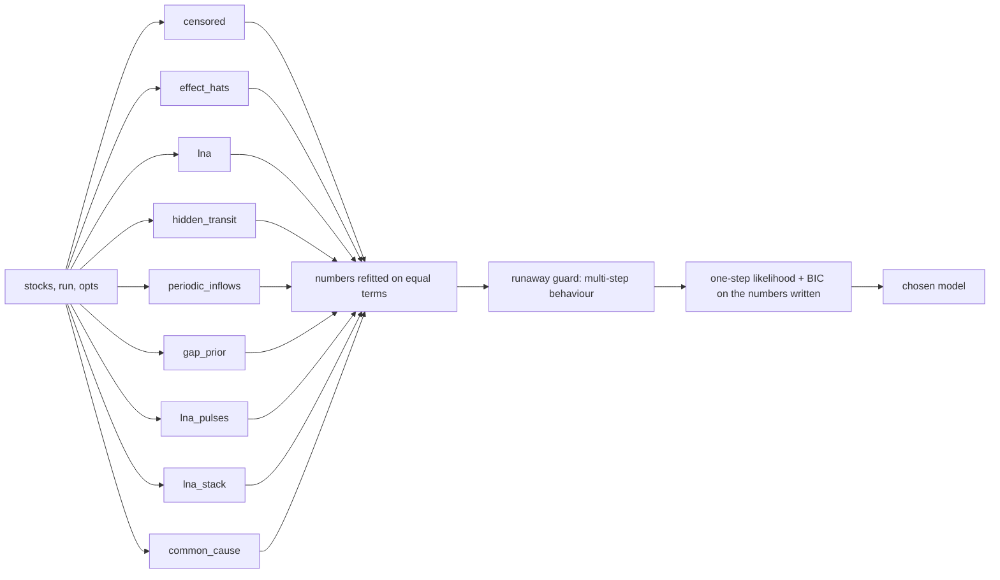

# Combined: the specialists side by side, one judge

**Status:** done for the ladder's test cases 001-048 and the realistic examples (commit ded5e80);
the generated-model bench was still running when this was written (see Results). Work left: the
noisy-measurement cases (080-087) and the canonical models (100-110), whose specialists
(`kalman_lna`, `structures`) are not candidates yet.
**Verdict:** adopt as the ladder's combination. On 001-048 it passes 415 of 472 cells (87.9%)
against lna's 340 (72.0%) and lna_stack's 374 (79.2%). Some strategy passes 437 (92.6%), so
combined reaches 95% of that ceiling. On the 152 hand-written cells it passes 140 (92.1%) against
lna's 94 (61.8%), with a ceiling of 145. It loses no cell lna passes. It loses 3 cells lna_stack
passes (046 link loops, counts-long; see the judge sanity section). On the realistic examples it
reaches 41.1% mean skill@20, up from 21.9%, above matrix (31.8%) and level with censored (41.3%),
but still below effect_hats (49.9%).

Strategy: `combined` (`sdlab/discovery/strategies/combined/`), tests `tests/test_ladder_combined.py`.

## What it does

1. **Candidates.** Each specialist runs as a black box through its own `identify()`, so its
   improvements flow in without changes here. censored and effect_hats run first because they are
   the best candidates on the realistic models. The lna family is the slowest, so it runs after
   them. `lna_loops` is deliberately left out: its passes come on cells the data cannot decide
   (revisit.md). Specialists that start from the matrix method's model, or from lna's, share one
   computation of it (`shared.py`, which swaps the name each specialist imported for a cached copy
   during the call). Each specialist runs under a cap (`deadline.py`: a SIGALRM nested under the
   runner's own timer; 90 s, and never past the budget, which is 240 s or 70% of what the caller's
   timer leaves). A specialist that raises or runs out of time is left out.
2. **Numbers refitted on equal terms** (`refit.py`). The specialists write numbers their own way,
   and some round to four significant figures. On noise-free data that rounding alone costs
   thousands of nats, so the judge would be comparing how numbers were written rather than
   structures. Each candidate's structure is kept, and its numbers are refitted by least squares
   of the one-step changes across all stocks at once. With counts, each row is weighted by the
   candidate's own one-step variance. Repeated inflow values stay tied, so a repeating profile
   stays one profile. Effects are held at what was found, and gaps are refitted as c + k x. The
   refit is kept only if it raises the candidate's likelihood. On the stored results it turned 43
   failing candidate models into passes and no passing one into a failure.
3. **Runaway guard.** A candidate is set aside when its multi-step error on the data is both above
   0.1 and more than 4 times the best candidate's. The error is the main line's judge: runs from
   many moments over 5, 20 and 100 steps, with measured inputs fed and unmeasured stocks started
   from their open-loop estimate. This only removes models that drift off. It never ranks the
   rest (see Judge for why).
4. **One judge** (`judge.py`, `params.py`):

       score = NLL(one-step changes) + 0.5 x log T x (numbers the candidate wrote down)

   - **Counts** (whole numbers that move) use the linear noise approximation. Each flow moves a
     Poisson number of things, so the change from x_t has mean S a(x_t) and covariance
     S diag(a(x_t)) S^T, co-flows included, plus the rounding quantum's variance. A wrong set of
     flows gets the wrong covariance even where its means are right: a move against a link, births
     against deaths.
   - **Other data** (noise-free, written to a quantum) give each stock its own variance, floored at
     the rounding of the levels (quantum² / 6; 1e-4 for the engine's noise-free runs). Two models
     that are exact to the data's precision tie, and their prices decide.
   - **Equations as the engine applies them.** Floors and caps (`simulate.Model`), effects,
     co-flows and measured inputs (`opts["inputs"]`) are applied as the engine does. Unmeasured
     stocks (a hidden stock, a `via` delay) are run open loop from the measured levels. The start
     is chosen by likelihood among multiples of the stock's steady state and the candidate's own
     estimate.
   - **What is priced** (`params.py`). Each flow counts its rate's numbers: constant 1,
     proportional 1, gap 2, linear 1 per stock read plus 1 for a constant. Found outside-inflow
     pieces cost one number per distinct value and one per change place. A repeating profile pays
     its places once per period, plus one for the period. Effects cost 3 for linear and 2 per
     point for a table, plus 1 per co-flow, 1 for a ratio other than 1 and 1 per unmeasured stock.
     A flow's existence costs nothing beyond its numbers (`per_flow` = 0; 1 changes no cell on
     001-048).
   - **Exact ties** (identical stocks without noise) go first to the model with fewer flows that
     read a stock other than the ones they join, then to fewer numbers, then to a fixed preference
     with the lna family first.

Options: `price`, `per_flow`, `budget`, `cap`, `refit`, `guard`, `guard_floor`, `specialists`,
`trace`; also from `SDLAB_COMBINED` (JSON).

## Results

All numbers come from the result store after `uv run sdlab-ladder sync --strategies combined
--jobs 6` at commit ded5e80, run on 2026-10-19. Specialists' cells are their latest results, and
some are older versions (the board mixes versions).

### Ladder

| cells | combined | lna | lna_stack | some strategy passes |
|---|---|---|---|---|
| 001-038 hand-written (152) | **140 (92.1%)** | 94 (61.8%) | 109 (71.7%) | 145 (95.4%) |
| 001-048 incl. draws (472) | **415 (87.9%)** | 340 (72.0%) | 374 (79.2%) | 437 (92.6%) |
| all non-realistic, incl. new cases 049-110 (914) | 679 | 579 | 514 of 780 | 798 |

- **Lost against lna:** none.
- **Lost against lna_stack:** 046-random-link-loop #2, #4 and #5, counts-long. The judge prefers
  the loop without its small closing link, at a BIC gap of 2-8 nats (see below).

Per case on 001-038 (cells passed of 4; the other columns count passes):

| case | combined | lna | lna_stack | any |
|---|---|---|---|---|
| 001-006, 012-014, 020, 023, 028-031, 036, 037 | 4 each | 4 each | 4 each | 4 each |
| 007-link | 2 | 2 | 2 | 4 |
| 008-link-loop | 2 | 2 | 2 | 2 |
| 009-births-and-deaths | 2 | 2 | 2 | 2 |
| 010-loop-branch | 1 | 1 | 1 | 2 |
| 011-goal-gap | 4 | 2 | 4 | 4 |
| 015-hidden-stock | 4 | 0 | 0 | 4 |
| 016-coflow | 3 | 1 | 3 | 3 |
| 017-linear-effect | 4 | 0 | 2 | 4 |
| 018-table-effect | 4 | 0 | 2 | 4 |
| 019-announced-era | 4 | 3 | 3 | 4 |
| 021-daily-inflow | 4 | 0 | 2 | 4 |
| 022-pulse | 4 | 0 | 4 | 4 |
| 024-floor-binds | 3 | 0 | 0 | 4 |
| 025-runs-empty | 4 | 0 | 0 | 4 |
| 026-hidden-stock-driven | 4 | 0 | 0 | 4 |
| 027-stepping-inflow-drain | 4 | 3 | 4 | 4 |
| 032-three-chains-of-three | 4 | 2 | 2 | 4 |
| 033-independent-chains-shared-driver | 3 | 2 | 2 | 4 |
| 034, 035, 038 (identical twins) | 4 each | 2 each | 2 each | 4 each |

Ceiling misses on 001-048:

- **007 none and the 045/054 link sweeps, none-long** (only `shared_noise` passes). Without noise,
  a link and a move are the same linear system.
- **010 counts-short and the 046 link loops** (`lna_loops`, `lna_stack`). A small loop-closing
  link within its standard error.
- **024 counts-long** (censored passes alone). effect_hats' effect curve imitates the floor at a
  BIC 22 lower than censored's model. censored's re-cut inflow pieces have unequal values, so its
  repeating schedule is priced as 20 pieces.
- **033 counts-short** (common_cause).
- **032 none-long** (common_cause, at 2-26 s per cell). It was capped or out of budget on this
  loaded machine.

### Realistic examples (31 sd-* models x 2 lengths)

| version | mean skill@20 (62 runs, clipped at -100%) |
|---|---|
| 244c81d, no guard, lna first, 45-75 s budget | 21.9% |
| 696189d, runaway guard, inputs, caps | 31.8% |
| **ded5e80**, censored and effect_hats first, cap 90 s | **41.1%** |
| matrix / censored / effect_hats (54 runs) / lna / lna_stack (35) | 31.8% / 41.3% / 49.9% / 17.5% / 39.6% |

**Which model the judge picks where combined loses.** Before the fixes, the lna family's model won
on BIC and then ran away on the graded run: sd-hidden-chain long -10.1, sd-webshop-stock -4.8 and
-7.6, sd-services long -307. effect_hats and censored, the realistic winners, were often never run,
because the budget was spent on the lna family. Running them first and capping each specialist
raised the mean from 31.8% to 41.1%. The losses that remain are judge losses. On sd-webshop-stock
short, for example, the chosen lna model has in-data multi-step error 0.239 and effect_hats 0.181,
but their skill@20 against the truth's inflows is -7.6 and 0.74. **No in-data measure separates
them.** On the stored candidates (61 realistic runs, plus every test cell):

| behaviour guard | realistic skill@20 | test cells passed (of 974) |
|---|---|---|
| none / 4x (default) / 3x | 40.9% | 673 |
| 2x | 43.2% | 654 |
| 1.5x | 46.4% | 608 |
| 1.25x | 49.8% | 561 (below lna's 583) |
| 2x, with inflow pieces replaced by their mean | 40.9% | 673 |

A guard tight enough to match effect_hats on the realistic models costs more test cells than
combined gains over lna. This in-data judge replays each model's own inflow pieces, so on the test
cases it favours wrong models that carry many pieces. The default stays at 4x, which costs no test
cell. Closing this gap needs a behaviour judge that does not replay a model's own pieces (a
held-out era, or inflows from a shared re-estimate), not a tighter factor.

### Benchmark v2.1 (examples) and generated models

- **Examples** (`tests/bench/evaluate.py --strategy combined --baseline v2.1 --jobs 3`, commit
  696189d): mean skill@20 31.4% (+1.7 against v2.1), skill@100 41.6% (+12.3), 13 of 62 runs meet
  the goal. Paired against v2.1: 32 better and 18 worse at @20 (sign p = 0.065). Against lna's
  default-length run (31 runs): +27.5 points @20 (Wilcoxon p = 0.004) and +39.1 @100 (p = 0.004).
- **Generated models** (`--generated 100 --jobs 3`): lna's reference is -51.8% mean skill@20, with
  6 of 200 runs meeting the goal. combined was still running when this was written (commit
  696189d, 100 of 200 runs done). Its result is in
  `~/.cache/sdlab/bench/runs/generated/*combined-696189d*`.

### Time

On the shared machine (load 90-140 on 28 cores), the whole ladder for combined (974 cells,
`--jobs 6`) took 46 minutes. Most of that went to the 62 realistic runs: mean 152 s each, 9,448 s
in all. The test cells took a mean of 11.1 s (hand-written) and 5.2 s (draws), against lna's 1.1 s
and 0.6 s. The 472 cells of 001-048 add up to 3,801 s of discovery, about 10.6 minutes at `--jobs 6` under
this load. The first version (six specialists, no lna_stack and no guard) took 7.1 minutes for the
same 472 cells. That is over the "few minutes" goal on a loaded machine; see Speed below.

## Judge sanity: does the judge prefer the truth?

`uv run python tests/test_ladder_combined.py [price] [upto]` scores, on every case and variant in
the store, the true model against every specialist's failing model. The truth's numbers are fitted
by the judge's own likelihood, starting at the truth, with schedule values kept tied. Each wrong
model is refitted as the strategy refits it. A row means the judge scores a wrong model better than
the truth. The run on 001-048 at commit ded5e80 is in progress; the results below come from the
first run on 001-048 (31 cells, earlier truth fit).

- **Truly unidentifiable or data-limited cells** (gap at most 4 nats, about the price of 1-2
  numbers):
  - 009 births and deaths, none: only the net rate is identifiable.
  - 045 link and 054 link-strength sweeps: a weak link.
  - 046 and 055 link loops, and 010 loop-branch counts-short: a small loop-closing link within
    its standard error.
  - 016 coflow counts-short.
- **Judge bugs** (gap far above a few numbers):
  - **024-floor-binds counts-long:** fixed. It was a bug in the sanity fit (the truth's signs were
    lost) and has been fixed.
  - **017-linear-effect counts-long** (62 nats; the truth's effect needs 51 numbers against
    effect_hats' 36). The table points of a linear effect written as `linear` cost 3, but the
    truth's schedule pieces dominate the price. This is a pricing artefact of inflow pieces, not of
    the effect.
  - **048-random-stepping-inflow-drain #8 counts-long** (24 nats). The truth's inflow steps
    (42 numbers in all) cost more than they gain in fit over lna's 6-number model. The BIC price per inflow change (value plus
    place, 0.5 log T each) is high when the steps are small relative to the counting noise.
  - **056 sweep-zero-floor counts** (12-31 nats in the offline study; the truth, unfitted, loses to
    lna). Near zero, the counts are 0 and 1 and the drain
    is cut short by the empty stock, so the Gaussian approximation is biased. A discrete (Poisson
    or Skellam) likelihood for small counts would fix it.

## What would close the remaining gap

1. **A behaviour judge that does not replay each model's own inflow pieces**, used in place of the
   4x guard. It would be the main lever on the realistic models (40.9% to about 50% on the stored
   candidates), but only if it does not cost the test cells.
2. **Candidates for the new cases:** `kalman_lna` (measurement noise, 080-087: it passes 60 cells that
   combined does not) and `structures` (canonical models 100-110: 25 such cells). The judge also needs a likelihood
   for measurement noise (a Kalman filter on the levels). The one-step likelihood here assumes the
   levels are measured exactly.
3. **A discrete likelihood for small counts** (056), and a lower price for small inflow steps,
   which the change_price research suggests (048 #8).
4. **Speed.** common_cause and effect_hats dominate on noise-free long runs, and the lna family on
   realistic ones. A screen that skips common_cause when no two stocks move alike would save most
   of its time.

## Needed changes outside this package (reported, not made)

- `lna_pulses` and `lna_stack` raise `ValueError: 'pump' is not in list` on 062: a measured input
  is not handled. `lna_stack` also raised a numba `SystemError` in `inv_logdet` on
  sd-webshop-stock counts-short.
- `052-sweep-run-length#5` `counts-run` errors for every strategy: a variant name the case no
  longer has (`KeyError` in `cases.spec`).
