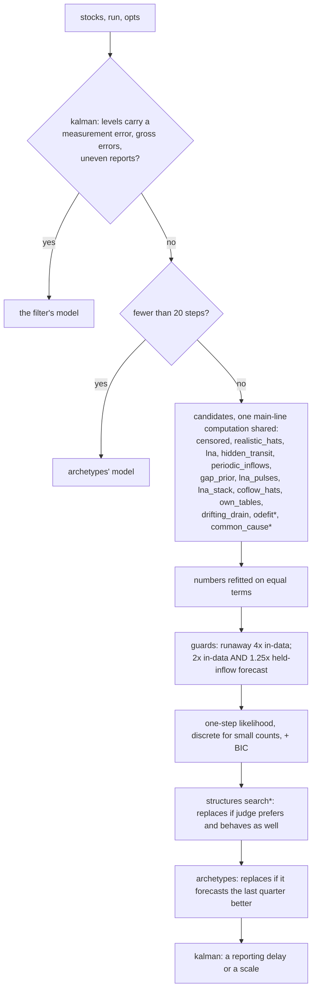

# combined2: every specialist, one judge that does not trust replayed inflows

**Status:** first version done (ladder: every non-heavy case, 1,404 cells, all at commit a6186b7, run 2026-10-19 08:53-17:40 PDT with `--jobs 2`, partly by the watcher at the same strategy hash). Strict pass not filled for 371 of its test cells (see Results).
**Strategy:** `combined2` (`sdlab/discovery/strategies/combined2/`), tests
`tests/test_ladder_combined2.py` (8). Queue item 2f (combined, round 2).
**Verdict:** adopt as combined's successor on the test cases (same scorer: 852 passes against combined's 703 of 1,150 test cells, 159 gained, 10 lost), the noisy cases (124 vs 62 of 156), the canonical (23 vs 3 of 48) and distilled cases (76 vs 20 of 170) and the twins (10 pass + 10 equivalent vs none). Not yet the realistic leader: skill@20 44.6% against combined's 41.9% (+2.7 points paired, 18 better, 10 worse), below effect_hats' 49.9%, and 13 goals met against combined's 16. Physics 14 of 28 against odefit's 26: the measurement-noise physics cells go to the Kalman filter, which fails them (What remains).

## The question

combined (combined.md, ded5e80) picks among nine specialists with one judge. Since then new
specialists pass cells combined misses: kalman_lna (noisy reports, 080-088), structures
(canonical 100-110, products, hidden chains), archetypes (short series and twins), odefit
(physics), own_tables, drifting_drain and the improved censored (curved and drifting flows,
floored gaps), coflow_hats (co-flows and cycles) and realistic_hats (answers in time, transit
stocks). And combined's judge cannot tell a runaway model from a sound one when the runaway one
replays its own inflow pieces (realistic skill@20 41.1% against effect_hats' 49.9%). Can one
strategy carry all of them, without losing what any of them passes?

## What it does

(* skipped by a screen where it cannot matter.)

Every specialist is a copy in `combined2/_vendored/`, taken from HEAD 05ae898 with its imports
rewritten (the header of each file and `_vendored/__init__.py` name each source commit: combined
beab53e, lna f3270a8, lna_levels dc73851, lna_products 9bd1e2a, lna_pulses dc73851, lna_stack
9bd1e2a, gap_prior 2bbc025, hidden_transit 2b6a827, common_cause 0419efe, periodic_inflows 1421f81,
impulses 60753ce, censored 6ca61d5, effect_hats 89adae4, realistic_hats 06b0062, coflow_hats af06c28,
own_tables 67a604b, drifting_drain 453358e, odefit 333f814, kalman_lna 6a93270, structures 7e0a2bf,
archetypes 3c3e009). Nothing imports another strategy (`tests/test_isolation.py`).

1. **kalman first** (`stages.Kalman`, kalman_lna's identify split in two). On up to 4 stocks,
   uneven reports or announced injections, the filter's superset is fitted. When the levels carry
   a measurement error (or gross errors, or uneven reports), the filter's model is the answer: the
   one-step judge assumes exact levels and cannot rank it.
2. **Short series** (under 20 steps): archetypes' model. The matrix method and everything on it
   return nothing there.
3. **Candidates** as in combined (each under a 90 s cap, a budget of 240 s or 60% of the caller's
   timer, the main line's model as the fallback when none finishes), sharing one main-line
   computation (`shared.py`, extended to the new candidates). realistic_hats replaces effect_hats
   (it loses no test cell against it and answers in time). The kalman, structures and archetypes
   specialists are combined plus one stage each; they run as that stage on combined2's pick, so the
   base runs once.
4. **Screens** (`screens.py`): common_cause only when two stocks' changes correlate at |r| >= 0.9
   or the levels are tied exactly (combined's 11 s per cell came mostly from it); odefit not on
   counts; odefit and the structures search not where the model is exact to the data's rounding
   without inflow pieces (none of their wins over combined is such a cell).
5. **The judge** (`judge.py`, `forecast.py`, `choose()`): combined's (numbers refitted, one-step
   likelihood, BIC price on every number written) with two changes.
   - **Held-inflow forecasts.** Each candidate runs from ~80 moments of the run over 5, 20 and 100
     steps with every found inflow piece (and found era) held at its value when the forecast
     starts; measured inputs, announced eras and injections follow their times. A candidate is set
     aside when its in-data error (combined's, replaying its pieces) is over 2x the best AND its
     held-inflow error is over 1.25x the best, besides combined's own 4x runaway guard.
   - **A discrete likelihood for small counts.** For a model whose flows each touch one measured
     stock, every step whose rates add to at most 30 is scored exactly: Poisson in, Poisson out cut
     at the level (056).
6. **structures** (`stages.structures`): its search (products, multi-stock gaps, Erlang chains);
   its model replaces the pick when combined's judge prefers it and it behaves as well.
7. **archetypes** (`stages.archetypes`, up to 3 stocks and 120 steps): its model replaces the pick
   when it forecasts the run's last quarter better, the pick refitted on the first three quarters
   by its structure (archetypes itself rediscovers the base there, which would run everything twice).
8. **kalman again**: a reporting delay or a stock counted at a scale.

## The judge: which guard (offline study)

`tests/study_combined2_judge.py run all OUT.jsonl` scores every stored model of the 14 pool
specialists on each cell (k8s cases left out) with combined's judge, the discrete likelihood, the
in-data multi-step error and the held-inflow error; `analyse` compares rules by the stored status
and skill@20 of the model each rule picks. 1,361 cells, store as of 2026-10-19 13:40 (specialists'
latest results; some are older versions). Without the stages (kalman, structures, archetypes are not
in this pool):

| rule (candidates: 14 specialists' stored models) | tests (1,150) | noisy (156) | canonical (48) | distilled (170) | physics (28) | particles skill@20 | realistic skill@20 (62) |
|---|---|---|---|---|---|---|---|
| combined's judge, combined's 9 specialists | 722 | 61 | 15 | 28 | 12 | 51.1% | 42.8% |
| combined's judge, new pool | 745 | 62 | 14 | 53 | 18 | 54.6% | 49.9% |
| + discrete likelihood | 749 | 62 | 14 | 53 | 18 | 54.6% | 49.9% |
| + held 2x alone | 745 | 63 | 14 | 53 | 19 | 63.8% | 49.0% |
| in-data guard 2x alone | 724 | 60 | 14 | 51 | 18 | 65.4% | 54.0% |
| ranked by held-inflow error alone | | | | | | | 32.9% |
| **combined2: in-data 2x AND held 1.25x, discrete** | **749** | 62 | 14 | 53 | **19** | **65.4%** | **51.3%** |
| oracle: any candidate passes / best skill | 777 | 73 | 17 | 63 | 25 | 71.9% | 66.3% |

- **The new pool is most of the realistic gain**: combined's judge on combined's nine specialists
  picks 42.8% realistic skill@20; on the new pool, 49.9%.
- **The held-inflow error alone is not a judge for realistic models**: ranked by it, realistic
  falls to 32.9%. Their inflows really change; a held inflow is wrong for every candidate.
- **The in-data error alone, tightened, still costs test cells** (2x: 724 vs 745, as combined.md
  found), because it sets aside sound models whose few pieces cannot replay the run.
- **Both together** (set aside only a model worse on both) loses no test cell and gains realistic
  skill (51.3%), a physics cell and particle skill (+11 points).
- The discrete likelihood adds 4 test cells (056 and small-count cells).

## Results

Commit a6186b7 (strategy hash 9f8828538073d255), every non-heavy case (sd-k8s-platform left out),
1,404 cells, `--jobs 2 --timeout 300`, single-threaded, 2026-10-19. Machine load 80-210 on 28 cores
throughout, so seconds are inflated for every strategy.

**Same scorer** (`tests/study_rescore_pair.py combined2 combined <cases> OUT.jsonl`, both stored
models re-scored now in one process; the store's rows carry different scorer hashes):

| set | combined2 | combined | gained / lost | best single specialist (store, mixed scorer versions) |
|---|---|---|---|---|
| tests (1,150 cells) | **852 pass** + 161 eq | 703 + 141 | 159 / 10 | structures 757, kalman_lna 755 |
| noisy (156) | **124** + 12 | 62 + 6 | | kalman_lna 121 |
| canonical (48) | **23** + 8 | 3 + 5 | | structures 28 of 66 incl. 111-116 (combined2 25 of 66) |
| distilled (170) | **76** + 23 | 20 + 23 | | structures 42 |
| realistic (64): skill@20 | **47.3%** | 44.7% | +2.6 paired, 17 better, 10 worse | effect_hats 49.9% (store) |
| realistic: fresh skill@20 | 45.7% | 42.8% | | |
| realistic: goals met | 15 | **17** | 0 / 2 (sd-hidden-chain long, sd-hospital long) | combined 16, archetypes 16 (store) |
| realistic: recall | 55.7% | 56.7% | | gap_prior 58.6% (store) |

**From the store** (`uv run python tests/study_combined2_compare.py OUT.json`; each strategy's
latest rows, its own scorer version; physics, particles and twins use their own scorers):

| set | combined2 | combined | best single specialist |
|---|---|---|---|
| physics (28) | 14 pass | 12 | odefit 26 |
| particles (16) | 4 pass, skill@20 61.5% | 3, 60.7% | 4 (odefit, own_tables, censored, ...); structures 62.7% |
| real twins (52) | 10 pass + 10 eq, recall 51.1% | 0 + 0, 5.6% | archetypes 12 + 20, 64.0% |
| strict (tests) | not measured reliably: 386 of 821 verdicts known in the summary; `sdlab-ladder strict --strategies combined2,combined --set tests --jobs 2` (2026-10-19 18:14) reported 0.0% strict for both on 35% / 46% of verdicts known, 83 / 64 passes failing strict on extra complexity | 626 of 1,184 (summary) | |
| seconds per test cell | 16.6 | 8.0 | (lna 0.6, structures 19.3, kalman_lna 10.1) |
| seconds per realistic run | 142 | 155 | |

The headline realistic case is fixed: sd-webshop-stock short goes from -100% (combined: the lna
family's runaway model) to 84% skill@20.

### Losses: cells a specialist (or combined) passes and combined2 does not

54 cells in the store (`study_combined2_compare.py`, "losses"); same-scorer against combined, 10
test cells and 1 physics cell. By cause:

- **Measurement noise on smooth data goes to the Kalman filter, which fails it (17 cells):** phys-*
  meas (coupled tanks, Lotka-Volterra, spring, reaction chain, thermostat; 12), 139/141/142/143 meas
  (5), plus 141 none-short. kalman's before-stage reads a measurement error and answers alone;
  odefit passes these. Offline on the stored models, preferring odefit when its in-data error is
  under 0.3x kalman's would win 7 of these and lose 1 of kalman's (083 bias-short); a plain
  comparison loses 25 of kalman's noisy cells. Not implemented (no time to re-run).
- **kalman's outlier reading on noise-free data (022-pulse none-long):** a one-step pulse is read as
  a gross error and the filter answers. kalman_lna fails it too.
- **Specialists newer than the copies or than their stored runs**: 019 none-short (every candidate,
  combined2's copies included, returns the same pieced model; combined's pass is from an older run),
  047 #1/#5 none (4 cells, equivalent: the BIC ties to 1e-3 nats between coflow_hats' and gap_prior's
  model with the same numbers count; a tie tolerance from 1e-3 to 2 nats loses as many cells offline
  as it wins), 087 outliers-long (equivalent).
- **structures' or own_tables' acceptance on counts:** 196 counts-long (structures replaces
  own_tables' table), 123 and 210 counts-long, 210 none-short (own_tables), 107 counts-short and 101/102/
  138 none (structures passes, combined2 equivalent), 024 counts-long (censored).
- **Others, not diagnosed:** 033 counts-short and sd-eras short (common_cause), 035 none-short, 044 #4
  counts-short, 054 #1 none-short, 055 #7 counts-short, 080 outliers-short, 100 none-long, 110/116/205
  counts-long (hidden_transit), 112 meas-long and 2 twins (archetypes), 157 counts-long, phys-draining-
  tank and phys-newton-cooling meas, sd-pipeline long (periodic_inflows).

## What remains

1. **odefit against the filter on smooth measured data** (17 cells above): a comparison both can be
   judged by (output error on held-out segments, as odefit's own run.py does).
2. **Realistic models**: the offline study said 51.3% with every candidate finishing; on the ladder
   the 240 s budget leaves later candidates capped on long runs (142 s per run on average), and
   sd-hidden-chain long now loses its goal (-100%). The held-inflow guard is not the lever there
   (alone it ranks at 32.9%): realistic inflows really change. Closing to effect_hats' 49.9% needs
   a fairer ranking than BIC among the kept candidates, or the time to run realistic_hats and
   coflow_hats to the end.
3. **Speed**: 16.6 s per test cell against combined's 8.0 (structures' search on counts runs ~8 s
   even where it cannot win; kalman's superset fit on every case of up to 4 stocks).
4. **Strict**: not measured reliably (the strict run reported 0.0% for both strategies on a third of the verdicts; the summary had 386 of 821 for combined2 against 626 of 1,184 for combined). 83 of combined2's passes fail strict on extra complexity: some stages add flows the truth does not have.
5. The 10 same-scorer test-cell losses against combined, listed above.

## Needed changes outside this package (reported, not made)

- `052-sweep-run-length#k` `counts-run` still raises `KeyError('counts-run')` in `cases.spec` (seen
  again by the study script).
- A strategy cannot learn from the store which candidate the judge chose: only flows are stored, so
  `combined2`'s own trace (`result["combined2"]`) is lost after a ladder run; storing the result's
  small metadata would make choices auditable.

## The declared boundary (2026-10-20)

Outside flows are a modelling decision the case makes, not something discovery may invent (the user's
approval, CLAUDE.md invariant 2; docs/research/declared-boundary.md). This strategy carries its own copy of
`matrix/boundary.py` at 723f72c (`combined2/boundary.py`; HIDDEN_PRICE 0, CLAIM_PRICE 2) and uses it:

- **lna's atoms** (the search lna, gap_prior, lna_pulses, lna_stack and its levels and products stages share,
  `_vendored/lna/`): an atom with an outside end (in, grow, link, gap, out, drain) is offered only on a
  declared side and kind (`atom_rule`: one that reads a measured input is "measured", any other
  "estimate"); the candidate set is filtered before the noise check and every later fit holds an atom off
  the boundary at 0 (swaps and stages cannot bring one back). A stock with no declared outflow therefore
  has no drain: what it loses is moves.
- **structures' search** (`_vendored/structures/`): the library and every fit hold outside terms (in, link,
  gap, goal, plink, out, drain, an outside-fed chain) only on declared sides; with none declared, each
  outside flow adds CLAIM_PRICE x log T to its BIC.
- **kalman_lna's atoms** (`_vendored/kalman_lna/`): every refit leaves out an atom off the boundary.
- **The stages:** a stage's model that replaces the pick (structures, archetypes) is guarded first.
- **archetypes' search** (`_vendored/archetypes/fit.py`, `search.py`, `hidden.py`): the term library, the archetypes and the
  GLV start hold outside terms only on declared sides, and every fit leaves out a term off the boundary;
  with none declared each outside term adds CLAIM_PRICE x log T to AICc. The holdout's cut run keeps the
  announcement.
- The other specialists' copies (censored, effect_hats, common_cause, hidden_transit, periodic_inflows, realistic_hats, coflow_hats, own_tables, drifting_drain, odefit)
  start from the main line's matrix method (the pinned shared library, which they cannot change) and are
  kept inside the boundary by the guard on their models below.
- **Every candidate before the judge:** where a boundary is declared, each candidate model passes the guard
  (`inside_candidates`: a flow outside it becomes its best-priced alternative, a move into a stock of its
  unit, a link made a move, or nothing), with one refit budget for all candidates (GUARD_FITS 150 refits,
  and at most 30 s or half what the caller's timer leaves; past it the offending flows are dropped
  unrefitted, never kept). Identical candidates are guarded once.
- **The judge:** with no boundary declared, each outside flow is a boundary claim and adds CLAIM_PRICE x log T
  (on the -2 log L scale, so half that on the judge's negative log-likelihood) to the candidate's BIC.
- **The answer:** the guard and the anti-correlated pair moves once more (declared), or the moves and the
  priced claims (not declared), bounded the same way; `boundary` and `boundary_claims` in the result.

Results: in progress (paired pool runs on Kubernetes 300-305 and 40 Tests cells; see below when reported).
