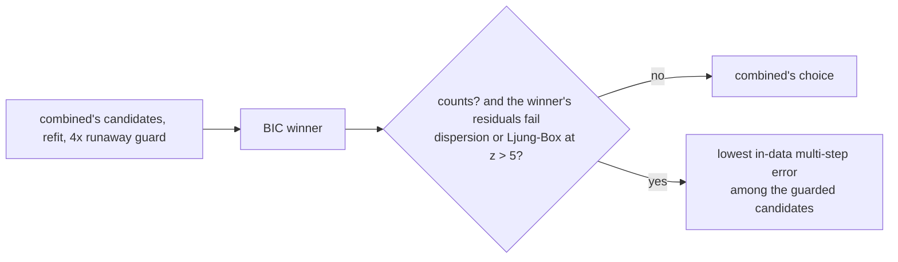

# combined_misfit: multi-step error picks where no candidate fits the counts

**Status:** done on the ladder (tests 001-111 and the 62 realistic runs, code e0bc5f5; made self-contained in 0bb2b02 with identical output). Examples bench run (9cae1ae label, the same code).
**Strategy:** `sdlab/discovery/strategies/combined_misfit/` (commit e0bc5f5), tests
`tests/test_ladder_combined_misfit.py`; offline study `tests/study_combined_r2.py`.
**Verdict:** adopt the switch into combined (round 2). Realistic mean skill@20 is 45.2%, against 40.6% for the stored combined (+2.0 points paired over 62 runs; 49.8% against effect_hats' 49.9% on the 54 runs effect_hats has). Against combined run in the same session (combined_lean, which is combined where the switch does not apply), it is +12.3 points. On the tests it is the same as combined except one cell (101 SEIR counts-short, pass -> fail).

## Question

combined leads the tests (74.3% pass, 66.6% strict) but trails effect_hats on the realistic examples
(41.1% mean skill@20 against 49.9%; on the 54 runs both have, 44.9% against 49.9%). Where it loses,
its judge (one-step counting likelihood plus BIC) picks an lna-family model that drifts off when fed
the truth's inflows. combined.md found that no in-data multi-step guard closes this gap without
losing test cells, because the in-data error replays each model's own inflow pieces. Can a rule
tell the realistic runs apart from the tests, and judge them differently?

## What it does

1. Exactly combined's candidates, refit, guard and BIC choice (it calls `combined.candidates` and
   `combined.choose`).
2. **Goodness of fit of the winner** (`fitcheck.py`). The standardized one-step residuals z = (change
   - mean) / sd come from the winner's own linear-noise covariance. **Dispersion** is
   (mean z² - 1) / sqrt(2 / (T S)), a z-score. **Whiteness** is the Ljung-Box Q over lags 1-10 summed
   over stocks, as (Q - 10 S) / sqrt(20 S).
3. If either is above `z` = 5, no candidate is right. The candidate with the lowest multi-step error
   on the data (combined's behaviour measure: runs from many moments over 5, 20 and 100 steps, own
   inflows) among those the guard keeps is chosen, with ties going to BIC. Noise-free and other
   non-count data are never switched: their residuals are rounding, of no known size.

Why it should work: on counts test cells, the BIC winner fits (dispersion z ≤ 2.7 at the 99th
percentile; the only exceptions are canonical 102, 105 and 108). On the realistic runs its median
dispersion z is 9.3, and 48 of 62 runs fail at z > 5. Under a misspecified model class, selecting by
simulation error is the standard choice (Piroddi and Spinelli 2003; Farina and Piroddi 2011; Ribeiro
and Aguirre 2018). The full evidence and references are in [ideas-2026-10-18.md](ideas-2026-10-18.md).

## Results

All from the result store after `uv run sdlab-ladder sync --strategies combined_misfit,combined_lean,combined_r2
--cases 0,1,sd- --jobs 3 --timeout 300`, which ran 2026-10-18 22:53 to 2026-10-19 ~03:15 PDT on code
e0bc5f5, and `sdlab-ladder strict --strategies ... --cases 0,1` for the strict verdicts. The comparison
script is a summary query (`api.summary()`), paired on the cells every strategy ran.

**Caveat on "combined".** combined's stored rows are ded5e80/130d21b, from before the lna variants moved
onto lna's hooks (dc73851), and stale. The strategies here ran with the specialists as they were at
e0bc5f5. On a loaded machine combined's specialists also run under time caps, so the same model can
come out differently from run to run (sd-hidden-chain long: stored combined 100%, the same code in this
session -100%). The cleanest measure of the switch is against **combined_lean**, which ran in the same
session. Its gate skips its leaner pass on most realistic runs, so there it is close to combined's own
choice. It is not identical: before eda02dd/781c56c its leaner pass also acted on sd-population.

### Tests (936 paired cells: 001-111 with draws and noise variants)

| | pass | equivalent | strict |
|---|---|---|---|
| combined (stored) | 679 | 101 | 618 (66.0%) |
| lna | 579 | 123 | 432 (46.2%) |
| **combined_misfit** | **678** | **101** | **617 (65.9%)** |

The only cell that changed status is 101-canonical-seir counts-short (pass -> fail; the BIC winner fails
the fit test, since no candidate writes S x I). On the 110 noisy cells (meas, gaps, weekly, lag,
outliers, bias) it is identical to combined: 26 pass, 19 strict. Non-count data are never switched.

### Realistic (31 sd-* models x 2 lengths)

| | runs | mean skill@20 (clipped at -100%) |
|---|---|---|
| combined (stored) | 62 | 40.6% (paired) |
| combined_lean (combined's choice, same session) | 62 | 32.9% |
| **combined_misfit** | 62 | **45.2%** |
| effect_hats | 54 (12 timeouts) | 49.9% |
| lna | 62 | 17.5% |

- Against stored combined: +2.0 points, 10 runs better and 11 worse by more than 2 points (Wilcoxon p = 0.75).
  On the 54 runs effect_hats has: 49.8% against effect_hats' 49.9% and combined's 44.9%.
- Against combined_lean (its first run, code e0bc5f5), same session: +12.3 points, 11 better and 9 worse (p = 0.32).
  Against its fixed rerun (781c56c): +5.8 points, 10 better and 10 worse (p = 0.77). The large moves:
  sd-hidden-chain long -100% -> 100%, sd-webshop-stock short -100% -> 87%, sd-population short -100% -> 59% and long
  -42% -> 46%, sd-orders short 46% -> 96% and long 36% -> 99%, sd-manufacturing short 65% -> 95%, sd-cloud-credits long
  -90% -> -16%, sd-restaurant short 77% -> 96%, sd-fishery short 25% -> 52%. The ones it loses: sd-emergency short 64% ->
  24%, sd-brewery long 82% -> 65%, sd-webshop-stock long 68% -> 32%, sd-emergency long -36% -> -47%.
- The offline study predicted 49.9% (from 40.7%) on the stored candidates. The ladder gain is smaller, because
  combined refits candidates and runs its specialists under time caps, and because the specialists changed.

### Examples bench (`tests/bench/evaluate.py --strategy combined_misfit --baseline v2.1 --jobs 3`)

Saved run `2026-10-19T14-08-12-216Z-combined-misfit-9cae1ae.json`. There are now 33 examples (66 runs).
Mean skill@20 is 42.6% (+12.9 against v2.1) and skill@100 49.3% (+20.0); 17 of 66 runs meet the goal.
Paired with v2.1 over 62 runs: skill@20 34 better and 14 worse, +15.7 points (Wilcoxon p = 0.0002).
Against combined's last bench run (696189d, an older combined: `tests/bench/compare.py`):
skill@20 15 better and 14 worse, +14.0 points (p = 0.16); skill@100 +10.9 (p = 0.064).

### Time

The same as combined plus one goodness-of-fit pass (a single one-step evaluation): on the realistic runs
200-250 s per long run and 20-150 s per short run on the loaded machine (load ~95 on 28 cores).

## Open

- Underdispersion (dispersion z below -5) does not switch. It shows on several realistic runs (sd-brewery long
  -54, sd-reservoirs long -33) and on floors near zero (056). Whether to switch there is untested.
- A distilled case (CLAUDE.md invariant 4) for the mechanism behind the realistic losses: an outside inflow
  that lna writes partly as an inflow reading its own stock (sd-webshop-stock: about 21 of 60 as a constant,
  the rest as 0.234 x backlog), so the grader's true inflow drives it up.

## The declared boundary (2026-10-20)

Outside flows are a modelling decision the case makes, not something discovery may invent (the user's
approval, CLAUDE.md invariant 2; docs/research/declared-boundary.md). This strategy carries its own copy of
`matrix/boundary.py` at 723f72c (`combined_misfit/boundary.py`; HIDDEN_PRICE 0, CLAIM_PRICE 2) and uses it:

- **lna's atoms** (the search lna, gap_prior, lna_pulses, lna_stack and its levels and products stages share,
  `_vendored/lna/`): an atom with an outside end (in, grow, link, gap, out, drain) is offered only on a
  declared side and kind (`atom_rule`: one that reads a measured input is "measured", any other
  "estimate"); the candidate set is filtered before the noise check and every later fit holds an atom off
  the boundary at 0 (swaps and stages cannot bring one back). A stock with no declared outflow therefore
  has no drain: what it loses is moves.
- The other specialists' copies (censored, effect_hats, common_cause, hidden_transit, periodic_inflows)
  start from the main line's matrix method (the pinned shared library, which they cannot change) and are
  kept inside the boundary by the guard on their models below.
- **Every candidate before the judge:** where a boundary is declared, each candidate model passes the guard
  (`inside_candidates`: a flow outside it becomes its best-priced alternative, a move into a stock of its
  unit, a link made a move, or nothing), with one refit budget for all candidates (GUARD_FITS 150 refits,
  and at most 30 s or half what the caller's timer leaves; past it the offending flows are dropped
  unrefitted, never kept). Identical candidates are guarded once.
- **The judge:** with no boundary declared, each outside flow is a boundary claim and adds CLAIM_PRICE x log T
  (on the -2 log L scale, so half that on the judge's negative log-likelihood) to the candidate's BIC.
- **The answer:** the guard and the anti-correlated pair moves once more (declared), or the moves and the
  priced claims (not declared), bounded the same way; `boundary` and `boundary_claims` in the result.

Results (CPU pool, 2026-10-20, paired: before = 3cc5c54, after = a578c86; same cells, variants and seeds;
`pool_results` of the jobs named; nothing timed out or errored):

| set | jobs (before/after) | pass + equivalent | invented boundary | discovery seconds (sum) |
|---|---|---|---|---|
| Kubernetes 300-305, all variants (28 cells) | 31/66 | 27 -> 26 (+305 none-long; -303 meas-long, -305 counts-long) | 1 -> 0 | 511 -> 839 |
| 40 Tests cells (104, 114, 152, 155, 202, 207, 220, 012, 010, 063 x none/counts, short/long) | 46/69 | 8 -> 8 (no flips) | 28 -> 0 | 387 -> 1132 |

The Tests cells were chosen where the stored results had the most invented boundaries (and three that
passed). Every invented boundary is gone. The loss on 303 meas-long (in all six composites) is the
numbers, not the structure: before, the pick had three invented outside flows that the errors-in-variables
refit (eiv.py) dropped while instrumenting the numbers (queue -> inflight 0.56, true 0.6); now the pick is
already inside the boundary, eiv's multi-step check keeps the least-squares numbers biased by the
measurement error (0.68; instrumented 0.56 judged 0.212 against 0.209), and the cell fails on the numbers.
The fix belongs to eiv's acceptance test (next step). Discovery time rose on most of them (the guard over
every candidate and the final passes, each bounded at 150/120 refits and 30 s).
