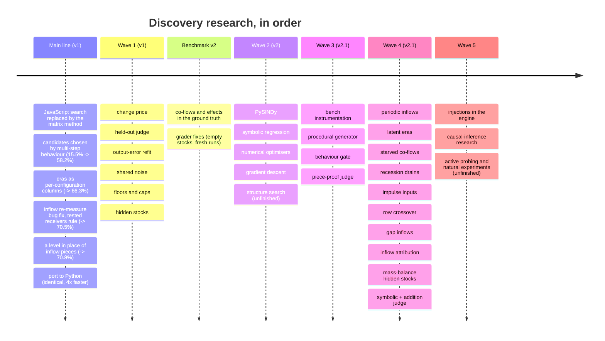
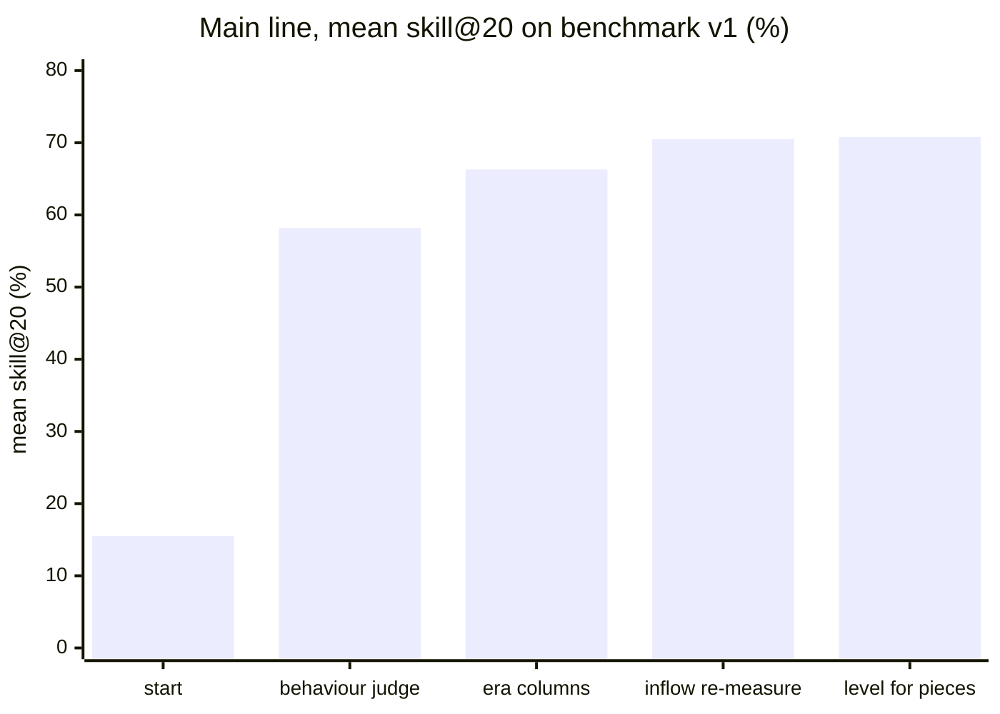
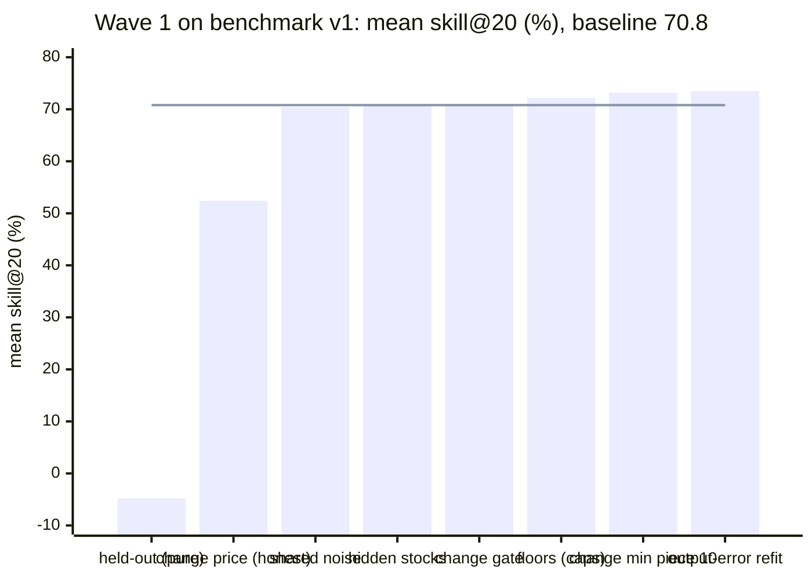
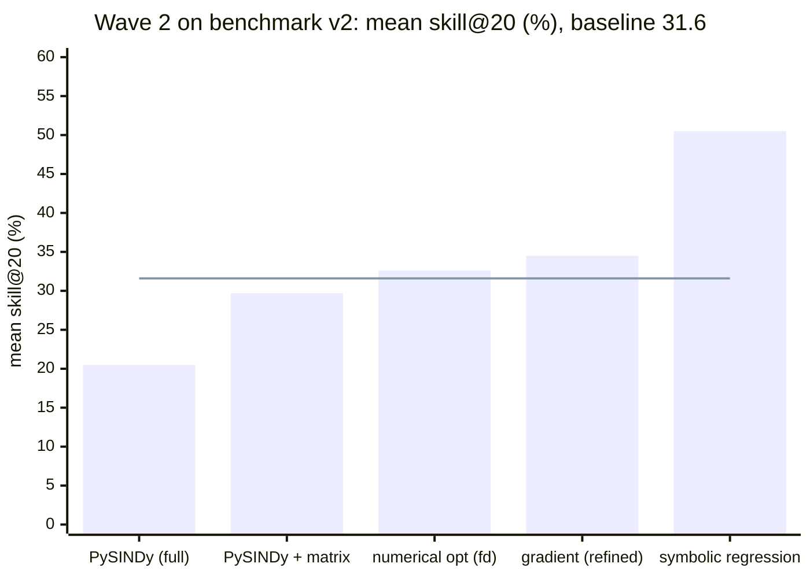
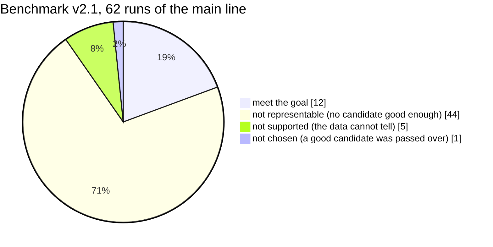
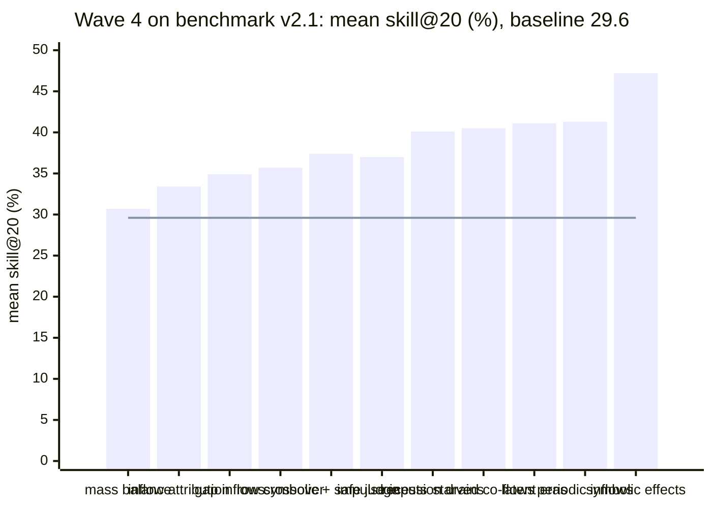
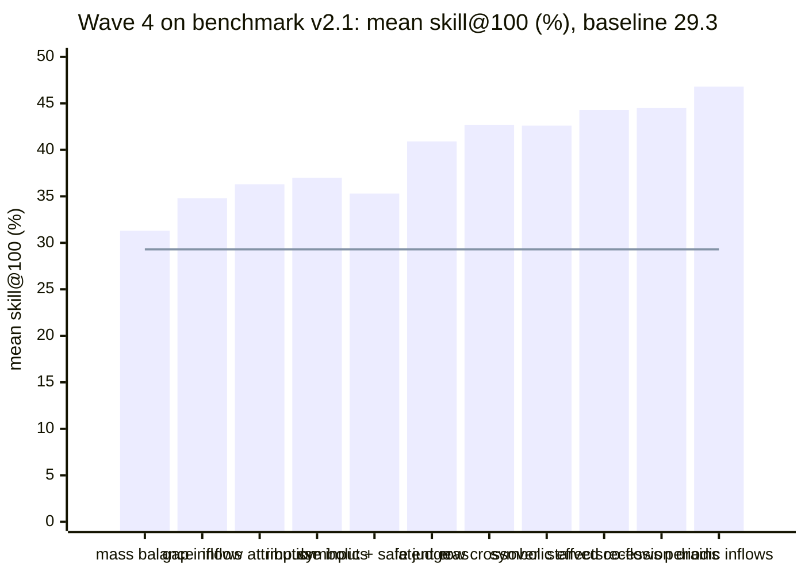
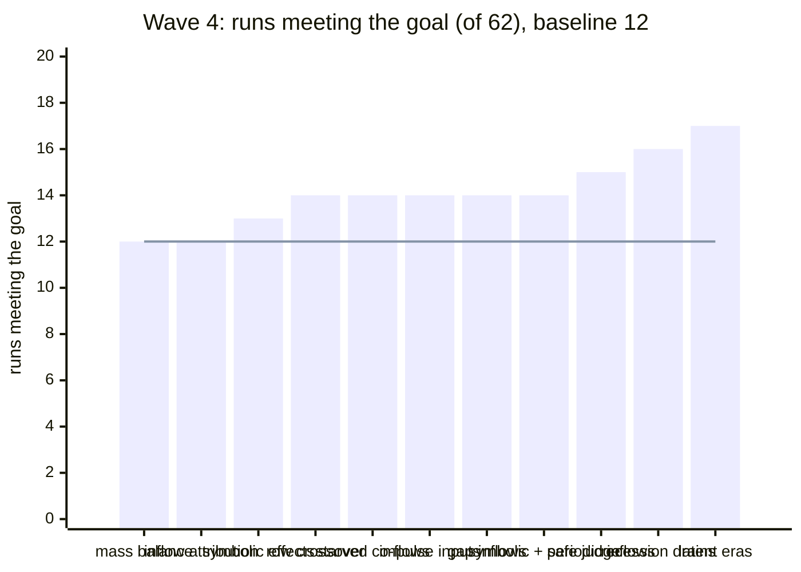
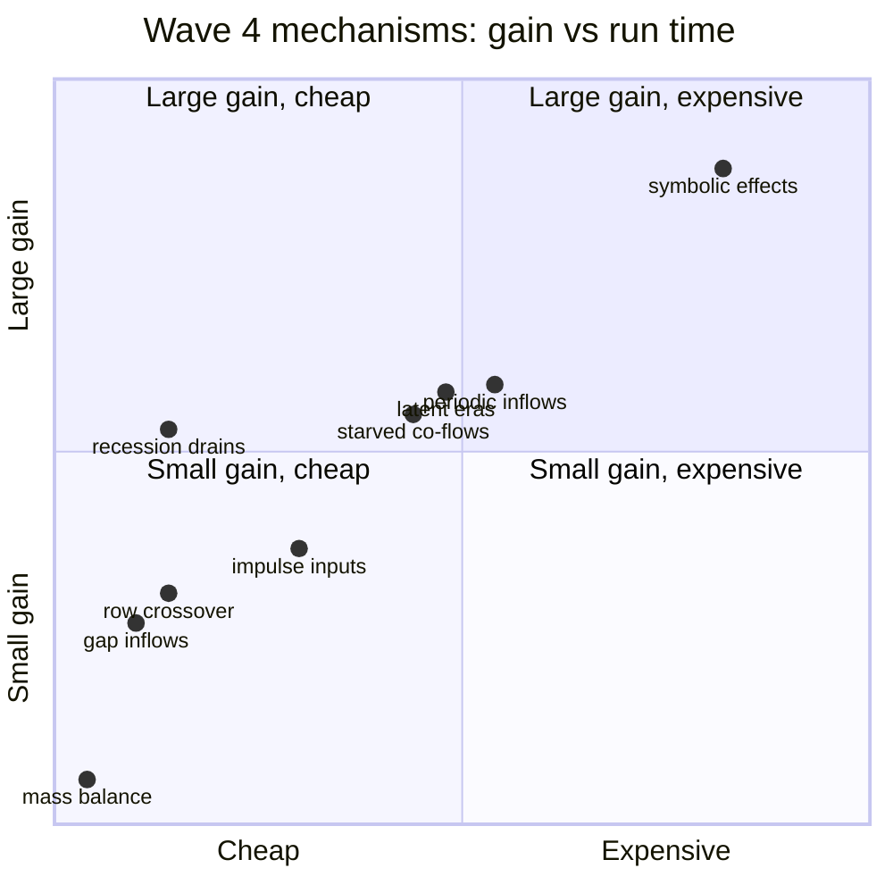
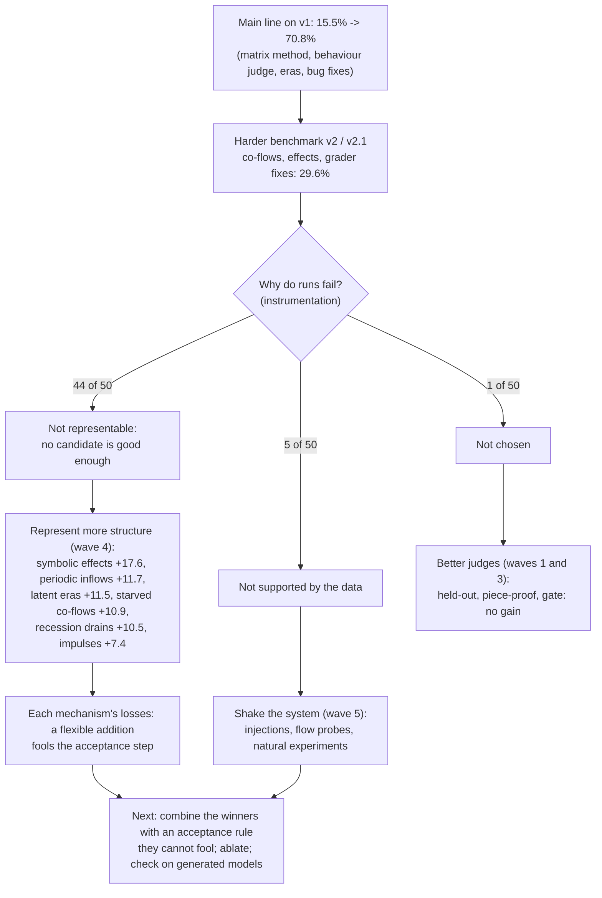

# What we tried: discovery research and how well it worked

A summary of every research effort on SD Lab's discovery (reverse-engineering a system dynamics
model from measured stock levels), with the measured results. Details for each effort are in its
topic document in this folder (see [README.md](README.md)); the step-by-step history of the main line
is in [../DISCOVERY-EXPERIMENTS.md](../DISCOVERY-EXPERIMENTS.md). Every strategy tried in waves 1-4 is now
on the main line as its own isolated strategy, runnable with `--strategy <name>`
([../../sdlab/discovery/strategies/README.md](../../sdlab/discovery/strategies/README.md)).

**How results are measured.** Each example is generated by a known system dynamics model. A found
model's **skill@H** is the share of the true model's movement over H steps it predicts, both models
started from the same states and fed the truth's outside inflows (100% = behaves as the truth, 0% = no
better than "nothing changes", below 0 = worse). The headline is **mean skill@20** over every example at
two lengths (each run clipped at -100%), with skill@100 and the **runs meeting the goal** (skill@20 >= 90%
and skill@100 >= 80%). Since benchmark v2.1, every model is also graded on a **fresh run** it was not
fitted on.

**Three benchmarks.** Numbers are only comparable within one benchmark:

| benchmark | examples | main line (skill@20 / @100 / runs meeting goal) | what changed |
|---|---|---|---|
| v1 | 21, 42 runs | 70.8% / 68.9% / 18 of 42 | the original ground-truth examples |
| v2 | 31, 62 runs | 31.6% / 32.1% / 17 of 62 | co-flows in 15 examples, 10 new co-flow and effect examples |
| v2.1 | 31, 62 runs | 29.6% / 29.3% / 12 of 62 | grader fixed: nothing leaves an empty stock (as in the engine) |

On top of these, the **procedural generator** (300 random models) gives the main line **-49% mean
skill@20, 22 of 600 runs meeting the goal**: the hand-made examples flatter us.

---

## The research journey

## The main line before the experiment waves (benchmark v1)

Runs meeting the goal went from 9 to 18 of 42.

---

## Wave 1: weak spots of the matrix method (benchmark v1)

Baseline: 70.8% / 68.9% / 18 of 42.

| experiment | best version (skill@20 / @100 / goal) | verdict | what we learned |
|---|---|---|---|
| change price (charge each inflow change 2 log n) | gate 71.0 / 69.5 / 18; honest price 52.4 / 43.8 / 17 | reject | real changes are missed and the bias spirals; a 10-step minimum piece gave 73.2 |
| held-out judge | blend 70.5 / 68.1 / 20; pure -4.8 / -6.3 / 3 | reject | a held-out judge must forecast unannounced inflows; the judge already picks the best candidate in 31 of 42 |
| output-error refit (multi-step numbers) | 73.5 / 72.7 / 18 | keep as a final step | numbers cannot fix structure; never let a refit move the inflows |
| shared noise (moves vs links vs co-flows) | 70.4 / 68.8 / 17, parts +3.5 | needs a combination | right structure exposed a biased drain |
| floors and caps | caps 72.2 / 69.3 / 18; hinges up to 21 runs | needs a combination | hinges exact in isolation, unstable on the bench; found the empty-stock grader bug |
| hidden stocks (delayed copies) | 70.9 / 68.6 / 20, parts 62.0 | needs a combination | 5 true hidden stocks found, one false one |

## Wave 2: established methods (benchmark v2)

Baseline: 31.6% / 32.1% / 17 of 62.

| experiment | best version (skill@20 / @100 / goal) | run time | verdict |
|---|---|---|---|
| PySINDy (SD-shaped library, constraints) | full 20.5 / 16.2 / 8; combined with matrix 29.7 / 33.4 / 17 | ~10x | reject as a strategy; keep the joint conservation fit and product terms |
| **symbolic regression (effect curves)** | **50.5 / 47.7 / 19** | ~6x | needs a combination (judge fooled on some examples) |
| numerical optimisers (finite differences, Powell, CMA-ES, BO...) | fd 32.6 / 34.2 / 20 | ~8x | the optimiser is not the bottleneck |
| gradient descent (differentiable simulator) | refined 34.5 / 33.3 / 18; generous 34.5 / 29.5 / 16 | 2x / ~70x | keep only the refit as a final step |
| structure search (beam, MCTS, GA) | unfinished (stopped by a spend limit) | | |

## Wave 3: measurement and the judge (benchmark v2.1)

Baseline: 29.6% / 29.3% / 12 of 62.

| effort | result | verdict |
|---|---|---|
| bench instrumentation | every candidate graded; failure classes; seeds; paired tests; leakage check | adopted (infrastructure) |
| procedural generator | 300 random models with held-out families and a sealed pool; main line -49% | adopted (infrastructure) |
| behaviour-consistency gate | 25.3 / 29.3 / 12 (no change without the 5x test) | reject for the main line; keep `gate.py` |
| piece-proof judge (8 designs) | best "anchor" 29.9 / 29.5 / 12; "common" 12.5 / 17.1 / 11 | reject as the main judge |

The instrumentation's most important finding: the main line fails because **no candidate is good
enough**, not because the judge picks the wrong one.

Even an oracle that always picked the best of the main line's 16 candidates would reach only 45.4%
mean skill@20 and 13 runs meeting the goal: the gap is in what the candidates can represent.

## Wave 4: representing more of the true structure (benchmark v2.1)

Baseline: 29.6% / 29.3% / 12 of 62 (fresh runs 28.9% / 29.7% / 12). Every mechanism alone.

| mechanism | skill@20 / @100 | fresh @20 / @100 | goal (fresh) | run time | verdict |
|---|---|---|---|---|---|
| **symbolic effects** (re-measured on v2.1) | **47.2 / 42.6** | 46.5 / 42.9 | 13 | ~5x | best single mechanism (p = 0.002); needs a stricter acceptance |
| **periodic inflows** | 41.3 / 46.8 | 40.7 / 47.0 | 15 (15) | ~3.7x | needs a combination; strong adopt candidate |
| **latent eras** (unannounced regimes) | 41.1 / 40.9 | 40.1 / 41.3 | **17** (16) | ~3.4x | needs a combination |
| **starved co-flows** | 40.5 / 44.3 | 39.4 / 44.2 | 14 (14) | ~3.2x | adopt as extra candidates |
| **recession drains** | 40.1 / 44.5 | 39.6 / 44.9 | 16 (14) | ~1.7x | needs a combination |
| impulse inputs (pulses, bursts) | 37.0 / 37.0 | 36.2 / 37.1 | 14 (15) | ~2.5x | adopt behind the judge |
| symbolic + addition judge (safe rule) | 37.4 / 35.3 | 36.6 / 35.7 | 14 | ~1x | no losses, but a third of symbolic's gain |
| row crossover (best row per stock) | 35.7 / 42.7 | 34.9 / 43.4 | 14 (14) | ~1.7x | needs a stricter judge |
| gap inflows (from paced moves) | 34.9 / 34.8 | 34.0 / 35.0 | 14 | ~1.5x | needs a combination; paced moves rejected |
| inflow attribution (+ pieces-gate bug fix) | 33.4 / 36.3 | 32.5 / 36.5 | 12 | | needs a combination; found a genuine bug |
| mass-balance hidden stocks (Kalman filter) | 30.7 / 31.3 | 30.1 / 31.7 | 12 | ~1.2x | 6 real hidden stocks, no false ones; small gain |
| LLM critic | unfinished (stopped by a spend limit) | | | | |
| combination of the winners | unfinished (stopped by a spend limit) | | | | |

### Gain against cost

Gain is the rise in mean skill@20 over the v2.1 baseline (top of the chart = +20 points); cost is the
run time relative to the main line (left = 1x, right = 6x).

## Wave 5: causation and shaking the system (in progress)

- **Injections in the engine** (adopted): announced interventions (add an amount to a stock at a step),
  made identically by the engine, the simulator, the grader and discovery. On sd-population, 8 probes
  at 300 steps improve the found model (69% vs 66% skill@20 on a plain fresh run, 74% vs 51% after a
  shock) and fix a reversed flow; at 3,000 steps they show that the model learned from flat data
  collapses when the system is shaken (-46%).
- **Causal-inference research** (done): Pearl's do-calculus and causality in dynamic systems; five ideas
  (a shake-response judge, shakes as instruments, invariance across eras and shakes, probe design, an
  identifiability report).
- **Active probing** (unfinished): shaking controllable flows (pause, throttle, boost, dithering) and
  reading the impulse responses.
- **Natural experiments** (unfinished, near its final runs): using shocks already in the data.

---

## What it adds up to

**Lessons that held across every wave**

1. **Representing the true structure is what moves the numbers.** Every large gain came from a
   mechanism that can express something the main line could not (effect curves, repeating inputs,
   hidden regimes, stocks that run dry, quiet-stretch drains). Better optimisers, searches and judges
   added a few points at most.
2. **Outside-inflow pieces are the recurring trap.** Fine pieces can replay the data, so a wrong model
   wins the in-data judge and fails once the truth's inflows are fed in. Every structural mechanism
   tripped on this at its acceptance step.
3. **Flat data hides wrong models.** Near equilibrium, "nothing changes" beats a slightly wrong model;
   shaking the system (natural shocks or deliberate probes) is what tells them apart.
4. **The hand-made examples flatter us.** The main line scores 29.6% on them and -49% on 300 generated
   models; adoption now needs gains on generated models too, with seeds and paired tests.

**Where we are:** the best single mechanism (symbolic effects) reaches 47.2% mean skill@20 on v2.1; the
most runs meeting the goal is 17 of 62 (latent eras). None is adopted into the main line yet: the
combination of the winners, with an acceptance rule they cannot fool, is the next step.

## Ladder strategies (2026-10-18)

| strategy | ladder | examples v2.1 (skill@20 / @100, goal) | generated (100 x 2) | verdict |
|---|---|---|---|---|
| [censored](censored.md): floors (hinges), capped demands, inflow re-cut at 2 log n, negative links as floored inflows, on top of the main line | 024 and 025 PPPP (every other strategy FFFF); 442 pass / 134 equivalent of 720 (matrix 345 / 116), 2 cells worse | 39.0 / 46.0, 16 of 62 (matrix 29.6 / 29.3, 12) | +1.3 / -1.3 (neutral) | adopt as a final step; floors cost ~2-3 bench points |
| [effect_hats](effect-hats.md): effects as tent (table) columns fitted jointly across rows, co-flows on effect moves, outside inflows pooled and re-cut | 018 PPFP (every other strategy FFFF), 017 PPFF (counting variants data-limited); 475 pass / 159 equivalent of 720 (matrix 345 / 116), no cell worse | 46.6 / 43.1, 14 of 62 (matrix 29.6 / 29.3, 12); sd-sawmill worse; ~24x time | +4.8 / -2.5 (neutral) | adopt candidate; a second effect and a safer re-cut left to do |
| [realistic_hats](realistic-hats.md): effect_hats (copy) that keeps its best model and stops before the timer, then hidden_transit's pair search (copy) on its answer | 462 hand-written cells: 140 pass / 53 equivalent (effect_hats 125 / 53), none worse; 015 PPPP | realistic (06b0062): 65 of 66 graded (effect_hats 54), 44.5% @20 over graded, 15 goals (14), paired +0.4 points, none worse | not run | keep; mechanisms B-E of the realistic triage next |
| [loop_transit](loop_transit.md): realistic_hats (copy) whose pair fit takes injections, refits a return move with shared noise, folds the move's echo | 156 PPFP (every strategy FFFF); whole ladder 9 better, 0 worse vs realistic_hats | sd-ev-fleet, sd-recycling unchanged | not run | keep as a specialist; stages on per-era rates next |
| [inflow_effects](inflow_effects.md): effect_hats (copy) whose outside inflows may be a schedule or a measured input times a table of a stock's level, optionally using up or running from another stock; earned on its own row, by BIC, against a straight line, and on the judge | 160 PPFF, 217 PPFP (every strategy FFFF); whole ladder 14 better, 3 worse vs effect_hats (047 counts-long) | sd-farm-soil fail, fresh skill@100 62-64% -> 93-94%; 212 fail | not run | keep as a specialist; a goal gap among the readings next |
| [blockwise](blockwise.md): one-step regressions from sums computed once, delayed copies as one-step stages, links reading, floored rates, ratios, per-block candidates, judged with inputs | below 15 stocks it is matrix (64 paired cells same status) | sd-k8s-small 96.1% / 98.1% @20, sd-k8s-platform 99.4% / 99.3% in ~40 s | not run | keep for large input-driven models; effects next |
| [lna](lna.md): every row fitted jointly by the counting-noise (linear noise approximation) likelihood; moves vs links, co-flows vs drains, births vs deaths and goal gaps read from the covariance of the changes | 578 pass / 123 equivalent of 912 (matrix 378 / 121, partly stale); all noisy 002-016 variants pass but 010 and 016 short (data-limited); noise-free 007-011, 016 equivalent (the best possible) | 15.8 / 13.2, 10 of 62 (matrix 29.6 / 29.3, 12); 9 better, 14 worse | -51.8 / -50.1 vs matrix -52.4 / -48.1 (neutral) | adopt the structure mechanism; not the behaviour (hidden stocks, unannounced inputs, self-reinforcing readings) |
| [odefit](odefit.md): per-step models linear in their numbers (levels, measured inputs, a constant, products where earned) fitted by output error with estimated segment starts; the main line kept where it predicts a held-out 30% better, or under counting noise where its judge prefers it | physics 25 of 28, 26 with square-root terms (948c0a2: coupled tanks 4 of 4) (best before 15; matrix 13); distilled 141-143 12 of 12; standard tests vs matrix +20 passes, 0 lost (1 pass -> equivalent) | not run | not run | adopt for physics and smooth measured data |
| [master_eq](master_eq.md): moves, drains, input shares, constants (per era, merged where BIC allows), then links and binds, fitted by the likelihood of counted changes whose multinomial or Poisson noise follows from the same numbers (GLS, then ML; dispersion fitted or held at 1); BIC elimination and destination swaps; kept when it forecasts a held-out 30% as well as the main line | particles: equations 5 of 8 (best before 2), gap@20 to mean-field -2.7 (best before -59.5); distilled 170, 171, 226 counts-long pass; standard tests vs matrix +112 / -14 passes | not run | not run | adopt for particle / counted data |
| [structures](structures.md): combined, replaced by a BIC search over bilinear terms, multi-stock goal gaps and hidden Erlang chains when combined's judge and the behaviour agree | 100-110: 30 pass + 7 equivalent of 44 (combined 3 + 1); distilled six 17 + 4 of 24; ladder 762 + 160 vs combined 710 + 120, 99 better, 6 worse | realistic: identical to combined in 66 of 66 runs; bench 36.7-40.2% skill@20 |
| [combined_misfit](combined_misfit.md): combined, but where even the BIC winner fails a dispersion or Ljung-Box test on the counts, the lowest multi-step error picks | tests as combined (678 of 936 vs 679), strict 617 vs 618; realistic skill@20 45.2% vs 40.6% | 42.6 / 49.3, 17 of 66 (+15.7 vs v2.1 paired, p = 0.0002) | not run | adopt into combined |
| [combined_lean](combined_lean.md) / [combined_r2](combined_r2.md): inflow change places at 1.5 log T and backward flow elimination, only where the model fits the counts (r2: with combined_misfit's switch) | strict 649 vs 618 of 936, passes 682 vs 679, noisy 32 vs 26; realistic 39.4% / 44.1% | not run | not run | adopt both into combined (round 2) |
| [combined2](combined2.md): combined's judge over every specialist (copies), kalman/structures/archetypes as stages, a held-inflow forecast guard (set aside a model worse on both in-data and held-inflow error), a discrete likelihood for small counts | same scorer vs combined: tests 852 vs 703 of 1,150, noisy 124 vs 62, canonical 23 vs 3, distilled 76 vs 20 | realistic skill@20 47.3% vs 44.7%, goals 15 vs 17 | not run | adopt for the tests; realistic and physics-with-noise remain |
| [matrix_v2](matrix_v2.md): the matrix with the fixes other strategies proposed for it, each a switch measured alone (pool and re-cut inflows, exact-data floor, falling inflows, paired moves, guarded products, SE tie test, ...) | tests 585 + 207 vs matrix 390 + 146, 287 better / 8 worse; strict 375 vs 212 | 31.4% / 31.9%, 21 of 66 (+6.8 @20 paired, p = 0.007) | realistic 36.7% / 21 goals vs 31.0% / 12 | adopt as the main line's successor |

