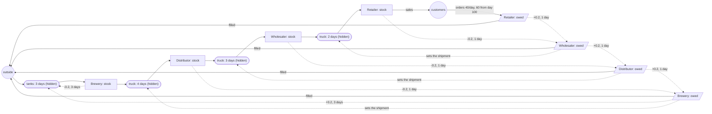

# Beer game: the answer key

For graders. The model (`../beergame.json`) is told only what the four companies' books show at
the end of every day: cases in stock and cases owed (orders received, not yet filled) at the
retailer, wholesaler, distributor and brewery. That is 8 stocks, no group, no flows and no counters. This is
what the simulation (`machines/sim.py`, seed 20261016, 365 one-day steps) really does.
`python truth.py` regenerates `truth.json`: every parameter, the ordering rule, the hidden stocks,
and the SD structure a perfect discovery would report (`sd_structure`). `tests/fixtures/beergame-run.json`
holds the imported run plus the simulator's daily counters (customer orders, cases shipped,
received, orders in and placed per tier, brewed, produced), which the model never sees.

## How the simulation works

Every day, at every tier, in this order:

1. **Receive.** The truck that left the tier above `SHIP_DAYS` ago arrives (wholesaler to retailer
   2 days, distributor to wholesaler 3, brewery to distributor 4). The brewery's batch started 3 days
   ago is ready.
2. **Ship.** The tier ships the smaller of its stock and its backlog (the orders on hand since
   yesterday) into a truck to the tier below. The retailer hands its customers the cases, out of the system.
3. **Orders in.** The orders the tier below placed yesterday arrive in the backlog (one day in the
   mail). The retailer's customers order today (Poisson) and are served tomorrow.
4. **Order** (anchoring and adjustment, Sterman 1989):
   `order = max(0, round(E + 0.2 x (80 - stock + backlog) + 0.1 x (E x lead - supply line)))`,
   where `E` is expected demand (exponential smoothing of orders in, 0.25 a day), 80 is the desired
   net stock, `lead` is 1 + the truck days (brewery: 3 brewing days), and the supply line is the
   upstream backlog plus the cases in trucks to the tier (brewery: the tanks). People underweight the
   supply line (0.1 against 0.2), which is what makes the chain oscillate. The brewery's order is
   what it starts brewing, capped by its capacity.

Customer demand is Poisson with mean 40 a day, **60 from day 100** (the step), and x1.4 (84) in a
**promotion, days 240 to 253**. Everything starts in equilibrium at 40 a day: 120 in stock and 40
owed at every tier, and full trucks and tanks.

Eras (the brewery's capacity): 200 cases a day from day 1; **40 a day from day 200** (one line
down for maintenance); 200 again from day 214.

Every case is accounted for (tested in `tests/test_example_beergame.py`): each stock changes by
exactly what came in minus what went out; a truck delivers exactly what was shipped its days
before; and stock + trucks + tanks = the starting amount + brewed - sold, every day.

## Long runs

`sim.run(seed, steps)` and `sim.measured(seed, steps)` take any length; the default (365 days) is
the run described here, and the first 365 days of a longer run are exactly it. `sim.LONG_STEPS`
is ten years (3,650 days; `measured` takes well under a second, about 0.4 MB of JSON);
`history.py [seed] [steps]` prints any length. The year repeats with fresh random demand. The
demand step alternates so demand stays between 40 and 60: even years (the first is year 0) step
up from 40 to 60 on day 100 of the year, odd years step down from 60 to 40 (a slump). The
promotion (days 240-253 of the year, x1.4) comes every year. From the second year on the brewery
services a line twice a year, days 60-73 and 200-213 of the year (40 cases a day), so every later
year has four eras against the first year's three. The structure and the ordering rule are the
same at any length.

## The true structure

Solid arrows are **real flows** (cases move). Dotted boxes are **hidden stocks** nobody counts.
Dashed arrows are **information links** (orders): the driver loses nothing; the target's
arrivals follow the driver's level a day later (k = +0.2 for a backlog, -0.2 for a stock).

## The SD structure a perfect discovery would report

In SD Lab terms, one day per step (`truth.json`, `sd_structure`):

| kind | from | to | form | numbers | what |
|---|---|---|---|---|---|
| hidden (pipe) | Wholesaler: stock | Retailer: stock | pipe, 2 days | holds 111 cases; 0.43 x stock a day realised | trucks |
| hidden (pipe) | Distributor: stock | Wholesaler: stock | pipe, 3 days | holds 168; 0.37 | trucks |
| hidden (pipe) | Brewery: stock | Distributor: stock | pipe, 4 days | holds 224; 0.31 | trucks |
| outside in | (outside) | Brewery: stock | pipe, 3 days | 56.2 a day, tanks hold 169 | production |
| outside out | Retailer: stock | (outside) | k = 1 x Retailer owed | 55.6 a day | sales |
| outside in | (outside) | Retailer: owed | constant | 40, 60 from day 100, 84 in days 240-253 (mean 55.6) | customer orders |
| outside out | each tier's owed | (outside) | proportional, k = 1 while stocked | realised 1.00, 0.98, 0.87, 0.95 (retailer to brewery) | orders filled |
| link | X: owed | upstream owed | +0.2, 1 day late | plus expected demand and the supply-line term | orders |
| link | X: stock | upstream owed | -0.2, 1 day late | | orders |
| link | Brewery: owed / stock | Brewery: stock | +0.2 / -0.2, 3 days late | capped by capacity (the eras) | brewing |

Two things no single SD Lab equation expresses:

- **A shipment's rate is set by the shipper's backlog, not by its stock.** It is
  `min(stock, owed yesterday)`: about 1 x the shipper's owed level while it has stock, and
  everything it has when it runs out. The same cases leave the shipper's owed stock (a co-flow).
  Discovery's hidden-stock flows take `k x level of the source`, so the "share" in the table is
  only the realised ratio (shipped / stock of the day before). `rate_driver` in `truth.json`
  gives the true driver.
- **Orders depend on unmeasured stocks too**: expected demand (a smoothing of orders in), the
  cases in trucks, and the mail. The links above are the measured part of the ordering rule.

The model gives backlogs the unit *cases owed*, not *cases*: an order owed is not a case in a
warehouse, so discovery should never move cases between a stock and a backlog.

What the levels look like: until day 100 the stocks wobble around 120 (the brewery 139), more
the further up the chain (standard deviation 9, 16, 38 and 37 cases from retailer to brewery), and
owed stays around 40. After the step, the **bullwhip**: the standard deviation of orders placed is
10, 18, 33 and 46 cases a day from retailer to brewery (customers: 9); the wholesaler, distributor
and brewery run out of stock 4, 6 and 5 times (maximum 480, 806 and 628 cases), and the brewery
owes up to 301 cases. The maintenance era
(days 200 to 213) and the promotion (days 240 to 253) each start another wave.

## What discovery finds today

Run on `tests/fixtures/beergame-run.json` with `sdlab/static/discover.js` as of 2026-10-16, eras
given (the page's call is `discover(stocks, run, {window: 5, eras})`; 8 stocks, so the page does not split).

- **Page default (window 5, 73 windows, ~2 s):** 4 flows, none of them true. It finds the
  distributor's arrivals as a link driven by the wholesaler's stock (k 0.21 to 0.45 per era) with
  a drain out of the distributor (k 0.198), plus two tiny cross-unit flows (×3) between the
  brewery's backlog and the retailer's / distributor's stock. No hidden stock, no trucks, no orders.
- **Window 1 (365 windows, ~35 s):** 12 flows. Two real hints: *inv_brewery → inv_distributor*
  (beer does go that way, but as a direct flow with a constant per era, not through a 4-day pipe)
  and arrivals at the wholesaler and the distributor driven by the stock below them (k 0.4 to 0.8:
  stock below is the wrong driver; the truth is the backlog of the shipper). The rest is spurious:
  three ×3 flows from stocks into *backlog_brewery*, *inv_distributor → inv_brewery* (upstream),
  and arrivals at the brewery driven by the retailer's stock.
- **discoverAll (window 5 or 1):** the same kind of answer with more links: the order links
  *backlog_retailer → backlog_wholesaler* (k 0.58), *backlog_wholesaler → backlog_distributor*
  (0.67) and *backlog_wholesaler → backlog_brewery* (0.43) show up as driven arrivals (the truth:
  +0.2 a day later, plus expected demand, so the fitted k absorbs the whole order), but next to
  many spurious flows between stocks and backlogs.
- **The truth in discovery's own forms scores worse than what it finds.** Scoring the three
  trucks (pipe 2, 3, 4 days, `k x stock` of the shipper) plus the edge flows with `opts.score`
  gives 6455 at window 1 against 5301 for the found structure (119.8 against 19.6 at window 5);
  adding the order links makes it worse. The shipments are not `k x stock of the shipper` (they
  are `min(stock, owed yesterday)`), so the true structure is not expressible and discovery is
  right to reject it.

**Verdict:** today's discovery does not recover the beer game. What is missing is a flow between
two stocks whose rate follows a third stock (a shipment set by the backlog), through a hidden
pipe; and a link with a delay of a day. The trucks are also short (2 to 4 days) next to the
5-day windows the page uses.

## What would help

Counters at the edges would anchor it: shipments out of each tier (`shipped__<tier>`) as
measured flows would turn every truck into a hidden stock with both ends counted (section 6 of
docs/DISCOVERY.md), and customer orders would pin the retailer's inflow. To measure them, add
flows with those ids to the model: the history and the sensor print any recorded counter whose
id a model flow uses (`sim.COUNTERS`).
