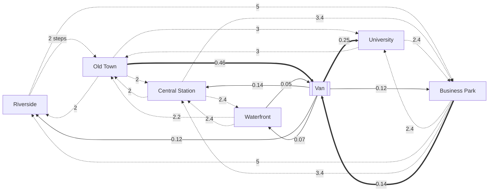

# Bike share: the answer key

For graders. The model (`../bikeshare.json`) is told only what the operator's dashboard shows at
the end of every 5 minutes: bikes docked at each of six stations and bikes on board the
rebalancing van, 7 stocks in one group (`city`), all in bikes, no flows and no counters. This is
what the simulation (`machines/sim.py`, seed 20261016, 14 days of 288 five-minute steps = 4032
steps, day 0 a Monday, 200 bikes, 18,641 rides, 231 van runs moving 2,867 bikes) really does.
`python truth.py` regenerates `truth.json`: every parameter, the van's trip log, and under
`sd_structure` the structure a perfect discovery would report, with the numbers it should find.
`tests/fixtures/bikeshare-run.json` holds the imported run plus the simulator's per-step counters
(rides started per pair, rides started and ended per station, diverted rides, bikes loaded onto
and unloaded from the van per station), which the model never sees.

**Measured:** the 7 levels only. **Not measured:** everything else, in particular the bikes
being ridden (on average 12.2 bikes, at most 35, in 15 hidden stocks, one per pair of stations
riders use). No counters are given: a counter at the edge would make this a different, easier
example.

## How the simulation works

- **Rides.** Each bike docked at a station at the end of a step is taken in the next step with
  a probability: the station's hazard (Riverside 3.3%, Old Town 3.9%, Central Station 4.5%,
  Waterfront 3.0%, University 3.6%, Business Park 3.3% per step) times the time of day (x0.35 at
  night 21:00-05:30, ramping to x1 by 07:30 and down again 20:00-22:00; weekdays +0.3 around
  08:00 and 17:30; weekends x0.8; the rain day, Wednesday day 2, x0.5). So departures are
  proportional to the bikes docked, with a rate that varies through the day.
- **Destinations.** Each station sends riders to two or three others (15 pairs in all, below).
  On weekdays the shares follow the commute: in the morning (06:00-10:30) towards Business
  Park and University, at midday mixed, in the evening and at night back to Old Town, Riverside
  and Central Station; at weekends towards Old Town and the Waterfront (see `truth.json`
  `destinations`).
- **Riding.** The rider leaves at a uniform moment of the step and rides for a lognormal time
  around the pair's mean (10 to 25 minutes, cv 0.2) before docking. Nobody counts the bikes on
  the street.
- **Full docks and the closure.** A rider who finds the destination full docks at its fixed
  neighbour (Business Park -> University -> Central Station -> Old Town -> Central Station...;
  346 rides in two weeks, 247 of them into Central Station when Old Town or University is full). On day 8 the
  Waterfront is closed: no rides start or end there, its bikes stay locked in (its level is
  flat), riders headed there dock at Old Town.
- **The van.** During the crew's shift (06:30-19:00, until 23:30 from day 11) the van
  rebalances without a break: it goes to the fullest station by share of docks (if above 60%),
  loads 5 bikes a step (up to 20, never below half the docks), drives (ride time x0.8, at least
  2 steps), and unloads 5 a step at the emptiest station (if below 40%, up to 60% of its docks);
  bikes that do not fit stay on the van for its next run. With nothing worth moving it looks
  again 15 minutes later. Mean load 4.6 bikes, at most 20.

Every bike is accounted for: docked + on the van + being ridden = 200 at every step, and every
station, the van and each hidden pair change by exactly what their flows moved (tested in
`tests/test_example_bikeshare.py`).

## The true structure

Solid arrows are the van's real moves (bikes per step over the run); dashed arrows are rides
through a hidden stock (labels: ride time in steps). Nothing enters or leaves the system.

### Hidden stocks: bikes being ridden (`sd_structure.hidden`)

Each is "things leave `from` at k x its docked bikes per step, wait unmeasured, arrive in `to`
after the delay". Shape `pipe` (lognormal ride time, cv 0.2: nearly a fixed delay); delay in
steps = mean minutes / 5; share = rides on the pair / Σ the origin's docked bikes over the steps
before (the run's average: at 08:00 on a weekday it is three to five times that, at night a
third); holds = mean bikes on the street on that pair (Little's law: rides per step x delay).

| from | to | ride (min) | delay (steps) | realised | share k / step | holds (bikes) | rides |
|---|---|---|---|---|---|---|---|
| Riverside | Old Town | 10 | 2.0 | 2.01 | 0.01598 | 1.05 | 2102 |
| University | Old Town | 15 | 3.0 | 2.98 | 0.0207 | 1.50 | 2027 |
| Old Town | Central Station | 10 | 2.0 | 2.00 | 0.01021 | 0.93 | 1880 |
| Old Town | Riverside | 10 | 2.0 | 1.97 | 0.0095 | 0.85 | 1748 |
| Central Station | Waterfront | 12 | 2.4 | 2.40 | 0.01229 | 1.02 | 1714 |
| Central Station | Old Town | 10 | 2.0 | 2.00 | 0.01183 | 0.82 | 1652 |
| Old Town | University | 15 | 3.0 | 2.99 | 0.00545 | 0.74 | 1004 |
| Riverside | Business Park | 25 | 5.0 | 4.99 | 0.00665 | 1.08 | 875 |
| Central Station | Business Park | 17 | 3.4 | 3.40 | 0.00621 | 0.73 | 867 |
| Waterfront | Old Town | 11 | 2.2 | 2.22 | 0.00899 | 0.47 | 848 |
| Waterfront | Central Station | 12 | 2.4 | 2.41 | 0.00898 | 0.51 | 847 |
| Business Park | University | 12 | 2.4 | 2.38 | 0.00893 | 0.48 | 813 |
| Business Park | Riverside | 25 | 5.0 | 5.02 | 0.00865 | 0.98 | 789 |
| Business Park | Central Station | 17 | 3.4 | 3.42 | 0.00841 | 0.65 | 766 |
| University | Business Park | 12 | 2.4 | 2.39 | 0.00724 | 0.42 | 709 |

Together they hold 12.2 bikes on average. 10% of rides (346 diverted) end at a neighbour of
their destination; the hidden stocks are keyed by the planned destination.

### Real moves: the van (`sd_structure.moves`)

| from | to | bikes in 2 weeks | per step | k (/ step, x source level) |
|---|---|---|---|---|
| Old Town | Van | 1866 | 0.463 | 0.0101 |
| Van | University | 1020 | 0.253 | 0.0553 |
| Business Park | Van | 560 | 0.139 | 0.0062 |
| Van | Central Station | 551 | 0.137 | 0.0299 |
| Van | Riverside | 494 | 0.123 | 0.0268 |
| Van | Business Park | 494 | 0.123 | 0.0268 |
| Van | Waterfront | 298 | 0.074 | 0.0162 |
| Waterfront | Van | 211 | 0.052 | 0.0022 |
| University | Van | 100 | 0.025 | 0.0010 |
| Central Station | Van | 67 | 0.017 | 0.0005 |
| Riverside | Van | 63 | 0.016 | 0.0005 |
| Van | Old Town | 10 | 0.003 | 0.0005 |

The van's work is mostly one job: Old Town is where riders end up (6,486 rides end there,
4,632 start), so the van carries the surplus to University (and to Central Station, Riverside
and Business Park), and in the morning takes bikes from Business Park, where commuters left
them. The moves are scheduled work in runs, not a rate: no equation in the levels expresses
*when* they happen, only how much they move on average. `outside`, `links` and `echoes` are
empty: nothing is created or destroyed, and no stock drives another without losing anything.

### Stations

| station | docks | bikes at start | mean | min-max | rides started | ended | diverted here | van loaded | van unloaded |
|---|---|---|---|---|---|---|---|---|---|
| Riverside | 65 | 40 | 32.6 | 11-53 | 2977 | 2536 | 0 | 63 | 494 |
| Old Town | 65 | 44 | 45.7 | 17-65 | 4632 | 6486 | 97 | 1866 | 10 |
| Central Station | 75 | 48 | 34.6 | 13-56 | 4233 | 3739 | 247 | 67 | 551 |
| Waterfront | 50 | 26 | 23.4 | 10-44 | 1695 | 1607 | 0 | 211 | 298 |
| University | 70 | 26 | 24.3 | 4-49 | 2736 | 1819 | 2 | 100 | 1020 |
| Business Park | 44 (64 from day 4) | 16 | 22.6 | 5-48 | 2368 | 2449 | 0 | 560 | 494 |

## Eras and events

| t (first step) | day | change |
|---|---|---|
| 1 | 0 (Mon) | Start |
| 1153 | 4 (Fri) | Business Park: 20 more docks (44 to 64) |
| 2305 | 8 (Tue) | Waterfront closed for a festival |
| 2593 | 9 (Wed) | Waterfront reopened |
| 3169 | 11 (Fri) | The van crew works a late shift too (until 23:30) |
| 577 to 864 | 2 (Wed) | rain all day: rides x0.5 (not an era) |
| days 5-6, 12-13 | | weekends: fewer rides, later, towards Old Town and the Waterfront (not eras) |

## Long runs

`sim.run(seed, steps)` and `sim.measured(seed, steps)` run any number of steps (`sim.LONG_STEPS` =
52,416, 26 weeks, for the discovery test bed: about 1.1 s, 1.4 MB of JSON). The two-week schedule
recurs every two weeks, always from a Monday: an era "Business Park back to 44 docks; the van crew
back to the day shift" at the start of each fortnight, then the 20 extra docks (day 2-6), the
Waterfront's closure (day 7-9, for 1 or 2 days), its reopening and the late van shift (day 10-13),
with one rain day anywhere in the fortnight. The days are drawn from a generator of each
fortnight's own, so the rides draw exactly what they always did and the first two weeks are
always the run described here. Five eras every fortnight; the stations, pairs, hazards, ride times
and van rules are the same at any length. `measured()` is what `history.py` prints: the seven
levels and the eras.

## What a perfect discovery would report

1. **15 flows station -> station through a hidden stock** (table above): proportional to the
   origin's docked bikes, a pipe-like delay of 2 to 5 steps, holding 0.4 to 1.5 bikes each and
   12 in all.
2. **The van's moves**: Old Town -> Van and Business Park -> Van (and smaller ones), Van ->
   University, Central Station, Riverside, Business Park and Waterfront.
3. **Nothing to or from outside.** Σ of the 7 measured levels is 200 minus the bikes on the
   street: it dips by up to 35 in the rush hours. That dip is the conservation evidence for the
   hidden stocks (the "total" row of discovery's regression).

## What should be visible at 5-minute steps, and what should not

- **Hard by nature.** Each pair moves 0.2 to 0.5 bikes a step and holds about one: single
  steps are whole-number noise. A station's change has a variance of 1.4 to 4.6 bikes² a step;
  the truth's *expected* change (the time-varying hazards and shares, the ride-time
  distributions, and the van's actual moves) explains 26 to 54% of it, and the van alone 23 to
  49%: at single steps the rides add only 3 to 10 points. In 55-minute windows the truth explains
  27 to 67% and the rides matter more (Old Town: van alone -8%, with the rides 46%). The rates
  also vary several fold through the day, which a constant k only averages; the commute shows as
  level swings (Business Park and University fill in the morning and empty in the evening) that
  a k x level equation explains only partly.
- **Rides inside a window.** At the page's default window for this run (11 steps, 55 minutes),
  every ride starts and ends inside one or two windows: they look like direct station ->
  station flows with no hidden stock. Only at window 1 or 2 can the 2 to 5 step delays show.
- **The van** is the largest, plainest signal (bursts of 5 bikes a step), but scheduled: a
  constant or proportional equation fits its average, not its timing.
- **Experiments** that help: the closure (Waterfront flat for a day, Old Town taking its
  arrivals), the extra docks at Business Park (fewer diversions), the late van shift (the van
  works in the evening too), the rain day (everything at half speed).

## What the current discovery finds (`sdlab/static/discover.js`, 16 October 2026)

Run with `discoverAll(model.stocks, run, {window, eras: run.eras})` on the fixture:

- **Page default (`window: 5`, which becomes 11 steps, 366 windows): nothing.** No flow pays its
  price; all 7 stocks are reported with no persistent drift (wobble 0.33 to 0.65 bikes a step).
- **`window: 1, maxWindows: 100000` (4032 windows, about 20 s):** 8 flows, of which three touch
  the truth: *Van -> University* (proportional k 0.057 vs true 0.055, as a 1-step erlang
  "hidden" delay holding 0.5), *Van -> Business Park* (k 0.039 vs 0.027), and *University ->
  Van* (k 0.016; true direction is the other way except 100 bikes). The rest are flows to or
  from outside that the truth does not have (Business Park -> outside, gap inflows into
  University, Central Station, Waterfront, Riverside). **No station -> station ride is found,
  with or without a hidden stock; Old Town -> Van, the biggest move, is not found.**
- Scoring the true structure directly (`opts.score`) shows why: with the true 15 hidden pairs
  and 12 van moves, the weighted residual falls by only 3% (window 1), 2.6% (3) and 6% (11)
  while their 90 coefficients cost more than that under BIC, so the empty structure scores
  better at every window (9599 against 9881 at window 1, -551 against 345 at 3, -618 against
  276 at 11; lower is better). The limits are those of docs/DISCOVERY.md section 9: equations linear in levels
  with constant coefficients (the hazard and the destinations vary through the day; the van is
  scheduled) and low counts per step.
