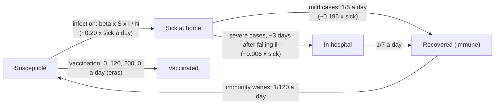

# Flu season: the answer key

For graders. The model (`../flu.json`) is told only the five counts the public-health dashboard
shows at the end of every day; this is what the simulation (`machines/sim.py`, seed 20261016,
200 days, 1-day steps, a town of 50,000) really does. `python truth.py` regenerates `truth.json`;
its `sd_structure` is what a perfect discovery would report, in SD Lab terms.

Measured: Susceptible, Sick at home, In hospital, Recovered (immune), Vaccinated (all `people`,
one group). No counters are given to the model: the town is closed (the five counts always add
up to 50,000), so nothing has to be measured at the edges. The simulator records a daily counter
for every true flow (`infections`, `recoveries`, `admissions`, `discharges`, `waning`,
`vaccinations`); the history program prints one only if the model has a flow with that id.

## The true structure

| from | to | what | truth | linear reading (`sd_structure.moves`) |
|---|---|---|---|---|
| Susceptible | Sick | infection | `beta(t) x S x I / N` + imports (4e-5 x S a day), beta 0.40, 0.22 in holidays | `k x sick` (a term on the **target's** level), k = beta x S / N: 0.20 on average, per era below |
| Sick | Recovered | mild cases recover (97% of cases) | daily probability 1/5 (geometric, mean 5 days) | proportional, 0.196 x sick (fitted 0.197) |
| Sick | In hospital | severe cases (3%) are admitted | two stages of mean 1.5 days (erlang-2-like, mean 3 days), waiting inside *Sick* | proportional, ~0.006 x sick (fitted 0.0067), lagged ~3 days behind infections |
| In hospital | Recovered | discharge | daily probability 1/7 (mean 7 days) | proportional, 0.143 x hospital (fitted 0.137) |
| Recovered | Susceptible | immunity wanes | daily probability 1/120 | proportional, 0.0083 x recovered (fitted 0.0084) |
| Susceptible | Vaccinated | the clinics' daily capacity | Poisson around 0 / 120 / 200 / 0 a day | constant, per era: 0, 120 (day 61), 200 (day 101), 0 (day 161) |

There are no flows to or from outside, no links, no hidden stocks and no echoes
(`outside`, `links`, `hidden`, `echoes` are empty). Every step, each count changes by exactly
what its flows moved, and the five always sum to 50,000 (tested).

Season (seed 20261016): 28,700 infections (57% of the town), peak of 2,640 sick on day 40, at
most 107 in hospital, 925 admissions, 16,709 vaccinated. Mean levels: susceptible 25,029, sick
704, hospital 33, recovered 17,148, vaccinated 7,086.

## Eras

| from day | era | contacts | vaccines a day | infection k (beta x S / N) | k fitted from the counters |
|---|---|---|---|---|---|
| 1 | Term time | 1.0 | 0 | 0.302 | 0.279 |
| 41 | School holidays: fewer contacts | 0.55 | 0 | 0.142 | 0.145 |
| 55 | Schools reopen | 1.0 | 0 | 0.250 | 0.238 |
| 61 | Vaccination campaign: 120 a day | 1.0 | 120 | 0.201 | 0.201 |
| 101 | Second clinic opens: 200 vaccinations a day | 1.0 | 200 | 0.157 | 0.160 |
| 121 | Spring holidays: fewer contacts | 0.55 | 200 | 0.081 | 0.082 |
| 131 | Schools reopen | 1.0 | 200 | 0.140 | 0.159 |
| 161 | Vaccination campaign ends | 1.0 | 0 | 0.153 | (few cases left) |

## Long runs

`sim.run(seed, steps)` and `sim.measured(seed, steps)` take any length; `sim.LONG_STEPS` is ten
years (3,650 days) for the discovery test bed (`measured` gives `t`, the five levels, the eras and
every counter; it is what `history.py` prints at the default length). The first 200 days are always
the season above, draw for draw. The town's year is 365 days: days 216-255 of the first year are
summer holidays, and every later year is a new season drawn from its own random stream: a new
strain on its first day (contacts x 0.8-1.25 for the year, scaling every era's contact factor),
autumn, spring and summer school holidays, and a vaccination campaign with one clinic and then two
(capacities and days drawn per year). Waning refills the susceptible, so the epidemic comes back
every year, bigger or smaller.

One flow exists only in runs longer than a year: on the first day of every later year last
season's vaccine stops protecting and everyone vaccinated is susceptible again (counter
`vaccine_expiry`, Vaccinated -> Susceptible, a once-a-year pulse). Without it the vaccinated would
only grow and the town would run out of susceptible people within three years. Everything else
(flows, rates, no hidden stocks, links or echoes) is the same at any length.

## What an ideal linear discovery should report

Infection is the one nonlinear flow: its rate is `beta x S x I / N`, a product of the source's
and the target's levels. No SD Lab equation form has a product, so the best linear reading is:

- **Susceptible -> Sick at `k x Sick at home`**, the target's level (the "linear/gap with the
  target" term `b`, with a small or zero constant): an epidemic grows with the number already
  sick. k is about 0.20 a day over the season, and it changes by era: it roughly halves in the
  school holidays (contacts x 0.55) and falls through the season as susceptible people run out
  (beta x S / N). A discovery that reports one k per era matching the table above has read the
  nonlinearity as well as a linear model can; one that notes k falls with Susceptible has found
  the S x I term.
- **Sick -> Recovered**, proportional, about 0.2 a day (5 days at home).
- **Sick -> In hospital**, proportional, about 0.006 a day; better, a delay of about 3 days
  behind the infections. The severe cases wait inside the measured *Sick at home*, so this is a
  lag, not a hidden stock.
- **In hospital -> Recovered**, proportional, about 0.14 a day (7 days).
- **Recovered -> Susceptible**, proportional, about 0.008 a day (immunity lasting months).
- **Susceptible -> Vaccinated**, constant per era (0, 120, 200, 0 a day).
- Nothing to or from outside.

## Running the current discovery on the fixture

`tests/fixtures/flu-run.json` is the imported run. With `discover.js` as of this writing (it was
being changed at the same time):

- The true structure, scored by discovery's own criterion, is far better than what the search
  returns (window 1: -214 against 2,653; window 5: -198 against 510). The data supports the
  answer; the greedy search does not reach it.
- What it gets right: Recovered -> Susceptible at 0.008-0.009 x recovered (window 5); the
  vaccination amounts per era (120, 200, 200, 200), though from the wrong stock (Sick or
  Recovered, with Susceptible -> Vaccinated listed as "fits about as well"); Sick -> Recovered at
  0.199 x sick and Sick -> In hospital at 0.0093 x sick, but as *links* (outside -> target driven
  by Sick) rather than moves.
- What it misses: infection (Susceptible -> Sick reading Sick's level) is never found; instead
  it proposes flows such as Susceptible -> In hospital at ~9 x hospital, Sick -> Susceptible
  constants and hidden stocks with 1-27 day delays, and flows to and from outside although the
  town is closed. With `discover` (not `discoverAll`) at window 5 it finds nothing at all.
