# Kanban board: the answer key

For graders. The model (`../kanban.json`) is told only what the team's board shows at the end
of every day: cards in Backlog, In development, In review, In testing and Done (final), and open
bug cards. That is 6 stocks in *cards*, no group, no flows and no counters. This is what the simulation
(`machines/sim.py`, seed 20261016, 182 one-day steps, 1,266 cards) really does. `python truth.py`
regenerates `truth.json`: every parameter, every true flow's total, the hidden defects, and the
SD structure a perfect discovery would report (`sd_structure`). `tests/fixtures/kanban-run.json`
holds the imported run plus the simulator's daily count of every true flow (`planned`, `pulled`,
`to_review`, `approved`, `rejected`, `released`, `triaged`, `shipped_defect`, `reported`), which
the model never sees.

## How the simulation works

One step is a working day; the team works every day. Every day, in this order:

1. **Sprint planning** (days 1, 15, 29, ...): a batch of new cards lands in the Backlog
   (Poisson, mean 76; realised 59 to 91).
2. **Bug reports**: defects whose time has come are noticed, and a bug card opens.
3. **Triage**: each open bug goes into development with probability 0.2 a day (bugs jump the queue).
4. **Development**: each developer works one day on one card (bugs and rework first, then the
   oldest). A card needs a lognormal effort (new cards mean 1.8 developer-days, bugs 1.5, rework 1.0;
   cv 0.6). A finished card waits in development until review has room.
5. **Review**: each card in review is approved with probability 0.7 a day and goes to testing. Then
   finished cards move from development into review up to its **WIP limit of 18**.
6. **Testing**: each card finishes with probability 0.4 a day; 20% of those go **back to
   development** (rework), the rest go to Done. During the **release freeze** passed cards stay in
   testing and all go to Done the day it lifts.
7. **Defects**: each card that reaches Done carries a defect with probability 0.25. Nobody notices it
   for 7 to 21 days (uniform, mean 14); then it opens a bug card. The card itself stays in Done.
8. **Pull**: each Backlog card becomes ready to start with probability 0.15 a day; ready cards are
   started, oldest first, while development holds fewer than **2 cards per developer** (its WIP
   limit; rework and triaged bugs may go over it).

A card moves at most one column a day.

Eras: 15 developers from day 1; **24 from day 92** (nine developers join); **release freeze days
141 to 147**; freeze lifted from day 148.

Every card is accounted for (tested in `tests/test_example_kanban.py`): each column changes by
exactly what its true flows moved, the cards on the board are every card planned or reported, and
every defect shipped is either reported or still unnoticed.

## Long runs

`sim.run(seed, steps)` and `sim.measured(seed, steps)` take any length; the default (182 days) is
the run described here, and the first 182 days of a longer run are exactly it. `sim.LONG_STEPS`
is five years (1,820 days, ten half-years; `measured` takes well under a second, about 0.1 MB of
JSON); `history.py [seed] [steps]` prints any length. The half-year repeats every 182 days with
fresh random draws: each later half-year starts with the nine contractors leaving (15
developers), they join again on its day 92 (24), and the release freeze is again its days
141-147, so every later half-year has four eras like the first. Sprints keep their 14-day rhythm
(182 days is 13 sprints). Done keeps every card, so it grows without end (about 13,000 after five
years). The structure is the same at any length.

## The true structure

Solid arrows are **real flows** (cards move). The dotted box is the **hidden stock** nobody
counts. The dashed arrow is an **echo**: Done keeps its cards; what it gains comes back later as new
arrivals into Open bugs.

```mermaid
flowchart LR
    OUT(("outside"))
    backlog["Backlog"]
    dev["In development"]
    review["In review<br/>WIP limit 18"]
    testing["In testing"]
    done["Done (final)"]
    bugs["Open bugs"]
    defects(["defects not yet noticed (hidden)"])
    OUT -- "sprints: ~76 cards every 14 days" --> backlog
    backlog -- "0.15 x Backlog, within dev WIP limit" --> dev
    dev -- "finished effort, while review has room" --> review
    review -- "0.7 x review" --> testing
    testing -- "0.32 x testing (none in the freeze)" --> done
    testing -- "rework 0.08 x testing" --> dev
    bugs -- "triage 0.2 x bugs" --> dev
    done -. "25% of what Done gains" .-> defects
    defects -- "7 to 21 days later (mean 14)" --> bugs
```

## The SD structure a perfect discovery would report

In SD Lab terms, one day per step (`truth.json`, `sd_structure`). k is per day; realised k is
cards moved / cards in the source the day before.

| kind | from | to | form | k (realised) | cards a day | what |
|---|---|---|---|---|---|---|
| move | Backlog | In development | proportional, capped by the WIP limit | 0.15 (0.095) | 5.30 | started; at the dev WIP limit on 65 days, mostly before the hiring |
| move | In development | In review | capacity-limited | (0.26 before the hiring, 0.35 after) | 8.24 | developers / effort a day at most; review full on 24 days |
| move | In review | In testing | proportional | 0.7 (0.696) | 8.19 | approved |
| move | In testing | Done | proportional | 0.32 (0.297) | 6.65 | passed (0 in the freeze, 63 cards on day 148) |
| move | In testing | In development | proportional | 0.08 (0.065) | 1.46 | rework |
| move | Open bugs | In development | proportional | 0.2 (0.211) | 1.53 | triage |
| outside | (outside) | Backlog | constant (pulses) | | 5.37 | sprint planning, every 14 days |
| echo | Done's gains | Open bugs | delay 14 (uniform 7 to 21), share 0.25 (0.256) | | 1.58 | defects noticed |

The echo's hidden stock (defects not yet noticed) holds 23 cards on average (max 50): Little's
law, 1.7 a day x 14 days. The uniform 7-to-21-day wait is closer to an erlang or pipe than to an
exponential delay. There are no links.

What the levels look like: the Backlog saw-tooths with the sprints (up by ~76, then drains over
about two weeks). Before the hiring development sits at its WIP limit (30) for weeks and the
Backlog climbs to 144; after it, throughput rises from 5.2 to 8.1 cards a day, review becomes the
bottleneck (full at 18 on 24 days), and the Backlog peaks at 88 or less. In the freeze testing
fills to 84, then 63 cards reach Done in one day, and 1 to 3 weeks later the bugs follow. Open
bugs hold 7 cards on average (max 20).

## What discovery finds today

Run on `tests/fixtures/kanban-run.json` with `sdlab/static/discover.js` as of 2026-10-16, eras
given (the page's call is `discover(stocks, run, {window: 5, eras})`; 6 stocks, so the page does not split).

- **Page default (window 5, 36 windows, <0.1 s):** 1 flow: arrivals into Done driven by In
  testing (k 0.31, 0.30, 0.18 in the freeze, 0.31). The rate is right (true testing → Done
  0.32, realised 0.30), but as a link, and nothing leaves testing. 36 windows are too few: the true
  six moves score 57 against -54 for this one flow.
- **Window 1 (182 windows, <1 s):** the left-to-right chain, every step as a **link plus a drain**
  instead of a move:

  | found | true |
  |---|---|
  | outside → In development, driven by Backlog, k 0.05 to 0.085 per era; In development → outside 0.143 | Backlog → In development, 0.15 (realised 0.095) |
  | outside → In review, driven by In development, k 0.13 to 0.22; In review → outside 0.62 | In development → In review, realised 0.26 / 0.35 |
  | outside → In testing, driven by In review, k 0.75 to 1.08 | In review → In testing, 0.7 |
  | outside → Done, driven by In testing, k 0.31, 0.31, 0.002 (freeze), 0.43; In testing → outside 0.41 | In testing → Done, 0.32 (0 in the freeze) |
  | In testing → In review, ~0.15 | none (rework goes to development: In testing → In development, 0.08) |

  It gets the freeze (k near 0 in that era) and roughly the right rates, but not that these are
  moves. It does not find rework, Open bugs → In development (0.2), the sprints into the Backlog,
  or the echo from Done into Open bugs.
- **The search, not the score, fails at window 1:** with `opts.score`, the true six moves plus
  the sprints score -298.5 and the left-to-right chain alone -334.0, both better than the -262.3
  of what the search returns. The echo (erlang 14 days from Done's gains, `terms: ["g"]`) does not
  pay for itself (-290.4 with it).
- **discoverAll (window 5 or 1):** similar links, plus spurious flows (In review → Done; In
  development → Done through an erlang 40-day hidden stock).

**Verdict:** the left-to-right chain is visible in the data (better scores) but the search
settles on links and drains; the rework, the bug triage and the echo are too small (1.5 cards a
day each) to pay their price in 182 days. Counting the bug reports (`reported`) or the cards
released (`released`) as measured flows should make the echo identifiable: add a flow with that
id to the model and the history prints it.
