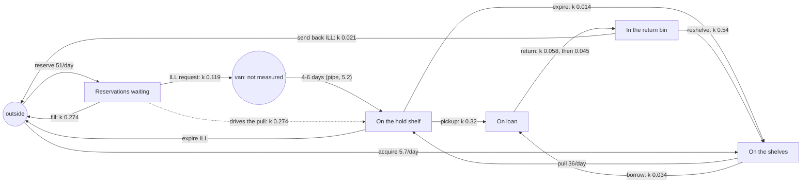

# Public library: the answer key

For graders. The model (`../library.json`) is told only what the circulation dashboard shows at
closing time each day: reservations waiting, books on the shelves, on the hold shelf, on loan
and in the return bin, 5 stocks in one group (`library`), all counted in books (one reservation
is one book requested), no flows and no counters. This is what the simulation
(`machines/sim.py`, seed 20261016, 365 daily steps, day 0 = Monday 1 January, after a 150-day
warm-up so the year starts mid-stream) really does. `python truth.py` regenerates `truth.json`:
every parameter, the hidden van's level, every true flow per day, loan lengths per era, and under
`sd_structure` the structure a perfect discovery would report, with the numbers it should find.
`tests/fixtures/library-run.json` holds the imported run, the measured levels at the end of the
warm-up (`start`), and the per-day count of every true flow (`counters`, not page-visible).

**Measured:** the 5 levels only. **Not measured:** every flow, and one stock: the
**interlibrary van** (81 books on average, at most 168). No counters are given.

## How the simulation works

| flow | from -> to | rule | per day |
|---|---|---|---|
| reserve | outside -> Reservations | placed online every day: 45 a day, +60% in exam weeks (days 105-152, 335-355), +25% in summer | 51.5 |
| fill + pull | Reservations -> outside, Shelves -> Hold shelf | 70% of reservations are for titles on our shelves: staff pull the book with p 0.5 per open day; the reservation is filled and the book goes to the hold shelf (same count) | 35.9 |
| ill_request | Reservations -> **Van** (hidden) | 30% are for titles we do not own: the request goes out with p 0.4 per weekday and the reservation leaves the waiting list | 15.6 |
| ill_arrive | **Van** -> Hold shelf (hidden) | after 4-6 days (uniform whole days; a Sunday arrival waits for Monday; realised mean 5.23 days); deliveries are received even when closed | 15.6 |
| pickup | Hold shelf -> On loan | the patron collects with p 0.3 per open day | 48.4 |
| expire / expire_ill | Hold shelf -> Shelves / outside | uncollected after 8 open days (interlibrary books go back to their owner) | 2.1 / 0.9 |
| borrow | Shelves -> On loan | each book on the shelves in the morning is borrowed with p 0.032 x season (summer reading days 166-244 +45%, exam weeks +15%, a mild winter bump) x weekday (Sat 1.2, Sun 0.8) | 337.9 |
| return | On loan -> Return bin | the loan period is 21 days (28 from day 182): 75% come back uniformly in 35-100% of it, 13% in its last 3 days, 12% late (+ exponential 12 days); into the book drop every day, open or not | 381.0 |
| reshelve | Return bin -> Shelves | each book that was in the bin that morning, p 0.6 per open day | 366.8 |
| send_back | Return bin -> outside | interlibrary books go back to their owner instead (same p) | 14.1 |
| acquire | outside -> Shelves | about 8 new books per open weekday | 5.7 |

Closed (no borrowing, pickups, pulls, reshelving, interlibrary requests or acquisitions; the book
drop and online reservations stay open): 1 January, 25-26 December and the renovation, days
300-306.

Every book and reservation is accounted for: each of the six stocks (van included) changes by
exactly what its flows moved, every day, and Σ measured + van = the warm-up's total + what came
in from outside - what left (tested in `tests/test_example_library.py`).

## Long runs

`sim.run(seed, steps)` and `sim.measured(seed, steps)` take any length; the default (365 days) is
the run described here, and the first 365 days of a longer run are exactly it. `sim.LONG_STEPS`
is ten years (3,650 days; `measured` takes about a second and its JSON is about 0.3 MB);
`history.py [seed] [steps]` prints any length. The calendar repeats every 365 days (weekdays keep
counting, so each year starts a weekday later) with fresh random draws: the holidays, summer
reading, the exam weeks, and a closed week on days 300-306 of every year (the renovation in the
first year, "Closed for the annual stocktake" after it). The loan period follows the year: 3
weeks from 1 January, 4 weeks from 1 July, so every later year has four eras ("Loan period back
to 3 weeks" on its first day, "extended to 4 weeks", closed, reopened). The structure is the same
at any length. Nothing weeds the collection, so acquisitions (about 2,000 books a year) make it
grow: over ten years the shelves reach about 24,000 and on loan about 18,000.

## The true structure

Solid arrows are real flows between stocks; dotted arrows are links (the source's level drives
the flow; nothing leaves it); `((van))` is the stock nobody measures.

## `sd_structure` (k = the year's total / Σ the source's level at the end of the day before)

**moves** (real stock-to-stock flows, ratio 1)

| from | to | form | k / day | per day | what |
|---|---|---|---|---|---|
| Shelves | On loan | proportional | 0.0341 (0.032 x season x weekday) | 337.9 | borrowing |
| On loan | Return bin | proportional (really a delayed copy of what was lent) | 0.0505; 0.0577 with 3-week loans, 0.0448 with 4-week loans | 381.0 | returns; realised loan 17.5 days, then 21.9 days |
| Return bin | Shelves | proportional | 0.544 (0.6 per open day) | 366.8 | reshelving |
| Hold shelf | On loan | proportional | 0.321 (0.3 per open day) | 48.4 | pickups |
| Shelves | Hold shelf | driven by Reservations | 0.274 x reservations | 35.9 | staff pull reserved books |
| Hold shelf | Shelves | proportional | 0.0136 | 2.1 | uncollected |

**outside**: reserve -> Reservations 51.5/day (constant, seasonal); Reservations -> outside k 0.274
(filled: the same count as the pull); acquire -> Shelves 5.7/day; Return bin -> outside k 0.021
(interlibrary books sent back); Hold shelf -> outside k 0.0058.

**links**: Reservations -> Hold shelf, k 0.274 (the pull's arrivals follow the reservations
waiting; the books come from the shelves).

**hidden**: Reservations -> Hold shelf, shape `pipe`, delay 5.23 days (4-6), share k 0.119 per
day, holds 81 books (15.6 a day x 5.2 days).

**echoes**: none (no final stocks).

Levels: Reservations 75-431 (mean 131), Shelves 8,045-12,029 (9,906), Hold shelf 97-284 (151),
On loan 5,657-9,714 (7,549), Return bin 411-3,107 (674), van 0-168 (81).

## Eras and events

| t (first day) | change |
|---|---|
| 1 | Start (loans last 3 weeks; the era is labelled "Start") |
| 183 | Loan period extended to 4 weeks (1 July) |
| 301 | Closed for renovation |
| 308 | Reopened after renovation |
| 106-153, 336-356 | exam weeks: reservations +60%, borrowing +15% (not eras) |
| 167-245 | summer reading: borrowing +45%, reservations +25% (not an era) |
| 1, 360, 361 | closed holidays (not eras) |

What the experiments look like:

- **The renovation (days 300-306)** is the clearest experiment in the year. Returns keep coming
  into the book drop and nobody reshelves: the bin climbs from ~580 to 3,107. Shelves stay
  flat, on loan falls from 8,238 to 5,712, reservations pile up to 431 (nobody pulls), the van
  empties (no requests go out; deliveries still arrive, so the hold shelf rises from 124 to 214).
  On reopening the bin halves in a day (3,107 -> 1,644 -> 986 -> 727: k 0.6 per day, plainly
  proportional), the shelves jump by 1,400, and the van refills from the backlog (0 -> 168 in
  four days).
- **Longer loans (day 183)**: returns per book on loan fall by a fifth (k 0.057 -> 0.045) and,
  with summer reading, on loan climbs to 9,714.

## What a perfect discovery would report

1. The circulation loop **Shelves -> On loan -> Return bin -> Shelves**, proportional, with
   residence times of about 30 days on the shelves (1/0.034), 17.5 then 22 days on loan, and 1.8
   days in the bin.
2. **Hold shelf -> On loan** (k ~0.32, about 3 days on the hold shelf).
3. **Reservations drive Shelves -> Hold shelf** (k ~0.27 x reservations), and reservations are
   filled out to outside at the same rate.
4. **One hidden stock between Reservations and the Hold shelf**: a fixed ~5-day delay (pipe),
   about 12% of the reservations waiting per day, holding about 80 books.
5. Small flows to and from outside: reservations placed, acquisitions, interlibrary books sent
   back.

## What should be visible at daily steps, and what should not

- **Visible:** the bin -> shelves drain (every day, and spectacularly after the
  renovation); the reservations -> hold shelf link (the hold shelf's arrivals follow the
  reservations waiting); borrowing proportional to the shelves (the shelves drop when demand
  rises in summer).
- **Hard:** returns are a *delayed copy* of borrowing (a 2-4 week pipeline), not proportional
  to what is on loan, so a proportional on_loan -> bin is only an approximation; the loop moves
  ~350 books a day while the levels change by tens, so a search that charges for what flows
  move relative to how much levels change sees the loop only through its imbalances (seasons,
  the renovation, the loan-period change).
- **The van** is identifiable in principle: what leaves the reservations beyond what is pulled
  (15.6 a day) arrives on the hold shelf 4-6 days later, and the renovation makes it plain (no
  requests for a week, then the arrivals stop four days later and restart four days after
  reopening). It is small next to the pulls (36 a day) and pickups (48 a day) that share its two
  ends.

## What the current discovery finds (`sdlab/static/discover.js`, 16 October 2026)

Run with `discoverAll(model.stocks, run, {window, eras: run.eras})` on the fixture.

**Page default (`window: 5`: 73 windows of 5 days), 9 flows:**

| found | truth | verdict |
|---|---|---|
| Shelves -> On loan, proportional k 0.027 | k 0.034 | right flow, k 20% low |
| Return bin -> Shelves, proportional k 0.337 (per era 0.17, 0.10, 0.61, 0.34) | k 0.54 | right flow, k low except around the renovation |
| On loan -> Return bin, constant 272 a day (per era 142, 104, 1370, 272) | proportional k 0.05, ~381 a day | right flow, wrong form |
| outside -> Hold shelf driven by Reservations, k 0.246 | link k 0.274 | right link (the books really come from the shelves) |
| Hold shelf -> Shelves, proportional k 0.221 | Hold shelf -> On loan k 0.32 (-> Shelves only 0.014) | wrong target |
| Return bin -> outside, proportional k 0.102 | k 0.021 | 5x too much |
| Reservations -> Return bin (constant), Reservations -> On loan (k 0.28), outside -> Reservations driven by Return bin (k 0.063) | reservations come from outside (51/day) and leave to outside or the van | wrong |
| (nothing) | hidden van Reservations -> Hold shelf, pipe 5.2 days | **not found** |

**`window: 1, maxWindows: 100000` (365 windows), 14 flows:** Return bin -> Shelves k 0.493
(right, close to 0.54); outside -> Hold shelf driven by Reservations k 0.246 (right link);
Reservations -> Hold shelf, proportional k 0.093 (the van's route without its delay: true share
0.119); a **hidden-stock flow Hold shelf -> Reservations, pipe 4 days, holding 118** (the van,
but backwards: the truth is Reservations -> Hold shelf, pipe 5.2 days, holding 81); Hold shelf
-> outside k 0.11 instead of Hold shelf -> On loan; and no Shelves -> On loan or On loan ->
Return bin (replaced by Shelves -> Return bin constant 330 a day, outside -> On loan 64 a day,
Return bin -> On loan, On loan -> Reservations via a 1-day hidden stock and other flows the
truth does not have). Passing the warm-up's levels as `start` changes the details but not the
picture.

Scoring the true structure directly (`opts.score`, with `discover` on all five stocks) gives a
worse score than the structure found (123 against -104 at window 1, -46 against -141 at window
5; lower is better): the true flows' linear equations cannot follow the weekday swings in borrowing
or the delayed-copy shape of returns, and the loop pays the movement price (docs/DISCOVERY.md
sections 4 and 9).
