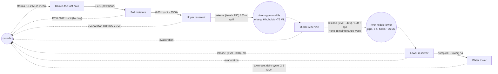

# Reservoirs: the answer key

For graders. The model (`../reservoirs.json`) is told only what the water board's telemetry shows
at the end of every hour: six stocks in megalitres (ML), no flows, no counters. This is what the
simulation (`machines/sim.py`, seed 20261016, 90 days, 2160 one-hour steps) really does.
`python truth.py` regenerates `truth.json`: every parameter, the operating rules, the rivers
nobody measures, and the SD structure a perfect discovery would report (`sd_structure`).
`tests/fixtures/reservoirs-run.json` holds the imported run plus the simulator's per-hour amount
of every true flow (`counters`), which the model never sees.

## How the simulation works

Deterministic for a seed, standard library only. Every flow in hour *t* is computed from the levels
at the end of hour *t − 1* (an explicit Euler step), which is exactly what discovery's equations
assume. One unit throughout: 1 mm of rain on the 40 km² catchment is 40 ML.

- **Rain** is exogenous: storms (3 to 14 hours, Poisson starts about every 30 hours, random
  intensity) in the wet weeks, **no rain at all from day 18 to day 40** (the dry spell), and **one
  big storm** on day 40 (30 hours, 7,663 ML, peak 733 ML in one hour). 34,918 ML in all.
- **Rain in the last hour** (the gauge) is what fell on the catchment that hour. All of it soaks
  into the soil during the next hour: *rain → soil* at k = 1.
- **Soil moisture** loses water to evapotranspiration (0.0012 × soil per hour as a daily mean, by
  day only: zero at night, up to π times the mean at noon) and runs off into the upper reservoir at
  0.03 × (soil − 3,500 ML field capacity) per hour, nothing below field capacity. The soil is below
  field capacity for 623 hours (most of the dry spell), so runoff stops.
- **Each reservoir** releases toward its target level: *max(1.5 × min(1, level / target),
  (level − target) / time)* ML per hour, times (1 + 4% noise) for the gate setting. A **spillway**
  takes half of anything above the crest every hour. Release and spill both go down the river.
  **Evaporation** takes 0.00025 × level per hour (daily mean, by day only).
- **The rivers** hold water nobody measures. *Upper → middle*: two linear stretches of 3 hours each
  (an erlang delay, mean 6 h). *Middle → lower*: a pipe, everything arrives exactly 6 hours after it
  left. Nothing is lost on the way.
- **The water tower**: the town pumps from the lower reservoir at (30 − tower) / 4 ML per hour (a
  gap closed over 4 hours, at most 8 ML/h, never reached) and draws from the tower with a daily
  cycle (low at night, a morning and an evening peak, mean 2.5 ML/h, 8% noise).
- **The lower reservoir's release** leaves the valley.
- **Maintenance week** (day 60 to 67): the middle dam's gates are shut, it releases nothing; its
  spillway still works and spills on days 63 to 67.

Every megalitre is accounted for: each stock (rivers included) changes by exactly its true flows
every hour, and rain = everything that left + what the valley holds more than at the start
(tested in `tests/test_example_reservoirs.py`). The telemetry rounds levels to 0.1 ML.

## The true structure

Solid arrows are flows between measured stocks, dashed ones go through a river nobody measures
(`(( ))`), dotted ones cross the valley's edge.

## Stocks

| stock | measured | mean | min | max | notes |
|---|---|---|---|---|---|
| Rain in the last hour | yes | 16.2 | 0 | 733 | 0 in 1,682 of 2,160 hours |
| Soil moisture | yes | 3,729 | 2,024 | 7,927 | field capacity 3,500 |
| Upper reservoir | yes | 837 | 6.8 | 1,948 | crest 1,800, target 150, release time 60 h; nearly empty at the end of the dry spell |
| Middle reservoir | yes | 2,021 | 415 | 3,031 | crest 3,000, target 400, release time 120 h |
| Lower reservoir | yes | 1,204 | 97 | 1,895 | crest 2,400 (never reached), target 300, release time 90 h |
| Water tower | yes | 20.0 | 15.5 | 26.4 | target 30, pump time 4 h |
| River upper → middle | no | 75.6 | 0.4 | 551 | two stretches of 3 h |
| River middle → lower | no | 75.8 | 0 | 151 | a 6-hour pipe |

## Flows (ML per hour, mean over the 90 days)

| flow | from | to | form | per hour |
|---|---|---|---|---|
| rainfall | outside | rain | exogenous | 16.17 |
| soak | rain | soil | proportional, k = 1 | 16.15 |
| soil ET | soil | outside | proportional, k = 0.0012 (by day) | 4.45 |
| runoff | soil | upper | 0.03 × (soil − 3,500), ≥ 0 | 12.46 |
| upper release + spill | upper | river → middle | (level − 150) / 60, min 1.5; spill 0.5 × (level − 1,800) | 11.80 + 0.78 |
| upper evaporation | upper | outside | 0.00025 × level (by day) | 0.21 |
| middle release + spill | middle | river → lower | (level − 400) / 120, min 1.5, 0 in maintenance; spill 0.5 × (level − 3,000) | 12.05 + 0.58 |
| middle evaporation | middle | outside | 0.00025 × level | 0.50 |
| lower release | lower | outside | (level − 300) / 90, min 1.5 | 10.20 |
| lower evaporation | lower | outside | 0.00025 × level | 0.30 |
| pumping | lower | tower | gap: (30 − tower) / 4 | 2.49 |
| town use | tower | outside | daily cycle | 2.50 |

The release rules are a gap on the *source*: release = k × level + c with c < 0 (k = 1/time,
c = −target/time). Fitted where the rule is linear (not at the minimum, not spilling, not shut),
the run gives k = 0.0167, c = −2.51 (upper; nominal 0.0167, −2.5) and k = 0.0083, c = −3.36
(middle; nominal 0.0083, −3.33). Discovery's flows through a hidden stock have only a
proportional form; as k × level the releases are 0.0141 (upper), 0.0060 (middle) and 0.0085
(lower) per hour (`k_if_proportional` in `truth.json`).

Nonlinear parts, none of which a linear form expresses: runoff stops below field capacity (623
hours); the upper release sits at its minimum for 421 hours, the middle for 128, the lower for 190
(the dry spell and after the maintenance week); the upper spillway runs for 69 hours (days 7 to 8
and 41 to 43), the middle one for 128 (days 9 to 11, and 63 to 67 while the gates are shut);
evaporation and ET happen by day only; the town's draw has a daily cycle.

## Eras

| t (first hour) | era | what changes |
|---|---|---|
| 1 | Start | wet weeks |
| 433 | Dry spell | no rain until hour 960; soil falls below field capacity, runoff stops, reservoirs fall to their minimum releases |
| 961 | Storm | 30 hours of heavy rain from hour 967; soil to 7,900, the upper spillway runs |
| 1033 | After the storm | showers again |
| 1441 | Maintenance week: the middle dam's gates are closed | middle release 0; middle rises from 1,992 to 3,028 and spills; lower falls from 1,504 to 637 |
| 1609 | Middle dam back in service | |

## Long runs

`sim.run(seed, steps)` and `sim.measured(seed, steps)` take any length; `sim.LONG_STEPS` is three
years of hours (26,280) for the discovery test bed (`measured` gives `t`, the six levels at 0.1 ML,
the eras and every flow per hour; it is what `history.py` prints at the default length). The run is
a series of 90-day seasons cycling spring, summer, autumn and winter; the first is always the 90
days above, draw for draw. Every later season draws its weather and calendar from its own random
stream (the hourly gate and demand noise continue on the main one): storms more often in autumn
and winter and rarer in summer, a dry spell (longest in summer: a hot summer can run the lower
reservoir and the tower nearly dry), a big storm at its end or up to two weeks later, and the
middle dam's maintenance week. Eras: the season's name, Dry spell, Rain returns (when the big
storm comes later), Storm, After the storm, and the maintenance week's start and end. Every rule
and coefficient is unchanged, and so is the structure (the same hidden rivers, no links or echoes).

## The SD structure a perfect discovery would report

1. **Moves between measured stocks: 3.** *rain → soil* (proportional, k = 1), *soil → upper*
   (k = 0.03 above 3,500: linear 0.03 × soil − 105 while it runs), *lower → tower* (gap on the
   tower: goal 30, time 4).
2. **Through hidden stocks: 2.** *upper → middle* through a river (erlang, delay 6 h, share 1,
   holds ~76 ML) and *middle → lower* through a river (pipe, delay 6 h, share 1, holds ~76 ML),
   each driven by the source's release rule.
3. **To and from outside: 8.** outside → rain (exogenous, mean 16.2); soil → outside (ET, k 0.0012);
   evaporation from each reservoir (k 0.00025, realised 0.0002); lower → outside (release, k 0.0111,
   c −3.33); tower → outside (town use, mean 2.5). The lower spillway never runs.
4. **No links, no echoes.** (*rain → soil* can also be read as a link outside → soil at 1 × the
   gauge with the gauge emptying to outside, but nothing is lost: it is a move.)

## What discovery should and should not be able to see

- **Visible:** rain → soil (the gauge's level is exactly next hour's soil inflow); soil → upper
  in the wet weeks and after the storm; the releases from one reservoir showing up in the next
  (the storm and the maintenance week are strong experiments: the middle stops sending and the
  lower falls; the middle fills and spills).
- **Hard:** the 6-hour river delays at 6-hour windows (the page's default window is 5 steps, which
  becomes 6 for 2160 steps): one window of delay. At 1-hour windows the delay is visible, but the
  daily cycles of ET, evaporation and the town's draw are too. Hidden flows have one coefficient for
  the whole run and no constant, so the maintenance week (middle release 0) and the release rule's
  negative constant both count against the river through the middle dam.
- **Probably invisible:** evaporation (0.2 to 0.5 ML/h against releases of 10 to 12); the water
  tower. The tower is a tight buffer: 2.5 ML/h passes through it while its level swings between 15
  and 26 with the town's daily cycle. The pump follows the town's draw an hour or two behind, so the
  level shows almost nothing of what passes through (docs/DISCOVERY.md section 9, the first limit),
  and the movement price charges a flow pair moving 2.5 ML/h through a stock that barely changes.

## What the current discovery finds (2026-10-16)

Run on `tests/fixtures/reservoirs-run.json` with the eras, all six stocks
(`discover(model.stocks, run, {window: 5, eras})`, as the page does; window 5 becomes 6 hours):

| truth | found | verdict |
|---|---|---|
| rain → soil, k 1 | link outside → soil at 1.06 × rain (0.64 to 1.04 by era) | right pair, as a link instead of a move |
| soil → upper, 0.03 × (soil − 3500) | not found; instead rain → upper through a hidden erlang stock (delay 8 h, share 0.32) | skips the soil |
| upper → middle through a 6 h erlang river | link outside → middle at 0.0196 × upper, plus middle → outside 0.014 × middle | right pair and about the right k (truth 0.014 as k × level), as a link with no delay |
| middle → lower through a 6 h pipe | link outside → lower at 0.0081 × middle (0.0055 to 0.0224 by era) | right pair, k close to the rule's 0.0083, as a link with no delay |
| lower → outside, (level − 300) / 90 | lower → rain 0.01 × lower | right k, wrong destination (rain's row absorbs it) |
| lower → tower (gap), tower → outside | nothing | invisible, as expected |
| ET, evaporation | soil → outside −50 + 0.021 × soil (truth 0.0012); no evaporation | ET grossly overstated: it balances spurious inflows to the soil |
| | spurious: upper → soil, lower → soil, rain → middle, middle → lower (gap on lower), outside → rain 1.15 + 0.22 × rain | rain's spiky row and the soil soak up misfit |

12 flows (the default cap), 11.6 s. Scores (lower is better): the found structure 340; the true
structure with direct moves *upper → middle* and *middle → lower* as c + k × source 845; the true
structure with the two hidden rivers (k × source, erlang 6 and pipe 6) 3,186; with only the
upper-middle river hidden 1,238. So the true structure is not the best-scoring one in discovery's
terms: the exogenous rain row, the thresholds and the maintenance week favour structures that are
not physical.

Other settings: `discover` at 1-hour windows (65 s) finds the same three links (outside → middle
0.0166 × upper, outside → lower 0.0081 × middle, outside → soil 0.93 × rain), outside → upper at
45 + 0.019 × soil (the runoff, as a link) and rain → upper through an erlang (8 h), with large
spurious flows between the soil and the reservoirs; `discoverAll` at 5- and 1-hour windows (1.6 s,
19 s) finds the five links outside → soil 1.01 × rain, outside → upper 0.0327 × soil (the runoff:
truth 0.03 above field capacity), outside → middle 0.0204 × upper, outside → lower 0.0058 × middle,
and outside → lower 0.312 × tower (spurious), with spurious stock-to-stock flows besides.
None of the settings finds a river as a hidden stock between two reservoirs, the pumping, or the
town's use.

Where it is lost, measured by scoring the true structure on variants of the simulation (window 6):
removing the daily cycles does not close the gap (found 646, true with direct moves 1,644);
removing the maintenance week as well drops the true structure with both rivers hidden from 4,964
to 1,730, and with only the pipe below the middle dam hidden to 531 (found 195): one coefficient
for the whole run cannot follow a week with no release. Leaving the rain gauge out of the stocks
(rain only as a driver of the soil's inflow) brings the true structure with direct moves within
~130 points of the best found (441 against 314).
