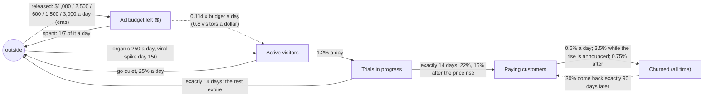

# SaaS growth: the answer key

For graders. The model (`../saas.json`) is told only the five levels the growth dashboard shows
at the end of every day; this is what the simulation (`machines/sim.py`, seed 20261016, 365 days,
1-day steps, after 200 days of warm-up) really does. `python truth.py` regenerates `truth.json`;
its `sd_structure` is what a perfect discovery would report, in SD Lab terms.

Measured: Ad budget left (`dollars`), Active website visitors, Trials in progress, Paying
customers, Churned customers (all time; `final`) (`people`, one group). No counters are given to
the model, and none are needed to make the answer unambiguous: each stock's inflow comes from at
most one measured stock, and *Churned* is final. The simulator records a daily counter for every
true flow (`budget_released`, `ad_spend`, `ad_visits`, `organic_visits`, `trial_starts`,
`gone_quiet`, `conversions`, `trials_expired`, `cancellations`, `win_backs`); the history program
prints one only if the model has a flow with that id.

## The true structure

Thick arrows move people (or dollars); the dashed arrow is a **link** (the budget's level drives
the visitors' arrivals, and nothing leaves the budget for them); the dotted arrow is an **echo**
(timed by *Churned*'s gains 90 days earlier; *Churned* keeps its count).

| from | to | kind | truth | SD Lab reading |
|---|---|---|---|---|
| outside | Ad budget left | outside | the team releases a fixed amount a day, per era | constant per era: 1,000 / 2,500 / 600 / 600 / 600 / 1,500 / 3,000 |
| Ad budget left | outside | outside | the ad platform spends 1/7 of what is left a day (x0.85-1.15) | proportional, 0.143 x budget (fitted 0.143) |
| (Ad budget left) | Active visitors | **link** | 0.8 visitors per dollar spent today | outside -> visitors at 0.114 x budget (fitted 0.115) |
| outside | Active visitors | outside | search and word of mouth, 250 a day; viral post: +3,000, 1,800, 900, 400 on days 150-153 | constant 250 (plus an unexplained spike) |
| Active visitors | Trials in progress | move | each active visitor starts a trial with probability 1.2% a day | proportional, 0.012 x visitors (fitted 0.0120) |
| Active visitors | outside | outside | goes quiet with probability 25% a day | proportional, 0.247 x visitors |
| Trials in progress | Paying customers | move, **pipe** | every trial ends exactly 14 days after it started; 22% convert (15% for sign-ups from day 200) | a fixed 14-day delay; linear reading 0.0157 x trials (0.0107 after) |
| Trials in progress | outside | outside, **pipe** | the rest expire on day 14 | a fixed 14-day delay; linear reading 0.056 x trials |
| Paying customers | Churned | move | daily probability 0.5%; 3.5% in the five days the rise is announced; 0.75% after | proportional per era: 0.005 / 0.035 / 0.0075 (fitted 0.0050 / 0.0354 / 0.0078) |
| (Churned gains) | Paying customers | **echo** | 30% of those who cancel take a win-back offer exactly 90 days later | echo of *Churned*'s gains, pipe 90 days, share 0.30 |

No hidden stocks (`hidden` is empty): the trial cohort *is* the measured *Trials in progress*,
with a fixed residence. Every step, each level changes by exactly what its flows moved (tested);
win-backs stay in *Churned*, which only grows.

Year (seed 20261016): $567,000 released, $551,928 spent, 540,642 visitors (443,033 from ads),
24,747 trials, 4,427 conversions, 5,596 cancellations, 1,470 win-backs. Mean levels: budget
$10,582, visitors 5,656, trials 931, paying 2,324; churned grows from 1,594 to 7,190.

## Eras

| from day | era | released a day | pricing |
|---|---|---|---|
| 1 | Ad budget $1,000 a day | 1,000 | old |
| 61 | Spring campaign: $2,500 a day | 2,500 | old |
| 121 | Budget cut: $600 a day | 600 | old |
| 200 | Price rise announced: +30% in five days | 600 | announced (new sign-ups pay the new prices) |
| 205 | New prices apply to every customer | 600 | new |
| 241 | Ad budget $1,500 a day | 1,500 | new |
| 301 | Holiday campaign: $3,000 a day | 3,000 | new |

Not an era: the viral spike on days 150-153. Its trials convert 14 days later (days 164-167),
and the 5-day cancellation wave from day 200 comes back as a win-back wave on days 290-294:
these two are the clearest evidence for the pipe and the echo.

## Long runs

`sim.run(seed, steps)` and `sim.measured(seed, steps)` take any length (after the same 200-day
warm-up); `sim.LONG_STEPS` is five years (1,825 days) for the discovery test bed (`measured` gives
`t`, the five levels, the eras and every counter; it is what `history.py` prints at the default
length). The first 365 days are always the year above, draw for draw. Every later year is drawn
from its own random stream in the same shape: new plans bring the old prices back on its first
day, a spring campaign, a budget cut, a price rise announced around day 200 and applied five days
later, a new budget, a holiday campaign (amounts and days drawn per year), and one or two viral
spikes on random days (not eras). Pricing keeps its three states, so churn and conversion keep
their era values; the structure (moves, link, echo, no hidden stocks) is the same at any length.

## What an ideal discovery should report

- **Visitors linked to the ad budget**: outside -> Active visitors at about 0.11 x Ad budget left
  (a link: the budget is not drained by it), plus a constant ~250 a day.
- **Ad budget**: a constant inflow per era from outside and a proportional drain of ~0.14 a day.
- **Visitors -> Trials**, proportional, ~0.012 x visitors; visitors also drain to outside at ~0.25.
- **Trials -> Paying through a fixed 14-day delay** (a pipe), 22% then 15%; the rest leave to
  outside after the same 14 days. A linear reading is ~0.016 x trials to Paying.
- **Paying -> Churned**, proportional, 0.005 / 0.035 / 0.0075 by pricing era.
- **Win-backs as an echo**: outside -> Paying timed by Churned's gains 90 days earlier, share 0.3.

## Running the current discovery on the fixture

`tests/fixtures/saas-run.json` is the imported run (with `start`, the levels at day 0). With
`discover.js` as of this writing (it was being changed at the same time):

- **Found well**: Paying -> Churned per era 0.005 / 0.031-0.036 / 0.008 (every window and
  entry point); the ad link, outside -> Active visitors driven by Ad budget at 0.085 x budget
  (`discoverAll`; truth 0.114); visitors going quiet at 0.193 (truth 0.247); Trials draining to
  outside at ~0.09-0.11 a day.
- **Found as something nearby**: Visitors -> Trials comes out as a *link* driven by visitors
  (0.018 x visitors) rather than a move of 0.012: what leaves the visitors is 1% of a stock
  that swings by thousands, too small to see. Trials -> Paying comes out as a flow through a
  hidden stock (exp 1-8 days, pipe 5 days or pipe 15 days from *visitors*), or as a link from
  trials at ~0.016: right size, but not the fixed 14-day residence.
- **Missed**: the per-era budget releases (flows to and from outside keep one number across
  eras, so a constant of ~720 is the best it can say, or nothing), and the win-back echo (it
  reports a constant outside -> Paying of ~5 a day instead). In a search restricted to Trials,
  Paying and Churned, the echo at 90 days does pay for itself at window 1 (score 192 against 240
  without it), so the data supports it; at window 5 it does not pay.
