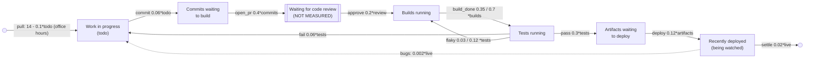

# sd-ci: a software delivery pipeline (ground truth)

A product team's CI/CD pipeline, counted every hour for eight weeks (default run: 1,344 hours; long
run: 13,440). Developers pick up work from the sprint board during office hours and push commits.
Every commit then sits in code review, which nobody counts, before its build starts. Finished builds
go to the test suite. Passing changes become artifacts waiting to deploy, and deployed releases are
watched for a while before they settle. Failing tests send the change back to its developer. Flaky
tests send it back for a rebuild and rerun. Releases being watched produce bug reports, which come
back as new work.

The data is generated by `truth.model.json`, an SD Lab model stepped by `sdlab/sdtruth.py` (one
step per hour, flows from the levels at the start of the step, Poisson counting noise). All
stocks are in **changes**.

## True structure

| flow | from -> to | equation |
|---|---|---|
| pull (Developers pick up work) | outside -> todo | linear `c - 0.1*todo`, c = 14 in office hours (30 on sprint planning day, 20 in the end-of-sprint crunch), 0 at night and weekends |
| bugs (Bugs reported from production) | outside -> todo | linear `0.002*live` |
| commit | todo -> commits | proportional 0.06 |
| open_pr | commits -> review (hidden) | proportional 0.4 |
| approve | review (hidden) -> builds | proportional 0.2 (a 5-hour mean review delay) |
| build_done | builds -> tests | proportional 0.35 with two build agents, 0.7 with four |
| pass | tests -> artifacts | proportional 0.3 |
| fail | tests -> todo | proportional 0.06 |
| flaky | tests -> builds | proportional 0.03 (0.12 while a flaky suite is in) |
| deploy | artifacts -> live | proportional 0.12 |
| settle | live -> outside | proportional 0.02 |

## Schedule (repeats every 1,344 hours = 8 weeks)

- Unannounced: `pull` switches on at 09:00 and off at 17:00 on weekdays (two-week sprints: day 1
  is planning with a bigger intake, days 11 and 12 are crunch), and is off on nights and weekends.
- Unannounced: a flaky test suite slips in at hour 400 (flaky rerun rate 0.03 -> 0.12) and is
  quarantined at hour 520.
- **Announced** at hour 673: "Two more build agents added" (build_done 0.35 -> 0.7). At the
  start of each period: "Build farm back to two agents" (0.35).

## What it tests in discovery

- **Moves along a chain**: todo -> commits, builds -> tests -> artifacts -> live.
- **A hidden stock**: commits -> (code review, unmeasured) -> builds should come out as a delay
  between two measured stocks (about 5 hours), not as a direct move.
- **Loops**: test failures go back to todo (a rework loop through the whole pipeline). Flaky
  reruns go tests -> builds, a short cycle with the forward flow, and the rate changes without
  announcement.
- **A link**: bug reports into todo are driven by `live`, a stock downstream. The bug loop's gain
  is small (about 0.1), so the system stays stable.
- **Goal-seeking inflow**: developers' intake falls as work in progress grows (`-0.1*todo`). It is
  switched on and off by office hours and sprints, so the system never settles. Discovery has to
  find this inflow even though its constant keeps changing without notice.
- **An announced era**: the build-farm change doubles a rate partway through each period. A good
  discovery fits the era change and does not blur two regimes into one.
- **Final stock**: none. Every stock drains, so the long run must stay bounded.
