# sd-ev-fleet: an electric delivery-van depot

A ground-truth example: the data is generated by the system dynamics model in `truth.model.json`
(stepped by `sdlab/sdtruth.py`, one step per hour, Poisson counting noise). `truth.json` is the
answer key derived from it (`python truth.py` rewrites it).

## The story

A depot runs a fleet of 40 electric vans. Parcels arrive at the depot all day, heavily in the
morning, less in the afternoon, a trickle at night, and less at weekends. The dispatcher sends
parked vans out when parcels pile up, aiming for about one van on the road per 25 waiting parcels.
A van on its route delivers about 10 parcels an hour; a route lasts about 6 hours. Then the van
drives back to the depot (about 2 hours; the depot does not count these vans), waits for a free
charger, charges for about 4 hours and parks, ready again. Now and then a van breaks down on its
route and spends about a day in the workshop. The chargers run off the depot's battery bank: each
van that finishes charging has taken about 160 kWh from it (40 kWh an hour for about 4 hours), and
the grid tops the battery up toward 2400 kWh, an eighth of the shortfall each hour. When many vans
charge at once the battery runs low and vans stay on the chargers until it recovers. The energy
left in the battery is counted.

The depot has six chargers. Every second fortnight a fast-charge bay opens and there are ten; this
change is announced (an era). The daily demand peaks are not announced.

## The true structure

```mermaid
flowchart LR
  out1((outside)) -- "Parcels arrive (schedule)" --> parcels[Parcels waiting]
  parcels -- "Parcels delivered = 10 x road" --> out2((outside))
  ready[Vans parked ready] -- "Dispatched = 0.01 x parcels - 0.25 x road" --> road[Vans on routes]
  road -- "Route finished = road / 6" --> returning[[Driving back - hidden]]
  returning -- "Back at the depot = returning / 2" --> queue[Waiting for a charger]
  queue -- "Plugged in = (chargers - charging) / 1" --> charging[Charging]
  charging -- "Fully charged = charging / 4" --> ready
  road -- "Breaks down = 0.004 x road" --> workshop[In the workshop]
  workshop -- "Repaired = workshop / 24" --> ready
  out3((outside)) -- "Grid top-up = (2400 - energy) / 8" --> energy[Energy in the battery, kWh]
  charging -. "each van charged uses 160 kWh" .-> energy
  road -. reads .-> parcels
  parcels -. reads .-> ready
```

Stocks (vans unless noted): `parcels` (parcels, 300), `ready` (20), `road` (8), `returning` (2,
hidden), `queue` (2), `charging` (4), `workshop` (4), `energy` (kWh, 2400). The van stocks hold
the whole fleet of 40 and nothing enters or leaves it.

| flow | from -> to | equation (per hour) |
|---|---|---|
| orders | outside -> parcels | constant, set by the schedule |
| deliver | parcels -> outside | linear: 10 x road |
| dispatch | ready -> road | linear: 0.01 x parcels - 0.25 x road (floored at 0) |
| finish | road -> returning | proportional: road / 6 |
| arrive | returning -> queue | proportional: returning / 2 |
| plug | queue -> charging | gap: (6 or 10 - charging) / 1 |
| charged | charging -> ready | proportional: charging / 4 |
| breakdown | road -> workshop | proportional: 0.004 x road |
| repaired | workshop -> ready | proportional: workshop / 24 |
| grid | outside -> energy | gap: (2400 - energy) / 8 |

Co-flow: `charged` uses up 160 kWh of `energy` for each van it moves (`"uses": [{"stock": "energy", "per": 160}]`).

Outflows never take more than a stock holds (`sdtruth` shares it out), so dispatch is capped by
the vans ready and plugging in by the vans queueing; vans finishing their charge share the battery
with nothing else, so `charged` is capped at energy / 160.

## The schedule

Every 672 hours (four weeks), repeating:

- Each day (unannounced): parcel arrivals at hour 1 (night, 8-20 an hour), hour 7 (morning peak,
  140-230 on weekdays, 60-90 at weekends), hour 12 (afternoon, 80-140 / 40-70) and hour 18
  (evening, 25-45). The 28 days differ; the exact numbers are in `truth.model.json`.
- Hour 1 (announced from the second period on: "Fast-charge bay closed: six chargers"): the
  charger goal is 6.
- Hour 337 (announced: "Fast-charge bay opens: ten chargers"): the charger goal is 10.

The default run is 1344 hours (two periods, eight weeks); `long_steps` is 13440.

## What it tests in discovery

- **A closed loop of moves**: ready -> road -> (hidden) -> queue -> charging -> ready; the van total
  is conserved, so every van stock's changes must be explained by moves, not flows from outside.
- **A hidden stock**: vans driving back (road -> returning -> queue, a 2-hour exponential delay)
  are never counted; discovery should find the delayed road -> queue move.
- **Goal-seeking flows**: dispatch is a linear equation with a negative term (it seeks a target
  number on the road set by parcels waiting); plugging in is a gap toward the charger count.
- **A co-flow**: every van that finishes charging uses up 160 kWh of the battery; the battery's
  fall is explained by the charged flow (vans charging -> ready), not by a flow of its own, and when
  the battery runs low (mostly in the fast-charge weeks) that flow is held back.
- **A balancing loop with a delay**: more parcels -> more dispatch -> more vans on the road -> more
  deliveries -> fewer parcels (damped oscillation of about a day).
- **Unannounced changes**: the daily demand peaks change parcel arrivals without an era; discovery
  must treat arrivals as a flow from outside whose rate moves, not as a change in structure.
- **Announced eras**: the charger count changes the plug-in goal (and, through it, how long the
  queue gets), so a model fitted per era should find goal 6 and goal 10.
- **Capacity limits**: in the morning peak the ready vans can run out, so dispatch is capped by
  what is there rather than by its equation.
