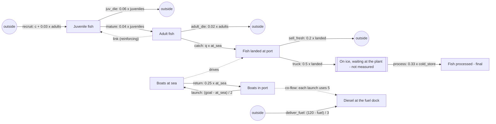

# sd-fishery: a managed fishery

A fishing port's records, every week for ten years (520 steps; `long_steps` 5,200). Young fish
drift onto the fishing grounds and are spawned there by the adults; juveniles die or grow up;
adults die or are caught by the boats at sea. Boats go out toward a target fleet size while the
season is open and come home when it closes. The catch is landed on the quay, where some is sold
fresh and the rest is trucked to the plant, waits on ice, and is processed. In year 6 a quota is
introduced. Every boat that puts to sea takes about 5,000 litres of diesel from the port's fuel
dock, which tankers refill toward 120,000 litres (a third of the shortfall a week); when the
season opens the dock runs low and boats wait in port until it is refilled. The data is made by stepping `truth.model.json` with SD Lab's own equations, with
Poisson counting noise (`sdlab/sdtruth.py`).

## The true structure

Two kinds of thing: fish (thousand fish: `juveniles`, `adults`, `landed`, `cold_store`,
`processed`) and boats (`in_port`, `at_sea`, a fleet of 40 that never changes size). Fish and boats
never exchange things: the boats drive the catch through its equation only. A third kind, diesel
(`fuel`, thousand litres), is used up by the boats going out.

| flow | from -> to | equation |
|---|---|---|
| recruit | outside -> juveniles | linear: c + 0.03 adults (c set each year by the schedule) |
| juv_die | juveniles -> outside | proportional, k = 0.06 |
| mature | juveniles -> adults | proportional, k = 0.04 |
| adult_die | adults -> outside | proportional, k = 0.02 |
| catch | adults -> landed | linear: q at_sea (q = 4 per boat-week, 2.5 under the quota) |
| launch | in_port -> at_sea | gap: (goal - at_sea) / 2 (goal 36 in season, 22 in season under the quota, 0 out of season) |
| return | at_sea -> in_port | proportional, k = 0.25 (four-week trips) |
| sell_fresh | landed -> outside | proportional, k = 0.2 |
| truck | landed -> cold_store | proportional, k = 0.5 |
| process | cold_store -> processed | proportional, k = 0.33 (about three weeks on ice) |
| deliver_fuel | outside -> fuel | gap: (120 - fuel) / 3 |

Co-flow: `launch` uses up 5 thousand litres of `fuel` for each boat it moves (`"uses": [{"stock": "fuel", "per": 5}]`).

The reinforcing loop adults -> juveniles -> adults has a gain of
0.03 x 0.04 / ((0.06 + 0.04) x 0.02) = 0.6 < 1, so without the larvae drifting in from outside the
stock would decline; with them it settles where they put it, and fishing pulls it lower. Every
equation is linear in the levels, so the system is stable: a 50x run stays within the first
decade's range.

## The schedule (repeats every 520 weeks)

- Week 1 of each year (unannounced): the young fish drifting in, `c` in `recruit`: 300, 420, 200,
  300, 480, 160, 340, 260, 440, 220 thousand a week in years 1-10 (good and bad year classes).
- Week 14 of each year (unannounced): the season opens, `launch` goal 36 boats (22 from year 6).
- Week 40 of each year (unannounced): the season closes, `launch` goal 0; boats drift home.
- Week 1 (announced era): "Open access: no quota", q = 4.
- Week 261, the start of year 6 (announced era): "Quota introduced: trip limits and a smaller
  fleet", q = 2.5. The adult stock recovers over the following years.

## What it tests in discovery

- **A move between two kinds of fish** (`mature`: juveniles -> adults) and **a move between boat
  states** in both directions (`launch`, `return`).
- **A link with a reinforcing loop**: juveniles' arrivals follow the adult stock (`recruit` reads
  `adults`), on top of a changing outside inflow.
- **A driven move**: the catch leaves the adults at a rate set by a different stock (`at_sea`),
  not by the adults themselves. Discovery may name it a move adults -> landed, or see the landings
  as driven by the boats; the answer key has it as a move.
- **Goal-seeking**: boats go out toward a target that changes with the season, without warning.
- **A hidden stock**: fish trucked from the quay sit on ice at the plant (not measured) for about
  three weeks before they are processed: landed -> processed with an exponential delay.
- **Flows to and from outside**: recruitment, natural mortality of both stages, fresh sales.
- **Unannounced changes** in what arrives from outside (year classes) and in the season, which
  keep the system from settling, and **one announced era** (the quota) that changes the catch
  equation.
- **A co-flow**: each launch uses up 5 thousand litres of diesel; the fuel dock's fall is
  explained by `launch` (in_port -> at_sea), and at the season's opening the dock runs low and
  holds launches back below their equation.
