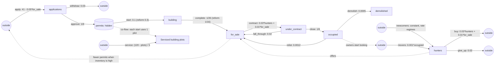

# sd-housing: a city's housing market (ground truth)

A city of about 16,000 occupied homes, seen every week for ten years (520 weeks; the long run is
5,200). Builders file permit applications when there are too few homes for sale; approved permits
wait (unseen) until construction starts; finished homes are listed; house hunters make offers; sales
close and buyers move in; owners eventually sell up and put their homes back on the market, and a
few homes are demolished or abandoned each week. Mortgage rates swing without warning, changing how
many new households start looking. A zoning reform, announced, speeds up building for half of every
five-year cycle. Every home that starts construction uses up a serviced building plot; the city
services plots toward 120 ready (a fifth of the shortfall a week), so in a building rush the plots
run low and construction starts wait.

The user sees seven stocks (`../sd-housing.json`): permit applications in review, homes under
construction, homes for sale, homes under contract, occupied homes, demolished or abandoned homes
(final), house hunters (households, a different unit from homes), and serviced building plots (plots). Approved permits not yet
started are not measured.

## True structure

| flow | from -> to | equation (per week) |
|---|---|---|
| apply | outside -> applications | linear: 41 - 0.05 * for_sale (floored at 0) |
| withdraw | applications -> outside | proportional: 0.03 * applications |
| approve | applications -> permits (hidden) | proportional: applications / 6 |
| start | permits -> building | proportional: 0.1 * permits (0.3 under the reform) |
| complete | building -> for_sale | proportional: building / 26 (building / 16 under the reform) |
| contract | for_sale -> under_contract | linear: 0.03 * hunters + 0.01 * for_sale |
| fall_through | under_contract -> for_sale | proportional: 0.02 * under_contract |
| close | under_contract -> occupied | proportional: under_contract / 6 |
| relist | occupied -> for_sale | proportional: 0.0012 * occupied |
| demolish | occupied -> demolished | proportional: 0.0005 * occupied |
| newcomers | outside -> hunters | constant (rate regimes below) |
| movers | outside -> hunters | linear: 0.001 * occupied |
| buy | hunters -> outside | linear: 0.03 * hunters + 0.01 * for_sale |
| give_up | hunters -> outside | proportional: 0.02 * hunters |
| service | outside -> plots | gap: (120 - plots) / 5 |

Co-flow: `start` uses up one plot (`plots`) for each home it moves (`"uses": [{"stock": "plots", "per": 1}]`).

Counting noise (Poisson) on every flow; seed 20261016.

## Schedule (repeats every 260 weeks)

| week | change | announced |
|---|---|---|
| 1 | zoning reform lapses: start 0.1, complete 1/26 (merged with Start in the first cycle) | yes |
| 1 | ordinary mortgage rates: 32 new households a week | no |
| 61 | rates cut, a buying boom: 50 a week | no |
| 113 | rates jump, buyers stay away: 16 a week | no |
| 131 | zoning reform: start 0.3, complete 1/16 | yes |
| 181 | rates ease: 36 a week | no |
| 225 | rates edge up: 26 a week | no |

Levels start near the long-run average, so the system cycles with the rate regimes (a boom drains
homes for sale, applications surge, building follows months later; a rate jump leaves inventory
piling up and applications stop) and never settles or drifts away.

## What it tests in discovery

- **Goal-seeking link** (`apply`): an inflow from outside whose rate falls as another measured stock
  (homes for sale) rises, floored at zero, so in gluts it switches off entirely.
- **Hidden stage** (`permits`): applications -> building goes through an unmeasured stock with a
  10-week mean delay (4 weeks under the reform); the answer key lists it as a hidden stock.
- **Loop**: for_sale -> under_contract -> occupied -> for_sale (relisting), plus the small
  fall-through return under_contract -> for_sale.
- **Link across units** (`movers`): occupied homes (homes) drive house hunters (households).
- **A move driven by another stock** (`contract`): sales out of homes for sale follow the number of
  house hunters, with a smaller own-level term; the hunters' matching `buy` outflow mirrors it.
- **Unannounced regimes** in what arrives from outside (`newcomers`), so the system never settles.
- **Announced eras** changing two rates at once, one of them out of the hidden stock.
- **A final stock** (`demolished`) that only accumulates.
- **A co-flow** (`start` uses `plots`): the plots fall as homes start, out of the hidden permits
  stock into building, and when the plots run low the starts are held back below their equation.
