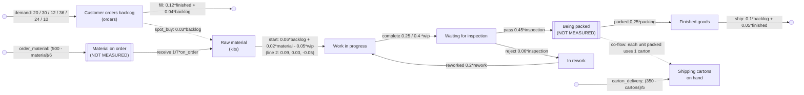

# sd-manufacturing: a make-to-order factory (ground truth)

A factory that builds to order, counted every day for two years (default run: 720 days; long run:
7,200). Customer orders wait in a backlog. The buyer keeps raw material near a target by ordering
from a supplier who takes about a week to deliver. Nobody on the floor counts what is on order.
When the backlog is high, the buyer also makes spot purchases that arrive the same day. The line
starts units from material at a pace set by the backlog and by the material on hand, and starts
fewer when work in progress is already crowded. Completed units wait for inspection. Rejects go to
rework and back onto the line. Passed units are packed (not counted) and become finished goods; each unit packed uses up a
shipping carton, and the carton supplier tops the cartons on hand up toward 350 (a fifth of the
shortfall a day), so in a production surge the cartons run low and packing waits.
Shipments follow the backlog, and orders are marked filled as finished goods are available.

The data is generated by `truth.model.json`, an SD Lab model stepped by `sdlab/sdtruth.py` (one
step per day, flows from the levels at the start of the step, Poisson counting noise). The backlog
is in **orders**, material in **kits** (one kit per unit), everything on the floor in **units**, and the cartons in **cartons**.

## True structure

| flow | from -> to | equation |
|---|---|---|
| demand (Customer orders arrive) | outside -> backlog | constant, changed by the schedule |
| fill (Orders filled) | backlog -> outside | linear `0.12*finished + 0.04*backlog` |
| order_material (Material ordered) | outside -> on_order (hidden) | gap: goal 500 kits of material, adjustment time 6 days |
| receive (Material delivered) | on_order (hidden) -> material | proportional 1/7 (a 7-day mean lead time) |
| spot_buy (Spot purchases of material) | outside -> material | linear `0.03*backlog` (a link: orders drive kits) |
| start (Production starts) | material -> wip | linear `0.06*backlog + 0.02*material - 0.05*wip`; with the second line `0.09*backlog + 0.03*material - 0.05*wip` |
| complete (Units completed) | wip -> inspection | proportional 0.25; 0.4 with the second line |
| pass (Pass inspection, go to packing) | inspection -> packing (hidden) | proportional 0.45 |
| packed (Packed into finished goods) | packing (hidden) -> finished | proportional 0.25 (a 4-day mean delay) |
| reject (Rejected at inspection) | inspection -> rework | proportional 0.06 (about 12% of inspected units) |
| reworked (Back to the line after rework) | rework -> wip | proportional 0.2 |
| ship (Shipments) | finished -> outside | linear `0.1*backlog + 0.05*finished` |
| carton_delivery (Cartons delivered) | outside -> cartons | gap: goal 350 cartons, adjustment time 5 days |

Co-flow: `packed` uses up one carton (`cartons`) for each unit it moves (`"uses": [{"stock": "cartons", "per": 1}]`).

## Schedule (repeats every 360 days)

- Day 1 (unannounced): steady orders, 20 a day; one production line (`start` and `complete` back
  to their one-line equations).
- Unannounced demand cycle: day 61 orders pick up to 30 a day, day 121 slump to 12, day 211 a big
  contract brings 36, day 271 orders ease to 24, day 316 holiday lull at 10.
- **Announced** at day 181: "Second production line installed" (`start` coefficients rise, and
  `complete` 0.25 -> 0.4). It is removed again, unannounced, at the start of the next period.

## What it tests in discovery

- **Moves along a chain**: material -> wip -> inspection, with units of different kinds (kits
  become units one to one).
- **A loop**: inspection -> rework -> wip -> inspection. The reject rate is small (0.06 against
  0.45 passing), so rework is a thin side stream discovery must not confuse with the main flow.
- **A goal-seeking flow behind a hidden stock**: material is ordered toward a target of 500 kits,
  but the orders sit with the supplier for about a week, unmeasured. Discovery sees material
  arrive from outside as a delayed, oscillating stream. The answer key does not list this hidden
  stock (it is fed from outside, not from a measured stock); it is there to make the material
  inflow realistic and hard.
- **A hidden delay between measured stocks**: inspection -> (packing, unmeasured) -> finished goods
  should come out as a delay of about 4 days, not as a direct move.
- **A link**: spot purchases of material (kits) are driven by the backlog (orders): a flow from
  outside whose rate reads another stock in a different unit.
- **Linear rates with several terms**: production starts read the backlog, the material and the
  work in progress itself (negative). Shipments out of finished goods read the backlog, and orders
  filled read finished goods, so backlog and finished goods are coupled in a negative loop through
  the line.
- **Unannounced changes**: demand steps up and down without notice, so the system never settles.
- **An announced era**: the second production line changes two flows at once. A good discovery
  fits the era change and does not blur the two regimes into one.
- **A co-flow**: each unit packed uses up a carton; the cartons' fall is explained by `packed`, a
  flow out of the hidden packing stock into finished goods, and when the cartons run low that flow
  is held back below its equation.
- **Final stock**: none. Every stock drains, so the long run must stay bounded.
