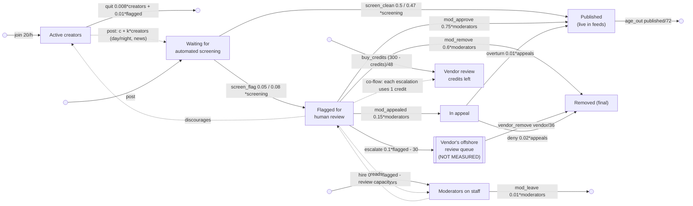

# sd-moderation: content moderation on a social platform (ground truth)

A social platform's trust-and-safety dashboard, counted every hour for sixty days (default run:
1,440 hours; long run: 14,400). Active creators write posts, more by day than by night. Every post
waits for an automated screening model, which passes most straight to the feeds and flags the rest
for human review. Moderators work the flagged queue: they approve, remove, or remove a post its
creator then appeals. When the flagged backlog grows past 300 posts the overflow goes to an
offshore vendor, whose queue nobody on the dashboard counts, and the vendor removes what it gets. Each
post escalated uses up one prepaid vendor review credit; the platform buys credits back toward
300 (a 48-hour adjustment), so after a spike the credits run out and escalation pauses.
Appeals are decided slowly; upheld ones put the post back in the feeds. Published posts age out of
feeds after a few days. Staffing follows the backlog, and a long flag queue discourages creators.
News events bring unannounced bursts of posting, and a new screening model is deployed (announced)
halfway through each month.

The data is generated by `truth.model.json`, an SD Lab model stepped by `sdlab/sdtruth.py` (one
step per hour, flows from the levels at the start of the step, Poisson counting noise). Creators
and moderators are in **people**; the vendor credits in **credits**; everything else is in **posts**.

## True structure

| flow | from -> to | equation |
|---|---|---|
| join (Creators become active) | outside -> creators | constant 20 |
| quit (Creators go inactive) | creators -> outside | linear `0.008*creators + 0.01*flagged` |
| post (New posts) | outside -> screening | linear `c + k*creators`: k = 0.1 from 08:00 to 22:00, 0.03 at night; c = 0 except during news spikes (600, 400, 800) |
| screen_clean | screening -> published | proportional 0.5 (model v1), 0.47 (v2) |
| screen_flag | screening -> flagged | proportional 0.05 (model v1), 0.08 (v2) |
| mod_approve | flagged -> published | linear `0.75*moderators` (capped by what is flagged) |
| mod_remove | flagged -> removed | linear `0.6*moderators` |
| mod_appealed | flagged -> appeals | linear `0.15*moderators` |
| escalate | flagged -> vendor (hidden) | linear `0.1*flagged - 30` (the backlog above 300, a tenth an hour) |
| vendor_remove | vendor (hidden) -> removed | proportional 1/36 (a 36-hour mean delay) |
| overturn (Appeal upheld) | appeals -> published | proportional 0.01 |
| deny (Appeal denied) | appeals -> removed | proportional 0.02 |
| age_out | published -> outside | proportional 1/72 |
| hire | outside -> moderators | linear `0.004*flagged - 0.1*moderators` |
| mod_leave | moderators -> outside | proportional 0.01 |
| buy_credits (Review credits bought) | outside -> credits | gap: goal 300 credits, adjustment time 48 hours |

Co-flow: `escalate` uses up one credit (`credits`) for each post it moves (`"uses": [{"stock": "credits", "per": 1}]`).

At rest: about 2,170 creators, 160 posts an hour, 300 waiting for screening, 270-300 flagged,
11 moderators, 50 in appeal, 11,000 published, about 100 in the vendor's queue.

## Schedule (repeats every 720 hours = 30 days)

- Unannounced: posting per creator switches between day (0.1/h, 08:00-22:00) and night (0.03/h).
- Unannounced news spikes: +600 posts/h for 6 hours at hour 200, +400/h for 4 hours at hour 470,
  +800/h for 3 hours at hour 610.
- **Announced** at hour 361: "New screening model (v2) deployed: flags more posts" (flag share
  0.05 -> 0.08, clean pass 0.5 -> 0.47). At the start of each period: "Screening model v1".

## What it tests in discovery

- **A link**: posting is driven by active creators (people), a different unit from the posts it
  makes. Discovery has to find `post` reading `creators`, under a day/night switch.
- **Moves that split**: screening divides between published and flagged; the flagged queue divides
  four ways (approve, remove, appeal, escalate), three of them limited by moderator capacity, not
  by the queue's size.
- **A hidden stock**: flagged -> (vendor queue, unmeasured) -> removed should come out as a
  36-hour delay, not as a direct move. The vendor is used only when the backlog passes 300, so it
  shows up after news spikes and under the v2 model.
- **Loops**: creators -> posts -> flagged -> creators quit (balancing); flagged -> hiring ->
  moderators -> review capacity -> flagged (balancing, oscillatory, period about a day and a
  half). Appeals bring removed-pending posts back into the feeds.
- **Goal-seeking**: hiring closes the gap between staff and 4% of the backlog over ten hours; the
  escalation overflow holds the backlog near 300 when it would otherwise run away.
- **An announced era**: the v2 screening model raises the flagged share by 60% halfway through
  each month; a good discovery fits two regimes for `screen_flag` and does not blur them.
- **Unannounced shocks**: news spikes are pulses discovery must not explain with new structure.
- **A co-flow**: each post escalated to the vendor uses up a prepaid credit; the credits' fall is
  explained by `escalate` (flagged -> hidden vendor queue), and when they run out escalation is
  held back below its equation and the flagged backlog grows.
- **Final stock**: removed accumulates forever; every other stock stays bounded.
