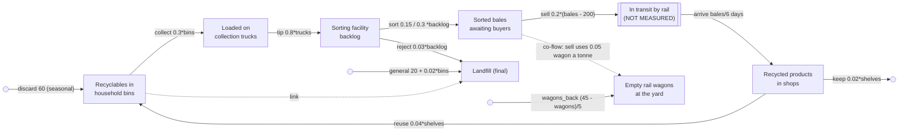

# sd-recycling: a city's waste and recycling (ground truth)

A mid-sized city's recycling system, weighed every day for two years (default run: 730 days; long
run: 7,300). Households put recyclables in their bins. Collection crews empty a share of the
bins every day, so the fuller the bins the more the trucks pick up. Trucks tip their loads at the
sorting facility, where material waits in a backlog until a sorting line gets to it. Most of it
becomes bales; contaminated loads are rejected and sent to landfill. A broker sells bales whenever
the yard holds more than its working stock of 200 t, and sold bales go by rail to a processor (no
one weighs what is on the trains). The processor's recycled products reach the city's shops;
people buy them, and two thirds of what they buy comes back into the recycling bins later, closing
the loop. Separately, the general-waste bins go to landfill, and they hold more recyclables when
the recycling bins are full. Sold bales leave in rail wagons, 20 t to a wagon: the yard counts its
empty wagons, and the processor sends them back toward 45 at the yard (a fifth of the shortfall a
day), so when sales surge the yard runs short of wagons and bales wait.

The data is generated by `truth.model.json`, an SD Lab model stepped by `sdlab/sdtruth.py` (one
step per day, flows from the levels at the start of the step, Poisson counting noise). All stocks
are in **tonnes**, except the empty wagons (**wagons**).

## True structure

| flow | from -> to | equation |
|---|---|---|
| discard (Households put out recyclables) | outside -> bins | constant 60 t/day (seasonal, see schedule) |
| collect (Bins collected) | bins -> trucks | proportional 0.3 |
| tip (Trucks tip at the facility) | trucks -> backlog | proportional 0.8 |
| sort (Sorted into bales) | backlog -> bales | proportional 0.15 with one line, 0.3 with two |
| reject (Contaminated loads rejected) | backlog -> landfill | proportional 0.03 |
| sell (Bales sold and loaded on rail) | bales -> rail (hidden) | linear `-40 + 0.2*bales` = `(bales - 200)/5`, floored at 0 |
| arrive (Recycled products reach shops) | rail (hidden) -> shelves | proportional 1/6 (a 6-day mean rail transit) |
| reuse (Recycled products bought, used and binned) | shelves -> bins | proportional 0.04 |
| keep (Recycled products bought and kept) | shelves -> outside | proportional 0.02 |
| general (General waste to landfill) | outside -> landfill | linear `20 + 0.02*bins` |
| wagons_back (Empty wagons sent back) | outside -> wagons | gap: goal 45 wagons, adjustment time 5 days |

Co-flow: `sell` uses up 0.05 of a wagon (`wagons`) for each tonne it moves (`"uses": [{"stock": "wagons", "per": 0.05}]`).

Near its steady state (60 t/day discarded, one line) about 135 t/day is collected, 112 t/day is
baled, 75 t/day comes back to the bins from the shops, and the bale yard sits near 760 t. The
recycling loop's gain is about 0.56 (0.61 with two lines), so the system is stable.

## Schedule (repeats every 365 days)

- Unannounced changes in what households throw away (`discard`): 60 t/day from day 1, 72 in the
  spring clean (days 95-124), back to 60 on day 125, 46 in summer from day 180, 62 from day 245,
  and 95 in the holiday season from day 330 until the year turns.
- **Announced** on day 120: "Second sorting line opens" (sort 0.15 -> 0.3).
- **Announced** on day 300: "Second sorting line closes for a refit" (sort 0.3 -> 0.15).

## What it tests in discovery

- **Moves along a chain**: bins -> trucks -> backlog -> bales, with proportional (first-order)
  outflows whose rates differ by a factor of five.
- **A split outflow**: the backlog drains both to bales and to landfill (contamination, about 17%
  of what is processed with one line, 9% with two).
- **A hidden stock**: bales -> (rail, unmeasured) -> shelves should come out as a 6-day delay
  between two measured stocks, not a direct move.
- **A goal-seeking flow**: bale sales follow the gap between the yard and its 200 t working stock,
  an affine outflow (a constant plus a proportional term), not a plain proportional one.
- **A loop**: shops -> bins brings recycled material back to the start of the chain.
- **A flow to outside** (products kept) and **flows from outside** (household discards, general
  waste) alongside moves.
- **A link**: general waste into the landfill grows with the recycling bins' level (a flow from
  outside whose rate reads another measured stock).
- **A final stock**: landfill only grows; it receives from a move (reject) and from outside
  (general), which discovery must separate.
- **Unannounced inflow changes** (seasons) that should not be mistaken for structure, and
  **announced eras** in which one flow's rate constant changes (sort doubles while the second line
  runs), which discovery should fit per era.
- **A co-flow**: every tonne of bales sold uses up 0.05 of an empty wagon; the wagons' fall is
  explained by `sell` (bales -> rail), and when the wagons run low that flow is held back below
  its equation, so bales pile up.
