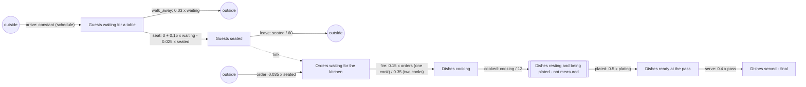

# sd-restaurant: a restaurant's floor and kitchen

A restaurant counted every minute over three twelve-hour service days (2,160 steps; `long_steps`
21,600). Guests arrive, wait for a table, sit, order, and leave. Their orders queue for the
kitchen, are fired by the cooks, cook, rest and get plated, wait at the pass, and are served. The
data is made by stepping `truth.model.json` with SD Lab's own equations, with Poisson counting noise
(`sdlab/sdtruth.py`).

## The true structure

Stocks: guests (`waiting`, `seated`) and dishes (`orders`, `cooking`, `plating`, `pass`, `served`).
Guests and dishes never exchange things: the kitchen's inflow is a link, not a move.

| flow | from -> to | equation |
|---|---|---|
| arrive | outside -> waiting | constant, set by the schedule |
| walk_away | waiting -> outside | proportional, k = 0.03 |
| seat | waiting -> seated | linear: 3 + 0.15 waiting - 0.025 seated (floored at 0) |
| leave | seated -> outside | proportional, k = 1/60 (an hour at the table) |
| order | outside -> orders | linear: 0.035 seated (about two dishes per guest per hour) |
| fire | orders -> cooking | proportional, k = 0.15 (one cook), 0.35 (two cooks) |
| cooked | cooking -> plating | proportional, k = 1/12 |
| plated | plating -> pass | proportional, k = 0.5 |
| serve | pass -> served | proportional, k = 0.4 |

## The schedule (repeats every 720 minutes)

| t | change | announced |
|---|---|---|
| 1 | morning, 0.3 guests a minute | no |
| 1 | one cook on the line (fire k = 0.15) | yes |
| 61 | lunch rush, 2.2 a minute | no |
| 211 | afternoon lull, 0.4 a minute | no |
| 331 | a second cook starts the evening shift (fire k = 0.35) | yes |
| 361 | dinner rush, 2.8 a minute | no |
| 571 | late tables, 0.5 a minute | no |
| 661 | doors close, no new guests | no |

## What it tests

- **Flows to and from outside** with unannounced changes: the rushes and lulls in `arrive`, and
  the two exits (`walk_away`, `leave`).
- **A goal-seeking move with a balancing loop**: `seat` slows as the dining room fills (negative
  term on `seated`, the flow's own destination) and grows with the queue at the door.
- **A link**: dishes appear in `orders` from outside at a rate set by `seated`, a stock in a
  different unit; discovery must not call it a move.
- **A hidden stock**: `plating` sits between `cooking` and `pass` with a 2-minute mean delay that
  nobody counts; cooking -> pass looks like a delayed move.
- **An announced era**: the second cook doubles the firing rate every evening and is gone the
  next morning, so `fire` has two values that the eras separate.
- **A final stock**: `served` only accumulates.
