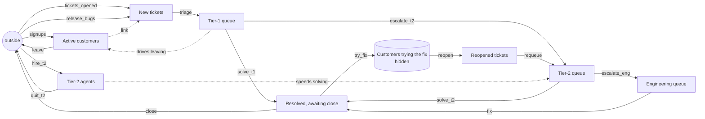

# sd-support-tiers: tiered customer support (ground truth)

A software company's support desk, counted once a day. Customers open tickets; tickets are triaged
to tier 1, which solves most and escalates the rest to tier 2, which in turn escalates the hardest to
engineering. Solved tickets wait for the customer to confirm. A few fixes do not hold: the customer
tries them for a week or so, quietly, and then the ticket comes back reopened and goes straight to
tier 2. Long tier-1 queues drive customers away. Bad releases bring unannounced bursts of tickets,
and once a year the tier-2 team is allowed to grow (an announced era).

The data is generated by `truth.model.json`, stepped with SD Lab's own equations (`sdlab/sdtruth.py`),
one step per day, with Poisson counting noise. 730 days by default, 7300 for the long run.

## The true structure

Measured: customers, new_tickets, tier1, tier2, tier2_agents, engineering, resolved, reopened.
Hidden (`"measured": false`): trying, "customers trying the fix (fix will not hold)".

## Equations (per day)

| flow | from -> to | rate |
|---|---|---|
| signups | outside -> customers | constant 25 (scheduled) |
| leave | customers -> outside | linear 0.0035 x customers + 0.05 x tier1 |
| tickets_opened | outside -> new_tickets | linear 0.012 x customers (the link) |
| release_bugs | outside -> new_tickets | constant 0, bursts when a release breaks (scheduled) |
| triage | new_tickets -> tier1 | proportional 0.5 x new_tickets |
| solve_t1 | tier1 -> resolved | proportional 0.25 x tier1 |
| escalate_t2 | tier1 -> tier2 | proportional 0.06 x tier1 |
| hire_t2 | outside -> tier2_agents | gap: (goal - tier2_agents) / 20, goal 12 or 20 (announced) |
| quit_t2 | tier2_agents -> outside | proportional 0.01 x tier2_agents |
| solve_t2 | tier2 -> resolved | linear 0.05 x tier2 + 0.5 x tier2_agents |
| escalate_eng | tier2 -> engineering | proportional 0.03 x tier2 |
| fix | engineering -> resolved | proportional 0.05 x engineering |
| close | resolved -> outside | proportional 0.2 x resolved |
| try_fix | resolved -> trying (hidden) | proportional 0.02 x resolved |
| reopen | trying -> reopened | proportional 0.125 x trying (about 8 days) |
| requeue | reopened -> tier2 | proportional 0.3 x reopened |

Loops: customers -> tickets -> tier-1 queue -> customers leaving (balancing); tier 2 -> resolved ->
hidden -> reopened -> tier 2 (a rework loop with gain well below 1); staffing seeks its goal
(balancing). Every queue drains in proportion to itself, so the system is stable at any length.

## Schedule (repeats every 365 days)

| day | change | announced |
|---|---|---|
| 1 | signups 25, no release bugs | no |
| 1 | tier-2 staffing target 12 agents | yes (shows from day 366) |
| 40-44 | release 4.1 bug: 45 extra tickets a day | no |
| 75 | spring promotion: signups 40 | no |
| 130 | promotion ends: signups 22 | no |
| 150-153 | release 4.2 bad migration: 90 extra tickets a day | no |
| 180 | tier-2 staffing target 20 agents | yes |
| 220 | summer lull: signups 15 | no |
| 250-256 | release 4.3 regression: 60 extra tickets a day | no |
| 280 | signups 30 | no |
| 330-333 | year-end billing break: 70 extra tickets a day | no |

## What it tests in discovery

- **Moves along a chain with branches**: tier 1 splits three ways (solve, escalate) and tier 2 has
  two exits; resolved receives from three queues.
- **A link**: tickets opened follow the customer count, not a constant.
- **Unannounced outside spikes**: release bursts into new tickets that discovery must treat as
  outside inflow, not as structure.
- **A hidden stock**: resolved -> (customers trying the fix, unmeasured, ~8 days) -> reopened.
- **Goal seeking with an announced era**: tier-2 agents approach a staffing target that changes at
  an announced era; the agent count also speeds tier-2 solving (an outflow reading another stock).
- **An outflow driven by another stock**: customers leave faster when the tier-1 queue is long.
- **Small integer stocks**: tier-2 agents move by one at a time, a hard signal under counting noise.
