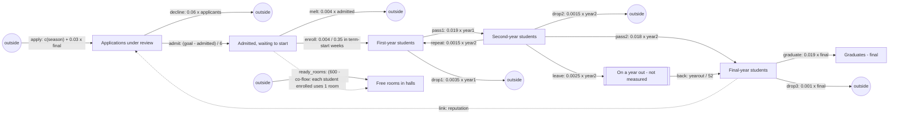

# sd-university: a university's intake and progression

A university's student records, counted every week over ten academic years (520 steps;
`long_steps` 5,200). Applications arrive and are either accepted (an offer taken up) or go
elsewhere; admitted students wait for term to start, then move through first, second and final
year to graduation. Students drop out at every stage, some second-years are sent back to repeat
first year, and some take a year out (a placement or a leave of absence) that the records do not
count, returning straight into the final year. Every new first-year takes a room in halls: the
rooms are freed and made ready again over the year (toward 600 free, a sixth of the shortfall a
week), and in the term-start rush they can run out, holding enrolment back until more are ready.
The free rooms are counted. The data is made by stepping `truth.model.json`
with SD Lab's own equations, with Poisson counting noise (`sdlab/sdtruth.py`).

## The true structure

| flow | from -> to | equation |
|---|---|---|
| apply | outside -> applicants | linear: c + 0.03 final; c set by the schedule (season x year) |
| decline | applicants -> outside | proportional, k = 0.06 |
| admit | applicants -> admitted | gap: (goal - admitted) / 6 weeks; goal 800, then 1,100 |
| melt | admitted -> outside | proportional, k = 0.004 |
| enroll | admitted -> year1 | proportional, k = 0.004 (January starts), 0.35 in the four term-start weeks |
| pass1 | year1 -> year2 | proportional, k = 0.019 |
| drop1 | year1 -> outside | proportional, k = 0.0035 |
| repeat | year2 -> year1 | proportional, k = 0.0015 |
| pass2 | year2 -> final | proportional, k = 0.018 |
| drop2 | year2 -> outside | proportional, k = 0.0015 |
| leave | year2 -> yearout (hidden) | proportional, k = 0.0025 |
| back | yearout -> final | proportional, k = 1/52 (a year away) |
| graduate | final -> graduates | proportional, k = 0.019 |
| drop3 | final -> outside | proportional, k = 0.001 |
| ready_rooms | outside -> rooms | gap: (600 - rooms) / 6 weeks |

Co-flow: `enroll` uses up one room (`rooms`) for each student it moves (`"uses": [{"stock": "rooms", "per": 1}]`).

The admitted pool is held toward the target class size: offers flow only while the pool is short of
the goal, and are capped by the applications on hand (in summer applications run out and the gap
stays open). The reputation link (final-year students draw applications) closes a reinforcing loop
applicants -> admitted -> year1 -> year2 -> final -> applicants, but the goal-seeking admissions cap
it: extra applications only raise `decline`, so the system cannot run away.

## The schedule (`every` 520 weeks, ten years)

Each year y (weeks 52(y-1)+...), with a year factor f = 1.0, 1.15, 0.9, 1.05, 1.2, 0.95, 1.1, 0.85,
1.0, 1.1 scaling the applications constant:

| week of year | change | announced |
|---|---|---|
| 1 | January deadline rush: apply c = 45 f | no |
| 6 | spring, late applications: c = 14 f | no |
| 22 | summer, clearing only: c = 4 f | no |
| 36 | term starts: enroll k = 0.35 | no |
| 40 | autumn, next year's applications open: c = 28 f; enroll k back to 0.004 | no |

| t | change | announced |
|---|---|---|
| 1 | main campus only: admit goal 800 (shown from the second decade on) | yes |
| 261 | new campus opens: admit goal 1,100 | yes |

## What it tests

- **An aging chain with a loop back**: four moves along the chain plus `repeat`, a move against
  the direction of the chain (year2 -> year1) that discovery must not fold into `pass1`.
- **Flows to outside at every stage**: `decline`, `melt`, `drop1`, `drop2`, `drop3`, small next to
  the moves they compete with.
- **A goal-seeking move**: `admit` is a gap on its own destination; its goal changes in an
  announced era, so it has two values the eras separate.
- **A link and a reinforcing loop**: applications arrive from outside at a rate that follows the
  final-year count (reputation), on top of an unannounced seasonal constant.
- **A hidden stock**: `yearout` sits between year2 and final with a one-year mean delay; year2 ->
  final looks like a direct move plus a slow delayed one.
- **Unannounced changes**: application seasons, year-to-year swings in demand, and the term-start
  enrolment pulse, none reported as eras.
- **A final stock**: `graduates` only accumulates.
- **A co-flow**: each enrolment uses up a free room in halls; the rooms' fall is explained by
  `enroll` (admitted -> year1), and when the rooms run low at the start of term that flow is held
  back below its equation.
